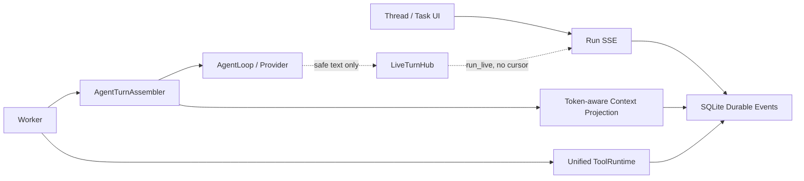

# Oktapod Agent Runtime 性能与 LLM 调用优化执行方案 V2.0

> 版本：V2.0
> 更新日期：2026-08-22
> 实施分支：`codex/runtime-performance-v2`
> 基线：`main@f3fa78d`
> 状态：PERF-0～4 代码、本地完整验证、浏览器回归和 Windows 原生烟测已完成；真实 Provider 性能报告、远端双平台 CI 与 PERF-5 决策尚未形成

## 1. 结论

本次没有重写 Agent Runtime，也没有移植 pi 或 DeepSeek Harness。SQLite Trusted Execution Kernel 继续拥有 Task/Run/Step、Lease/Fence、审批、Receipt、Artifact、Completion Gate 和恢复状态；新增的 Live Hub 只传递可丢失的展示增量，性能表和 Context Checkpoint 只提供投影与观测，不是第二业务真源。

新 Run 的热路径已经收敛为一次业务 Agent Turn：Auto 不再先调用模型分类；计划控制可与业务工具共处同一次模型响应；Provider 活跃 Run 不再访问模型目录；历史上下文按工具调用组和 Token 预算投影；工具按安全属性形成连续并发段与 exclusive barrier。历史 Run 缺少 V2 快照字段时继续执行旧协议，不迁移、不改写。

当前不能声明性能门禁已通过。代码已记录调用次数、Token、TTFB、首个安全正文、Assembly、请求字节、Provider 总时延与稳定 purpose；12 个固定场景必须在隔离数据目录上完成自动回放 30 次和真实 Provider 至少 5 次后，才能给出 p50/p95 与 PERF-5 判断。

## 2. 架构与所有权



| 责任 | 唯一所有者 | V2 边界 |
|---|---|---|
| 业务状态与恢复 | SQLite Durable Harness | 不由 Live Hub、前端 provisional buffer 或性能表推导 |
| ModelRequest | `AgentTurnAssembler` | Tool Schema 是名称、描述、参数的唯一模型来源；最终请求继续进入 `assembly_hash` |
| 语义计划 | 模型声明 + Runtime 校验 | Runtime 不从一次工具成功机械推断计划项完成 |
| 工具执行 | 现有 `ToolRuntime` | 不新增第二套 Policy、Authorization、Receipt 或凭据路径 |
| 临时正文 | 进程内 `LiveTurnHub` | 可丢失、不可重放、无 durable cursor，不阻塞 Worker |
| 上下文压缩 | 确定性投影 + 单 Run Checkpoint | 只在确定性裁剪仍超预算时生成；事件每 Run 最多一次 |

## 3. 新 Run 冻结协议

| 快照字段 | 新值 | 缺失时行为 |
|---|---|---|
| `turn_router_version` | `auto_agent_v2` / `explicit_v2` | 保持旧 Auto/显式路由语义 |
| `plan_protocol_version` | `transition_v2` | 保持完整清单且独占的 `update_plan` |
| `tool_scheduler_version` | `barrier_v2` | 保持旧 `parallel/sequential` |
| `context_projection_version` | `token_v2` | 保持 96 KiB 兼容裁剪 |

新 Single Agent Run 同时冻结 Provider、模型、工具能力已知性、Catalog Version、Context Window 与 Max Output。已知不支持工具时创建前拒绝；未知能力不在活跃 Run 内访问 `/models`，由 Provider 协议响应决定。

## 4. 已实施内容

### 4.1 PERF-0：性能真相

- `ModelResult` 记录 Provider TTFB、首个安全正文、总时延、Assembly 时延和序列化请求字节。
- 000064 新增一对一的 `model_call_performance`，记录稳定 purpose、Cache Read/Write Token 与上述耗时；`GET /runs/{id}/usage` 汇总这些字段和 purpose 次数。
- 稳定 purpose：`task_execute`、`task_replan`、`task_repair`、`task_completion_recovery`、`task_synthesis`、`task_compaction`；旧协议保留 `legacy_plan_define/progress`。
- `Test/runtime-performance-baseline.mjs` 固化 12 个场景，要求隔离目录存在 `.oktapod-perf-isolated`，并显式指定场景和 1～30 次迭代；输出逐 Run JSONL 与 p50/p95 摘要。

### 4.2 PERF-1：消除管理型模型调用

- `mode=auto` 直接创建轻量 Durable Task/Run，不调用 `classifyProjectTurn`。
- Auto Task 初始 `presentation_kind=pending_auto`；首次真实业务工具切为 `task`；无工具且通过 Completion Gate 后切为 `answer`，审计记录仍保留。
- V2 新 Run 不创建占位计划。`replace_plan` 与首批业务工具、`advance_plan` 与下一批业务工具在同一事务中先控制计划、再绑定工具。
- 每次模型响应最多一个计划控制；控制调用不能单独占用响应；工具成功不会自动推进语义项；最终无工具响应通过 Completion Gate 后由 Runtime 收敛计划终态。
- 显式 `skill_id` 直接冻结并加载，模型请求不暴露 `skill_invoke`；模糊发现仍保留受治理语义选择。

### 4.3 PERF-2：Task 实时可见流式

- Bootstrap 创建一个 `LiveTurnHub`，注入所有 Worker 与 HTTP Handler。
- AgentLoop 只把 assistant 正文交给回调；reasoning、未完成工具参数与 Secret 不进入 Live Hub。
- `run_live` 按 50ms 或 2 KiB 合并，无 SSE `id`；订阅队列为 64，溢出时断开该临时订阅，不阻塞 Worker，也不影响 Durable 终态。
- 前端按 `run_id + model_call_id` 聚合 provisional text；持久 `model.message` 到达后清空并由消息真源替换。断线不取消 Task。

### 4.4 PERF-3：Provider、Prompt 与 Context

- 活跃 Run 使用冻结能力，不访问 Provider Catalog；配置、显式刷新和 Run 创建仍可访问目录。
- System Prompt 删除与 Tool Schema 重复的工具目录，只保留跨工具流程、安全、审批与交付合同。
- `token_v2` 保留目标/验收/活动计划等稳定段；历史工具对按组从新到旧装入预算，旧 reasoning 仅保留最近一组，大结果先 Artifact 化并用摘要、Hash、Receipt 和 Artifact 引用替换。
- 输入预算为 `context_window - max_output - max(4096, 5% context_window)`；未知窗口使用 96 KiB 兜底。Checkpoint 是投影，不覆盖原消息、ToolResult 或 Artifact。

### 4.5 PERF-4：Per-call Barrier

- 连续 concurrency-safe 调用进入同一并行组；builtin exclusive、未知工具、MCP mutation 或注解不完整工具各自独占一组；后续安全调用形成新组。
- 000064 以附属表持久化 `execution_mode=barriered` 与每个 ToolCall 的 `barrier_group`，不破坏旧表 CHECK 和历史记录。
- Claim 只允许最低未完成组；同一安全组可由多个 Worker 同时领取；exclusive 后继被前组阻挡。
- 任一失败后禁止后继 claim，等待已启动调用收敛，取消未启动当前组与后继组，再复用现有 Recovery。结果继续按模型原始 ToolCall 顺序投影。

## 5. 数据迁移与回滚

000064 只增加附属表：

- `task_presentations`
- `model_call_performance`
- `tool_batch_schedulers`
- `tool_call_barriers`
- `run_context_checkpoints`

回滚优先把新 Run 默认协议恢复为旧版本；已创建 V2 Run 仍可依据冻结快照恢复。附属表删除不会改变历史核心 Task/Run/Step/Event/Receipt/Artifact 数据，但执行中的 V2 Run 不应在删除 000064 前降级。下载目录中的 Claude 报告不修改。

## 6. 固定性能场景

| ID | 场景 | 关键指标 |
|---|---|---|
| 1 | `auto_answer` | 管理调用 0、业务调用 1、`presentation_kind=answer` |
| 2 | `direct_task_answer` | 不强制计划、单业务响应完成 |
| 3 | `single_safe_tool` | 首工具时延、一次 continuation |
| 4 | `parallel_safe_tools` | 两个安全调用同组并行 |
| 5 | `safe_exclusive_safe` | parallel → exclusive → parallel |
| 6 | `replace_plan_with_tool` | 初始计划与首工具同响应、同事务 |
| 7 | `advance_plan_with_tool` | 语义推进与下一工具同响应 |
| 8 | `explicit_skill` | 零 `skill_invoke` 握手 |
| 9 | `long_context_round_10` | 第十轮输入 Token 相对旧 Assembly 下降至少 30% |
| 10 | `approval_gate` | 临时流式不绕过审批，状态可恢复 |
| 11 | `tool_failure_recovery` | 组失败取消、Recovery 与源顺序 |
| 12 | `artifact_delivery` | Receipt、真实路径、Artifact 与 Completion Gate |

执行示例：

```powershell
New-Item -ItemType File -Force "D:\oktapod-perf\.oktapod-perf-isolated" | Out-Null
$env:OKTAPOD_PERF_ISOLATED_DATA_ROOT="D:\oktapod-perf"
$env:OKTAPOD_PERF_SCENARIO="auto_answer"
$env:OKTAPOD_PERF_ITERATIONS="5"
$env:OKTAPOD_PERF_PROJECT_ID="<isolated project id>"
$env:OKTAPOD_PERF_COOKIE="<temporary isolated-session cookies>"
$env:OKTAPOD_PERF_CSRF="<temporary csrf>"
node Test/runtime-performance-baseline.mjs
```

Cookie/CSRF 只能来自隔离测试会话，不写入文档、仓库或输出文件。自动回放设置 30 次；固定真实 Provider、Model、Thinking 与 Prompt 后设置至少 5 次，并分别报告 min/median/max。不同 Harness 只做同 Provider 分析，不作为发布门禁。

## 7. 验收状态

| 门禁 | 当前状态 | 自动化证据/剩余工作 |
|---|---|---|
| Auto 一次业务调用 | 代码与定向测试通过 | `TestAutoAnswerUsesOneBusinessModelCall` |
| Plan 控制与业务工具同响应 | 代码与定向测试通过 | `TestTransitionPlanControlsShareBusinessResponses` |
| 工具成功不推进语义项 | 代码与定向测试通过 | 同上，在首工具成功后读取活动计划 |
| 显式 Skill 零握手 | 代码与定向测试通过 | `TestExplicitSkillSurvivesSemanticPlanContinuation` |
| 活跃 Run Catalog 请求为 0 | 代码与 Adapter 测试通过 | `TestActiveRunDoesNotReadModelCatalog` |
| Live 慢消费者不阻塞 | 代码与 Go/Web 测试通过 | `TestLiveTurnHubDropsSlowSubscriberWithoutBlockingPublisher`、RunEventsProvider provisional 测试 |
| Barrier 领取和顺序 | 代码与定向测试通过 | `TestBarrierSchedulerPreservesModelOrder`、unknown/MCP mutation exclusive 测试 |
| 历史 Plan/Recovery | legacy 快照回归通过 | semantic plan、Lease/Fence、失败批次与进程恢复测试 |
| 第十轮 Token 下降 30% | `PENDING_MEASUREMENT` | 需要旧 Assembly 对照回放 30 次 |
| 安全文字到 SSE flush p95 ≤100ms | `PENDING_MEASUREMENT` | 需要进程内与 HTTP 观测样本 |
| 安全并行组 ≤最慢项 1.2x+100ms | `PENDING_MEASUREMENT` | 需要固定延迟工具 30 次报告 |
| PERF-5 Durable Fast Path | `NOT_TRIGGERED` | PERF-1～4 实测后仅在内部 p95 >250ms 或墙钟占比 >10% 时另立 RFC |

## 8. 交付门禁

每个阶段先执行 focused Go/Web/Golden Trace，再执行：

```powershell
$env:GOCACHE="$env:TEMP\go-build-cache"
pnpm verify
pnpm test:e2e
pnpm test:race
pnpm release:build
pnpm release:smoke
```

本地通过、远端 CI、正式 tag 与真实 Provider 性能报告必须分开记录。平均耗时不能单独判定成功；调用次数、Token、TTFB、p95、任务正确性、Artifact 交付与恢复语义必须同时满足。

2026-08-22 本地交付证据：

| 门禁 | 结果 |
|---|---|
| `pnpm verify` | `PASS`：Go vet/test、ESLint、Web 14 文件 55/55、TypeScript/Vite/Go build、SQLite migration、OpenAPI drift |
| Playwright | `PASS`：foundation 初始化 1/1、Vault 重启 1/1、success 27/27；真实浏览器回归同时发现并修复无计划 Run 的合法 404 噪声，以及 Auto answer 在 Task 先终止时漏刷最终助手消息的竞态 |
| `pnpm test:race` | `BLOCKED_ENV`：本机 Go 为 `CGO_ENABLED=0`，且未安装可用 C 编译器；`-race` 在进入测试前拒绝启动，不计为代码失败，继续由 Ubuntu CI 提供正式证据 |
| `pnpm release:build` | `PASS`：`Build/oktapod-v1.0.0-windows-amd64.exe`，SHA256 `a02b931c193bf2775d8c7678e7fa2779c5b64ad55d2b1ba215736e7829c00790` |
| `pnpm release:smoke` | `PASS`：隔离数据目录、端口 54543、health 200；烟测进程已停止 |

上述证据只证明语义、工程和本地发布门禁。12 场景每项 30 次、真实 Provider 固定配置至少 5 次仍未执行，因此本文件不声明 Token、TTFB、SSE flush、并行组墙钟或内部 p95 已达到性能阈值。
