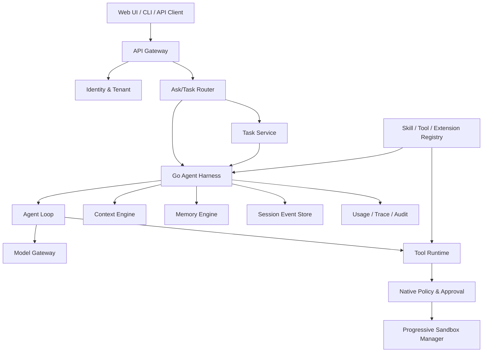

# Oktapod 产品需求文档（PRD）

> **当前实现决策覆盖（2026-07-30）**：本文保留为完整产品蓝图，不是 V1.0.0 完成度真源。V1 发布注册用户 + Owner-only 个人私有项目、SQLite、React/TypeScript、REST 写操作 + 可恢复 SSE 和单 Agent Coding 主链路；内建搜索、Team、Schedule、Memory、Agent Team 等已有兼容能力不强制删除，但只有个人版“读-改-验-Diff-恢复”计入发布完成度。当前范围、架构和证据分别以 V1 总体架构、执行计划及验收矩阵为准；本文中的 HTMX/templ、WebSocket、团队主流程和能力市场表述不指导 V1.0.0。

> **文档版本**：V1.1
> **文档状态**：架构轻量化修订版 / 研发输入
> **产品名称**：Oktapod
> **产品形态**：单机与集群部署一体化的 Go 原生 B/S Agent Harness 平台
> **核心语言约束**：Agent Runtime、Harness、模型接入、会话、上下文、记忆、工具、插件、安全、调度、服务端与 CLI 全部使用 Go 原生实现
> **参考基线**：`earendil-works/pi` 的能力与行为语义；OpenAI Codex 的项目、会话、任务和执行交互
> **调研快照日期**：2026-07-25
> **本次修订重点**：统一单机/集群部署拓扑、SQLite/PostgreSQL 双适配、三级渐进式沙箱、MVP 依赖收敛与分阶段扩展

---

## 1. 文档目的

本文档用于明确 Oktapod 的产品定位、用户场景、功能范围、交互方式、核心架构、Agent Loop、上下文工程、记忆体系、安全治理、多租户隔离、技术选型、数据模型、接口规范、非功能指标及验收标准。

本 PRD 不是“给 Pi 增加一个 Web 页面”，也不是“用 Go 服务包装 Pi 的 TypeScript 进程”。Oktapod 必须完成对 Pi 核心能力的 **Go 原生、可验证、可持续演进的等价重构**，并在此基础上增加：

1. Codex 风格的项目、线程、任务和执行交互；
2. 单服务端多用户并发、账户与知识环境隔离；
3. 企业级身份、权限、审批、审计、沙箱和策略治理；
4. Token、模型、工具、技能、Agent、耗时和成本全链路透明；
5. Agent 团队、并行任务、Git Worktree 和协同交付能力；
6. 从单二进制单机部署到多 Worker 集群的平滑演进能力。

---

## 2. 一句话定义

**Oktapod 是一个以 Go 原生 Harness 为中枢、以项目会话为工作界面、以渐进式执行边界保障安全、可从单机平滑扩展到集群的透明化 Agent 工程平台。**

---

## 3. 产品定位

### 3.1 产品类别

Oktapod 属于以下产品类别的交叉形态：

- Agent Harness / Agent Runtime；
- AI 编程与通用任务执行平台；
- 多模型统一接入与路由平台；
- 上下文、记忆、技能和工具工程平台；
- 企业级 Agent 安全治理平台；
- 多用户、多项目、可审计的 Agent 工作台。

### 3.2 核心差异化

| 维度 | 常规聊天产品 | 常规 Agent 框架 | 本地编码 CLI | Oktapod |
|---|---|---|---|---|
| 工作组织 | 聊天记录 | 代码编排 | 当前目录会话 | 项目 → 线程 → 任务 → 执行 |
| Agent Loop | 不透明 | 需自行实现 | 内置但偏单用户 | Go 原生闭环 Harness |
| 多用户 | 有限 | 通常不提供 | 不提供 | 服务端原生多租户 |
| 安全 | 平台级 | 依赖应用 | 本机权限 | 策略、审批、沙箱、审计内嵌 |
| 透明性 | 模型响应为主 | 依框架而定 | 部分可见 | Token、模型、工具、上下文、成本全可见 |
| 迁移部署 | SaaS | 开发集成 | 单机 | 单文件、单机、单服务器、集群 |
| 扩展体系 | 插件 | 代码 SDK | Skills/Extensions | Skills、Built-in/Exec/MCP Tools、Hooks、Agents；WASM/进程插件按阶段扩展 |
| 记忆 | 黑盒或弱可控 | 需自行建设 | 会话为主 | 用户/项目/团队分层、可见可删 |
| 任务并行 | 弱 | 需自行实现 | 单线程为主 | 多 Agent、Worktree、并行执行 |

---

## 4. 强制约束与产品原则

### 4.1 强制约束

1. **核心能力全部 Go 原生实现**
   不嵌入 Pi 的 Node.js/TypeScript Runtime，不将 Pi CLI 作为子进程长期托管，不依赖其 RPC 模式完成核心执行。

2. **能力不得缩水**
   Pi 已具备的模型抽象、Agent Loop、工具调用、流式事件、会话树、分支、压缩、Steering、Follow-up、Skills、Prompt Templates、Hooks、Packages、项目可信、导入导出等能力，必须形成逐项兼容验收。

3. **B/S 前后端分离，但不建设重型前端运行时**
   服务端页面组件使用 Go `templ`；交互优先使用 HTMX、SSE/WebSocket 和浏览器原生能力。Monaco、xterm.js、Diff Viewer 等仅作为必要的浏览器组件引入。生产环境不依赖 Node.js Runtime。

4. **部署拓扑同源**
   不维护“个人版/团队版”两套产品逻辑。同一代码基线通过配置切换单机/集群拓扑、SQLite/PostgreSQL、内嵌/独立 Worker 和不同沙箱引擎。

5. **默认安全、默认透明、默认节省 Token**
   安全边界、执行审批和使用明细不是附加模块，而是 Harness 的必经链路。

### 4.2 设计原则

- **Harness First**：所有 UI、API、CLI、自动化均调用同一 Harness。
- **Event Sourcing**：会话和任务以追加式事件为事实来源。
- **Deterministic Before LLM**：可通过规则、索引、解析器、编译器、脚本和工具完成的工作，不调用大模型。
- **Progressive Disclosure**：技能、上下文、工具说明按需加载。
- **Policy Before Execution**：工具执行前必须完成参数校验、策略判断和必要审批。
- **User Owns Context**：用户能查看、纠正、删除和导出其上下文与记忆。
- **Ports and Adapters**：模型、存储、沙箱、Git、工具、身份和对象存储均通过接口隔离。
- **Single Binary Friendly**：单机模式应可由单一 Go 可执行文件启动。
- **No Hidden Privilege Escalation**：继承的全局资源只能增加能力描述，不能绕过用户或租户策略。
- **Observable by Design**：每一个 Turn、Tool Call、Memory Read、Context Injection 都具备可追踪记录。
- **Progressive Hardening**：默认依赖最少；仅在风险、规模或合规需求提升时启用系统隔离、容器、外部数据库和企业组件。
- **No Mandatory Middleware for MVP**：首版不强制依赖 PostgreSQL、Redis、消息队列、OPA、容器运行时或 Kubernetes。

---

## 5. 参考基线与能力继承

### 5.1 Pi 作为行为基线

Pi 的公开工程将能力拆分为统一模型 API、Agent Runtime、Coding Agent 和 TUI；其 Agent Runtime 支持状态管理、工具调用和事件流。Oktapod 应继承其核心行为，而不是继承其 TypeScript 实现。

Pi 的关键能力基线包括：

- 统一多模型 Provider；
- Stateful Agent；
- 工具调用和工具结果回灌；
- `agent_start / turn_start / message_update / tool_execution_* / turn_end / agent_end` 事件序列；
- 工具并行和串行执行；
- `beforeToolCall`、`afterToolCall` 等 Hook；
- Steering、Follow-up、Abort；
- 会话自动持久化、树形分支、Fork、Clone；
- Context Compaction 和 Branch Summary；
- Skills 按需加载；
- Prompt Templates；
- Extensions 注册工具、命令、Hook 和 UI；
- 项目信任控制；
- 包安装与资源管理；
- JSON/RPC/SDK 模式；
- Token、缓存、成本、模型和上下文使用显示；
- Windows 与 Linux 支持。

### 5.2 Codex 作为交互基线

Oktapod 的交互借鉴 Codex 的以下模式：

- 项目组织多个线程；
- 每个任务在独立线程中持续执行；
- 多任务、多 Agent 并行；
- 独立工作区或 Git Worktree；
- 用户可查看执行过程、工具、终端和代码变更；
- 用户可中途干预、追加要求或终止；
- 在同一线程中评审 Diff、发表评论、继续修改；
- Quick Ask 与可执行 Task 区分；
- 项目、会话历史和配置持续保留。

Oktapod 不复制 Codex 的品牌视觉，而是复用其信息架构和交互逻辑。

---

## 6. 产品目标与非目标

### 6.1 产品目标

#### G1：成为可独立使用的 Go 原生 Agent Harness

Oktapod 不依赖外部 Agent 框架，即可完成模型调用、工具执行、上下文构建、会话持久化、任务恢复和安全治理。

#### G2：单机安装足够轻

用户可下载单一可执行文件，初始化后直接在浏览器使用；默认使用 SQLite、本地文件系统、内嵌 Worker 和 Simple Sandbox，不要求预装数据库、容器运行时或消息中间件。

#### G3：单机模式支持轻量协同

同一个单机节点既可服务本地单用户，也可在启用认证后服务小规模协作。用户的会话、文件、记忆、凭据、工作区和配额必须在应用层严格隔离，不因使用 SQLite 而退化为单用户代码路径。

#### G4：具备集群扩展与企业治理能力

在不修改核心业务代码的前提下，可切换 PostgreSQL、独立 Worker、S3 兼容存储和容器/Kubernetes 沙箱，并逐步启用身份联邦、审批、审计、网络控制、密钥管理和资源配额。

#### G5：降低 Token 消耗

通过任务路由、上下文预算、结构化工具结果、缓存、摘要、索引和小模型路由降低大模型调用成本。

#### G6：过程透明

用户可在 Turn 和 Task 级查看模型、Provider、Thinking Level、Token、成本、耗时、工具、Skills、Agents、上下文来源和策略决策。

#### G7：扩展能力分阶段交付

首版优先支持 Agent Skills、Prompt Templates、Built-in Go Tool、Exec/CLI Tool、MCP、Hook 和 Agent 定义；OpenAPI Connector、WASM Plugin、Out-of-process Plugin、OCI Package 与企业目录集成按发布阶段逐步引入。

### 6.2 非目标

首个正式版本不以以下能力为主目标：

- 自研大模型训练平台；
- 自研代码托管平台；
- 取代完整 IDE；
- 取代 Kubernetes、Vault、GitHub/GitLab 等基础设施；
- 对所有第三方 Pi TypeScript Extension 提供二进制兼容；
- 在 MVP 中提供 OPA/Rego、WASM、OCI 签名、SCIM 或强制容器沙箱；
- 将 Simple Sandbox 宣称为可抵御恶意代码的强安全隔离；
- 展示模型供应商不允许公开的原始隐藏思维链。

## 7. 目标用户与角色

### 7.1 个人开发者

诉求：

- 本机快速安装；
- 打开项目后直接提问和执行；
- 可查看代码变更、命令、Token 与成本；
- 可自由配置模型、Skill、Tool；
- Windows/Linux 均可运行。

### 7.2 团队成员

诉求：

- 登录团队服务器；
- 使用个人隔离环境；
- 复用团队发布的 Skills、Tools、Agents；
- 在项目中创建任务并持续跟进；
- 与其他成员共享指定项目或任务；
- 不暴露个人凭据和私有记忆。

### 7.3 团队管理员

诉求：

- 管理成员、角色、配额和项目；
- 发布全局公告、插件、Skills、Tools、Agents、Agent Teams；
- 配置模型和统一凭据；
- 制定命令、网络、目录和工具策略；
- 查看使用量、成本、风险和审计。

### 7.4 安全与审计人员

诉求：

- 查看策略命中、审批、敏感操作和异常行为；
- 追踪某次输出使用了哪些上下文、工具和数据源；
- 导出不可抵赖的审计记录；
- 配置保留、脱敏、密钥和出网策略。

### 7.5 平台运维人员

诉求：

- 监控任务队列、Worker、沙箱、模型错误和资源占用；
- 执行备份、恢复、升级和迁移；
- 管理节点、存储、对象库和运行时镜像；
- 对失败任务进行恢复或标记中断。

---

## 8. 产品形态与部署拓扑

Oktapod 不划分“个人版”和“团队版”。产品仅定义两种部署拓扑，功能由能力开关、资源配置和安全策略决定，不在业务层维护两套分支。

### 8.1 单机模式（Single-Node Mode）

**适用场景：**

- 本地个人开发；
- 共享开发机；
- 1～2 人或小规模可信团队的轻量协作；
- PoC、内网试用和边缘节点。

**默认组成：**

- 单个 `oktapod` 可执行文件；
- Server、Scheduler 和 Worker 同进程运行；
- SQLite（WAL）作为默认数据库；
- 本地文件系统保存工作区和 Artifact；
- 内嵌 Web 静态资源；
- 默认监听 `127.0.0.1`，共享部署时显式配置监听地址和认证；
- 本地账户或系统账户认证；
- Simple Sandbox 作为默认执行模式，无容器依赖。

**可选增强：**

- PostgreSQL 替换 SQLite；
- Worker 拆分为独立进程；
- S3 兼容对象存储；
- System Sandbox 或 Docker Sandbox；
- OIDC 登录。

**安装体验目标：**

```bash
oktapod init
oktapod serve
```

打开浏览器即可使用。单机模式不得因为启用多用户而强制引入 PostgreSQL、Redis、Docker 或 Kubernetes。

### 8.2 集群模式（Cluster Mode）

**适用场景：**

- 多团队或企业级部署；
- 多 Worker 横向扩展；
- 高并发、长任务、集中治理和高可用要求；
- 需要强隔离、统一身份、外部对象存储或集中密钥管理的环境。

**推荐组成：**

- 一个或多个 Oktapod Server；
- 多个独立 Worker；
- PostgreSQL 作为共享事务与协调存储；
- S3/MinIO 作为 Artifact 和大型输出存储；
- Kubernetes、Docker/containerd 或外部沙箱池；
- 外部 OIDC/SAML、KMS/Vault；
- OpenTelemetry 与统一可观测平台。

**集群能力：**

- Worker 租约、心跳、任务认领和失败转移；
- 多节点并发调度与配额；
- 每个 Run 独立工作区和沙箱；
- 租户/团队/用户/项目四层策略；
- 集中审计、备份和恢复；
- 可选高可用与跨可用区部署。

集群模式不是 MVP 的前置依赖。首个集群版本优先使用 PostgreSQL 实现 Durable Queue 和 Worker Lease，不强制增加 Redis、Kafka 或其他消息中间件。

### 8.3 数据库双适配与迁移边界

- 业务层仅依赖 Storage Port，不直接依赖 SQLite 或 PostgreSQL 特性；
- 使用 SQL First 方式维护公共数据模型，并为 SQLite/PostgreSQL 分别生成或维护方言查询；
- SQLite 默认启用 WAL、`busy_timeout`、外键约束和受控写事务；
- PostgreSQL 使用连接池、事务、行级锁和可选 RLS；
- 新部署可通过 `storage.driver: sqlite|postgres` 选择后端，不修改业务代码；
- **既有实例切换数据库仍需执行受控的数据导出、校验和导入流程，不能仅修改配置文件完成存量迁移**；
- 提供 `oktapod storage migrate`、一致性校验、失败回滚和迁移报告。

### 8.4 渐进式演进路径

| 能力维度 | 单机默认 | 单机增强 | 集群模式 |
|---|---|---|---|
| 进程拓扑 | Server + Worker 同进程 | 独立 Worker | 多 Server + 多 Worker |
| 数据库 | SQLite WAL | PostgreSQL 可选 | PostgreSQL 推荐/必需 |
| Artifact | 本地文件系统 | S3 可选 | S3/MinIO |
| 沙箱 | Simple | System / Docker | Docker / containerd / Kubernetes |
| 身份 | 本地账户 | OIDC 可选 | OIDC/SAML，SCIM 后续可选 |
| 策略 | Go Native Rule + Approval | CEL 表达式 | 可选外部策略适配器 |
| 插件 | Built-in / Exec / MCP | OpenAPI Connector | WASM / Process Plugin 按阶段启用 |

任一增强能力都必须通过 Adapter 接口接入，禁止在核心 Harness 中出现按“版本”或“客户类型”分叉的业务逻辑。

## 9. 信息架构

```text
Oktapod
├── 首页
│   ├── 最近项目
│   ├── 最近线程
│   ├── 正在执行
│   ├── 待审批
│   └── 使用概览
├── 项目
│   ├── 项目总览
│   ├── 线程与任务
│   ├── 文件与代码
│   ├── 变更与 Diff
│   ├── 终端
│   ├── 上下文
│   ├── 项目记忆
│   ├── Skills / Tools / Agents
│   ├── 自动化
│   └── 项目设置
├── 工作台
│   ├── 全部任务
│   ├── Agent 团队
│   ├── Worktrees
│   ├── 审批中心
│   └── 运行历史
├── 资源中心
│   ├── Skills
│   ├── Prompt Templates
│   ├── Tools
│   ├── Plugins
│   ├── Agents
│   ├── Agent Teams
│   └── 模型与 Providers
├── 个人中心
│   ├── 个人记忆
│   ├── 凭据
│   ├── 默认模型
│   ├── 配额与用量
│   └── 偏好
└── 管理中心
    ├── 用户与组织
    ├── 全局资源发布
    ├── 模型网关
    ├── 安全策略
    ├── 沙箱策略
    ├── 网络策略
    ├── 审计
    ├── 成本与配额
    ├── 系统公告
    └── 系统运维
```

---

## 10. 核心交互设计

### 10.1 项目工作区布局

采用 Codex 式四区布局：

```text
┌─────────────────────────────────────────────────────────────┐
│ 顶栏：项目 / 分支 / 工作区 / 模型 / 模式 / 运行状态          │
├──────────────┬──────────────────────────────┬───────────────┤
│ 左侧导航      │ 中央线程与执行区              │ 右侧检查器     │
│ 项目          │ 用户消息                      │ 上下文组成     │
│ 线程          │ Agent 状态                    │ Token/成本     │
│ 任务          │ 计划与进度                    │ 工具/Skills    │
│ Worktrees     │ Tool Cards                    │ Agent/策略     │
│               │ Diff / 结果                   │ 文件/引用      │
├──────────────┴──────────────────────────────┴───────────────┤
│ Composer：Auto/Ask/Task、@文件、/技能、附件、发送/Steer      │
└─────────────────────────────────────────────────────────────┘
```

### 10.2 Composer

Composer 必须支持：

- `Auto / Ask / Task` 模式；
- 模型选择；
- Thinking Level；
- `@` 文件、目录、符号和上下文引用；
- `/` Skills、Prompt Templates 和命令；
- 图片、文本、日志和文件附件；
- 多行输入；
- 当前任务执行时：
  - Enter：发送 Steering；
  - Alt+Enter：加入 Follow-up；
  - Escape：请求中止；
- 显示预计上下文规模和模型窗口占用；
- 显示当前工具权限级别。

### 10.3 消息与执行卡片

中央线程采用统一事件流，不把执行过程隐藏成一个“加载中”。

事件卡片类型：

- 用户消息；
- Agent 状态；
- 计划；
- 模型响应；
- Thinking Summary；
- Tool Call；
- Tool Result；
- 命令执行；
- 文件读取；
- 文件修改；
- Diff；
- 审批请求；
- 安全策略命中；
- Compaction；
- Memory Read/Write；
- Agent Spawn；
- Worktree 创建/合并；
- 错误、重试、中断和恢复；
- 最终结果。

Tool Card 默认折叠，仅显示：

- 工具名；
- 目标；
- 状态；
- 耗时；
- 是否需要审批；
- 结果摘要。

展开后显示：

- 完整参数；
- 沙箱与工作目录；
- 环境变量白名单；
- 标准输出/错误输出；
- Exit Code；
- 结果对象；
- 策略判断；
- Token 是否回灌以及回灌长度。

### 10.4 右侧检查器

右侧检查器提供以下 Tab：

1. **运行**
   - 当前状态、Turn、Agent、子任务；
2. **上下文**
   - 系统提示词分层、文件片段、记忆、Skills、工具说明；
3. **用量**
   - 输入、输出、Reasoning、Cache Read、Cache Write、费用；
4. **工具**
   - 已启用工具、调用次数、耗时、错误；
5. **安全**
   - 策略、审批、沙箱、网络和敏感数据；
6. **变更**
   - 文件列表、Diff、测试结果；
7. **追踪**
   - 完整事件时间线和 Correlation ID。

不得向用户显示供应商隐藏的原始 Chain-of-Thought；应显示可审计的计划、状态、决策摘要和工具依据。

---

## 11. 任务模式与智能路由

### 11.1 三种模式

#### Ask

用于快速回答、解释和只读分析：

- 默认不创建长期任务；
- 默认禁用写文件和高风险工具；
- 可读取用户明确指定的上下文；
- 结果直接进入当前线程。

#### Task

用于多步骤、工具调用、代码修改、测试、部署或长任务：

- 创建持久化 Task；
- 创建独立 Run；
- 分配工作区或 Worktree；
- 启动 Agent Loop；
- 具备恢复、审批、追踪和结果验收。

#### Auto

由路由器决定 Ask 或 Task，用户可随时覆盖。

### 11.2 路由原则

优先使用规则和静态分类，不默认调用大模型。

**直接进入 Ask 的条件示例：**

- 无文件写入；
- 无命令执行；
- 无外部系统写操作；
- 预计不超过一个 Turn；
- 不要求持续跟踪；
- 不需要多 Agent；
- 输入本身可直接回答。

**进入 Task 的条件示例：**

- 明确要求修改代码或文件；
- 要求运行命令、测试、构建或部署；
- 需要多个步骤或多个工具；
- 需要异步持续执行或恢复；
- 需要 Worktree；
- 需要审批；
- 需要 Agent 团队；
- 需要生成可交付成果并验证。

### 11.3 路由器设计

路由器按以下顺序工作：

1. 指令和关键词规则；
2. 当前模式强制覆盖；
3. 工具需求静态识别；
4. 风险和权限判断；
5. 复杂度评分；
6. 仅在置信度不足时，调用低成本分类模型；
7. 输出路由结果和可解释原因。

路由结果结构：

```json
{
  "mode": "task",
  "confidence": 0.94,
  "reasons": [
    "requires_file_write",
    "requires_test_execution",
    "multi_step"
  ],
  "estimated_risk": "medium",
  "suggested_agent": "coding-agent"
}
```

---

## 12. Pi 能力等价矩阵

以下能力为 Oktapod 正式发布前的强制验收项。

| Pi 能力 | Oktapod Go 实现要求 | 验收标准 |
|---|---|---|
| 多 Provider 模型统一 API | Go Provider Registry + Adapter | 同一 Context 可跨 Provider 继续 |
| 流式文本与 Tool Call | 统一 Stream Event | Delta 顺序稳定、可取消 |
| Agent State | `AgentState` Go 结构 | 状态可查询、可恢复 |
| Agent Loop | Go 原生状态机 | Tool Call 后自动回灌并继续 |
| 并行/串行 Tool | Scheduler | 与工具声明和全局策略一致 |
| Tool 参数校验 | JSON Schema | 非法参数不执行 |
| before/after Tool Hook | Hook Bus | 可阻断、修改、终止 |
| Steering | Queue | 当前 Turn 工具结束后注入 |
| Follow-up | Queue | Agent 无待处理 Tool 后注入 |
| Abort | Context Cancellation | Provider、工具和队列按策略终止 |
| Continue/Retry | Durable Run | 从持久化边界继续 |
| Session 自动保存 | Event Store | 每个完成事件持久化 |
| Session Tree | Parent/Leaf 结构 | 可导航和创建分支 |
| Fork/Clone | Session Service | 新会话保持来源关系 |
| Compaction | Context Service | 自动/手动压缩，保留近期消息 |
| Branch Summary | Summary Service | 切换分支可保存放弃路径摘要 |
| Skills | Agent Skills Loader | Progressive Disclosure |
| Prompt Templates | Template Engine | 参数、默认值、切片兼容 |
| Extensions | Go Hook + Built-in/Exec/MCP 扩展接口；WASM/Process 后续适配 | 首版覆盖核心扩展语义，不要求 TS 二进制兼容 |
| Packages | Local/Git Package 为首版；OCI 与签名后续扩展 | 先验证安装、版本、作用域和权限清单语义 |
| Project Trust | Trust Service | 未信任项目不加载可执行资源 |
| Context Files | Context Loader | AGENTS.md 等分层加载 |
| RPC/JSON 模式 | REST/WebSocket/CLI API | 所有 UI 能力均可 API 调用 |
| Session Import/Export | JSONL/JSON/HTML | 可导入 Pi 会话的核心消息树 |
| Usage/Cost | Usage Ledger | Turn、Task、User、Tenant 可聚合 |
| Images | Multimodal Content | 输入、工具结果和附件支持 |
| Model/Thinking 切换 | Runtime Config Snapshot | 下一 Turn 生效，不污染当前请求 |
| Project/Global Settings | Overlay Config | 作用域优先级明确 |
| Windows/Linux | Cross Platform | CI 和 E2E 双平台通过 |

### 12.1 能力不缩水的工程保障

建立 **Oktapod Harness Compatibility Suite（OHCS）**：

1. 为 Pi 的关键行为建立 Golden Trace；
2. 对相同输入、Tool Mock 和 Provider Mock 比较事件序列；
3. 比较以下语义：
   - 事件顺序；
   - Message 持久化顺序；
   - Tool 调度顺序；
   - Queue 消费时点；
   - Abort 行为；
   - Compaction 切分点；
   - Branch Leaf 行为；
   - Hook 阻断和变更；
4. 每个兼容项必须有自动化测试；
5. 兼容测试未通过，不得标记为完成；
6. 正式版本兼容矩阵必须达到 100%，允许 Provider 数量按阶段增加，但统一协议能力不得缺失。

---

## 13. Harness 总体架构



### 13.1 Harness 职责

Harness 是 Oktapod 的执行中枢，负责：

- 会话加载和持久化；
- Runtime 配置解析；
- Turn Snapshot；
- Agent Loop 驱动；
- Context 组装；
- Tool Registry；
- Hook Bus；
- Steering/Follow-up/Next-turn Queue；
- Compaction；
- Branch Navigation；
- 任务锁和并发控制；
- 中断、重试和恢复；
- 使用量、追踪和审计；
- 子 Agent 创建；
- 策略上下文传递。

### 13.2 Turn Snapshot

每个 Turn 开始时创建不可变快照：

```go
type TurnSnapshot struct {
    TenantID       string
    UserID         string
    ProjectID      string
    SessionID      string
    TaskID         string
    RunID          string
    Model          ModelRef
    ThinkingLevel  ThinkingLevel
    SystemPrompt   PromptBundle
    Messages       []AgentMessage
    Tools          []ToolDescriptor
    ActiveTools    map[string]struct{}
    Skills         []SkillDescriptor
    ContextBudget  TokenBudget
    PolicyContext  PolicyContext
    StreamOptions  StreamOptions
    CreatedAt      time.Time
}
```

运行中修改模型、Thinking、Tool、Skill 或 Prompt，只影响下一 Turn，不修改正在进行的 Provider 请求。

---

## 14. Agent Loop

### 14.1 状态机

```text
IDLE
  ↓ prompt/task
PREPARING
  ↓ snapshot/context
MODEL_STREAMING
  ├─ no tool call → TURN_COMMIT
  ├─ tool call → TOOL_PREFLIGHT
  └─ error → RETRY_OR_FAIL

TOOL_PREFLIGHT
  ├─ blocked → TOOL_RESULT_ERROR
  ├─ approval → WAITING_APPROVAL
  └─ allowed → TOOL_EXECUTING

WAITING_APPROVAL
  ├─ approved → TOOL_EXECUTING
  ├─ denied → TOOL_RESULT_ERROR
  └─ expired → TOOL_RESULT_ERROR

TOOL_EXECUTING
  ↓ results
TOOL_RESULT_COMMIT
  ↓
SAVE_POINT
  ├─ steering queued → PREPARING
  ├─ more tool continuation → PREPARING
  ├─ follow-up queued → PREPARING
  ├─ compaction needed → COMPACTING
  └─ no work → COMPLETED

COMPACTING
  ↓
PREPARING / COMPLETED

任意执行态
  └─ abort → CANCELLING → INTERRUPTED
```

### 14.2 核心循环伪代码

```go
func (h *Harness) Run(ctx context.Context, input UserInput) error {
    if err := h.lockStructuralOperation(); err != nil {
        return err
    }
    defer h.unlockStructuralOperation()

    if err := h.persistAcceptedInput(ctx, input); err != nil {
        return err
    }

    for {
        snapshot, err := h.createTurnSnapshot(ctx)
        if err != nil {
            return h.failRun(ctx, err)
        }

        h.emit(TurnStarted(snapshot))

        assistant, err := h.models.Stream(ctx, snapshot, h.emitModelEvent)
        if err != nil {
            if h.retry.ShouldRetry(err) {
                continue
            }
            return h.failRun(ctx, err)
        }

        if err := h.persistAssistant(ctx, assistant); err != nil {
            return err
        }

        calls := assistant.ToolCalls()
        if len(calls) == 0 {
            if next := h.dequeueSteeringOrFollowUp(ctx); next != nil {
                h.persistQueueConsumption(ctx, next)
                continue
            }
            return h.completeRun(ctx)
        }

        results := h.tools.ExecuteBatch(ctx, calls, snapshot)
        if err := h.persistToolResultsInSourceOrder(ctx, results); err != nil {
            return err
        }

        if h.allTerminate(results) {
            return h.completeRun(ctx)
        }

        if h.shouldCompact(ctx) {
            if err := h.compact(ctx); err != nil {
                return err
            }
        }
    }
}
```

### 14.3 Tool 执行语义

- 默认允许无依赖工具并行；
- 工具声明 `Sequential` 时，整个批次串行；
- Tool Result 按 Assistant 原始 Tool Call 顺序持久化；
- Tool 完成事件可按实际完成顺序流式发送；
- Tool 执行失败必须以结构化错误返回，不伪装成功文本；
- 非幂等工具不得自动重试；
- 工具可声明 `Terminate=true`；
- 只有批次内所有结果均 Terminate 时，才跳过后续模型调用。

### 14.4 Queue 语义

#### Steering

- 任务运行时可提交；
- 当前 Assistant Turn 的 Tool Calls 完成后注入；
- 优先于 Follow-up；
- 支持 One-at-a-time 和 All 模式；
- 每次消费必须写入 Durable Event。

#### Follow-up

- Agent 原本准备结束时注入；
- 仅在无 Tool Calls、无 Steering 时消费；
- 支持 One-at-a-time 和 All 模式。

#### Next Turn

- 在下一次用户主动发起请求前插入；
- Abort 后仍保留。

---

## 15. 会话、任务与持久化

### 15.1 对象关系

```text
Tenant
  └─ User
      └─ Project
          ├─ Environment
          ├─ Workspace
          └─ Session
              ├─ Branch
              ├─ Thread
              └─ Task
                  └─ Run
                      ├─ Turn
                      ├─ Tool Call
                      ├─ Approval
                      ├─ Usage
                      └─ Artifact
```

### 15.2 Session Event Store

Session 使用追加式事件模型，禁止直接覆盖历史。

核心事件类型：

- `session_created`
- `session_named`
- `message_added`
- `model_changed`
- `thinking_changed`
- `active_tools_changed`
- `leaf_changed`
- `label_changed`
- `compaction_created`
- `branch_summary_created`
- `queue_enqueued`
- `queue_consumed`
- `task_created`
- `run_started`
- `run_interrupted`
- `run_finished`
- `provider_request_started`
- `provider_request_finished`
- `tool_call_started`
- `tool_call_finished`
- `approval_requested`
- `approval_resolved`
- `memory_read`
- `memory_written`
- `artifact_created`

### 15.3 会话树

每个 Session Entry 包含：

```go
type SessionEntry struct {
    ID        string
    TenantID  string
    UserID    string
    SessionID string
    ParentID  *string
    Type      string
    Payload   json.RawMessage
    CreatedAt time.Time
    Hash      string
}
```

支持：

- 选择历史节点继续；
- 从用户消息重新编辑并形成新分支；
- 在同一 Session 内切换 Branch；
- Fork 到新 Session；
- Clone 当前 Branch；
- 设置 Label；
- 导出 JSONL/JSON/HTML；
- 导入 Oktapod 或 Pi Session。

### 15.4 Durable Recovery

服务重启后：

1. 恢复 Session Leaf；
2. 恢复模型、Thinking、Active Tools；
3. 恢复 Steering/Follow-up/Next-turn Queue；
4. 恢复 Pending Writes；
5. 检测未结束 Run；
6. 未结束 Provider Stream 标记为 Interrupted，不自动重放；
7. 未结束 Tool Call：
   - 幂等且声明 Retry-safe：可按策略重试；
   - 非幂等：生成 Interrupted Tool Result，等待人工处理；
8. 未完成 Compaction：若未生成最终 Entry，可重新执行；
9. 所有恢复动作写审计。

---

## 16. 上下文工程

### 16.1 上下文层级

按以下顺序构建，并保留来源：

1. 平台硬安全提示；
2. 租户策略提示；
3. 团队规范；
4. 用户全局偏好；
5. 项目 `AGENTS.md` / 项目规则；
6. 项目系统提示；
7. Agent 定义；
8. 当前 Skill；
9. 当前 Task 目标与验收条件；
10. 会话 Compaction Summary；
11. 近期消息；
12. 检索到的项目文件；
13. 检索到的记忆；
14. Tool Descriptors；
15. Runtime 状态。

安全提示和租户策略不可被低层覆盖。

### 16.2 Context Pipeline

```text
Discover
  → Normalize
  → Trust Check
  → Classify
  → Retrieve
  → Rank
  → Deduplicate
  → Redact
  → Budget
  → Serialize
  → Cache
  → Provider
```

### 16.3 Token Budget

每次调用必须创建预算：

```go
type TokenBudget struct {
    ContextWindow      int
    ReserveOutput      int
    ReserveReasoning   int
    SystemMax          int
    ToolSchemaMax      int
    SkillMax           int
    MemoryMax          int
    RetrievedFilesMax  int
    RecentMessagesMin  int
}
```

优先级：

1. 安全策略；
2. 当前任务和用户最新要求；
3. Tool Call/Result 配对完整性；
4. 近期消息；
5. 当前 Skill；
6. 必要文件；
7. 项目记忆；
8. 历史摘要；
9. 低相关文件。

不得在 Tool Call 与对应 Tool Result 之间切断上下文。

### 16.4 上下文压缩

采用三级策略：

#### L1：确定性压缩

不调用模型：

- Tool Result 截断；
- 重复文件片段去重；
- 大日志仅保留头尾和错误行；
- 文件内容转为引用句柄；
- Git Diff 只保留相关 Hunk；
- 已持久化 Artifact 仅注入摘要与 URI；
- 相同 Skill/Tool 描述缓存。

#### L2：结构化抽取

使用代码解析：

- 从 Tool Result 中抽取错误、文件、符号、Exit Code；
- 从测试日志抽取失败用例；
- 从构建日志抽取 Diagnostic；
- 从 Git 状态抽取改动集合。

#### L3：模型摘要

仅当 Context 超阈值或用户手动触发时调用模型。

摘要格式必须包含：

```markdown
## Goal
## Constraints
## Progress
### Done
### In Progress
### Blocked
## Key Decisions
## Next Steps
## Critical Context
## Read Files
## Modified Files
```

### 16.5 Compaction 规则

- 触发条件：`contextTokens > contextWindow - reserveTokens`；
- 从最新消息向前累计，保留 `keepRecentTokens`；
- 默认在完整 Turn 边界切分；
- 超大单 Turn 可 Split Turn；
- 不在 Tool Result 中间切分；
- 保存 `firstKeptEntryID`、`tokensBefore` 和 Summary Usage；
- 多次压缩必须携带上一次 Summary；
- 压缩前后均可追溯。

### 16.6 项目索引

优先使用确定性索引降低 Token：

- 文件树；
- Git 状态；
- 文本倒排索引；
- Ripgrep；
- 语言服务符号；
- Go AST；
- Tree-sitter 可选；
- 代码依赖图；
- 测试与构建命令缓存；
- 文件哈希和更新时间。

语义向量检索为可选能力，不能成为基础功能的强依赖。

---

## 17. 记忆体系

### 17.1 记忆分层

| 层级 | 作用域 | 示例 | 默认生命周期 |
|---|---|---|---|
| Working Memory | 当前 Run | 当前计划、临时变量 | Run 结束 |
| Session Memory | 当前 Session | 决策、上下文摘要 | Session 生命周期 |
| Project Memory | 用户+项目 | 项目命令、架构约定 | 长期 |
| User Memory | 用户 | 个人偏好、习惯 | 长期、可删 |
| Team Memory | 团队 | 团队规范、公共知识 | 管理员治理 |
| Platform Knowledge | 平台 | 公告、标准 Skill、模板 | 平台治理 |

### 17.2 隔离规则

- 用户记忆不得跨用户读取；
- 项目记忆默认绑定用户和项目；
- 团队共享记忆必须显式发布；
- 全局知识只读继承；
- 管理员不能把某用户私有记忆自动转为团队记忆；
- 所有记忆读取必须记录来源和用途；
- 所有记忆支持查看、纠正、删除和导出。

### 17.3 写入策略

默认不允许模型静默写入长期记忆。

长期记忆写入来源：

1. 用户明确要求记住；
2. 用户确认 Agent 建议；
3. 项目管理员发布；
4. 受控自动规则，例如稳定项目命令连续验证成功。

记忆记录结构：

```go
type Memory struct {
    ID           string
    Scope        MemoryScope
    TenantID     string
    OwnerUserID  *string
    ProjectID    *string
    TeamID       *string
    Content      string
    Summary      string
    Source       MemorySource
    SourceRef    string
    Confidence   float64
    Tags         []string
    ExpiresAt    *time.Time
    CreatedAt    time.Time
    UpdatedAt    time.Time
}
```

### 17.4 检索策略

- 先精确标签、项目和关键词；
- 再全文检索；
- 最后可选语义检索；
- 检索结果必须经过权限过滤；
- 注入前进行去重、时效检查和 Token 预算；
- 低置信度记忆必须标识；
- 冲突记忆不自动合并，应提示用户或按最新已确认记录处理。

---

## 18. Skills、Prompt、Tools、Plugins 与 Agents

扩展体系遵循“核心能力先稳定、动态执行后引入”的原则。接口可以提前定义，但首版不得因未来插件能力引入重型运行时。

### 18.1 Skills

兼容 Agent Skills 标准：

```text
skill-name/
├── SKILL.md
├── scripts/
├── references/
└── assets/
```

支持作用域：

- Platform；
- Tenant；
- Team；
- User；
- Project；
- Session 临时加载。

加载方式：

- 启动时仅加载名称和描述；
- 任务匹配时加载完整 `SKILL.md`；
- `/skill:name` 强制调用；
- Skill 可声明 Allowed Tools；
- Skill 可声明兼容环境、版本和权限；
- 未信任项目不得自动加载项目 Skill。

### 18.2 Prompt Templates

支持：

- Markdown；
- Frontmatter；
- `$1`、`$2`、`$@`；
- 默认值；
- 参数切片；
- `/template-name`；
- 作用域继承；
- 版本管理；
- 使用统计；
- 安全扫描。

### 18.3 Tool 类型与交付阶段

#### MVP / Release 1～2

1. **Built-in Go Tool**
   - read、write、edit、grep、find、ls、process、git、http；
2. **Exec/CLI Tool**
   - 通过统一进程执行器运行，必须经过参数校验、策略、审批和沙箱；
3. **MCP Tool**
   - stdio、HTTP/SSE；
4. **Human Tool**
   - 要求用户提供信息、审批或验收。

#### Release 3

5. **OpenAPI / Connector Tool**
   - 从 OpenAPI 生成 Schema，或接入企业系统连接器。

#### Release 4 及以后

6. **WASM Tool**
   - 使用可选 WASM Runtime；
7. **Out-of-process Tool**
   - JSON-RPC/gRPC 独立进程。

Tool Descriptor：

```go
type ToolDescriptor struct {
    Name             string
    Version          string
    Description      string
    InputSchema      json.RawMessage
    OutputSchema     json.RawMessage
    Capabilities     []Capability
    ExecutionMode    ExecutionMode
    Idempotent       bool
    RetrySafe        bool
    RequiresApproval ApprovalPolicy
    MaxDuration      time.Duration
    MaxOutputBytes   int64
}
```

### 18.4 Extension / Plugin

不采用 Go `.so` Plugin，原因是跨平台、版本耦合和安全边界不足。

#### 首版扩展机制

- Go 内置 Tool 和 Hook；
- Exec Tool；
- MCP Server；
- 声明式 Agent、Skill 和 Prompt；
- 静态注册，不支持运行时装载任意 Go 代码。

#### Release 4：WASM Plugin（可选）

- 使用 wazero 或等价 Go 原生 Runtime；
- 无 CGO；
- Capability-based Host Functions；
- 文件、网络、密钥默认不可访问；
- 适合轻量工具、Hook、转换器和校验器。

#### Release 4：Out-of-process Plugin（可选）

- 独立进程；
- JSON-RPC 或 gRPC；
- 明确协议版本；
- 可独立语言实现；
- 必须运行于 System/Container Sandbox；
- 适合复杂集成和长生命周期连接器。

### 18.5 Package

#### MVP

Package 使用本地目录或 Git 分发，可包含：

- Skills；
- Prompt Templates；
- 声明式 Tools；
- Agents；
- Agent Teams；
- Policy Rules。

MVP Manifest 至少包含：

```yaml
name: example-package
version: 1.2.0
apiVersion: oktapod.io/v1
resources:
  skills:
    - skills/review
  tools:
    - tools/git-audit
  agents:
    - agents/reviewer.yaml
permissions:
  - fs.read
  - git.read
```

#### Release 4～5

逐步增加 OCI Artifact、签名、Provenance、远程市场和 UI Assets。未启用签名体系时，安装界面仍必须展示来源、版本、哈希、权限和可执行内容。

### 18.6 Agent

Agent 定义：

```yaml
apiVersion: oktapod.io/v1
kind: Agent
metadata:
  name: coding-agent
spec:
  description: 完成代码分析、修改、测试和交付
  modelPolicy:
    route: coding
    thinking: high
  skills:
    - codebase-analysis
    - test-and-fix
  tools:
    - read
    - grep
    - edit
    - bash
    - git
  memory:
    scopes:
      - session
      - project
  policyProfile: coding-standard
  budgets:
    maxTurns: 30
    maxCostUSD: 10
    maxDuration: 2h
```

### 18.7 Agent Team

支持：

- Manager + Workers；
- 并行 Agent；
- 独立 Worktree；
- 子任务依赖图；
- 共享 Artifact，不共享私有 Working Memory；
- 汇总 Agent；
- 代码合并和冲突处理；
- 每个 Agent 独立模型、工具、预算和策略；
- 团队模板由管理员发布。

---

## 19. Git 与 Worktree

### 19.1 Git 能力

- 仓库初始化与识别；
- 分支；
- Status；
- Diff；
- Log；
- Commit；
- Worktree；
- Fetch/Pull/Push；
- PR/MR Connector；
- 冲突检测；
- Checkpoint；
- 回滚。

### 19.2 Worktree 模式

每个并行 Task 默认使用独立 Worktree：

```text
project-root/
├── main/
└── .oktapod/worktrees/
    ├── task-001/
    ├── task-002/
    └── task-003/
```

规则：

- Task 创建时记录基线 Commit；
- Worktree 与 Task 一一绑定；
- Agent 不直接修改用户主工作区，除非用户选择 In-place；
- Task 完成后提供：
  - 查看 Diff；
  - 应用到当前分支；
  - 创建 Commit；
  - 创建 PR；
  - 放弃；
- 多 Agent 不共享同一可写 Worktree；
- 合并前必须运行策略指定的测试和扫描。

### 19.3 Git 实现策略

- 元数据读取可使用 Go 库；
- 为保证兼容性，复杂操作优先调用沙箱内原生 Git CLI；
- Git 命令仍经过策略、审批、审计和输出解析；
- Git 凭据通过短期注入，不写入工作区。

---

## 20. 多模型与模型网关

### 20.1 Provider 目标

Go 原生适配：

- OpenAI Responses；
- OpenAI-compatible；
- Anthropic Messages；
- Google Gemini；
- Azure OpenAI；
- Amazon Bedrock；
- OpenRouter；
- GitHub Copilot；
- 本地 Ollama、vLLM、llama.cpp；
- 其他 Provider 通过 Adapter/Plugin 接入。

正式版的 Provider 覆盖应以 Pi 当前支持列表为对标清单分批完成，但统一能力协议必须先稳定。

### 20.2 统一模型能力

```go
type ModelCapabilities struct {
    Text             bool
    ImageInput       bool
    ImageGeneration  bool
    ToolCalling      bool
    ParallelTools    bool
    Reasoning        []ThinkingLevel
    PromptCaching    bool
    ContextWindow    int
    MaxOutputTokens  int
}
```

### 20.3 Thinking Level

统一级别：

- off；
- minimal；
- low；
- medium；
- high；
- xhigh；
- max。

Provider Adapter 负责映射；不支持的级别必须降级并透明提示，不得静默伪造。

### 20.4 模型路由

路由输入：

- Ask/Task；
- 任务类型；
- 复杂度；
- 上下文长度；
- 工具调用需求；
- 图片需求；
- 数据驻留；
- 成本上限；
- 延迟目标；
- 用户偏好；
- 租户策略。

优先级：

1. 用户显式指定；
2. 项目策略；
3. Agent 策略；
4. 路由规则；
5. 低成本模型；
6. 高能力模型回退。

### 20.5 模型切换

- Session 中允许切换模型；
- 下一 Turn 生效；
- Context 使用统一消息格式；
- 不同 Provider 间 Tool Call ID 和消息格式由 Adapter 转换；
- 切换事件持久化；
- 使用明细按 Provider 分账。

### 20.6 凭据

支持：

- 用户自带 Key；
- 团队共享 Key；
- Provider OAuth；
- 云 IAM；
- Vault/KMS；
- 短期凭据；
- 代理网关。

优先级和隔离：

- 用户私有 Key 不得被其他用户使用；
- 团队 Key 只显示别名；
- 日志、Tool Result、Prompt 和错误中必须脱敏；
- 模型请求只获取当前调用所需的短期凭据。

---

## 21. Token 与成本优化

### 21.1 Token 使用原则

- 不把完整工具输出回灌模型；
- 不重复注入相同文件；
- 不在每个 Turn 加载完整 Skill；
- 不默认注入所有 Tools；
- 不用大模型做确定性解析；
- 不用高价模型做路由、分类和简单摘要；
- 能复用 Provider Cache 时保持 Prompt 前缀稳定；
- 使用文件句柄和 Artifact 引用；
- 对长上下文实施预算和压缩。

### 21.2 具体机制

1. 规则路由优先；
2. Skills Progressive Disclosure；
3. Tool Schema 动态选择；
4. Context Dedup；
5. File Chunk Cache；
6. Stable Prompt Prefix；
7. Provider Prompt Cache；
8. Structured Tool Result；
9. Extractive Compaction；
10. Low-cost Summary Model；
11. Small Model Router；
12. Semantic Cache 可选；
13. Max Turn、Max Cost、Max Token；
14. 超预算前提示或自动降级；
15. 任务结束生成成本归因。

### 21.3 使用明细

每次 Provider Request 记录：

```go
type UsageRecord struct {
    TenantID        string
    UserID          string
    ProjectID       string
    SessionID       string
    TaskID          string
    RunID           string
    TurnID          string
    Provider        string
    Model           string
    InputTokens     int64
    OutputTokens    int64
    ReasoningTokens int64
    CacheRead       int64
    CacheWrite      int64
    Cost            Decimal
    Latency         time.Duration
    StartedAt       time.Time
}
```

---

## 22. 透明性与可观测性

### 22.1 用户可见透明性

每个任务可查看：

- 当前模型和 Provider；
- Thinking Level；
- 输入/输出/推理/缓存 Token；
- 费用；
- 上下文窗口占用；
- 注入的 Skills；
- 启用的 Tools；
- Agent 和子 Agent；
- Tool 参数、结果和耗时；
- 文件读写；
- 终端命令；
- 网络访问；
- Memory Read/Write；
- 策略判断；
- 审批；
- 重试；
- Compaction；
- 最终变更和测试。

### 22.2 平台可观测性

使用 OpenTelemetry：

- Trace；
- Metrics；
- Logs；
- Correlation ID；
- Tenant/User/Project/Task 标签；
- Provider Latency；
- Tool Latency；
- Sandbox Startup；
- Queue Wait；
- Context Build；
- Token and Cost；
- Error Rate；
- Approval Wait；
- Recovery。

### 22.3 审计与运行 Trace 区分

- **Run Trace**：为用户排障和理解过程；
- **Security Audit**：不可随意删除，面向审计；
- **Usage Ledger**：费用和配额；
- **Session Transcript**：业务会话；
- **Raw Provider Payload**：默认不长期保存，可按合规策略开启。

---

## 23. 安全治理

### 23.1 安全架构

```text
User Request
  → Identity
  → Tenant Isolation
  → Input Trust Classification
  → Context Redaction
  → Model Policy
  → Tool Parameter Validation
  → Capability Policy
  → Human Approval
  → Sandbox
  → Runtime Monitoring
  → Output Redaction
  → Audit
```

### 23.2 权限模型

基础角色：

- Platform Owner；
- Platform Admin；
- Security Auditor；
- Tenant Admin；
- Team Admin；
- Project Owner；
- Member；
- Viewer；
- Service Account。

授权模型：

- RBAC：角色授权；
- ABAC：Tenant、Project、Resource、Risk、Environment、Time；
- Capability：`fs.read`、`fs.write`、`process.exec`、`network.egress`、`secret.read`；
- Policy：默认使用 Go Native 声明式规则，可选 CEL 表达式；外部策略引擎仅作为后续 Adapter；
- Source ACL：不得突破源系统权限。

### 23.3 项目信任

项目第一次加载以下资源时，必须要求信任：

- 项目设置；
- Skills；
- Prompts；
- Extensions / Plugins（按已启用能力）；
- Agents；
- Hooks；
- Package Manifest；
- 可执行脚本。

信任级别：

- Never；
- Read-only；
- Trust resources；
- Full trust。

信任仅表示允许加载项目资源，不代表项目代码安全，也不代表允许全部命令。

### 23.4 工具风险等级

| 等级 | 示例 | 默认行为 |
|---|---|---|
| R0 | 读取公开元数据 | 自动允许 |
| R1 | 读取项目文件 | 按项目权限允许 |
| R2 | 写项目文件 | 记录并可配置审批 |
| R3 | 执行构建/测试 | 按 Sandbox Profile 执行，Simple 模式需可信项目 |
| R4 | 出网、安装依赖、读取密钥 | 强制策略或审批 |
| R5 | 删除、部署、推送、生产变更 | 强制人工审批 |
| R6 | 高危系统命令 | 默认拒绝 |

### 23.5 命令治理

命令执行前检查：

- Shell 类型；
- 命令 AST 或 Token；
- 可执行文件；
- 参数；
- 工作目录；
- 环境变量；
- 文件读写路径；
- 网络需求；
- 是否包含管道、重定向、子 Shell；
- 是否涉及提权；
- 是否可能破坏数据；
- 是否使用敏感凭据。

仅靠正则、路径校验或命令名单不是强安全边界。Simple Sandbox 提供误操作防护和可审计控制；面对不可信代码、跨用户对抗或高风险工具时，必须升级到 System Sandbox 或 Container Sandbox，并结合最小权限、网络策略和短期凭据。

### 23.6 Hook

Hook 生命周期：

- `before_input`
- `after_input`
- `before_context`
- `after_context`
- `before_provider_request`
- `after_provider_response`
- `before_tool_call`
- `after_tool_call`
- `before_memory_write`
- `after_memory_read`
- `before_artifact_publish`
- `before_git_push`
- `before_deploy`
- `on_session_start`
- `on_session_end`
- `on_run_recovery`

Hook 可：

- 观察；
- 阻断；
- 修改；
- 要求审批；
- 脱敏；
- 记录审计；
- 添加上下文；
- 设置终止。

### 23.7 三级渐进式沙箱

Sandbox Manager 统一暴露 `Start / Exec / Stop` 接口，根据部署拓扑、工具风险和项目可信度选择执行引擎。

#### Level 1：Simple Sandbox（默认）

**目标：**零容器依赖、快速启动、覆盖可信本地开发和小规模协作中的误操作防护。

**实现：**

- Go 原生子进程管理与 Context 取消；
- 工作区根目录限制，所有路径先规范化并校验真实路径；
- 防止 `..`、绝对路径、符号链接和挂载点绕过；
- 环境变量白名单，默认移除宿主敏感变量；
- 可执行文件、参数、工作目录、管道和重定向策略；
- `before_tool_call` 策略与人工审批；
- 超时、输出大小、并发进程数和可选资源限制；
- 网络工具默认按策略关闭或逐次审批；
- 低权限账户运行作为可选增强；
- 文件修改生成 Diff 和审计事件。

**安全边界声明：**

Simple Sandbox 是 Harness 级安全护栏，不是内核级隔离，不能承诺抵御恶意本地代码、内核漏洞、同机侧信道或拥有宿主权限的攻击者。共享给互不信任用户、运行未知仓库脚本或允许广泛命令执行时，不得仅使用 Simple Sandbox。

#### Level 2：System Sandbox（可选）

**Linux：**

- 独立低权限用户；
- `unshare`/Linux Namespace；
- `chroot` 或受控根文件系统；
- cgroups v2；
- seccomp/landlock 可按平台能力启用；
- 网络 Namespace 或出网白名单。

**Windows：**

- Restricted Token / Low Integrity；
- Job Object；
- ACL 限制工作区；
- 进程树、CPU、内存和时间限制；
- Windows Sandbox/WSL2 可作为增强，但不作为单机启动依赖。

System Sandbox 的能力按操作系统探测。缺少关键能力时必须显式降级并提示，不得静默宣称已隔离。

#### Level 3：Container / Cluster Sandbox（可选）

- Docker/containerd；
- Kubernetes Job/Pod 或外部沙箱池；
- Rootless 优先；
- 只挂载任务工作区；
- 默认禁止宿主 Home 和 Docker Socket；
- 只读依赖缓存；
- CPU、内存、PIDs、磁盘、时间配额；
- 网络默认禁用或白名单；
- Secret 短期注入；
- gVisor/Kata 等强化 Runtime 可选；
- Tool 结束后清理，Artifact 显式导出。

#### Sandbox Profile 选择规则

| 条件 | 最低建议级别 |
|---|---|
| 本地可信项目、只读工具 | Simple |
| 本地可信项目、受控写入/测试 | Simple + Approval |
| 共享节点、多用户执行命令 | System |
| 未信任仓库、第三方脚本、依赖安装 | System 或 Container |
| 生产变更、密钥访问、广泛出网 | Container + 强审批 |
| 集群 Worker | Container/Kubernetes 优先 |

配置示例：

```yaml
sandbox:
  mode: simple # simple | system | docker | k8s
  workspace_root: ~/.oktapod/workspaces
  network: deny_by_default
  approval:
    file_write: ask_on_risk
    process_exec: ask_on_risk
    network: always
    secret: always
    destructive: always
```

### 23.8 Prompt Injection 防护

- 外部文件和工具结果标记为 Untrusted Content；
- 指令与数据分层；
- 不允许外部内容覆盖安全提示；
- Tool 输出中的命令不得自动执行；
- 对网页、Issue、README、日志中的指令进行来源标注；
- 高风险动作要求独立策略判断；
- 记忆写入不接受未确认外部指令；
- 用户界面显示关键上下文来源。

### 23.9 Secret 安全

- 密钥不进入 Prompt；
- 密钥不进入 Tool Result；
- 日志自动脱敏；
- 使用短期 Token；
- Secret 仅注入获批工具；
- 审计记录 Secret ID，不记录值；
- 数据库存储使用 Envelope Encryption；
- 集群模式支持 KMS/Vault；
- 单机模式使用操作系统 Keychain 或加密文件。

### 23.10 审计

审计事件至少包含：

- Actor；
- Tenant；
- Action；
- Resource；
- Policy；
- Decision；
- Approval；
- IP/Device；
- Session/Task/Run；
- Timestamp；
- Previous Hash；
- Current Hash。

支持哈希链和外部 WORM 存储。

### 23.11 供应链

- Go Module 精确版本锁定；
- SBOM；
- SLSA Provenance；
- 二进制签名；
- Package 哈希与来源记录；
- Release 4 后可启用 Package 签名；
- 使用容器镜像时执行镜像签名校验；
- 依赖漏洞扫描；
- License 检查；
- 插件权限清单；
- 生命周期脚本默认禁用；
- 第三方资源安装前展示来源、版本、权限和签名。

---

## 24. 多租户与隔离

### 24.1 租户模型

```text
Platform
  └─ Tenant
      ├─ Teams
      ├─ Users
      ├─ Projects
      ├─ Shared Resources
      ├─ Policies
      ├─ Model Accounts
      └─ Usage Quotas
```

### 24.2 数据隔离

所有业务表必须包含 `tenant_id`；用户私有资源额外包含 `owner_user_id`。该约束同时适用于 SQLite 和 PostgreSQL，不允许将多租户隔离仅寄托在数据库特性上。

**所有数据库共同要求：**

- Repository 查询必须显式携带 Tenant/User Scope；
- 服务层执行资源归属和授权校验；
- 对象存储前缀、工作区目录、索引和 Cache Key 均带作用域；
- 集成测试验证跨租户、跨用户不可见；
- 管理员查询与普通查询使用不同权限入口并记录审计。

**SQLite：**

- 依赖服务层作用域校验和独立工作区目录；
- 禁止绕过 Repository 直接执行无 Scope SQL；
- 适用于单节点、可信运维边界和受控并发；
- 不宣称提供数据库级租户对抗隔离。

**PostgreSQL：**

- 在服务层校验之外，可启用 Row Level Security 作为纵深防御；
- 使用租户级连接上下文、事务和连接池；
- 对 RLS 绕过、管理员角色和迁移账户单独测试。

### 24.3 知识环境隔离

每个用户拥有独立 Overlay：

```text
Platform Published Resources
  → Tenant Published Resources
    → Team Resources
      → User Private Resources
        → Project Resources
          → Session Temporary Resources
```

继承规则：

- 上层资源可被下层禁用，但安全策略除外；
- 同名资源按更近作用域覆盖；
- 覆盖不得扩大权限；
- 全局公告以只读通知注入；
- 管理员发布资源必须带版本和变更说明；
- 用户可查看资源来源。

### 24.4 配额

支持：

- 每日/月 Token；
- 每日/月费用；
- 并发 Run；
- 并发 Agent；
- Sandbox CPU/Memory；
- 存储；
- Artifact；
- 模型白名单；
- Tool 白名单；
- 最大任务时长；
- 最大 Turn；
- 最大网络流量。

---

## 25. 管理中心

### 25.1 用户与组织

- 用户创建、邀请、禁用；
- Team；
- Role；
- Service Account；
- SCIM（Release 5 可选）；
- OIDC（Release 3）；
- SAML（Release 4 可选）；
- 登录策略；
- MFA 交由 IdP 或本地实现。

### 25.2 全局资源发布

管理员可发布：

- 公告；
- Skills；
- Prompt Templates；
- Tools；
- Extensions / Plugins（按已启用能力）；
- Agents；
- Agent Teams；
- Policy Rules；
- Sandbox Profiles；
- Sandbox Images（仅容器模式）。

发布流程：

```text
Draft → Validate → Review → Publish → Assign → Observe → Rollback
```

Release 4 启用签名后，在 Validate 与 Publish 之间增加 Sign。

### 25.3 模型管理

- Provider；
- Model Catalog；
- Endpoint；
- Credential；
- Rate Limit；
- Cost；
- Context Window；
- Data Residency；
- Model Route；
- Failover；
- Health Check。

### 25.4 安全管理

- 工具策略；
- 命令策略；
- 路径策略；
- 网络策略；
- Secret 策略；
- Approval Flow；
- Data Retention；
- Audit Export；
- Package Trust；
- Sandbox Profile。

### 25.5 用量和成本

- 按 Tenant；
- Team；
- User；
- Project；
- Model；
- Provider；
- Skill；
- Tool；
- Agent；
- 时间；
- 成本中心。

---

## 26. 前端技术与交互实现

### 26.1 技术路线

为满足 Go 原生重构与 B/S 交互，采用：

- React + TypeScript：页面、工作台和交互组件；
- TanStack Router：类型安全路由和可分享的工作台状态；
- TanStack Query：服务端权威状态、缓存与失效；
- REST：Prompt、Steering、Follow-up、Abort、审批和结构操作；
- 可恢复 SSE：Run Event、流式消息和工具进度，使用持久序号续传；
- Vite：开发、TypeScript 构建、代码分割和静态资源打包；
- Monaco Editor：代码与 Diff；
- xterm.js：终端；
- Radix UI：Dialog、Select、Tabs 等无障碍交互原语；
- CSS Variables + Design Tokens；
- 生产服务仅需 Go 二进制和静态资源。

### 26.2 选择理由

- Domain/Application、权限和执行状态仍由 Go 服务端负责；
- React 只持有交互状态，服务端状态统一通过 TanStack Query 管理；
- REST 写操作与持久 SSE 读事件保持职责清晰，断线后可按序号恢复；
- Monaco、xterm 和低频页面使用动态导入，避免进入首屏主包；
- Vite 产物嵌入 Go 二进制，生产环境不依赖 Node.js Runtime；
- feature 目录按会话、任务、资源和设置拆分，便于测试和 AI 工具修改。

### 26.3 设计系统

视觉风格：

- 极简；
- 信息密度可控；
- 深色/浅色；
- 执行状态色明确；
- Tool Card 默认折叠；
- 危险操作使用一致风险色；
- Token、成本和上下文信息不干扰主流程；
- 支持键盘优先操作。

核心组件：

- Project Sidebar；
- Thread List；
- Composer；
- Message Block；
- Tool Card；
- Diff Viewer；
- Terminal；
- Approval Dialog；
- Run Timeline；
- Usage Meter；
- Context Inspector；
- Resource Selector；
- Agent Graph；
- Worktree Panel。

---

## 27. Go 技术架构

### 27.1 模块划分

```text
cmd/
├── oktapod/
├── oktapod-server/
├── oktapod-worker/
└── oktapod-cli/

internal/
├── app/
├── identity/
├── tenant/
├── project/
├── workspace/
├── session/
├── task/
├── run/
├── harness/
├── agentloop/
├── model/
│   ├── registry/
│   ├── openai/
│   ├── anthropic/
│   ├── google/
│   ├── bedrock/
│   └── compatible/
├── context/
├── compaction/
├── memory/
├── skill/
├── prompt/
├── tool/
├── extension/
├── plugin/            # Release 4 可选
├── agent/
├── team/
├── git/
├── sandbox/
│   ├── simple/
│   ├── system/
│   ├── docker/
│   └── k8s/
├── policy/
│   ├── native/
│   └── cel/
├── approval/
├── secret/
├── usage/
├── audit/
├── artifact/
├── scheduler/
├── observability/
├── transport/
│   ├── http/
│   ├── websocket/
│   └── cli/
└── storage/
    ├── query/
    │   ├── sqlite/
    │   └── postgres/
    ├── sqlite/
    ├── postgres/
    ├── migration/
    ├── filesystem/
    └── s3/

web/
├── components/
├── pages/
├── assets/
└── adapters/

pkg/
├── sdk/
├── protocol/
├── pluginapi/
└── skillapi/
```

### 27.2 架构规则

- `internal/domain` 不依赖数据库、HTTP 和 Provider SDK；
- Adapter 通过 Interface 接入；
- 不允许 Handler 直接访问数据库；
- Domain/Service 不允许依赖 PostgreSQL 专有类型或 SQLite 方言；
- SQLite 与 PostgreSQL Adapter 必须通过同一 Storage Contract Test；
- 不允许 Tool 直接读取全局凭据；
- 不允许 Model Adapter 访问用户文件；
- 所有执行必须携带 Tenant/User/Project/Run Context；
- 所有跨模块错误使用类型化 Error Code；
- 所有外部协议必须版本化；
- 核心状态机使用显式状态，不使用隐式 Goroutine 状态；
- Goroutine 必须绑定 Context 和生命周期；
- 不使用全局可变单例保存 Session；
- 依赖通过构造函数注入；
- 单机模式不得要求外部消息队列，Durable Queue 使用当前 Storage Adapter；
- 可选企业组件必须通过 Build Tag、独立包或运行时 Adapter 隔离。

### 27.3 关键接口

```go
type ModelProvider interface {
    ListModels(ctx context.Context) ([]Model, error)
    Stream(ctx context.Context, req ModelRequest, sink EventSink) (AssistantMessage, error)
}

type Tool interface {
    Descriptor() ToolDescriptor
    Execute(ctx context.Context, call ToolCall, env ToolEnvironment, sink ToolEventSink) (ToolResult, error)
}

type SessionStore interface {
    Append(ctx context.Context, entries ...SessionEntry) error
    LoadBranch(ctx context.Context, sessionID, leafID string) ([]SessionEntry, error)
    SetLeaf(ctx context.Context, sessionID string, leafID *string) error
}

type Sandbox interface {
    Start(ctx context.Context, spec SandboxSpec) (SandboxHandle, error)
    Exec(ctx context.Context, handle SandboxHandle, cmd CommandSpec, sink OutputSink) (CommandResult, error)
    Stop(ctx context.Context, handle SandboxHandle) error
}

type PolicyEngine interface {
    Evaluate(ctx context.Context, input PolicyInput) (PolicyDecision, error)
}

type StorageCapabilities interface {
    Driver() string
    SupportsRLS() bool
    SupportsDistributedLease() bool
}

type SandboxCapabilities interface {
    IsolationLevel() IsolationLevel
    SupportsNetworkIsolation() bool
    SupportsResourceLimits() bool
}

type MemoryStore interface {
    Search(ctx context.Context, query MemoryQuery) ([]MemoryHit, error)
    Put(ctx context.Context, memory Memory) error
    Delete(ctx context.Context, id string) error
}
```

---

## 28. 技术选型

### 28.1 选型标准

每个核心组件按以下维度评估：

- 是否为首版必需；
- Go 原生程度与 CGO 依赖；
- 单二进制部署影响；
- API 稳定性和维护活跃度；
- Windows/Linux 支持；
- 安全记录；
- 可替换性；
- License；
- 运行时资源开销；
- 引入后的运维组件数量。

GitHub Stars 仅作为认知度指标，不作为引入依赖的充分理由。

### 28.2 推荐组件与引入阶段

| 领域 | 默认选择 | 引入阶段 | 说明 |
|---|---|---|---|
| Go | Go 1.26.x | Release 0 | 构建时锁定受支持的稳定版本 |
| HTTP Router | chi v5 | Release 1 | `net/http` 兼容、轻量 |
| HTML Components | templ | Release 2 | Go 类型安全组件 |
| Hypermedia | HTMX | Release 2 | 局部交互，无完整 SPA Runtime |
| Web Build | esbuild | Release 2 | 构建期使用，生产不依赖 Node.js |
| DB Abstraction | `database/sql` + Repository Port | Release 1 | 业务层不感知数据库驱动 |
| Default DB | SQLite WAL | Release 1 | 单文件、零外部依赖 |
| SQLite Driver | `modernc.org/sqlite` 或等价纯 Go Driver | Release 1 | CGO-free，支持单二进制发布 |
| PostgreSQL | pgx v5 | Release 3 | 集群、共享事务、Worker Lease、可选 RLS |
| SQL Codegen | sqlc | Release 1 | SQL First；按方言维护查询集 |
| Migration | goose/tern 或内置迁移器 | Release 1 | Schema 迁移与 SQLite→PG 数据迁移分开 |
| Policy | Go Native Rule Engine | Release 1 | YAML/JSON 声明式规则、白名单和风险矩阵 |
| Expression | CEL-Go（可选） | Release 3 | 复杂条件表达式，不作为 MVP 必需依赖 |
| Built-in Tool | Go Interface | Release 1 | 首版主要扩展方式 |
| Exec Tool | Go Process Manager | Release 1 | 统一命令、环境和输出控制 |
| MCP | MCP Client Adapter | Release 2 | 生态工具接入 |
| WASM Runtime | wazero（可选） | Release 4 | 动态插件，不进入 MVP |
| Process Plugin | JSON-RPC/gRPC（可选） | Release 4 | 必须配合强沙箱 |
| Telemetry | OpenTelemetry Go | Release 2 | 默认可关闭；集群集中导出 |
| Metrics | 内置指标；Prometheus Exporter 可选 | Release 2/3 | 单机不强制部署 Prometheus |
| Object Storage | 本地文件系统 | Release 1 | 默认 Artifact 存储 |
| S3 API / MinIO | 可选 Adapter | Release 3 | 集群和大 Artifact 场景 |
| Local Search | ripgrep + Go Index | Release 1 | 快速、Token 低 |
| Git | Git CLI + Go Metadata Adapter | Release 1 | 兼容性优先 |
| Sandbox L1 | Go Process Manager | Release 1 | Simple Sandbox 默认 |
| Sandbox L2 | OS Native Isolation | Release 3 | Linux Namespace/cgroups；Windows Job Object 等 |
| Sandbox L3 | Docker/containerd/Kubernetes | Release 4 | 集群与强隔离 |
| Code Viewer | Monaco | Release 2 | 局部复杂组件 |
| Terminal | xterm.js | Release 2 | 浏览器终端 |
| API Spec | OpenAPI 3.1 + Event Schema | Release 2 | 协议版本化 |

### 28.3 MVP 依赖预算

Release 1 的默认运行链路只允许以下外部运行依赖：

- 模型 Provider 或本地模型端点；
- 用户显式配置的 MCP/外部工具。

以下组件均不得成为 MVP 启动前置条件：

- PostgreSQL；
- Redis、Kafka、NATS 等消息中间件；
- Docker、containerd、WSL2 或 Kubernetes；
- OPA/Rego；
- wazero；
- S3/MinIO；
- OIDC/SAML/SCIM；
- Vault/KMS。

### 28.4 版本与替换策略

- 依赖版本精确锁定；
- 自动升级工具只提交 PR，不允许生产环境自动漂移；
- 每个 Adapter 必须具备 Contract Test；
- 可选依赖不得反向渗透 Domain；
- 引入重型组件前必须提供明确的规模、安全或合规触发条件；
- 若标准库和少量代码可满足首版需求，优先不引入新的运行时。

## 29. 数据模型

### 29.1 核心表

| 表 | 说明 |
|---|---|
| tenants | 租户 |
| users | 用户 |
| teams | 团队 |
| team_members | 团队成员 |
| roles | 角色 |
| role_bindings | 授权 |
| projects | 项目 |
| project_members | 项目成员 |
| environments | 环境 |
| workspaces | 工作区 |
| sessions | 会话 |
| session_entries | 追加式会话事件 |
| session_labels | 标签 |
| tasks | 任务 |
| runs | 执行 |
| turns | Turn 索引 |
| tool_calls | 工具调用 |
| approvals | 审批 |
| artifacts | 产物 |
| memories | 记忆 |
| memory_embeddings | 可选向量 |
| skills | Skills |
| prompts | Prompt Templates |
| tools | Tool Registry |
| plugins | Plugins |
| agents | Agents |
| agent_teams | Agent Teams |
| packages | Packages |
| policies | Policies |
| provider_accounts | Provider |
| model_catalog | 模型目录 |
| credentials | 加密凭据元数据 |
| usage_records | Token/费用 |
| audit_events | 审计 |
| announcements | 公告 |
| quotas | 配额 |

### 29.2 Task

```go
type Task struct {
    ID             string
    TenantID       string
    UserID         string
    ProjectID      string
    SessionID      string
    Title          string
    Goal           string
    Acceptance     []string
    Mode           TaskMode
    Status         TaskStatus
    AgentID        string
    TeamID         *string
    WorkspaceID    string
    WorktreeRef    *string
    Priority       int
    MaxTurns       int
    MaxCost        Decimal
    CreatedAt      time.Time
    StartedAt      *time.Time
    FinishedAt     *time.Time
}
```

### 29.3 Run 状态

- queued；
- preparing；
- running；
- waiting_approval；
- waiting_user；
- paused；
- cancelling；
- completed；
- failed；
- interrupted；
- cancelled。

---

## 30. API 与事件协议

### 30.1 API 风格

- REST：资源管理；
- WebSocket：双向 Run Stream；
- SSE：只读 Stream；
- OpenAPI 3.1；
- 所有 API 版本化：`/api/v1`；
- CLI 调用相同 API；
- Personal 模式通过本地 HTTP，不绕过 API。

### 30.2 核心 REST API

```text
POST   /api/v1/projects
GET    /api/v1/projects
GET    /api/v1/projects/{id}

POST   /api/v1/sessions
GET    /api/v1/sessions/{id}
POST   /api/v1/sessions/{id}/fork
POST   /api/v1/sessions/{id}/clone
POST   /api/v1/sessions/{id}/compact
POST   /api/v1/sessions/{id}/navigate

POST   /api/v1/tasks
GET    /api/v1/tasks/{id}
POST   /api/v1/tasks/{id}/run
POST   /api/v1/runs/{id}/steer
POST   /api/v1/runs/{id}/follow-up
POST   /api/v1/runs/{id}/abort

GET    /api/v1/runs/{id}/events
GET    /api/v1/runs/{id}/usage
GET    /api/v1/runs/{id}/artifacts

POST   /api/v1/approvals/{id}/approve
POST   /api/v1/approvals/{id}/deny

GET    /api/v1/memories
POST   /api/v1/memories
DELETE /api/v1/memories/{id}

GET    /api/v1/resources/skills
GET    /api/v1/resources/tools
GET    /api/v1/resources/agents
```

### 30.3 WebSocket 指令

```json
{"type":"prompt","requestId":"r1","message":"修复测试"}
{"type":"steer","requestId":"r2","message":"先不要修改数据库"}
{"type":"follow_up","requestId":"r3","message":"最后生成变更说明"}
{"type":"abort","requestId":"r4"}
{"type":"approval","approvalId":"a1","decision":"approve"}
```

### 30.4 事件 Envelope

```go
type EventEnvelope struct {
    APIVersion string
    EventID    string
    Type       string
    TenantID   string
    UserID     string
    ProjectID  string
    SessionID  string
    TaskID     string
    RunID      string
    TurnID     string
    Sequence   int64
    Timestamp  time.Time
    Payload    json.RawMessage
}
```

事件必须：

- Run 内严格单调序号；
- 支持断线续传；
- 可按 `Last-Event-ID` 恢复；
- 不因 UI 消费慢阻塞 Provider Transport；
- 服务端持久化关键事件后再确认；
- UI 临时 Delta 可不全部落库，但最终 Message 必须落库。

---

## 31. 功能需求清单

### 31.1 账户与租户

- FR-IAM-001：支持个人本地账户；
- FR-IAM-002：支持多用户注册/邀请；
- FR-IAM-003：支持 OIDC；
- FR-IAM-004：支持角色与权限；
- FR-IAM-005：支持 Tenant/Team/Project Scope；
- FR-IAM-006：支持 Service Account；
- FR-IAM-007：支持用户禁用和会话失效；
- FR-IAM-008：支持个人凭据隔离。

### 31.2 项目

- FR-PRJ-001：创建本地路径项目；
- FR-PRJ-002：创建 Git 项目；
- FR-PRJ-003：配置项目环境；
- FR-PRJ-004：配置项目规则和 Context Files；
- FR-PRJ-005：配置项目 Tools/Skills/Agents；
- FR-PRJ-006：配置项目成员和权限；
- FR-PRJ-007：项目 Trust；
- FR-PRJ-008：项目导入导出。

### 31.3 会话

- FR-SES-001：新建、命名、恢复；
- FR-SES-002：树形分支；
- FR-SES-003：历史导航；
- FR-SES-004：Fork；
- FR-SES-005：Clone；
- FR-SES-006：Label；
- FR-SES-007：Auto-save；
- FR-SES-008：Compaction；
- FR-SES-009：Branch Summary；
- FR-SES-010：JSONL/JSON/HTML 导出；
- FR-SES-011：Pi Session 导入。

### 31.4 Agent 与任务

- FR-AGT-001：Ask/Task/Auto；
- FR-AGT-002：Go Agent Loop；
- FR-AGT-003：并行/串行 Tool；
- FR-AGT-004：Steering；
- FR-AGT-005：Follow-up；
- FR-AGT-006：Abort；
- FR-AGT-007：Retry；
- FR-AGT-008：Durable Recovery；
- FR-AGT-009：子 Agent；
- FR-AGT-010：Agent Team；
- FR-AGT-011：任务预算；
- FR-AGT-012：计划与进度；
- FR-AGT-013：结果验收。

### 31.5 Context 与 Memory

- FR-CTX-001：分层 Prompt；
- FR-CTX-002：Context File；
- FR-CTX-003：文件检索；
- FR-CTX-004：Token Budget；
- FR-CTX-005：上下文去重；
- FR-CTX-006：Tool Result 结构化；
- FR-CTX-007：Compaction；
- FR-MEM-001：Session Memory；
- FR-MEM-002：Project Memory；
- FR-MEM-003：User Memory；
- FR-MEM-004：Team Memory；
- FR-MEM-005：记忆查看、纠正、删除、导出；
- FR-MEM-006：记忆来源和置信度；
- FR-MEM-007：跨用户隔离。

### 31.6 资源体系

- FR-RES-001：Agent Skills；
- FR-RES-002：Prompt Templates；
- FR-RES-003：Built-in Tools；
- FR-RES-004：MCP；
- FR-RES-005：OpenAPI Tool；
- FR-RES-006：WASM Plugin（Release 4，可选）；
- FR-RES-007：Out-of-process Plugin（Release 4，可选）；
- FR-RES-008：Local/Git Package 安装、更新、禁用、回滚；
- FR-RES-009：资源作用域；
- FR-RES-010：管理员发布与分配；
- FR-RES-011：MVP 权限清单与哈希；Release 4 增加资源签名。

### 31.7 安全

- FR-SEC-001：项目 Trust；
- FR-SEC-002：Tool Policy；
- FR-SEC-003：Command Policy；
- FR-SEC-004：Path Policy；
- FR-SEC-005：Network Policy；
- FR-SEC-006：Approval；
- FR-SEC-007：Progressive Sandbox（Simple/System/Container）；
- FR-SEC-008：Secret Injection；
- FR-SEC-009：Prompt Injection 标记；
- FR-SEC-010：数据脱敏；
- FR-SEC-011：审计；
- FR-SEC-012：Package 安全；
- FR-SEC-013：配额；
- FR-SEC-014：紧急中止。

### 31.8 透明性

- FR-OBS-001：模型和 Provider；
- FR-OBS-002：Thinking Level；
- FR-OBS-003：Token；
- FR-OBS-004：成本；
- FR-OBS-005：上下文组成；
- FR-OBS-006：Tools；
- FR-OBS-007：Skills；
- FR-OBS-008：Agents；
- FR-OBS-009：安全策略；
- FR-OBS-010：耗时；
- FR-OBS-011：完整 Trace；
- FR-OBS-012：使用报表。

---

## 32. 非功能需求

### 32.1 性能

在 16 Core / 32 GB 内存、模型请求外置的共享单机节点基线下：

- 200 个注册用户；
- 50 个在线 WebSocket Session；
- 20 个并发 Agent Run；
- 非模型 API P95 < 200 ms；
- Event 推送延迟 P95 < 300 ms；
- Tool Event 不因慢客户端阻塞执行；
- 10 万 Session Entry 的单会话加载采用分页和 Snapshot；
- 日志和 Tool Output 必须流式，不全量驻留内存。

### 32.2 可靠性

- 关键事件持久化成功后才向客户端确认；
- Server 重启不丢已接受 Queue；
- Provider Stream 中断可标记和恢复；
- 非幂等 Tool 不自动重试；
- 数据库备份可验证恢复；
- SQLite 模式支持在线一致性备份和恢复校验；
- Run 状态不可卡死在 Running；
- 所有 Goroutine 可通过 Context 回收。

### 32.3 安全

- 无跨租户数据泄露；
- 无用户间工作区访问；
- Secret 不出现在日志、Prompt、Tool Result；
- 高风险工具默认拒绝或审批；
- 未信任项目不能加载可执行资源；
- System/Container Sandbox 逃逸测试纳入安全测试；Simple Sandbox 执行路径绕过测试单独覆盖；
- 依赖和镜像定期扫描；
- 审计不可由普通管理员修改。

### 32.4 可维护性

- 单模块圈复杂度受控；
- 核心 Domain Test Coverage ≥ 85%；
- Harness/Policy/Isolation ≥ 95%；
- 每个 Provider 有 Contract Test；
- 每个 Tool 有 Schema、Policy 和 Failure Test；
- OpenAPI 自动生成并在 CI 校验；
- 数据库迁移可前滚和回滚；
- 无隐式跨模块数据库写入。

### 32.5 可移植性

- Linux amd64/arm64；
- Windows amd64/arm64；
- SQLite/PostgreSQL；
- Simple/System/Docker/Kubernetes Sandbox；
- 本地对象存储/S3；
- 本地模型/云模型；
- 无 CGO 为默认目标；
- 必须提供离线安装包方案。

---

## 33. 测试策略

### 33.1 测试层次

- Unit Test；
- Contract Test；
- Golden Trace；
- Integration Test；
- Sandbox Test；
- Cross-platform Test；
- Security Test；
- Load Test；
- Chaos/Recovery Test；
- UI E2E；
- Migration Test；
- Provider Mock Test；
- Real Provider Canary。

### 33.2 Harness Golden Trace

固定 Provider Mock 和 Tool Mock，验证：

```text
prompt
agent_start
turn_start
message_start
message_update*
message_end
tool_execution_start*
tool_execution_update*
tool_execution_end*
tool_result_message*
turn_end
...
agent_end
```

同时验证：

- Event Sequence；
- Persisted Sequence；
- Tool Source Order；
- Parallel Completion Order；
- Steering 注入时点；
- Follow-up 注入时点；
- Abort；
- Compaction；
- Recovery。

### 33.3 多租户安全测试

必须包含：

- 修改 URL 猜测其他用户资源；
- WebSocket 订阅其他 Run；
- 对象存储路径穿越；
- Cache Key 污染；
- Search Index 越权；
- Memory 越权；
- Tool Workspace 越权；
- Secret Alias 猜测；
- Audit 越权；
- SQLite Scope 校验绕过；
- PostgreSQL RLS 绕过（启用 RLS 时）。

---

## 34. 验收标准

### 34.1 产品级验收

1. Windows/Linux 可通过单个二进制启动单机模式；
2. 单机模式可使用 SQLite，启用认证后支持小规模多用户协作；
3. 集群模式可使用 PostgreSQL、多 Worker 和外部对象存储；
4. SQLite/PostgreSQL 通过同一 Storage Contract Test，业务代码无驱动分支；
5. 提供 SQLite→PostgreSQL 受控迁移、校验和回滚流程；
6. 用户数据、记忆、凭据和工作区隔离；
7. Ask/Task/Auto 路由可用且理由透明；
8. 任务可执行、干预、审批、中止、恢复；
9. 用户可查看模型、Token、成本、工具、Skills、Agents 和上下文；
10. 支持项目、线程、任务和 Worktree；
11. MVP 支持 Built-in/Exec/MCP 扩展，WASM/Process Plugin 不作为首版门槛；
12. Simple Sandbox 默认可用，System/Container Sandbox 可按能力启用；
13. 支持安全策略、审批和审计；
14. OHCS 能力兼容矩阵达到正式版门槛。

### 34.2 能力不缩水门槛

正式 GA 前必须满足：

- Pi 核心 Agent Loop 语义：100%；
- Session Tree/Fork/Clone/Compaction：100%；
- Steering/Follow-up/Abort：100%；
- Skill/Prompt/Hook 能力：100%；
- Tool 并发、错误、终止和 Hook：100%；
- 项目信任和资源作用域：100%；
- 使用量和成本记录：100%；
- Windows/Linux E2E：100%；
- Pi Provider 数量可按 Release Train 扩展，但 GA 至少覆盖企业常用 Provider 和 OpenAI-compatible，本体协议不得缺失。

### 34.3 安全门槛

- 高危命令未经批准不能执行；
- 未信任项目资源不能加载；
- 跨用户/租户访问测试全部失败；
- Secret 扫描无明文泄露；
- 审计完整；
- Sandbox Profile 生效且降级状态可见；
- MVP Package 哈希、来源和权限校验可用；Release 4 后验证签名；
- 安全评审无阻断级问题。

---

## 35. 发布路线

### Release 0：协议、边界与兼容测试

交付门槛：

- Agent Message Schema；
- Event Schema；
- Session Event Schema；
- Tool Contract；
- Provider Contract；
- Storage Contract；
- Sandbox Contract；
- Hook Contract；
- OHCS 与 Pi Golden Trace；
- Go 模块边界；
- MVP 依赖预算和禁止依赖清单。

### Release 1：单机 Go 原生 Harness

交付门槛：

- 多模型统一接口；
- Agent Loop；
- Built-in/Exec Tools；
- Session、Durable Queue 与 Recovery；
- Compaction；
- Skills、Prompt、Hooks；
- CLI；
- SQLite WAL；
- Simple Sandbox；
- Windows/Linux；
- 基础 Web UI；
- Token/成本；
- 单二进制、零外部中间件启动。

### Release 2：Codex 式工作台与轻量协作

交付门槛：

- 项目/线程/任务；
- Ask/Task/Auto；
- Tool Cards；
- Diff、Terminal、Artifact；
- Steering/Follow-up/Abort；
- Worktree；
- 右侧透明检查器；
- 本地多用户和基础 RBAC；
- MCP；
- 审批和基础 Audit；
- 单机模式仍不强制 PostgreSQL 或容器。

### Release 3：存储与执行扩展

交付门槛：

- PostgreSQL Adapter；
- SQLite→PostgreSQL 迁移工具；
- 独立 Worker；
- PostgreSQL Durable Lease；
- S3 Adapter；
- OIDC；
- System Sandbox；
- CEL 可选策略；
- OpenAPI/Connector Tool；
- 管理中心、配额和全局资源发布。

### Release 4：集群、安全强化与 Agent Teams

交付门槛：

- 多 Server/多 Worker；
- Kubernetes/Docker Sandbox Pool；
- Egress Policy；
- Secret/KMS；
- Agent Team；
- 并行 Worktree；
- Package 签名；
- WASM Plugin；
- Out-of-process Plugin；
- 集中审计和可观测性。

### Release 5：企业生态与规模化

交付门槛：

- Provider 扩展；
- SCIM；
- OCI Package；
- 可选外部策略引擎 Adapter；
- 企业连接器；
- 自动化任务；
- 运行评测；
- 资源市场；
- 高可用与多节点调度；
- 成本优化。

## 36. 产品指标

### 36.1 激活

- 首次安装到首个有效回答；
- 首次安装到首个成功 Task；
- 首次项目 Trust 完成率；
- 首次 Tool 成功率。

### 36.2 效率

- Task 完成率；
- 首次通过验收率；
- 平均人工干预次数；
- 平均 Tool Error；
- 平均 Turn 数；
- 平均上下文利用率；
- 单任务 Token；
- 单任务成本；
- Cache 命中率；
- 确定性路由占比。

### 36.3 安全

- 高风险操作审批率；
- 被阻断危险操作数；
- 越权事件；
- Secret 泄露事件；
- Prompt Injection 命中；
- 未信任资源加载拦截；
- 审计完整率。

### 36.4 团队

- 团队资源复用率；
- Skill 使用成功率；
- Agent Team 完成率；
- Worktree 冲突率；
- 人均并行 Task；
- 全局资源版本覆盖率。

---

## 37. 风险与应对

### 37.1 Go 重写导致行为偏差

**风险**：Agent Loop、队列、事件和持久化顺序与 Pi 不一致。
**应对**：OHCS、Golden Trace、Mock Provider、Session Replay。

### 37.2 Provider 协议数量大

**风险**：完全覆盖 Pi Provider 需要较大投入。
**应对**：先稳定统一协议；官方 SDK/直接 HTTP Adapter；Provider Contract Test；插件化扩展。

### 37.3 HTMX 对复杂 UI 的限制

**风险**：多任务、Diff 和终端存在复杂前端状态。
**应对**：业务状态仍由服务端持有；Monaco/xterm 使用独立 TypeScript Adapter；必要区域采用 Web Component，而非整体切换 SPA。

### 37.4 沙箱跨平台差异

**风险**：Windows 与 Linux 的原生隔离能力、命令语义和资源控制不一致。
**应对**：Simple Sandbox 保持统一 Harness 语义；System Sandbox 按能力探测并显式报告；Linux 优先 Namespace/cgroups，Windows 使用 Restricted Token/Job Object；强隔离统一升级到容器/Kubernetes，不把 WSL2/Docker作为单机默认依赖。

### 37.5 动态插件安全

**风险**：WASM 或独立进程插件可扩大攻击面和供应链复杂度。
**应对**：MVP 不提供动态插件；优先 Built-in/Exec/MCP；Release 4 后才引入 Capability Manifest、签名、版本协议和 System/Container Sandbox；不使用 Go `.so`。

### 37.6 Token 优化损伤效果

**风险**：过度裁剪上下文导致 Agent 失败。
**应对**：预算可解释；保留当前目标、近期消息和 Tool 配对；自动回补；比较压缩前后任务成功率。

### 37.7 多租户数据泄露

**风险**：缓存、索引、对象存储或 Tool 路径越权。
**应对**：全链路 Tenant/User Scope；Repository 强制作用域；SQLite 与 PostgreSQL 隔离测试；PostgreSQL RLS 仅作为纵深防御；每 Run 独立工作区；安全审计。

### 37.8 参考项目快速演进

**风险**：Pi 和 Codex 继续新增能力。
**应对**：维护季度 Capability Diff；建立 Compatibility Backlog；参考行为版本化，不追逐非核心视觉细节。

---

## 38. 关键产品决策

1. **Go 原生重写，不套壳 Pi。**
2. **能力语义等价优先，但不要求所有扩展机制在 MVP 同期交付。**
3. **Agent Harness 是唯一执行入口。**
4. **Session 采用追加式事件树。**
5. **产品只区分单机与集群部署拓扑，不区分个人版与团队版。**
6. **SQLite 是默认数据库，PostgreSQL 是可选扩展；二者共享 Storage Contract。**
7. **数据库驱动可通过配置选择，但存量数据切换必须执行受控迁移。**
8. **Simple Sandbox 默认零容器依赖，但不冒充强安全隔离。**
9. **System/Container Sandbox 根据风险和规模渐进启用。**
10. **策略默认使用 Go Native Rule Engine；CEL 可选，OPA 不进入 MVP。**
11. **首版扩展优先 Built-in/Exec/MCP；WASM 和独立进程插件延后。**
12. **单机模式不强制 PostgreSQL、Redis、Docker 或 Kubernetes。**
13. **生产环境不依赖 Node.js Runtime。**
14. **前端以 templ + HTMX 为主，复杂组件局部增强。**
15. **高风险动作必须经过策略和审批。**
16. **长期记忆不允许模型静默写入。**
17. **原始隐藏思维链不展示，展示计划、依据和执行摘要。**
18. **每个用户拥有隔离知识环境，可继承已发布的全局资源。**
19. **正式发布以 OHCS 兼容矩阵为硬门槛。**

## 39. 建议配置

### 39.1 单机最小化配置

```yaml
server:
  mode: single-node
  listen: 127.0.0.1:8080

worker:
  mode: embedded

storage:
  driver: sqlite # sqlite | postgres
  dsn: ~/.oktapod/oktapod.db
  sqlite:
    journal_mode: WAL
    busy_timeout: 5s
    foreign_keys: true

artifact:
  driver: filesystem
  root: ~/.oktapod/artifacts

workspace:
  root: ~/.oktapod/workspaces

sandbox:
  mode: simple # simple | system | docker | k8s
  workspace_root: ~/.oktapod/workspaces
  network: deny_by_default
  approval:
    file_write: ask_on_risk
    process_exec: ask_on_risk
    network: always
    secret: always
    destructive: always

policy:
  engine: native
  rules_file: ~/.oktapod/policy.yaml

router:
  mode: auto
  use_model_on_ambiguous: true
  classification_model: low-cost

context:
  compaction:
    enabled: true
    reserve_tokens: 16384
    keep_recent_tokens: 20000
  tool_result_max_bytes: 12000
  progressive_skills: true

memory:
  long_term_auto_write: false
  semantic_search: false

usage:
  show_token: true
  show_cost: true
  hard_budget: false

telemetry:
  anonymous_product_analytics: false
  opentelemetry: disabled
```

共享给小规模团队时，显式修改监听地址、启用认证，并根据互信程度将 Sandbox 升级为 `system` 或 `docker`。

### 39.2 集群配置覆盖示例

```yaml
server:
  mode: cluster
  listen: 0.0.0.0:8080

worker:
  mode: external
  lease_backend: postgres

storage:
  driver: postgres
  dsn_env: OKTAPOD_POSTGRES_DSN

artifact:
  driver: s3
  bucket: oktapod-artifacts

sandbox:
  mode: k8s
  network: deny_by_default

auth:
  mode: oidc

telemetry:
  opentelemetry: enabled
```

### 39.3 数据库切换说明

配置切换只解决 Adapter 选择。已有 SQLite 数据迁移到 PostgreSQL 时必须执行：

```bash
oktapod storage migrate \
  --from sqlite \
  --to postgres \
  --verify \
  --report migration-report.json
```

迁移成功并完成校验前，不得停用原数据库。

## 40. 参考资料

### Pi

- [Pi Repository](https://github.com/earendil-works/pi)
- [Pi Agent Core](https://github.com/earendil-works/pi/blob/main/packages/agent/README.md)
- [Agent Harness Lifecycle](https://github.com/earendil-works/pi/blob/main/packages/agent/docs/agent-harness.md)
- [Durable Harness](https://github.com/earendil-works/pi/blob/main/packages/agent/docs/durable-harness.md)
- [Sessions](https://github.com/earendil-works/pi/blob/main/packages/coding-agent/docs/sessions.md)
- [Compaction](https://github.com/earendil-works/pi/blob/main/packages/coding-agent/docs/compaction.md)
- [Skills](https://github.com/earendil-works/pi/blob/main/packages/coding-agent/docs/skills.md)
- [Extensions](https://github.com/earendil-works/pi/blob/main/packages/coding-agent/docs/extensions.md)
- [Prompt Templates](https://github.com/earendil-works/pi/blob/main/packages/coding-agent/docs/prompt-templates.md)
- [Packages](https://github.com/earendil-works/pi/blob/main/packages/coding-agent/docs/packages.md)
- [Security](https://github.com/earendil-works/pi/blob/main/packages/coding-agent/docs/security.md)
- [RPC Mode](https://github.com/earendil-works/pi/blob/main/packages/coding-agent/docs/rpc.md)

### Codex

- [Introducing the Codex App](https://openai.com/index/introducing-the-codex-app/)
- [Codex Product](https://openai.com/codex/)
- [Using Codex with ChatGPT Plan](https://help.openai.com/en/articles/11369540)

### 技术组件

- [Go 1.26](https://go.dev/doc/go1.26)
- [chi](https://github.com/go-chi/chi)
- [templ](https://github.com/a-h/templ)
- [HTMX](https://github.com/bigskysoftware/htmx)
- [esbuild](https://github.com/evanw/esbuild)
- [pgx](https://github.com/jackc/pgx)
- [CEL-Go](https://github.com/cel-expr/cel-go)
- [Open Policy Agent](https://github.com/open-policy-agent/opa)（未来可选）
- [wazero](https://github.com/tetratelabs/wazero)（Release 4 可选）

---

## 41. 结论

Oktapod 的正确建设路径不是先堆叠企业组件，也不是只做一个聊天页面；而是先把 Pi 已验证的 Harness 语义固化为可测试的 Go 原生运行时，以单二进制、SQLite 和 Simple Sandbox 形成可用闭环，再按风险和规模逐步启用 PostgreSQL、独立 Worker、系统隔离、容器沙箱与企业治理能力。

项目的首要成功标准不是“页面可以对话”，而是：

> **任何任务都能在明确上下文、明确权限、明确预算和明确执行边界下，被持续执行、实时干预、可靠恢复、完整审计，并且每一份 Token 和每一次工具调用都有据可查。**
