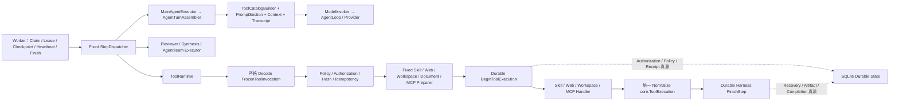

# Oktapod V1.1 Agent Runtime 优化执行计划

> 版本：V1.10（MCP 授权、资源能力真源与恢复链已收口）
> 更新日期：2026-08-24
> 实施分支：`codex/runtime-performance-v2`
> V1.0.0 关系：独立演进批次，不改变 V1.0.0 正式 tag 门禁
> 发布状态：Runtime 职责拆分与本地聚焦门禁已完成；12 场景脚本和性能字段保留但不执行发布级采样，Ubuntu race、远端双平台 CI、tag 与合并证据仍待产生

## 1. 执行结论

本批次已经按“一个 Assembly、一个 Tool Pipeline、一个 Durable 真源”完成代码收敛，并在同一边界内实施 Runtime 性能 V2。DeepSeek Harness 只作为原则参考，没有引入 Cordis、动态插件注册表、第二套 Receipt 或新的状态数据库。

2026-08-22 轻量职责收敛继续沿同一内核演进：`Worker` 只协调 Durable Claim/Lease/Checkpoint/Heartbeat/Finish、Steering 和 Follow-up；固定 `StepDispatcher` 分离 Main Agent、Reviewer、Synthesis、Agent Team 与 Tool Step；`ModelInvoker` 统一一次模型采样、总截止与错误分类；`ToolPreparerRegistry` 以 Skill、Web、Workspace、Document、MCP 五类固定映射替代 family switch。SQLite Store 只做同 package 源码拆分，没有改变 Store、事务、SQL、迁移、HTTP/OpenAPI、工具 Schema 或历史 Run 协议。

删除“12 场景 × 30 次自动回放 + 12 场景 × 5 次真实 Provider”的发布级性能基线批次。保留现有字段、脚本和 B9 `PARTIAL`，但不再把 p50/p95 报告作为本轮职责解耦的完成条件；只有出现明确延迟问题或准备对外承诺性能时才恢复采样。该决定不触发 Durable Fast Path，也不把“未测量”写成性能达标。

性能 V2 的决策是只优化 Agent Turn 热路径：Auto 不再先做模型分类；新 Run 使用可与业务工具同响应的 `replace_plan/advance_plan`；Task 正文经进程内 LiveTurnHub 临时可见；Provider 能力在 Run 创建时冻结；历史上下文按 Token 预算和工具组投影；工具批次按 concurrency-safe 连续段与 exclusive barrier 领取。旧 Run 缺少版本快照时保持旧路由、`update_plan`、上下文和整批调度语义。

原计划的两项兼容修复已完成：

1. 新 Run 选择的 Memory 正文、标题和来源 Hash 在创建 Task 时冻结，后续编辑或删除 Memory 不再改变该 Run 的模型请求；历史 Run 继续使用 live-ID 回退，并在 `ContextPlan` 标记 `legacy_live_ids`。
2. MCP 在执行开始后的取消明确返回 `TOOL_CANCELED`；Task Cancel 会把仍为 `started` 的 Receipt 原子收敛为 `unknown/SIDE_EFFECT_STATUS_UNKNOWN`，禁止非幂等调用自动重试。

收口时同步合入了已有缺陷修复：全局 Skill 按用户 Scope 可在其他自有项目调用；普通 continuation Step 冻结未完成计划计数并持续提醒 `update_plan`；已收敛的 `POLICY_REPAIR_QUEUED` 不再重复阻塞 Run；SSE 将校验、授权和状态冲突与真实模型中断分类；Changes 面板增加可理解的基线、行号、增删统计和折叠控制。

2026-08-21 运行回归补充：真实失败 Run 显示 Task 经 `AgentLoop.Complete` 发送 `stream:false`，12 次失败均精确等待 120 秒且零 Token，而同 Run 的成功调用只需 4.8～13.2 秒；Ask 经 `Stream` 8.1 秒成功。现已让 Task 优先消费同一 Provider SSE，移除会累计整个响应体时间的 HTTP 总截止，改为连接 10 秒、TLS 10 秒、首包 60 秒、流式静默 60 秒的分阶段边界；DNS、连接、TLS、首包和流中断以脱敏结构写入 Step/Event。网络与限流只自动重试 1 次，工具参数等会改变后续 Prompt 的语义修复仍保留 3 次。真实 Kimi Task `01a02228-5503-756e-8180-1d1f44475e9c` 两次模型交互 11.2 秒/7.9 秒，终态 `succeeded`、结果 `OK`。消息执行步骤的 Web 结果卡随步骤详情统一折叠，来源段落中的 `标题（URL）` 兼容渲染为可点击 Markdown 链接。

同日原失败“贪吃蛇” Run 浏览器续跑进一步证明仅有阶段超时仍不充分：Provider 在 SSE 连接持续活跃时，用 430,298 ms 才形成首个完整工具调用，期间既不触发 60 秒流静默，也没有可执行结果。Worker 因此增加单次模型 Turn 120 秒总完成时限；超限归类为脱敏 `model_turn_timeout/model_turn`，沿用网络类最多 1 次检查点重试，不再让 reasoning 或心跳把用户等待无限延长。另修复完成合同的否定语义：按意图片段过滤“不要修改/禁止创建/只分析/only reply”等只读要求，同时保留“不要修改旧文件，但创建新文件”的正向动作；只读 Task 不再误报 `WORKSPACE_MUTATION_MISSING`。历史上已被该门禁阻塞且所有 Step 均成功的 Run，手动继续时会追加新的 `completion_validation_recovery` 模型检查点，保留原成功 Step 审计记录并按当前门禁重新收口。

2026-08-22 真实 Kimi Task/Ask 对照进一步定位到 `thinking=auto`：最小 Ask 3.35 秒、完整 Task System + 最小消息 6.9 秒，而原始工具目标在 35 秒窗口内直到 33.9 秒才出现少量正文且未完成；同一冻结请求改为 `thinking=off` 后 4.5～6.8 秒完成并产生合法工具调用。新工具型 Run 因此冻结 `thinking_policy_version=task_action_v1`，把用户请求的 `auto` 解析为有效 `off`，显式 Off/Low/Medium/High 与缺少版本字段的历史 Run 保持原语义；请求值、有效值和策略版本进入 ContextPlan/Assembly Hash。Skill 回退匹配只检索 description/keywords/triggers，不再用完整 instructions 的通用词误加载无关 Skill。模型时间边界改为配置文件中的首真实 Token、流空闲和分级整轮硬上限：默认 15 秒、60 秒以及 Auto/Off/Low/Medium/High 的 120/120/180/300/600 秒，空 SSE/keep-alive 不得冒充首 Token。

原 Runtime 收敛批次没有改变 HTTP/OpenAPI、数据库迁移或 ToolBatch 顺序规则。随后合入的 Web Access 扩展新增 `web_fetch`、Bootstrap 配置契约、000062～000063 与 Web Renderer，但继续复用同一个 ToolRuntime、ExecutionPolicy、Receipt 和 SQLite Durable 真源。性能 V2 再追加 000064 附属表和 per-call barrier；旧批次仍保持“任一 `Sequential` 使整批串行”，只有冻结 `tool_scheduler_version=barrier_v2` 的新 Run 使用分组领取。

2026-08-21 Web 刷新收敛：项目页的任务、动态和消息查询改为仅在 live task 存在时有限轮询；动态面板未打开时不请求 activity；会话列表取消无条件定时刷新，Shell 保留共享缓存但不再创建重复轮询；项目库与会话树的任务刷新同样在无 live task 时停止；全局 inbox 统一 Query key，空列表退避至 15 秒，有待处理项时保持 5 秒。运行态仍以可恢复 SSE 为主，写操作通过 Query 失效保持列表一致。

2026-08-24 DeepSeek 浏览器回归发现：普通续轮仍可调用 `replace_plan`，Store 在保留完成项后又追加模型重发项，导致“目标级执行计划”退化为重复执行记录；另一个明确“不联网”的任务被完成门禁反向要求 `web_search` 收据。现已在 Tool Catalog 与 Store 双层关闭普通计划替换，只允许初始、Steering、权限与恢复阶段重规划，并过滤完成项/重复项；Domain 将“不联网、离线”冻结为零搜索预算。内部 `.oktapod/` 工作文件写入也不再因自动 Capture 被拒而误判失败。新 DeepSeek `deepseek-v4-flash` Task 实际加载 `frontend-design`，核对 HTML、写入并登记报告，计划始终只有“核对页面/登记验收结果”两项且终态 `2/2`，工具调用只出现在执行记录。

## 2. 当前架构



边界判断：

- `AgentTurnAssembler` 是工具型主 Agent 的唯一 ModelRequest 入口；Agent Team、搜索综合和 Reviewer 仍是无工具专用模型工作流。
- `ToolCatalogBuilder` 从同一个结果生成 Tool Definitions 与 AllowedTools，保留 Builtin → MCP → Skill Scope → 显式 Provider → Scene → Search Budget 的既有过滤语义。
- `PromptSection{Name, Order, Text}` 固定主 Prompt 顺序；不引入运行时注册表。
- `assembly_hash` 覆盖最终 System Prompt、Messages、Tool Definitions、AllowedTools、ModelRef、Thinking、Token 上限、工具开关及移除 hash 字段后的 ContextPlan。
- `ModelInvoker` 统一一次 Provider-neutral 采样、按有效 Thinking 选择有界总截止、临时安全正文回调和现有性能字段，不拥有持久状态；Provider Adapter 另行负责可配置的首真实 Token 与流空闲截止。
- `ToolRuntime` 统一 Skill、Web、Workspace/Artifact/Asset、Document 和 MCP 的 Decode → Policy/Authorization → Preparer → Begin → Dispatch → Normalize；五类 Preparer 是固定映射，不是动态插件表。
- 有状态本地 MCP 由进程级 `SessionBroker` 按组织/项目/Run/Capability 隔离复用协议会话，同一会话串行调用、15 分钟空闲和 32 会话上限回收；Broker 不持久化事实，每次工具调用仍独立走 Policy、Authorization 与 Receipt，传输失败只驱逐会话且不重试非幂等调用。
- 每个模型可见内建工具只能有一个 owner：Control Handler 或 Durable Tool Preparer；未知和重复 owner 在 Worker 创建时失败。
- `ToolExecutionLedger` 是本批次唯一新增接口；实现仍为 SQLite Store。Receipt、授权、Lease/Fence、审批、Artifact 和 Completion Gate 没有第二真源。

## 3. 数据与兼容决策

Run 配置快照新增向后兼容字段：

```json
{
  "context_memory_snapshots": [
    {
      "id": "memory-id",
      "title": "title-at-run-start",
      "content": "bounded prompt payload",
      "source_hash": "sha256:..."
    }
  ]
}
```

Web Access 追加同样向后兼容且不含明文 origin 的字段：

```json
{
  "web_access_policy_version": 1,
  "private_fetch_enabled": true,
  "allowed_origin_hashes": ["sha256:..."],
  "web_access_policy_hash": "sha256:..."
}
```

- 选中 Memory 的聚合正文上限为 24 KiB，并在 UTF-8 字符边界截断。
- 新 Run 优先读取快照；字段缺失的历史 Run 才读取 live Memory。
- `ContextPlan.memory_context_source` 为 `frozen_snapshot`、`legacy_live_ids` 或 `none`；历史回退同时设置 `legacy_memory_context=true`。
- `ContextPlan.assembly_schema_version=oktapod.agent-assembly/v1`，`assembly_hash` 使用 `sha256:` 前缀。
- Runtime 收敛本身未新增迁移；Web Access 使用 000062 `run_approval_rules` 和审批展示字段、000063 Web Receipt 授权证据字段。Run 安全策略仍写入已有 JSON 快照。

## 4. 已实施批次

| 批次 | 本地提交 | 结果 |
|---|---|---|
| Phase 0 行为冻结 | `9145e8a` | 固化主 Agent ModelRequest、实际工具目录、历史权限别名与现有 ToolBatch 契约 |
| Phase 1A Memory 确定性 | `d2e821a` | Task 创建时冻结有界 Memory Prompt 载荷，历史 Run 标记 live fallback |
| Phase 1B MCP Receipt 预检 | `bded7d6` | Secret、Manifest、参数和工具清单全部在 Receipt Begin 前验证 |
| Phase 2 主 Agent Assembly | `59c6241` | 提取 AgentTurnAssembler、ToolCatalogBuilder、PromptSection 与 assembly hash |
| Phase 3 ToolRuntime | `e42e099` | 四类工具迁入统一管线；planning/Begin/Runtime 共用 MCP 风险与幂等性推导 |
| Phase 4 取消收敛 | `c927426` | pre-dispatch cancel、Workspace 进程树终止、MCP cancel/timeout 分类、started Receipt unknown |
| 2026-08-20 回归收口 | `fe53801` | 合并 Scope/计划/Run 状态/SSE/Changes 修复；修复 Windows CI 受控 Git 信任边界，race 套件保留全量执行并放宽为 20 分钟超时 |
| 2026-08-20 Web Access | 本地工作树 | `WebAccess` 统一 Search/Fetch；私网精确 origin 配置、Run Hash 快照、`run_origin` 人工授权、安全 Transport、Web 卡片与 OpenAPI/UI 同步 |
| 2026-08-21 浏览器收口 | 本地工作树 | 执行记录展开状态提升为按 `task_id` 管理，任务流从用户消息迁移到助手结果消息时不再意外折叠；真实 Chromium 并发套件 27/27 |
| 2026-08-21 Web 刷新收敛 | 本地工作树 | 空闲项目停止任务/动态/消息轮询；活跃任务按状态启停有限刷新；Shell 与项目页共享缓存但不重复定时刷新；inbox 统一缓存并按是否有待处理项退避；Web 单测 50/50、lint、build 通过 |
| 2026-08-22 Runtime 性能 V2 | 当前工作树 | Auto 单 Turn、Plan Transition V2、LiveTurnHub、冻结 Provider 能力、token-aware context projection、000064 barrier/performance 附属表和 12 场景隔离基准入口已落地；本地完整验证、浏览器回归和 Windows 原生烟测通过；发布级真实 Provider 与 p95 采样已暂缓，不作为本轮完成门禁 |
| 2026-08-22 预置文档 Runtime | 当前工作树 | 000065～000067、预置目录/删除记忆、六个静态 `document_*` 工具、签名 stdio Runtime、解析/渲染缓存、CAS 修订、预览与 Artifact 完成门禁已落地；四格式 25 次真实 RPC 烟测通过。真实浏览器确认五个资源可用、依赖提示与代码任务输出正常，并据此修复开发渲染器透传和 Changes 缓存污染；跨平台签名发布和标准 P95 待 CI/夹具证明 |
| 2026-08-22 Runtime 轻量职责收敛 | 当前工作树 | 扩展纯文本与计划/工具/审批/Artifact Golden Trace；Context 配对清理覆盖截断、取消、Compaction、rollback 与 unknown；新增固定 StepDispatcher、ModelInvoker 和五类 ToolPreparer；SQLite Store 按 Runtime、Tool/Receipt、Context/Conversation 同 package 拆分。未新增迁移、API、工具 Schema、第二真源或 Feature Flag |
| 2026-08-24 资源与真实 Provider/MCP 收口 | 当前工作树 | 移除无项目上下文的全局“新建任务”；Provider 删除事务性回退可变引用且历史 ModelRef 不变；资源中心展示能力定位、真实工具、适用场景和治理边界；无凭据 Capability 不再被历史 blocked Run 错误锁死；Playwright MCP 删除、固定版重装、24 工具发现和 DeepSeek 两轮 `navigate → snapshot` 状态连续性通过 |
| 2026-08-24 计划与完成门禁回归 | 当前工作树 | 已绑定计划的普通续轮禁止 `replace_plan`，显式重规划保留完成项并去重；“不联网/离线”关闭新 Web 收据要求；`.oktapod/` 内部写入跳过自动 Capture；DeepSeek + `frontend-design` 真实 Task 以固定两项计划完成文件核对与 Artifact 登记 |
| 2026-08-24 MCP 治理与资源真源收口 | 当前工作树 | L3 MCP 增加仅绑定当前 Run 与完整动态工具身份的 `run_tool` 授权，继续保留逐调用 Authorization/Receipt；同一计划项 12 个终态 MCP 调用后无工具收尾。资源详情由 Skill Manifest/instructions 与 MCP 在线工具发现生成，不按资源身份写第二份能力表；预置修复先验证当前进程真实 Runtime，工具失败恢复计数按连续失败 lineage 重置。DeepSeek + Playwright 真实任务在百度验证码后切换移动版，复用已授权工具并打开 `https://www.znv.com.cn/`，最终计划 `3/3` 完成。 |

主要代码入口：

- `Src/internal/runtime/agent_turn_assembler.go`
- `Src/internal/runtime/step_dispatcher.go`
- `Src/internal/runtime/model_invoker.go`
- `Src/internal/runtime/tool_catalog.go`
- `Src/internal/runtime/prompt_assembler.go`
- `Src/internal/runtime/tool_runtime.go`
- `Src/internal/runtime/tool_preparer_registry.go`
- `Src/internal/runtime/live_turn_hub.go`
- `Src/internal/application/context_snapshot.go`
- `Src/internal/application/mcp_policy.go`
- `Src/internal/adapters/db/sqlite/store.go`
- `Src/internal/adapters/db/sqlite/store_runtime.go`
- `Src/internal/adapters/db/sqlite/store_tool_receipt.go`
- `Src/internal/adapters/db/sqlite/store_conversation.go`

## 5. 验收证据

| 不变量 | 自动化证据 |
|---|---|
| 同一 Run + Step 组装完全一致 | `TestAgentTurnAssemblyIsDeterministicAndHashesFinalRequest` |
| Prompt、Tool Schema、AllowedTools 改变 hash | 同上 |
| 新 Run 不受 Memory 后续编辑/删除影响 | `TestSelectedContextLoadsAuthorizedTextWithBoundedPlan` |
| 24 KiB 聚合上限与 UTF-8 完整 | `TestSelectedMemorySnapshotBoundsAggregateUTF8Payload` |
| 历史 Run live fallback 可恢复且有标记 | `TestHistoricalSelectedMemoryUsesMarkedLiveFallback` |
| MCP 缺少凭据不创建 Receipt | `TestMCPMissingCredentialFailsBeforeReceiptBegin` |
| MCP 当前任务授权只复用同一完整工具身份，其他工具仍需审批 | `TestMCPRunToolApprovalReusesExactToolOnly` + DeepSeek/Playwright 真实浏览器回归 |
| 同一计划项 MCP 调用达到上限后无工具收尾 | `TestContinuationTurnBoundsRepeatedMCPCallsPerPlanItem` |
| 工具恢复次数按连续失败链计数并在成功后重置 | `TestToolRecoveryEpisodeResetsAfterOrdinaryContinuation` |
| 全部 Durable 工具族共用严格解码并 fail-before-Begin | `TestToolRuntimeStrictDecoderRejectsEveryToolFamilyBeforeReceipt` |
| 派发前取消不创建 Receipt | `TestToolRuntimeCanceledBeforeDispatchDoesNotBeginReceipt` |
| MCP 取消、超时、普通失败分类独立 | `TestMCPCallErrorSeparatesCancelTimeoutAndFailure` |
| 同一 Run/Capability 的 MCP 连续调用保留协议状态 | `TestSessionBrokerReusesProtocolSessionWithinRunCapability` + DeepSeek/Playwright `browser_navigate → browser_snapshot` 浏览器回归 |
| 无凭据 Capability 可越过历史 blocked Run 删除，真正活跃或含凭据 blocked 继续保护 | `TestDeleteCredentialFreeCapabilityIgnoresHistoricalBlockedRun` + 既有活动 Run 删除阻止合同 |
| Provider 删除回退可变引用且历史 Run 不改写 | `TestDeleteProviderMovesMutableSelectionsToDefaultAndPreservesRunSnapshot` + `TestClientFallsBackToDefaultWhenRequestedProviderWasDeleted` |
| Task Cancel 将 started Receipt 置 unknown | `TestTaskCancelClosesPendingApproval` |
| Workspace 取消终止真实进程树 | `TestWorkspaceCommandCancellationTerminatesProcessTree` |
| OHCS 整批串行、并行收敛、审批、恢复不回退 | 既有 runtime/integration/Golden Trace 全套回归 |
| 纯文本与计划/工具/审批/Artifact 持久序列不回退 | `TestOHCSGoldenTraceTextTurn` + `TestOHCSGoldenTracePlanToolApprovalAndArtifact` |
| Compaction、取消、失败、blocked 与 unknown 不产生孤立工具消息 | `TestTranscriptAssemblerKeepsToolPairsAcrossRecoveryOutcomes` + `TestTranscriptAssemblerNormalizesCompactedAndRolledBackToolContext` |
| 步骤类型由固定 Dispatcher 唯一路由 | `TestStepDispatcherUsesFixedExecutorOwnership` |
| 每个内建工具只有 Control 或 Durable Preparer 一个 owner | `TestEveryModelVisibleBuiltinHasExactlyOneRuntimeOwner` + `TestDuplicateRuntimeOwnerFailsValidation` + `TestControlToolsNeverEnterDurableToolRuntime` |
| continuation Step 的计划进度冻结且重组确定 | `TestQueuedContinuationFreezesActivePlanProgress` + `TestContinuationTurnUsesFrozenPlanProgressReminder` |
| Auto 无分类且一次业务模型调用 | `TestAutoAnswerUsesOneBusinessModelCall` |
| Plan V2 控制与业务工具同响应，工具成功不自动推进 | `TestTransitionPlanControlsShareBusinessResponses` |
| 普通续轮不能重建稳定计划，显式重规划不重复完成项 | `TestTransitionPlanRejectsOrdinaryReplacementAfterProgress` + `TestTransitionPlanReplacementVisibility` + `TestParseTransitionPlanItemsRejectsSemanticDuplicates` + `TestModelStageAllowsPlanReplacementOnlyForExplicitReplan` |
| “不联网/离线”不要求 Web 收据 | `TestInferTaskCompletionRequirements` + `TestInferMaximumSearchCalls` + DeepSeek 两项计划浏览器回归 |
| `.oktapod/` 内部写入不误触 Artifact Capture | `TestInternalWorkspaceWriteSkipsArtifactCaptureWithoutFailing` + `TestDeliverableWorkspaceWriteStillRequiresArtifactCapture` |
| 临时流式慢消费者不阻塞 Durable Worker | `TestLiveTurnHubDropsSlowSubscriberWithoutBlockingPublisher` + RunEventsProvider provisional 测试 |
| per-call barrier 同组并发、后继隔离、unknown/MCP mutation 独占 | `TestBarrierSchedulerPreservesModelOrder` + `TestBarrierSchedulerTreatsUnknownAndMCPMutationAsExclusive` |
| token-aware projection 按完整调用组裁剪旧 reasoning | `TestTokenProjectionDropsOldReasoningByWholeGroup` |
| 已处理的 Policy Repair 不重复阻塞 Run | `TestDeriveRunStatusIgnoresSettledPolicyRepairs` |
| 全局 Skill 按用户 Scope 跨自有项目可用 | `TestGlobalSkillInvocableFromOtherProject` |
| SSE 保留确定性错误分类 | `TestTurnStreamErrorDetailPreservesDeterministicFailures` |
| Changes 行级展示与受治理提交无浏览器错误 | Playwright `Changes 可按文件查看并通过原 Thread 受治理提交所选路径` |
| 私网配置严格校验与旧 Run 不扩权 | `TestWebAccessPolicyValidation` + `TestWebAccessPolicyRunSnapshotIntersection` |
| 预置资源删除后不静默恢复且 Runtime 依赖阻止删除 | `TestPresetDocumentResourcesRememberDeletionAndProtectDependencies` |
| Runtime Manifest 签名、逐文件 Hash 与路径约束 | `TestSignedRuntimeManifestRejectsTamperingAndUnsafeHandles` + `TestRuntimeManifestRequiresHashesForEntrypointAndPython` |
| 六个文档工具固定 L0/L1 且拒绝可执行载荷 | `TestPlanToolClassifiesFixedDocumentProtocolAndRejectsExecutablePayloads` |
| 多文档修改不能由单一导出绕过完成门禁 | `TestDocumentCompletionRequiresEveryMutatedDocumentToHaveCurrentExport` |
| 四格式创建、打开、修订、渲染、导出 | `pnpm test:document-runtime`：25 次真实 JSON-RPC |
| 资源能力详情与 Skill/MCP 生命周期真实可用 | `resource-profile.test.ts`：Skill 从 Manifest/instructions、MCP 从在线工具发现生成说明；本机真实浏览器确认 `frontend-design` 与 Playwright MCP 的真实能力、单一来源输入说明、预置 Runtime 重启后可用，并完成删除/重装/24 工具发现闭环 |
| 项目/Agent 创建与预置资源并发确保 | `TestRetryTransientSQLiteValueRetriesBusySnapshot` + 4 Worker“创建项目 + Task 执行”定向压测 10/10；预置确保/依赖/显式安装及 Agent 创建共享幂等有界重试；浏览器只对同一 `Idempotency-Key` 的连接级失败重试一次 |
| DNS 混合地址、跨源重定向、代理隔离与内容边界 | `TestFetchPrivateHTMLUsesBoundedMarkdownConversion` + `TestFetchRejectsPrivateDNSAndCrossOriginRedirects` + `TestFetchHandlesSameOriginRedirectStatusAndContentBounds` |
| 每 Run 每 origin 授权，Full Access/Reviewer 不绕过 | `TestPrivateWebFetchApprovalIsRunOriginScoped` + `TestPrivateWebFetchIgnoresFullAccessAndAutoReviewer` |
| 浏览器内一次私网授权复用同 origin、迁移后保持展开、两张文本卡与零控制台错误 | Playwright `私网 Web Fetch 每 Run 每 origin 只审批一次并以文本卡片重放` 1/1 |

2026-08-24 先运行 Runtime、SQLite、MCP、Web 与 Integration focused tests，再运行 `$env:GOCACHE="$env:TEMP\go-build-cache"; pnpm verify`。发布门禁的最终结果以本节下方最新记录为准。

## 6. 合并与发布门禁

2026-08-24 本地可执行门禁已经全部重跑：

| 门禁 | 结果 |
|---|---|
| `pnpm verify` | `PASS`：Go、ESLint、Web 16 文件 67/67、TypeScript/Vite/Go build、migration、OpenAPI drift |
| Playwright | `PASS`：foundation 初始化 1/1、Vault 重启解锁 1/1、success 27/27；覆盖 Task Live 流、幂等网络重试、Agent JSON 创建、MCP/资源入口与既有恢复语义 |
| `pnpm test:race` | `BLOCKED_ENV`：本机 `CGO_ENABLED=0` 且没有可用 C 编译器，`go test -race` 在测试启动前拒绝执行；Ubuntu CI 仍是正式证据 |
| `pnpm release:build` | `BLOCKED_ENV`：当前命令明确报告缺少 `OKTAPOD_DOCUMENT_RUNTIME_STAGE`；旧主程序工件 `a02b931c…` 只证明引入文档 Runtime 前的基线，不能沿用旧 `PASS` |
| `pnpm release:smoke` | `BLOCKED_ENV`：本轮没有生成 `Build/document-runtime-trusted-keys.json` 和签名 Runtime 包；当前烟测强制信任并加载签名包、检查资源目录为 `available`，需在 release build 获得发布输入后重跑 |

远端还需 PR 触发 Ubuntu CI 的 `pnpm verify`、`pnpm test:race` 和原生 smoke，以及 Windows CI 的完整验证和原生 smoke。当前 workflow 只在 PR 或 `main` push 上运行，功能分支 push 本身不产生 CI 证据；Windows 本地结果不能替代 Ubuntu race 或远端双平台证据。

## 7. 非目标与后续 RFC

- 不把 Agent Team、Reviewer、搜索综合塞入巨型 Assembler。
- 不建立动态 Manager/Factory/Service Locator 或“万物插件”体系。
- 历史 Run 不改写原有 parallel/sequential 批次；新 Run 只通过 000064 附属投影启用 per-call barrier，不建立第二套 ToolRuntime。
- 逐块 stdout/stderr 直播、强沙箱和跨 Provider 参数转换分别进入独立 RFC；只有基准数据、恢复语义和兼容方案齐全后才能排期。
- 不因 Worker 或 ToolRuntime 行数达成某个数字就声明架构完成；验收以唯一入口、唯一真源与运行证据为准。
