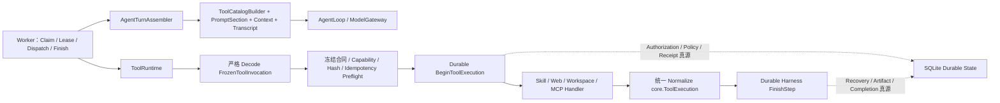

# Oktapod V1.1 Agent Runtime 优化执行计划

> 版本：V1.1（已实施，本地门禁通过）
> 更新日期：2026-08-20
> 实施分支：`codex/runtime-convergence-v1.1`
> V1.0.0 关系：独立演进批次，不改变 V1.0.0 正式 tag 门禁
> 发布状态：功能分支本地收口完成；未 tag、未合并，PR/Ubuntu/Windows 远端 CI 证据仍待产生

## 1. 执行结论

本批次已经按“一个 Assembly、一个 Tool Pipeline、一个 Durable 真源”完成代码收敛。DeepSeek Harness 只作为原则参考，没有引入 Cordis、动态插件注册表、第二套 Receipt 或新的状态数据库。

原计划的两项兼容修复已完成：

1. 新 Run 选择的 Memory 正文、标题和来源 Hash 在创建 Task 时冻结，后续编辑或删除 Memory 不再改变该 Run 的模型请求；历史 Run 继续使用 live-ID 回退，并在 `ContextPlan` 标记 `legacy_live_ids`。
2. MCP 在执行开始后的取消明确返回 `TOOL_CANCELED`；Task Cancel 会把仍为 `started` 的 Receipt 原子收敛为 `unknown/SIDE_EFFECT_STATUS_UNKNOWN`，禁止非幂等调用自动重试。

收口时同步合入了已有缺陷修复：全局 Skill 按用户 Scope 可在其他自有项目调用；普通 continuation Step 冻结未完成计划计数并持续提醒 `update_plan`；已收敛的 `POLICY_REPAIR_QUEUED` 不再重复阻塞 Run；SSE 将校验、授权和状态冲突与真实模型中断分类；Changes 面板增加可理解的基线、行号、增删统计和折叠控制。

HTTP/OpenAPI 结构、工具名和 Schema、数据库表与迁移、ToolBatch 顺序规则均未改变；SSE 只修正已有错误的分类与用户提示。任一 `Sequential` ToolCall 仍使整个批次串行；per-call barrier 不进入本批次。

## 2. 当前架构



边界判断：

- `AgentTurnAssembler` 是工具型主 Agent 的唯一 ModelRequest 入口；Agent Team、搜索综合和 Reviewer 仍是无工具专用模型工作流。
- `ToolCatalogBuilder` 从同一个结果生成 Tool Definitions 与 AllowedTools，保留 Builtin → MCP → Skill Scope → 显式 Provider → Scene → Search Budget 的既有过滤语义。
- `PromptSection{Name, Order, Text}` 固定主 Prompt 顺序；不引入运行时注册表。
- `assembly_hash` 覆盖最终 System Prompt、Messages、Tool Definitions、AllowedTools、ModelRef、Thinking、Token 上限、工具开关及移除 hash 字段后的 ContextPlan。
- `ToolRuntime` 统一 Skill、Web、Workspace/Artifact/Asset 和 MCP 的 Decode → Preflight → Begin → Dispatch → Normalize；Capability 适配细节仍在窄 Handler/Adapter。
- `ToolExecutionLedger` 是本批次唯一新增接口；实现仍为 SQLite Store。Receipt、授权、Lease/Fence、审批、Artifact 和 Completion Gate 没有第二真源。

## 3. 数据与兼容决策

Run 配置快照新增向后兼容字段：

```json
{
  "context_memory_snapshots": [
    {
      "id": "memory-id",
      "title": "title-at-run-start",
      "content": "bounded prompt payload",
      "source_hash": "sha256:..."
    }
  ]
}
```

- 选中 Memory 的聚合正文上限为 24 KiB，并在 UTF-8 字符边界截断。
- 新 Run 优先读取快照；字段缺失的历史 Run 才读取 live Memory。
- `ContextPlan.memory_context_source` 为 `frozen_snapshot`、`legacy_live_ids` 或 `none`；历史回退同时设置 `legacy_memory_context=true`。
- `ContextPlan.assembly_schema_version=oktapod.agent-assembly/v1`，`assembly_hash` 使用 `sha256:` 前缀。
- 未新增数据库迁移：配置快照继续使用已有 JSON 存储。

## 4. 已实施批次

| 批次 | 本地提交 | 结果 |
|---|---|---|
| Phase 0 行为冻结 | `9145e8a` | 固化主 Agent ModelRequest、实际工具目录、历史权限别名与现有 ToolBatch 契约 |
| Phase 1A Memory 确定性 | `d2e821a` | Task 创建时冻结有界 Memory Prompt 载荷，历史 Run 标记 live fallback |
| Phase 1B MCP Receipt 预检 | `bded7d6` | Secret、Manifest、参数和工具清单全部在 Receipt Begin 前验证 |
| Phase 2 主 Agent Assembly | `59c6241` | 提取 AgentTurnAssembler、ToolCatalogBuilder、PromptSection 与 assembly hash |
| Phase 3 ToolRuntime | `e42e099` | 四类工具迁入统一管线；planning/Begin/Runtime 共用 MCP 风险与幂等性推导 |
| Phase 4 取消收敛 | `c927426` | pre-dispatch cancel、Workspace 进程树终止、MCP cancel/timeout 分类、started Receipt unknown |
| 2026-08-20 回归收口 | `fe53801` | 合并 Scope/计划/Run 状态/SSE/Changes 修复；修复 Windows CI 受控 Git 信任边界，race 套件保留全量执行并放宽为 20 分钟超时 |

主要代码入口：

- `Src/internal/runtime/agent_turn_assembler.go`
- `Src/internal/runtime/tool_catalog.go`
- `Src/internal/runtime/prompt_assembler.go`
- `Src/internal/runtime/tool_runtime.go`
- `Src/internal/application/context_snapshot.go`
- `Src/internal/application/mcp_policy.go`
- `Src/internal/adapters/db/sqlite/store.go`

## 5. 验收证据

| 不变量 | 自动化证据 |
|---|---|
| 同一 Run + Step 组装完全一致 | `TestAgentTurnAssemblyIsDeterministicAndHashesFinalRequest` |
| Prompt、Tool Schema、AllowedTools 改变 hash | 同上 |
| 新 Run 不受 Memory 后续编辑/删除影响 | `TestSelectedContextLoadsAuthorizedTextWithBoundedPlan` |
| 24 KiB 聚合上限与 UTF-8 完整 | `TestSelectedMemorySnapshotBoundsAggregateUTF8Payload` |
| 历史 Run live fallback 可恢复且有标记 | `TestHistoricalSelectedMemoryUsesMarkedLiveFallback` |
| MCP 缺少凭据不创建 Receipt | `TestMCPMissingCredentialFailsBeforeReceiptBegin` |
| 四类工具共用严格解码并 fail-before-Begin | `TestToolRuntimeStrictDecoderRejectsEveryToolFamilyBeforeReceipt` |
| 派发前取消不创建 Receipt | `TestToolRuntimeCanceledBeforeDispatchDoesNotBeginReceipt` |
| MCP 取消、超时、普通失败分类独立 | `TestMCPCallErrorSeparatesCancelTimeoutAndFailure` |
| Task Cancel 将 started Receipt 置 unknown | `TestTaskCancelClosesPendingApproval` |
| Workspace 取消终止真实进程树 | `TestWorkspaceCommandCancellationTerminatesProcessTree` |
| OHCS 整批串行、并行收敛、审批、恢复不回退 | 既有 runtime/integration/Golden Trace 全套回归 |
| continuation Step 的计划进度冻结且重组确定 | `TestQueuedContinuationFreezesActivePlanProgress` + `TestContinuationTurnUsesFrozenPlanProgressReminder` |
| 已处理的 Policy Repair 不重复阻塞 Run | `TestDeriveRunStatusIgnoresSettledPolicyRepairs` |
| 全局 Skill 按用户 Scope 跨自有项目可用 | `TestGlobalSkillInvocableFromOtherProject` |
| SSE 保留确定性错误分类 | `TestTurnStreamErrorDetailPreservesDeterministicFailures` |
| Changes 行级展示与受治理提交无浏览器错误 | Playwright `Changes 可按文件查看并通过原 Thread 受治理提交所选路径` |

2026-08-20 收口仍先运行 focused tests，再运行 `$env:GOCACHE="$env:TEMP\go-build-cache"; pnpm verify`。最近一次结果为 Go vet/test、ESLint、Web 41/41、TypeScript/Vite/Go build、SQLite migration 与 OpenAPI drift 全绿。

## 6. 合并与发布门禁

2026-08-20 本地门禁已经全部重跑：

| 门禁 | 结果 |
|---|---|
| `pnpm verify` | `PASS`：Go、ESLint、Web 41/41、TypeScript/Vite/Go build、migration、OpenAPI drift |
| `pnpm test:e2e` | `PASS`：foundation 初始化 1/1、Vault 重启解锁 1/1、success 26/26 |
| `pnpm release:build` | `PASS`：`oktapod-v1.0.0-windows-amd64.exe`，SHA256 `b094ba20cd96193aeb854b20f2d734e44bd7a06214698be4ca809683e3ee56fa` |
| `pnpm release:smoke` | `PASS`：独立数据目录启动、health 200、项目创建与服务停止 |

远端还需 PR 触发 Ubuntu CI 的 `pnpm verify`、`pnpm test:race` 和原生 smoke，以及 Windows CI 的完整验证和原生 smoke。当前 workflow 只在 PR 或 `main` push 上运行，功能分支 push 本身不产生 CI 证据；Windows 本地结果不能替代 Ubuntu race 或远端双平台证据。

## 7. 非目标与后续 RFC

- 不把 Agent Team、Reviewer、搜索综合塞入巨型 Assembler。
- 不建立动态 Manager/Factory/Service Locator 或“万物插件”体系。
- 不改变工具批次的整批串行覆盖合同。
- per-call barrier、逐块 stdout/stderr 直播、强沙箱和跨 Provider 参数转换分别进入独立 RFC；只有基准数据、恢复语义和兼容方案齐全后才能排期。
- 不因 Worker 或 ToolRuntime 行数达成某个数字就声明架构完成；验收以唯一入口、唯一真源与运行证据为准。
