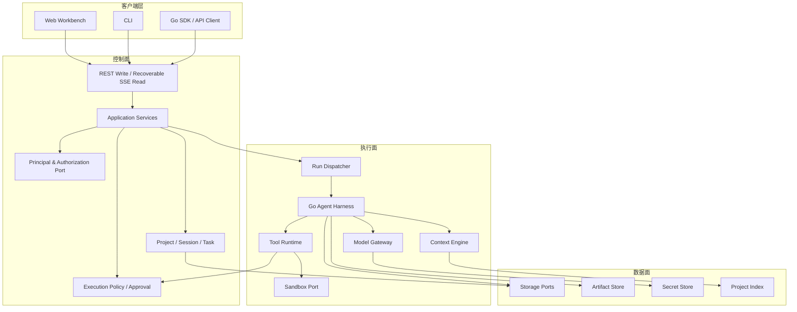
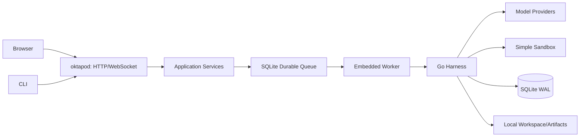
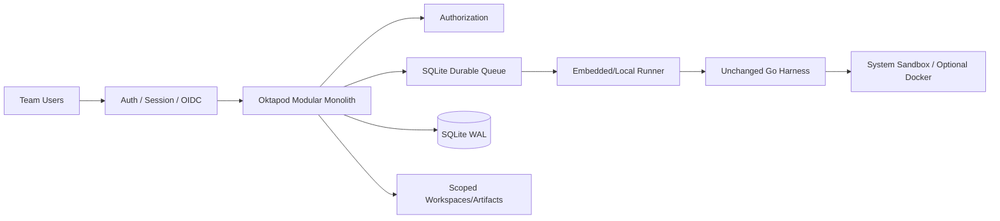
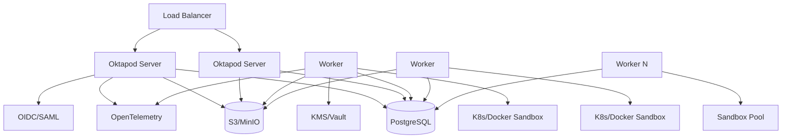

# Oktapod 三阶段递进式架构设计

> **当前第一阶段覆盖决策（2026-07-26）**：第一阶段已采用注册用户 + Owner-only 个人私有项目、React/TanStack 前端和 REST 写操作 + 可恢复 SSE 读事件。本文中“单用户固定主体”、HTMX/templ 或 WebSocket 的第一阶段描述属于历史方案；第二、三阶段的团队与集群目标仍保留，但不得反向改变当前 MVP 入口和完成度口径。当前状态以《Oktapod MVP 验收测试方案与状态 v0.1》为准。

> **文档版本**：V1.0
> **文档类型**：总体架构设计 / AI 编程实施基线
> **评审角色**：首席架构师
> **编制日期**：2026-07-25
> **输入基线**：`Oktapod PRD V1.1 轻量化架构优化版`
> **Pi 冻结基线**：`earendil-works/pi@b1c444d956b70e5c437d3d2782b01d157fa05ba3`
> **核心目标**：以同一套 Go 原生核心，依次交付“单用户单机版 → 团队多用户单机版 → 企业集群版”，阶段间只增加能力和替换适配器，不重写 Harness 核心。

---

## 1. 执行摘要

Oktapod 应采用**演进式模块化单体（Evolutionary Modular Monolith）+ 可拆分执行平面（Execution Plane）**的总体路线，而不是从第一天建设微服务、集群调度或完整企业治理体系。

三个阶段分别对应两个独立维度的递进：

| 阶段 | 产品能力 | 部署拓扑 | 默认数据库 | 目标用户 |
|---|---|---|---|---|
| 第一阶段 | Pi 能力语义完整迁移、注册用户个人私有项目、Web 工作台 | 单节点、单进程、内嵌 Worker | SQLite WAL | 多个本地账户、Owner-only 个人项目 |
| 第二阶段 | 团队项目、租户隔离与企业安全治理 | 单节点、模块化单体、隔离执行 | SQLite WAL / PostgreSQL 契约 | 小型团队、多用户协作 |
| 第三阶段 | PostgreSQL、独立 Worker、集群、高可用 | 多 Server + 多 Worker | PostgreSQL | 企业多团队 |

本设计的核心不是提前实现未来能力，而是从第一阶段稳定以下**不可变架构内核**：

1. Agent Message、Tool、Provider、Session Entry、Run Event 等协议；
2. Harness 生命周期、Turn Snapshot、Agent Loop、保存点与恢复语义；
3. Project、Thread/Session、Task、Run 的领域关系；
4. 存储、身份、授权、队列、沙箱、Artifact 等变化点的端口；
5. 作用域上下文、全局 ID、事件序号和数据库可迁移约束；
6. Pi Compatibility Suite（兼容测试体系）。

只要上述内核稳定，第二阶段主要增加身份与治理模块，第三阶段主要替换基础设施 Adapter 并拆分进程，业务核心无须重构。

---

## 2. 对现有 PRD V1.1 的审核结论

### 2.1 应保留的设计

现有 V1.1 的下列方向正确，应继续作为架构约束：

- Go 原生重构，不把 Pi 的 TypeScript Runtime 作为生产依赖；
- 单二进制、SQLite、本地文件系统和轻量执行护栏作为最小部署；
- SQLite/PostgreSQL 通过端口适配，业务代码不绑定数据库方言；
- Simple/System/Container 三级渐进式执行隔离；
- OPA、WASM、Kubernetes、S3、SCIM 等不作为首版前置条件；
- Harness First、Ports and Adapters、Turn Snapshot、透明可观测；
- 以 Pi Golden Trace 验证 Go 重构后的行为等价；
- Simple Sandbox 不冒充内核级安全隔离；
- 存量 SQLite 切换 PostgreSQL 必须执行受控迁移，不能仅改配置。

### 2.2 需要调整的关键问题

| PRD V1.1 现状 | 架构问题 | 本设计修正 |
|---|---|---|
| 单机模式默认考虑轻量多用户 | 与第一阶段“不需要用户体系”冲突，增加首版复杂度 | 第一阶段严格单用户；多用户全部进入第二阶段 |
| 总体架构始终包含 Identity & Tenant | AI 编程工具会过早实现账户和租户 | 第一阶段仅有 `LocalPrincipalResolver`，不提供用户功能 |
| `TurnSnapshot` 直接包含 `TenantID/UserID` | 核心 Harness 被企业身份语义污染 | 改为通用 `ExecutionScope` 与 `ActorRef` |
| 所有业务表从首版建设 tenants/users/teams/roles | 大量空模块、空表和无效逻辑 | 第一阶段只保留作用域字段和本地哨兵值，第二阶段再增加身份表 |
| Event Sourcing 被定义为全局原则 | 容易演变成全平台事件溯源，开发和查询复杂度过高 | 仅 Session、Run Timeline、Audit 使用追加日志；其他实体采用普通状态表 |
| Session、Thread、Branch 同时作为独立对象 | 概念重叠，容易生成重复表和重复服务 | Thread 是 Session 的产品名称；Branch 是 Session 树中的路径，不单独建 Thread 聚合 |
| Release 0～5 与三阶段目标不一致 | 交付边界分散，AI 工具难以判断完成状态 | 重构为三个阶段，每阶段再划分内部里程碑 |
| 第二个 Release 已引入多用户，第三个 Release 已引入 PG | 用户能力和部署能力交错 | 第二阶段只做单机多用户；第三阶段统一做 PG 和集群 |
| Go 模块树提前包含 tenant/team/postgres/k8s 等 | 容易生成大量占位代码和错误依赖 | 不创建未来空包；只提前定义确有必要的稳定端口 |
| NFR 使用“200 注册用户、20 并发 Run”的共享单机指标 | SQLite 团队版指标不现实，也不符合第一阶段 | 每阶段分别定义性能与容量目标 |
| Compaction 只描述 `firstKeptEntryID` | Pi 当前格式已支持 `retainedTail` 检查点 | 新实现以 `retainedTail` 为主，同时兼容旧格式导入 |
| Agent Team 与人类团队概念混用 | Pi 本身不默认提供 sub-agent/plan mode，且不属于团队用户体系 | 人类团队在第二阶段；多 Agent 编排作为第三阶段后的企业增强能力 |

### 2.3 最重要的架构判断

**“单机/集群”是部署拓扑，“单用户/多用户”是产品能力，两者不能混为一个版本概念。**

Oktapod 的正确递进路径是：

```text
阶段一：单用户 + 单机
阶段二：多用户 + 单机
阶段三：多用户 + 集群
```

而不是：

```text
个人版 → 团队版 → 企业版（三套代码路径）
```

---

## 3. 架构目标与非目标

### 3.1 架构目标

1. **第一阶段即形成完整可用产品**，不是只能演示 Agent Loop 的技术原型。
2. **Pi 核心行为语义完整迁移到 Go**，并有自动化兼容证据。
3. **前端不是 Pi 的附属页面**，而是以 Pi 能力为底座的 Web Agent 工作台。
4. **第二阶段增加多用户后不修改 Harness、Session 和 Tool 核心协议。**
5. **第三阶段拆分 Server/Worker、切换 PostgreSQL 后不修改业务用例。**
6. 默认运行链路不依赖 Node.js Runtime、PostgreSQL、Redis、消息队列、Docker 或 Kubernetes。
7. 允许局部浏览器 JavaScript/TypeScript，但生产服务端与核心运行时保持 Go 原生。
8. 所有阶段都具备可测试、可恢复、可审计、可迁移的明确边界。

### 3.2 非目标

- 第一阶段不建设注册、登录、组织、团队、角色和租户管理；
- 第一阶段不建设分布式调度、S3、Kubernetes、RLS、SCIM、SAML；
- 第一阶段不追求第三方 Pi TypeScript Extension 的二进制兼容；
- 不把所有模块抽象成微服务；
- 不为未来能力创建大量空目录、空接口或占位表；
- 不以数据库无关为理由实现通用 ORM 或“万能 Repository”；
- 不把事件日志扩大为全平台 CQRS/Event Sourcing；
- 不承诺 Simple Sandbox 能安全运行恶意代码；
- 不把 Pi 的 TUI 视觉逐像素复制到 Web。

---

## 4. 架构原则

### 4.1 稳定内核，变化外置

稳定内核包含：

- Agent Loop；
- Harness 生命周期；
- Session Tree；
- Context Pipeline；
- Tool Contract；
- Provider Contract；
- Resource Contract；
- Task/Run 状态机；
- 事件协议。

变化能力通过 Adapter 接入：

- SQLite / PostgreSQL；
- Local / OIDC / SAML Identity；
- Local Owner / RBAC / ABAC Authorization；
- Embedded / Distributed Run Queue；
- Filesystem / S3 Artifact；
- Simple / System / Container Sandbox；
- Local / Cluster Event Delivery。

### 4.2 逻辑分离早于物理分离

从第一阶段开始划分控制面和执行面，但二者默认运行在同一进程中：

- **控制面**：HTTP API、Web UI、项目、会话、任务、配置、策略；
- **执行面**：Harness、模型请求、工具执行、工作区、沙箱；
- **数据面**：SQLite/PostgreSQL、Artifact、Secret、索引。

第三阶段只是把执行面物理拆为 Worker，不改变逻辑职责。

### 4.3 模块化单体优先

第一、第二阶段采用模块化单体：

- 单一发布单元；
- 明确包边界；
- 禁止跨模块直接访问数据库；
- 不使用进程内全局可变 Session；
- 通过构造函数组装依赖；
- 不引入重量级依赖注入框架。

### 4.4 只在真实变化点定义接口

不创建“为了分层而分层”的接口。以下端口从第一阶段就稳定存在，因为后续确定会替换实现：

- `ModelProvider`；
- `SessionRepository`；
- `RunRepository`；
- `RunQueue`；
- `ArtifactStore`；
- `Sandbox`；
- `SecretStore`；
- `PrincipalResolver`；
- `Authorizer`；
- `ExecutionPolicy`。

接口由使用方模块定义，不由基础设施包定义。

### 4.5 兼容性优先于实现相似

Go 实现不需要复刻 Pi 的 TypeScript 类结构，但必须复刻可观察行为：

- 相同事件顺序；
- 相同工具执行语义；
- 相同 Steering/Follow-up 时机；
- 相同会话树行为；
- 相同 Compaction/Branch Summary 语义；
- 相同模型、Thinking、Active Tools 的下一 Turn 生效规则；
- 相同中止和恢复边界。

### 4.6 正确性依赖持久状态，不依赖消息通知

- 数据库中的 Run Queue 和 Run Event 是事实来源；
- 进程内 Channel、WebSocket、PostgreSQL Notify 只负责降低延迟；
- 通知丢失后必须能从持久状态恢复；
- 不以 Redis/Kafka 作为首个集群版本的正确性前提。

### 4.7 安全分为两条独立链路

1. **执行安全**：项目可信、工具风险、路径、命令、网络、审批、沙箱；第一阶段即存在。
2. **访问安全**：身份、租户、角色、资源授权、跨用户隔离；第二阶段引入。

两者不可混用。即使第一阶段没有用户体系，也必须有执行安全。

---

## 5. Pi 能力迁移基线

### 5.1 冻结基线

第一阶段不得以“跟随 Pi 最新主分支”为验收口径。应冻结：

```text
Repository: earendil-works/pi
Commit:     b1c444d956b70e5c437d3d2782b01d157fa05ba3
Date:       2026-07-25
```

冻结后建立 `PI_BASELINE.md`，记录：

- Commit SHA；
- 包版本；
- Provider 清单；
- Session 格式版本；
- 事件类型；
- 命令和快捷操作；
- Extension Hook 清单；
- 已知行为和已知缺陷。

后续 Pi 更新进入 Compatibility Backlog，不阻塞当前阶段完成。

### 5.2 “全部移植”的准确含义

第一阶段的“全部移植”定义为：

1. Pi Agent Core、Coding Agent 中与 Agent 执行相关的功能语义全部覆盖；
2. Pi 的 TUI 操作能力在 Web 中有等价入口；
3. Pi 的 JSON/RPC/SDK 能力映射为版本化 API、WebSocket、CLI 和 Go SDK；
4. Extension 的**能力类型**可实现，但不要求直接加载 TypeScript Extension；
5. Pi 的主题和自定义 UI 转换为 Web Design Token 与声明式 UI Contribution；
6. Provider 和认证能力按冻结清单逐项验收；
7. 不将 Pi 明确未内置的 sub-agent、plan mode 当作第一阶段兼容项。

### 5.3 第一阶段 Pi 兼容矩阵

| Pi 能力域 | Oktapod 第一阶段实现 | 验收方式 |
|---|---|---|
| 多 Provider API | Go Provider Registry + Family Adapter | Provider Contract Test |
| Stateful Agent | Go `Harness` + `AgentState` | Golden Trace |
| Streaming | 统一 Delta/Event Stream | 顺序、取消、错误测试 |
| Tool Calling | Tool Registry + Schema Validation | Tool Fixtures |
| 并行/串行 Tool | Batch Scheduler | 完成顺序与持久顺序测试 |
| before/after Tool | Typed Hook Bus | 阻断、修改、终止测试 |
| Steering | Durable Queue | 注入时机测试 |
| Follow-up | Durable Queue | 空闲检查测试 |
| Next Turn | Durable Queue | Abort 后保留测试 |
| Abort | Context Cancellation | Provider/Tool/Queue 测试 |
| Continue/Retry | Durable Boundary Recovery | 故障注入 |
| Session Auto-save | SQLite Session Entry Store | 重启恢复 |
| Tree/Branch | Parent-linked Session Entries | 导航测试 |
| Fork/Clone | Session Service | 关系与内容测试 |
| Compaction | Summary + `retained_tail` | 上下文重建测试 |
| Legacy Compaction | `first_kept_entry_id` Import | 兼容导入测试 |
| Branch Summary | Common Ancestor + Summary Entry | 分支切换测试 |
| Skills | Progressive Skill Loader | Agent Skills Fixtures |
| Prompt Templates | Template Parser | 参数、默认值、切片测试 |
| Context Files | Layered Context Loader | 目录优先级测试 |
| Project Trust | Canonical Path Trust Store | 可信决策测试 |
| Packages | Local/Git Package Manager | 安装、禁用、更新、哈希测试 |
| Extensions | Hook/Tool/Command/Custom Entry 等价机制 | Extension Contract Test |
| Model/Thinking Switch | Future Turn Config | Snapshot 测试 |
| Active Tools | Branch-scoped Config Entry | Restore 测试 |
| Usage/Cost | Usage Ledger | 聚合测试 |
| Image Input | Typed Content Block | Provider Test |
| Import/Export | Pi JSONL/JSON/HTML | Round-trip Test |
| JSON/RPC/SDK | REST/WebSocket/CLI/Go SDK | Protocol Test |
| Windows/Linux | Go Cross-platform Adapters | 双平台 E2E |

### 5.4 Extension 兼容策略

不在 Go 进程中加载 `.so`，也不嵌入 TypeScript Runtime。第一阶段提供三种扩展路径：

1. **Built-in Go Extension**：随主程序编译，适合官方能力；
2. **MCP/Exec Tool**：适合工具与外部系统；
3. **Extension Process Protocol**：可信本地子进程，通过 stdio JSON-RPC 注册 Hook、Command、Tool 和 UI Contribution。

Extension Process Protocol 首版只使用 stdio JSON-RPC，不引入 gRPC、WASM、OCI 或远程市场。

扩展能力至少覆盖：

- 注册 Tool；
- 注册命令；
- 生命周期事件；
- Tool Call 前后处理；
- Context 注入；
- Compaction 自定义；
- Custom Session Entry；
- 用户确认、选择、文本输入；
- 状态提示、卡片和简单表单。

不允许第三方扩展直接注入任意服务器端 Go 代码或任意浏览器脚本。复杂 UI 使用受控 iframe/声明式组件的能力可在后续单独评审。

---

## 6. 领域模型

### 6.1 核心对象关系

```text
Project
  ├─ Workspace
  ├─ Resources
  └─ Thread（产品名称）
       └─ Session（技术聚合，树形日志）
            ├─ Branch（Session 中的一条路径，不是独立聚合）
            ├─ Task（可选的持久工作目标）
            │    └─ Run（一次执行尝试）
            │         ├─ Turn
            │         ├─ Tool Call
            │         ├─ Approval
            │         ├─ Run Event
            │         └─ Artifact
            └─ Ask Run（无需独立 Task 的快速执行）
```

### 6.2 概念约束

- **Thread 是 Session 的用户界面称谓**，第一阶段不创建独立 `threads` 表；
- **Branch 是 Session Entry 树上的活动路径**，不维护独立 Branch 状态表；
- **Task 是可持续、可验收的工作目标**；
- **Run 是 Task 的一次执行，或 Ask 的一次直接执行**；
- 一个 Task 可有多个 Run，用于重试、恢复和重新执行；
- Session Transcript 与 Run Timeline 分开存储，但通过 ID 关联；
- Tool 输出较大时保存为 Artifact，Session 只保存摘要和引用。

### 6.3 通用执行作用域

核心 Harness 不直接理解“个人版、团队版、租户版”，只接收统一作用域：

```go
type ExecutionScope struct {
    NamespaceID string // 当前注册用户所属组织
    SubjectID   string // 当前已验证 Session 对应用户
    ProjectID   string
    SessionID   string
    TaskID      string
    RunID       string
}

type ActorRef struct {
    Type string // local | user | service_account | system
    ID   string
}
```

第一阶段 Web 已由 Session 中间件注入真实注册用户；无 Principal 时返回 401，禁止回退到 `local-user`。`LocalPrincipalResolver` 只用于 CLI/初始化等明确离线入口。第二阶段在同一 Principal 契约上增加团队项目与更完整的租户授权；第三阶段在 API 与 Worker 之间序列化同一结构。

---

## 7. 总体逻辑架构



### 7.1 分阶段物理部署

#### 第一阶段

控制面、执行面和数据面均在一个 `oktapod` 进程内，工具命令通过受控子进程执行。

#### 第二阶段

仍为单节点模块化单体，但执行面可使用独立低权限 OS 账户或可选本机 Runner 进程；用户访问通过认证和授权中间件。

#### 第三阶段

控制面部署为无状态 Server，执行面部署为 Worker 池，数据面切换 PostgreSQL/S3/KMS。

---

## 8. 稳定架构内核

### 8.1 Harness 职责

每个 Run 创建独立 Harness 实例。Harness 负责：

- 加载 Session 活动分支；
- 解析运行配置；
- 创建不可变 Turn Snapshot；
- 驱动 Agent Loop；
- 解析并执行 Tool Calls；
- 管理 Steering、Follow-up、Next Turn；
- 管理 Pending Session Writes；
- 执行 Compaction 和 Branch Summary；
- 写入 Session Entry、Run Event 和 Usage；
- 形成保存点；
- 处理中止、失败和恢复；
- 调用 Hook Bus；
- 暴露 UI 所需的状态事件。

禁止：

- 使用全局单例保存当前 Session；
- 在 Handler 中直接操纵 Harness 内部状态；
- 把 HTTP/WebSocket 对象传入 Agent Loop；
- 把数据库事务跨越 Provider 请求或 Tool 执行；
- 在正在进行的 Provider 请求中修改 Turn Snapshot。

### 8.2 Turn Snapshot

```go
type TurnSnapshot struct {
    Scope          ExecutionScope
    Actor          ActorRef
    Model          ModelRef
    Thinking       ThinkingLevel
    SystemPrompt   PromptBundle
    Messages       []AgentMessage
    Resources      ResourceSet
    Tools          []ToolDescriptor
    ActiveTools    map[string]struct{}
    ContextBudget  TokenBudget
    PolicyContext  PolicyContext
    StreamOptions  StreamOptions
    RuntimeHash    string
    CreatedAt      time.Time
}
```

`RuntimeHash` 记录模型、工具、Skill、Prompt、Extension 版本与关键配置，用于恢复时验证运行依赖是否兼容。

### 8.3 Harness 生命周期

```text
IDLE
  → PREPARING
  → MODEL_STREAMING
  → TOOL_PREFLIGHT
  → WAITING_APPROVAL / TOOL_EXECUTING
  → TOOL_RESULT_COMMIT
  → SAVE_POINT
  → PREPARING / COMPACTING / COMPLETED

任意执行态
  → CANCELLING
  → INTERRUPTED
```

结构性操作（Prompt、Compact、Tree Navigate、Fork、Clone）只能在安全状态执行；Steering、Follow-up、Next Turn 和配置更新按明确的保存点语义处理。

### 8.4 保存点

一个保存点发生在 Assistant Message 与本 Turn 的 Tool Results 都已完成后。保存点必须：

1. 持久化本 Turn 的最终消息；
2. 按 Assistant Tool Call 源顺序持久化 Tool Result；
3. 刷新 Pending Session Writes；
4. 记录已消费 Queue ID；
5. 更新 Run/Turn 状态；
6. 判断 Steering、Follow-up、Compaction；
7. 为下一 Turn 重新创建 Snapshot。

### 8.5 半持久化 Harness

运行时 Tool 实例、Provider Client、Hook Handler 不能直接序列化，因此恢复模型采用：

- Session/Run 日志保存 Harness 拥有的可序列化状态；
- 应用启动时重新注册 Provider、Tool、Resource 和 Extension；
- 根据稳定 ID、版本和 Hash 验证兼容性；
- Provider Stream 不恢复；
- 未完成非幂等 Tool 默认不重试；
- 未完成幂等且 Retry-safe Tool 可按策略重试。

---

## 9. 会话、事件与持久化设计

### 9.1 限定范围的追加日志

以下数据采用追加式日志：

- Session Entries；
- Run Events；
- Security Audit Events；
- Queue Enqueue/Consume 状态；
- Harness Operation Boundary。

以下数据采用普通状态表：

- Project；
- Task 当前状态；
- Provider Profile；
- Resource Metadata；
- 用户、团队、角色；
- 配额和系统配置。

这避免把整个平台变成全事件溯源系统。

### 9.2 Session Entry

```go
type SessionEntry struct {
    ID         string
    SessionID  string
    ParentID   *string
    Type       string
    Payload    json.RawMessage
    CreatedAt  time.Time
    ContentHash string
}
```

要求：

- ID 由应用生成，推荐 UUIDv7；
- Entry 不覆盖历史；
- 活动 Leaf 通过显式 `leaf_changed` Entry 持久化；
- 导入 Pi 时支持 Session v1/v2/v3；
- Custom Entry 使用命名空间类型，例如 `extension.example.todo`；
- 大内容保存为 Artifact，不直接塞入 Payload。

### 9.3 Compaction 检查点

新生成 Compaction Entry 使用：

```go
type CompactionEntry struct {
    Summary       string
    TokensBefore  int64
    RetainedTail  []AgentMessage
    Usage         *Usage
    Details       json.RawMessage
    GeneratedBy   string
}
```

`retained_tail` 允许从 Compaction Entry 直接重建上下文，不必遍历更早 Entry。导入旧 Pi Session 时继续识别 `firstKeptEntryId`。

### 9.4 Run Event

```go
type RunEvent struct {
    EventID    string
    RunID      string
    Sequence   int64
    Type       string
    Durable    bool
    Timestamp  time.Time
    Payload    json.RawMessage
}
```

规则：

- `Sequence` 在单 Run 内严格递增；
- 最终消息、状态变更、Tool Start/End、Approval、Usage 必须持久化；
- Token Delta 可作为临时事件，不要求逐片落库；
- WebSocket 断线后按最后持久序号恢复；
- 慢客户端不能阻塞 Provider Stream；
- Phase 3 多 Server 仍以数据库事件为事实来源。

### 9.5 Run Queue

从第一阶段开始使用同一接口：

```go
type RunQueue interface {
    Enqueue(ctx context.Context, item QueueItem) error
    Claim(ctx context.Context, workerID string, ttl time.Duration) (*Lease, error)
    Heartbeat(ctx context.Context, lease Lease) error
    Complete(ctx context.Context, lease Lease, result QueueResult) error
    Release(ctx context.Context, lease Lease, reason string) error
    RequeueExpired(ctx context.Context, now time.Time) (int, error)
}
```

- 第一阶段：SQLite Queue + 内嵌 Worker；进程内 Channel 仅用于唤醒；
- 第二阶段：SQLite Queue + 多用户公平调度；
- 第三阶段：PostgreSQL Queue + `SKIP LOCKED`/Lease/Fencing Token；
- 不允许第一阶段直接调用 Harness、第三阶段才补 Queue，否则必然重构。

---

## 10. 数据架构与数据库演进

### 10.1 数据库原则

- SQL First，不使用跨数据库“万能 ORM”；
- 使用 `database/sql` 和面向用例的 Repository；
- SQLite/PG 分别维护查询实现，共享领域模型和 Contract Test；
- Domain 中禁止出现 SQLite、pgx、JSONB、RLS 等专有类型；
- 金额使用整数最小单位或定点数，不使用 float；
- 时间统一 UTC；
- ID 由应用生成，不依赖数据库自增；
- Schema 迁移默认前向演进，回退依靠备份恢复，不承诺所有 Down Migration 安全可逆。

### 10.2 第一阶段最小表集合

| 表 | 用途 |
|---|---|
| projects | 项目 |
| workspaces | 工作区 |
| sessions | Session 元数据 |
| session_entries | 会话树和 Harness 可持久状态 |
| tasks | 持久任务，可为空 |
| runs | 执行尝试 |
| run_events | 运行时间线 |
| run_queue | Durable Queue / Lease |
| tool_calls | Tool 执行索引 |
| approvals | 本地高风险确认 |
| artifacts | 文件和大输出元数据 |
| resources | Skill/Prompt/Extension/Package 元数据 |
| provider_profiles | Provider 与模型配置 |
| usage_records | Token、费用和延迟 |
| trust_decisions | 项目信任 |
| settings | 全局/项目配置 |

第一阶段不创建 users、teams、roles、memberships 等用户体系表。

但可拥有以下内部字段，为第二阶段无损演进：

```text
namespace_id      DEFAULT 'local'
owner_subject_id  DEFAULT 'local-user'
```

这些字段只是技术作用域，不提供用户管理功能。

### 10.3 第二阶段增量表

新增：

- tenants；
- users；
- identities；
- teams；
- team_members；
- project_members；
- roles；
- role_bindings；
- user_sessions；
- credentials；
- quotas；
- audit_events；
- policy_versions；
- approval_assignments。

升级过程：

1. 创建默认 Tenant；
2. 创建默认管理员用户；
3. 将 `local` 作用域映射为默认 Tenant；
4. 将 `local-user` 映射为管理员 Subject；
5. 原有项目、会话和任务保持 ID 不变；
6. 开启认证前完成权限回归测试。

### 10.4 第三阶段 SQLite → PostgreSQL 迁移

首个企业迁移采用维护窗口，不建设双写：

```text
Preflight
  → SQLite Online Backup
  → Stop Writes
  → Export Logical Manifest
  → Import PostgreSQL
  → Verify Counts / Hashes / References
  → Rebuild Indexes
  → Start Server/Worker
  → Smoke Test
  → Cutover
```

不建议首版实现 SQLite/PG 双写，因为双写会显著增加一致性故障和回滚难度。

迁移验证至少包含：

- 表行数；
- 主键集合；
- Session Entry Hash；
- Run Event Sequence；
- Artifact 文件 Hash；
- 外键完整性；
- Usage 汇总；
- 抽样 Session 重放；
- 未结束 Run 的中断标记。

---

## 11. 端口与适配器设计

### 11.1 存储接口按领域拆分

禁止定义包含所有数据操作的 `Storage` 巨型接口。建议：

```go
type SessionRepository interface { /* session aggregate methods */ }
type ProjectRepository interface { /* project use cases */ }
type TaskRepository interface { /* task state */ }
type RunRepository interface { /* run state and events */ }
type ResourceRepository interface { /* skills/prompts/extensions */ }
type UsageRepository interface { /* usage ledger */ }
```

每个接口由调用它的 Application/Domain 包拥有。

### 11.2 身份和授权端口

```go
type PrincipalResolver interface {
    Resolve(ctx context.Context, request RequestIdentity) (Principal, error)
}

type Authorizer interface {
    Authorize(ctx context.Context, principal Principal, action Action, resource ResourceRef) error
}
```

- 第一阶段：Session PrincipalResolver + Owner-only 个人项目 Authorizer；CLI/初始化单独使用 `LocalPrincipalResolver`；
- 第二阶段：在同一 Session/OIDC Resolver 上增加团队项目 RBAC/ABAC Authorizer；
- 第三阶段：同一接口接外部 IdP、SAML、Service Account。

### 11.3 执行策略端口

访问授权与执行风险分开：

```go
type ExecutionPolicy interface {
    Evaluate(ctx context.Context, input PolicyInput) (PolicyDecision, error)
}
```

第一阶段即执行：路径、命令、出网、Secret、破坏性操作、项目 Trust 和人工确认。

### 11.4 BlobStore 与 Artifact 元数据

```go
type BlobStore interface {
    Put(ctx context.Context, r io.Reader, mediaType string, maxBytes int64) (BlobDescriptor, error)
    Open(ctx context.Context, storageKey string, expectedSize int64) (io.ReadCloser, error)
}
```

- Phase 1/2：本地文件系统，路径由应用生成；
- Phase 3：S3/MinIO，使用临时 URL 或代理下载；
- 数据库只保存 Artifact/Asset 元数据、引用、Hash、大小、Media Type、作用域和审计；BlobStore 不做授权判断。

---

## 12. 工具、扩展与执行环境

### 12.1 Tool Contract

```go
type Tool interface {
    Descriptor() ToolDescriptor
    Execute(ctx context.Context, call ToolCall, env ToolEnvironment, sink ToolEventSink) (ToolResult, error)
}
```

Tool Descriptor 必须声明：

- 名称和版本；
- 输入/输出 Schema；
- Capability；
- 并行或串行；
- 幂等性；
- Retry-safe；
- 风险等级；
- 最大时间和输出；
- 网络、Secret、文件写入需求。

### 12.2 第一阶段 Tool 集

Pi 兼容基础：

- read；
- write；
- edit；
- bash/process。

Oktapod 原生增强：

- list/find/grep；
- git；
- http；
- artifact；
- human_approval；
- MCP。

所有命令执行只能通过统一 `ExecutionEnv`，内置 Tool 不得直接调用 `os/exec` 绕过策略和沙箱。

### 12.3 分级沙箱

#### Phase 1：Simple Sandbox

- Canonical Path + Workspace Root；
- Symlink/Traversal 防护；
- 环境变量白名单；
- 命令和参数策略；
- Context 取消；
- 超时、输出、进程数限制；
- 网络默认审批；
- 文件变更 Diff；
- 项目 Trust。

定位：保护可信本地用户避免误操作，不是强隔离。

#### Phase 2：System Sandbox

团队模式执行命令时，生产建议以 Linux 为主：

- 独立低权限 Runner 用户；
- Namespace/cgroups；
- 工作区 ACL；
- 资源配额；
- 网络隔离或白名单；
- Secret 最小注入；
- 可选 Docker Runner。

Simple Sandbox 只能用于管理员明确批准的可信项目，不能作为互不信任用户的默认隔离。

#### Phase 3：Container/Kubernetes Sandbox

- 每 Run 独立 Pod/Container；
- Rootless 优先；
- 只挂载任务工作区；
- CPU/Memory/PID/Ephemeral Storage Limit；
- Egress Policy；
- 短期 Secret；
- 可选 gVisor/Kata；
- 任务完成后回收；
- Artifact 显式导出。

---

## 13. 前端架构

### 13.1 技术路线

- Go `templ`：服务端 HTML 组件；
- HTMX：普通页面、表单和局部刷新；
- WebSocket：Run 双向流、Steering、Follow-up、Abort、Terminal；
- SSE：只读流降级；
- Monaco：代码和 Diff；
- xterm.js：终端；
- 少量 TypeScript：WebSocket Event Reducer、Monaco/xterm Adapter；
- 静态资源编译后嵌入 Go 二进制；
- 生产环境不需要 Node.js Runtime。

### 13.2 状态所有权

- Server 保存 Project、Session、Task、Run 的权威状态；
- 浏览器只保存当前页面、折叠状态、输入草稿等临时状态；
- WebSocket Event Reducer 必须能重复消费幂等事件；
- 页面刷新后从 REST Snapshot + Event Sequence 恢复；
- 不在浏览器复制一套复杂业务状态机。

### 13.3 第一阶段页面

1. 首页/最近项目；
2. 项目创建与 Trust；
3. Thread/Session 列表；
4. Composer；
5. 模型和 Thinking 选择；
6. Message/Thinking/Tool Cards；
7. Steering/Follow-up/Abort；
8. Session Tree、Fork、Clone；
9. Compaction 与 Branch Summary；
10. File Explorer、Diff、Terminal；
11. Skills、Prompt、Extensions、Packages；
12. Context Inspector；
13. Token、费用、Provider、缓存；
14. Settings、Provider Login/Key；
15. Import/Export。

### 13.4 第二阶段页面增量

- 登录与个人中心；
- Tenant/Team/Member；
- 项目成员和共享；
- 角色和权限；
- 审批中心；
- Audit；
- 配额和使用量；
- 安全策略；
- 用户凭据隔离。

### 13.5 第三阶段页面增量

- Worker/Node；
- Queue 和 Lease；
- Sandbox Pool；
- 集群容量；
- Provider 健康；
- 集中日志、指标和 Trace；
- 备份、迁移和高可用状态。

---

## 14. 第一阶段：Go 原生 Pi 单机版

### 14.1 阶段目标

交付一个本地单用户、单二进制、SQLite 的完整产品：

- Pi 核心能力语义等价；
- Go 原生 Harness；
- Codex 风格 Web 工作台；
- 无用户、团队、租户管理；
- 无 PostgreSQL、Redis、Docker、Kubernetes 依赖；
- 可在 Windows/Linux 本地使用；
- 具备本地执行安全护栏和恢复能力。

### 14.2 部署架构



### 14.3 进程模型

一个二进制支持：

```bash
oktapod init
oktapod serve --role=all
```

内部仍通过 `RunDispatcher` 和 `EmbeddedWorker` 交互，不允许 HTTP Handler 直接同步运行长任务。

### 14.4 第一阶段内部里程碑

#### P1-A：协议与兼容实验台

- 冻结 Pi 基线；
- 定义 Agent Message；
- 定义 Session Entry；
- 定义 Event Envelope；
- 定义 Provider、Tool、Hook、Sandbox Contract；
- 建立 Pi Faux Provider/Mock Tool Trace；
- 建立 Go Golden Trace Runner；
- 建立 Import Fixtures。

**退出条件**：核心协议评审通过，Golden Trace 可以对比 Pi 与 Go Stub。

#### P1-B：Go Harness 内核

- Provider Registry；
- Agent Loop；
- Tool Scheduler；
- Hook Bus；
- Turn Snapshot；
- Session Tree；
- Queue；
- Abort/Steering/Follow-up/Next Turn；
- Compaction/Branch Summary；
- Durable Recovery；
- Usage Ledger。

**退出条件**：无 Web UI 的 Harness Contract/Golden Trace 通过。

#### P1-C：Coding Agent 能力

- Project/Workspace；
- Context Files；
- Skills；
- Prompt Templates；
- Project Trust；
- Package；
- Extension Process；
- Git；
- Simple Sandbox；
- Pi Session Import/Export；
- Provider 兼容清单。

**退出条件**：CLI 可以完成 Pi 基线中的典型工作流。

#### P1-D：Web 工作台

- Project/Thread/Task；
- Streaming；
- Tool Cards；
- Tree/Fork/Clone；
- Diff/Terminal；
- Resource Center；
- Context/Usage Inspector；
- Settings；
- E2E。

**退出条件**：Web 可以完成所有第一阶段 Pi 能力入口，CLI 与 Web 调用同一 Application API。

### 14.5 第一阶段非功能目标

参考开发机（8 Core、16 GB、模型外置）：

- 冷启动 P95 ≤ 3 秒；
- 非模型本地 API P95 ≤ 100 ms；
- SQLite WAL；
- 4 个并发 Run，实际命令并发受资源策略控制；
- 10 万 Session Entry 分页加载；
- 单个 Tool 输出不全量常驻内存；
- 服务重启不丢已接受 Queue；
- 未完成 Provider Stream 标记 Interrupted；
- Windows/Linux E2E；
- 核心 Harness 测试覆盖率 ≥ 90%。

### 14.6 第一阶段明确不做

- 注册、登录、用户邀请；
- Tenant、Team、RBAC；
- 项目多人共享；
- PostgreSQL；
- 独立 Worker；
- S3；
- System/Container Sandbox 默认实现；
- Agent Team；
- SCIM/SAML；
- OPA；
- WASM 市场。

---

## 15. 第二阶段：团队多用户单机版

### 15.1 阶段目标

在第一阶段不修改 Harness 内核的前提下增加：

- 用户和登录；
- Tenant、Team、Membership；
- 项目共享；
- 多租户数据隔离；
- 角色与权限；
- 用户凭据和记忆隔离；
- 审批、审计、配额；
- System Sandbox；
- 单节点团队可用性。

数据库仍默认为 SQLite，不提前引入 PostgreSQL。

### 15.2 部署架构



### 15.3 多租户隔离模型

隔离必须覆盖：

- API Resource；
- Repository Query；
- WebSocket Subscription；
- Workspace Path；
- Artifact Path；
- Search Index；
- Cache Key；
- Memory；
- Credential；
- Usage；
- Audit。

所有 Repository 方法必须显式接收 Scope，禁止从全局变量读取当前用户。

SQLite 不提供数据库级对抗隔离，因此：

- 服务层授权是主边界；
- Repository Scope 是强制编码规则；
- 每 Run 使用独立工作区；
- 多用户命令执行升级到 System/Container 隔离；
- 安全测试验证跨租户访问失败。

### 15.4 身份和授权

建议顺序：

1. 本地管理员初始化；
2. 本地账户；
3. 安全 Cookie Session；
4. CSRF/WebSocket Origin 校验；
5. Tenant/Team/Project Membership；
6. RBAC；
7. 资源级 ABAC 条件；
8. 可选 OIDC。

角色保持精简：

- Platform Admin；
- Tenant Admin；
- Project Owner；
- Member；
- Viewer；
- Auditor。

不在第二阶段引入复杂 Rego。策略由 Go Native Rule + 可选 CEL 表达式实现。

### 15.5 安全治理

- 项目 Trust；
- Tool/Command/Path/Network Policy；
- Approval Flow；
- Secret Envelope Encryption；
- 审计事件；
- 用户禁用和 Session 失效；
- 配额；
- 数据保留；
- 管理员操作审计；
- System Sandbox 能力探测；
- 安全降级必须在 UI 显示。

### 15.6 第二阶段容量边界

SQLite 团队版定位为小团队，不应被包装为无限扩展：

- 建议 1～20 个活跃用户；
- 10 个在线 Web Session；
- 5～8 个并发 Run；
- 单节点运行；
- 无高可用承诺。

触发进入第三阶段的条件：

- 活跃用户持续超过 20～50；
- 并发 Run 超过单机资源能力；
- 需要多个 Worker；
- 需要 Server 高可用；
- 需要数据库级纵深隔离；
- 需要集中对象存储或 Kubernetes 沙箱。

### 15.7 第二阶段退出条件

- 第一阶段 OHCS 全部继续通过；
- Harness 包无身份和租户实现依赖；
- 所有跨租户安全用例通过；
- 用户凭据无明文泄露；
- WebSocket 无越权订阅；
- Team/Project 权限矩阵通过；
- SQLite 升级无需复制原业务数据；
- System Sandbox 降级行为透明；
- 审计完整率 100%。

---

## 16. 第三阶段：企业集群版

### 16.1 阶段目标

- PostgreSQL；
- SQLite→PG 迁移；
- Server/Worker 物理解耦；
- 多 Worker 调度；
- 多 Server；
- S3/MinIO；
- Container/Kubernetes Sandbox；
- 集中身份、Secret、审计、可观测；
- 高可用和企业运维能力。

### 16.2 集群架构



### 16.3 进程角色

同一代码库、同一核心二进制支持不同角色：

```bash
oktapod serve --role=api
oktapod serve --role=worker
oktapod serve --role=all
```

容器镜像可分别设置默认角色，但不复制业务代码。

### 16.4 PostgreSQL 调度

首个集群版本使用 PostgreSQL 作为：

- 事务数据库；
- Durable Run Queue；
- Worker Lease；
- Run Event Store；
- Transactional Outbox；
- 可选 LISTEN/NOTIFY 低延迟信号。

正确性不依赖 LISTEN/NOTIFY。Worker 必须轮询和恢复过期 Lease。

Lease 要求：

- Worker ID；
- Lease Expiry；
- Heartbeat；
- Attempt；
- Fencing Token；
- 幂等完成；
- 过期重排；
- 非幂等 Tool 中断处理。

### 16.5 多 Server 事件流

- 持久 Run Event 是事实来源；
- WebSocket Server 可订阅 PG Notify；
- Notify 丢失后按 Sequence 补拉；
- 客户端携带 Last Sequence；
- API Server 无本地 Session 权威状态；
- Sticky Session 可优化，但不是正确性要求。

### 16.6 企业安全

- PostgreSQL RLS 作为纵深防御；
- KMS/Vault；
- OIDC/SAML；
- SCIM 可选；
- Container/K8s 强隔离；
- Egress Policy；
- 审计外部导出/WORM；
- Package 签名和 Provenance；
- Service Account；
- 高风险操作双人审批可选；
- 数据保留和合规策略。

### 16.7 高可用边界

- Server 无状态横向扩展；
- Worker 故障由 Lease 过期恢复；
- PostgreSQL 使用受支持的高可用方案；
- Artifact 使用 S3 版本/生命周期能力；
- Provider Stream 本身不可恢复；
- Run 从持久边界恢复，不伪造“无缝续流”；
- 非幂等 Tool 不自动重放。

### 16.8 第三阶段退出条件

- 第一、第二阶段兼容与安全测试全部继续通过；
- SQLite→PG 迁移演练成功；
- Storage Contract 双数据库通过；
- Worker Crash/Lease Expiry/Server Crash 故障注入通过；
- 多 Server WebSocket 断线恢复通过；
- 跨租户 RLS/服务层双重隔离通过；
- Sandbox Pool 资源回收通过；
- 备份恢复演练通过；
- 集中审计和 Trace 可关联到 Run/Turn/Tool。

---

## 17. 三阶段能力矩阵

| 能力 | 第一阶段 | 第二阶段 | 第三阶段 |
|---|---|---|---|
| Go Harness/Pi Parity | 完整 | 不变 | 不变 |
| Web 工作台 | 完整单用户 | 增加协作/管理 | 增加集群运维 |
| 用户体系 | 无 | 本地/OIDC | OIDC/SAML/SCIM 可选 |
| 租户/团队 | 无 | 完整 | 完整 |
| 数据库 | SQLite | SQLite | PostgreSQL |
| Worker | 内嵌 | 内嵌/本机 Runner | 多 Worker |
| Artifact | 本地文件 | 作用域本地文件 | S3/MinIO |
| 沙箱 | Simple | System/可选 Docker | Container/K8s |
| 策略 | Native Rule + Approval | RBAC/ABAC + CEL 可选 | 企业策略适配器可选 |
| Secret | OS Keychain/加密文件 | 用户隔离 Envelope | KMS/Vault |
| Audit | Run Trace + 本地安全记录 | 完整租户审计 | 集中/WORM |
| HA | 无 | 无 | 支持 |
| Provider | Pi 冻结基线 | 继承 | 企业路由/故障转移 |
| Agent Team | 非兼容项 | 可实验 | 企业增强 |
| WASM/市场 | 不需要 | 不需要 | 可选独立路线 |

---

## 18. 代码仓库结构

### 18.1 第一阶段实际结构

```text
cmd/
└── oktapod/

internal/
├── app/                 # 组装根与用例服务
├── core/
│   ├── harness/
│   ├── agentloop/
│   ├── message/
│   ├── session/
│   ├── task/
│   ├── run/
│   ├── context/
│   ├── compaction/
│   ├── model/
│   ├── tool/
│   ├── resource/
│   ├── project/
│   └── usage/
├── security/
│   ├── trust/
│   ├── executionpolicy/
│   ├── approval/
│   ├── redaction/
│   └── secret/
├── ports/
│   ├── identity/
│   ├── authorization/
│   ├── queue/
│   ├── sandbox/
│   ├── artifact/
│   └── clock/
├── adapters/
│   ├── sqlite/
│   ├── filesystem/
│   ├── process/
│   ├── providers/
│   ├── git/
│   ├── localidentity/
│   └── web/
├── extension/
└── transport/
    ├── http/
    ├── websocket/
    └── cli/

web/
├── components/
├── pages/
├── assets/
└── adapters/

contracts/
├── events/
├── tools/
├── providers/
└── extensions/

tests/
├── ohcs/
├── fixtures/pi/
├── contract/
├── integration/
└── e2e/

migrations/
└── sqlite/

docs/
├── adr/
├── PI_BASELINE.md
├── ARCHITECTURE.md
└── DEVELOPMENT.md
```

第一阶段不要创建 `tenant/`、`team/`、`postgres/`、`k8s/` 空包。

### 18.2 第二阶段新增结构

```text
internal/
├── identity/
├── tenant/
├── team/
├── membership/
├── authorization/
├── audit/
├── quota/
└── admin/

internal/adapters/
├── localauth/
├── oidc/
└── systemsandbox/
```

### 18.3 第三阶段新增结构

```text
internal/
├── cluster/
├── worker/
├── lease/
└── outbox/

internal/adapters/
├── postgres/
├── s3/
├── k8s/
├── kms/
└── clusterevents/

migrations/
└── postgres/
```

---

## 19. 依赖规则

### 19.1 包依赖方向

```text
transport/adapters
        ↓
application services
        ↓
core domain
```

- Core 不依赖 HTTP、SQLite、PostgreSQL、templ、pgx；
- Application 可以依赖 Core 和由自身定义的 Port；
- Adapter 实现 Port；
- Transport 只调用 Application Use Case；
- Handler 不直接调用 Repository；
- Tool 不直接读取全局 Secret；
- Model Adapter 不直接访问用户文件；
- Sandbox 不理解 Tenant 业务，只执行已解析的 SandboxSpec。

### 19.2 自动化 Fitness Functions

CI 必须检查：

- Core 包禁止导入 Adapter 包；
- Domain 禁止导入数据库驱动；
- 所有 Handler 只能依赖 Application Interface；
- Event Schema 向后兼容；
- OpenAPI Breaking Change；
- SQLite/PG Contract Test；
- Pi Golden Trace；
- Goroutine Leak；
- Context Cancellation；
- Secret Redaction；
- Scope Missing；
- Migration Rehearsal。

---

## 20. API 与协议稳定策略

### 20.1 API

从第一阶段即使用：

```text
/api/v1/projects
/api/v1/sessions
/api/v1/tasks
/api/v1/runs
/api/v1/resources
/api/v1/providers
```

第二阶段增加：

```text
/api/v1/me
/api/v1/tenants
/api/v1/teams
/api/v1/memberships
/api/v1/policies
/api/v1/audit
```

第三阶段增加：

```text
/api/v1/workers
/api/v1/nodes
/api/v1/cluster
/api/v1/migrations
```

第一阶段 API 不暴露虚假的用户/租户功能，但内部 Request Context 已有固定 Scope。

### 20.2 Event Envelope

```go
type EventEnvelope struct {
    APIVersion string
    EventID    string
    Type       string
    Scope      ExecutionScope
    Sequence   int64
    Timestamp  time.Time
    Payload    json.RawMessage
}
```

- 新增字段必须可选或有默认值；
- 不重命名已有 Event Type；
- Breaking Change 必须增加 API Version；
- Event Payload 使用 JSON Schema；
- UI Reducer 对未知 Event Type 必须安全忽略并记录。

---

## 21. AI 编程工具实施规范

### 21.1 开发方式

采用**垂直切片 + Contract First + 小步 PR**：

```text
协议/测试
  → Domain
  → Application Use Case
  → Adapter
  → API
  → UI
  → E2E
```

一个工作包应能够独立验收，不允许 AI 一次生成整个系统。

### 21.2 AI 编程硬约束

每次任务提示必须包含：

1. 当前阶段；
2. 允许修改的模块；
3. 禁止引入的未来依赖；
4. 对应 Contract/ADR；
5. 验收测试；
6. 不得改变的事件和 API；
7. 是否允许新增依赖。

AI 工具不得：

- 绕过 Application Service 直接写数据库；
- 为“以后可能需要”创建空模块；
- 在 Core 中加入 `if cluster`、`if team` 等版本分支；
- 在 Tool 中直接调用未治理的 `os/exec`；
- 修改协议而不更新 Schema 和兼容测试；
- 引入 ORM/消息队列/容器依赖而无 ADR；
- 删除失败测试以使 CI 通过；
- 将 Secret 写入日志、Prompt 或 Fixture。

### 21.3 工作包粒度

推荐每个 PR：

- 1 个领域用例；
- 或 1 个 Adapter；
- 或 1 组相互依赖的 UI 组件；
- 代码变化尽量控制在可审查范围；
- 必须附测试和变更说明。

### 21.4 Architecture Decision Record

以下变更必须新增 ADR：

- 新运行时依赖；
- 新数据库特性；
- 新跨模块调用；
- 新 Event Type；
- API Breaking Change；
- 新 Sandbox 引擎；
- 新 Plugin 执行方式；
- 新分布式组件；
- 安全边界变化。

---

## 22. 测试与验收体系

### 22.1 测试金字塔

- Unit Test；
- Domain State Machine Test；
- Contract Test；
- Golden Trace；
- Integration Test；
- Migration Test；
- Security Test；
- Sandbox Test；
- UI E2E；
- Recovery/Fault Injection；
- Load Test；
- Cross-platform Test。

### 22.2 OHCS：Oktapod Harness Compatibility Suite

流程：

1. 使用 Pi Faux Provider 和 Mock Execution Environment；
2. 执行固定场景；
3. 捕获 Event、Session Entry、Tool Result；
4. 规范化时间、随机 ID 和供应商非确定字段；
5. 在 Go Harness 执行同一场景；
6. 比较语义 Trace；
7. 差异必须被分类为 Bug、允许差异或基线更新。

核心 Fixtures：

- 纯文本 Turn；
- 单 Tool；
- 并行 Tool；
- 串行 Tool；
- Tool Error；
- Tool Terminate；
- beforeToolCall Block；
- afterToolCall Modify；
- Steering；
- Follow-up；
- Next Turn；
- Abort；
- Retry；
- Compaction；
- Split Turn；
- Branch Summary；
- Tree Navigate；
- Fork/Clone；
- Model/Thinking/Active Tool Change；
- Pending Write；
- Crash Recovery；
- Image Input；
- Extension Custom Entry。

### 22.3 阶段回归原则

- 第二阶段必须运行第一阶段全部测试；
- 第三阶段必须运行第一、第二阶段全部测试；
- 新 Adapter 必须通过同一 Contract Test；
- 任何阶段不得修改 Golden Trace 期待值来掩盖回归；
- 基线变化必须单独评审并记录原因。

---

## 23. 配置模型

### 23.1 第一阶段

```yaml
server:
  mode: single-node
  role: all
  listen: 127.0.0.1:8080

auth:
  mode: local-single-user

storage:
  driver: sqlite
  dsn: ~/.oktapod/oktapod.db
  sqlite:
    journal_mode: WAL
    busy_timeout: 5s
    foreign_keys: true

worker:
  mode: embedded

artifact:
  driver: filesystem
  root: ~/.oktapod/artifacts

workspace:
  root: ~/.oktapod/workspaces

sandbox:
  engine: simple
  network: ask

policy:
  engine: native

telemetry:
  exporter: none
```

### 23.2 第二阶段覆盖

```yaml
auth:
  mode: local # or oidc

tenancy:
  enabled: true

worker:
  mode: embedded

sandbox:
  engine: system

security:
  audit: enabled
  quotas: enabled
```

### 23.3 第三阶段覆盖

```yaml
server:
  mode: cluster
  role: api

storage:
  driver: postgres
  dsn_env: OKTAPOD_POSTGRES_DSN

worker:
  mode: external
  lease_backend: postgres

artifact:
  driver: s3

sandbox:
  engine: k8s

auth:
  mode: oidc

secret:
  driver: kms

telemetry:
  exporter: otlp
```

配置结构从第一阶段保持兼容，只新增配置节和实现选项。

---

## 24. 关键风险与应对

### 24.1 Pi 能力范围过大

**风险**：Provider、Extension 和 UI 能力导致第一阶段无限延期。
**应对**：冻结 Commit；建立兼容矩阵；阶段一内部拆分里程碑；以矩阵完成率而不是模糊描述验收。

### 24.2 Go 重构行为偏差

**风险**：Tool 顺序、Queue 时机、保存点和 Session Tree 与 Pi 不一致。
**应对**：Golden Trace、Faux Provider、故障注入、Session Round-trip。

### 24.3 过度抽象

**风险**：AI 工具生成大量接口和占位模块。
**应对**：只在确定变化点定义 Port；禁止未来空包；接口由消费者定义；新增抽象必须有两个真实实现或已批准的下一阶段实现。

### 24.4 SQLite 多用户边界

**风险**：第二阶段被误用为大型企业部署。
**应对**：明确容量建议、监控写锁、提供 PG 升级提示，不承诺 HA。

### 24.5 多用户执行隔离

**风险**：Simple Sandbox 无法阻止用户间主机级攻击。
**应对**：第二阶段团队执行默认 System Sandbox；不可信任务使用 Docker；生产团队部署优先 Linux。

### 24.6 第三阶段拆分失败

**风险**：第一阶段 HTTP Handler 直接运行 Harness，导致无法拆 Worker。
**应对**：第一阶段即使用 Durable Queue 和 Embedded Worker；Channel 只做唤醒。

### 24.7 数据迁移风险

**风险**：SQLite/PG 方言、ID、时间和 JSON 不一致。
**应对**：应用生成 ID、Portable Schema、双数据库 Contract Test、逻辑导出、Hash 验证、维护窗口迁移。

### 24.8 扩展安全

**风险**：扩展拥有与本地用户相同权限。
**应对**：项目 Trust、来源和 Hash 展示、权限清单、Extension Process；第二阶段后使用强沙箱。

---

## 25. 对 PRD V1.1 的具体修改建议

后续应同步修改 PRD，而不是仅附加本架构文档：

1. 将产品路线统一重写为三个阶段；
2. 第 6 节删除“单机模式支持轻量协同”作为第一阶段目标，移动到第二阶段；
3. 第 8 节改成“阶段一单用户单机、阶段二团队单机、阶段三集群”；
4. 第 13 节将 `Identity & Tenant` 改为 `Principal/Scope Port`；
5. `TurnSnapshot` 使用 `ExecutionScope`，不直接耦合租户模型；
6. 第 15 节澄清 Thread=Session 展示名，Branch 不是独立聚合；
7. 第 16 节 Compaction 增加 `retainedTail`，旧 `firstKeptEntryID` 仅用于兼容；
8. 第 17 节第一阶段仅实现 Session/Project Memory；User/Team Memory 移到第二阶段；
9. 第 18 节明确 Extension Process Protocol 在第一阶段承担 Pi Extension 语义兼容；
10. Agent Team 从 Pi 兼容门槛移除，单独作为后续增强；
11. 第 23～25 节访问安全和管理中心整体标注为第二阶段；
12. 第 27 节模块树按阶段展示，删除未来空包；
13. 第 29 节核心表按阶段拆分；
14. 第 30 节删除 `Personal mode` 旧术语；
15. 第 31 节功能需求增加 Phase 字段；
16. 第 32 节按三个阶段定义 NFR；
17. 第 34 节按三个阶段分别验收；
18. 第 35 节删除 Release 0～5，替换为 Phase 1～3 和内部里程碑；
19. 数据迁移回滚改为备份恢复优先，不要求所有 Schema Down Migration；
20. 明确第二阶段团队执行不能默认依赖 Simple Sandbox。

---

## 26. 架构决策清单

1. 使用模块化单体，而非首版微服务；
2. 控制面/执行面第一阶段逻辑分离，第三阶段物理分离；
3. Harness 是稳定内核，每 Run 独立实例；
4. Thread 是 Session 的产品名称，不重复建模；
5. 仅 Session/Run/Audit 使用追加日志，不做全平台事件溯源；
6. 第一阶段严格单用户，但内部使用固定 Scope 哨兵值；
7. 第二阶段在 SQLite 上增加用户、团队和租户；
8. 第三阶段统一切换 PostgreSQL 和集群；
9. 第一阶段即使用 Durable Run Queue + Embedded Worker；
10. Channel/Notify 只是加速信号，不是事实来源；
11. SQLite/PG 采用 SQL First + 分领域 Repository；
12. 使用应用生成的全局 ID；
13. Compaction 以 `retained_tail` 为当前格式，兼容旧格式；
14. 访问授权和执行安全是两套独立策略链；
15. Simple Sandbox 只适合可信本地单用户；
16. 第二阶段多用户命令执行最低建议 System Sandbox；
17. 第三阶段使用 Container/Kubernetes Sandbox；
18. 不加载 Go `.so`；
19. Pi Extension 采用能力语义兼容，不承诺 TypeScript 二进制兼容；
20. 生产服务端不依赖 Node.js Runtime；
21. 前端使用 templ/HTMX，复杂组件局部 JavaScript；
22. Pi 基线必须冻结并通过 OHCS 验收；
23. 第二、三阶段必须完整回归前序阶段；
24. AI 编程不得绕过架构边界或提前引入未来组件。

---

## 27. 结论

Oktapod 不应被设计成三个需要反复推倒的版本，而应被设计成一个稳定内核在三种成熟度下的自然展开：

- **第一阶段**验证产品和 Harness：单用户、SQLite、单进程，但 Pi 能力和 Web 工作台必须完整可用；
- **第二阶段**验证协作和治理：在同一内核上增加身份、租户、授权、隔离和安全管理，仍保持单节点；
- **第三阶段**验证规模和企业运行：替换 PostgreSQL/S3/K8s Adapter，拆分 Worker 并增加高可用。

真正需要从第一阶段就设计正确的，不是 PostgreSQL、Kubernetes 或 OPA，而是协议、状态机、保存点、作用域、队列、事件、ID、模块边界和兼容测试。只要这些基础稳定，后续演进是增量开发；如果这些基础不稳定，即使提前建设企业组件，也只会把重构成本放大。

---

## 参考资料

- Pi Repository: <https://github.com/earendil-works/pi>
- Pi Agent Core: <https://github.com/earendil-works/pi/blob/main/packages/agent/README.md>
- Pi AgentHarness Lifecycle: <https://github.com/earendil-works/pi/blob/main/packages/agent/docs/agent-harness.md>
- Pi Durable Harness: <https://github.com/earendil-works/pi/blob/main/packages/agent/docs/durable-harness.md>
- Pi Coding Agent: <https://github.com/earendil-works/pi/blob/main/packages/coding-agent/README.md>
- Pi Sessions: <https://pi.dev/docs/latest/sessions>
- Pi Session Format: <https://pi.dev/docs/latest/session-format>
- Pi Compaction: <https://pi.dev/docs/latest/compaction>
- Pi Extensions: <https://pi.dev/docs/latest/extensions>
- Pi Skills: <https://pi.dev/docs/latest/skills>
- Pi Security: <https://pi.dev/docs/latest/security>
