# Oktapod 第一阶段产品功能设计

> **文档版本**：V1.0
> **文档类型**：第一阶段产品功能设计 / PRD 细化 / AI 编程实施输入
> **编制日期**：2026-07-25
> **产品阶段**：Phase 1 — 注册用户 / Owner-only 个人私有项目
> **部署形态**：单二进制、单节点、内嵌 Worker、SQLite WAL、本地文件系统
> **技术约束**：服务端、Agent Runtime、Harness、Provider、Tool、Session、Queue、CLI 均使用 Go 原生实现
> **Pi 冻结基线**：`earendil-works/pi@b1c444d956b70e5c437d3d2782b01d157fa05ba3`
> **上位文档**：`Oktapod_三阶段递进式架构设计_V1.0.md`

---

## 1. 文档目的

本文档用于把 Oktapod 第一阶段总体架构进一步细化为可设计、可开发、可测试、可验收的产品功能范围，主要回答以下问题：

1. 第一阶段最终交付给用户的产品是什么；
2. 第一阶段必须具备哪些完整功能；
3. Pi 的能力如何映射到 Web、CLI、API 和 Go Harness；
4. 项目、Thread、Task、Run、Session Tree 等核心对象如何交互；
5. 关键功能的用户操作流程和系统处理流程是什么；
6. 哪些能力明确不属于第一阶段；
7. AI 编程工具应如何按垂直切片实现和验收。

本文档是第一阶段的功能基线。未经产品和架构评审，不得通过“后续再做”擅自删除本文标记为 **MUST** 的能力，也不得提前引入第二、三阶段的用户、租户、PostgreSQL 或集群能力。

---

## 2. 第一阶段产品定义

### 2.1 一句话定义

**Oktapod 第一阶段是一个面向注册用户、以 Owner-only 个人私有项目为当前交付边界、Go 后端与 React 前端协作、以 Pi 行为语义为基线、以 Codex 式项目工作台为交互形态的透明化 Agent 工程产品。**

用户注册并登录同一产品后，连接模型 Provider，创建仅自己可见的个人项目，即可在浏览器或 CLI 中完成提问、代码分析、文件修改、命令执行、会话分支、上下文压缩、Skills、Prompt Templates、扩展、Git 与结果审查。团队项目保留数据与 PostgreSQL 扩展边界，但不进入 Release 1A/1B 的用户入口和完成度声明。

### 2.2 阶段定位

第一阶段不是技术演示版，也不是只能完成一次模型调用的 MVP。它必须同时满足：

- **Harness 可用**：Pi 核心行为在 Go 中具备可验证的语义等价实现；
- **Coding Agent 可用**：能够分析和修改真实本地项目；
- **Web 产品可用**：Pi 的主要交互能力在浏览器中有完整入口；
- **本地安全可用**：具备项目可信、路径限制、命令策略和高风险确认；
- **数据可恢复**：任务、会话、队列和运行轨迹在重启后可恢复；
- **后续可演进**：第二阶段增加用户体系时不修改 Harness、Session、Tool 和 Event 核心协议。

### 2.3 目标用户

第一阶段当前面向本地注册用户：

- 独立开发者；
- 技术架构师；
- AI 工具开发者；
- 需要在本机项目中运行 Agent 的高级用户；
- 需要统一管理模型、Skills、Prompt、工具和会话的个人用户。

用户必须注册或登录后使用产品。每个个人项目仅创建者可见；HTTP 请求从已验证 Session 解析 `Principal`，缺少身份返回 401，不回退到固定 `local-user`。首次启动不生成共享默认密码；初始化内部主体没有固定登录凭据且不能绕过项目 Owner 隔离。团队成员、团队项目和企业审计员不进入当前入口；CLI/初始化等明确离线路径才允许使用本地主体解析器。

### 2.4 产品成功标准

第一阶段完成时，用户应能够：

1. 在 Windows 或 Linux 下载并启动单一二进制；
2. 通过向导连接至少一个模型 Provider；
3. 打开并信任一个本地项目；
4. 在 Web 中完成 Pi 冻结基线的主要 Coding Agent 工作流；
5. 查看模型响应、工具调用、命令、文件修改、Diff、Token、成本和上下文；
6. 在运行中追加 Steering、Follow-up 或中止；
7. 恢复历史 Thread，导航 Session Tree，Fork、Clone 和压缩上下文；
8. 加载 Skills、Prompt Templates、MCP Tool 和受控扩展；
9. 重启 Oktapod 后继续已持久化工作；
10. 导入 Pi Session，并导出 JSONL、JSON 或 HTML。

---

## 3. 设计原则与关键产品决策

### 3.1 功能优先级定义

| 标识 | 含义 |
|---|---|
| MUST | 第一阶段正式完成的硬门槛，缺失即不得宣布 Phase 1 完成 |
| SHOULD | 属于第一阶段范围，允许在 Beta 后补齐；延期必须单独评审 |
| INTERNAL | 用户不直接操作，但用户功能正确性依赖该能力 |

### 3.2 关键产品决策

#### D1：第一阶段使用 Ask、Task、Auto 三种入口

- **Ask**：快速问答或只读分析，不创建长期 Task，但仍创建可追踪的 Ask Run；
- **Task**：需要写文件、执行命令、持续迭代或验收的持久任务；
- **Auto**：优先通过确定性规则选择 Ask 或 Task，只有无法判断时才允许使用低成本分类模型。

Auto 不是复杂“智能规划系统”，不引入独立 Plan Agent。

#### D2：Thread 是 Session 的产品名称

- UI 中使用“Thread/线程”；
- 技术聚合使用 `Session`；
- 不建立独立 `threads` 表；
- Branch 是 Session Entry 树中的一条路径，不是独立业务对象。

#### D3：第一阶段不建设自动长期记忆系统

第一阶段只提供：

- Session 内的会话状态、摘要和分支摘要；
- 用户显式维护的项目说明、项目事实和项目上下文文件；
- 用户确认后写入的项目笔记。

不提供：

- 模型静默写入长期记忆；
- 向量数据库；
- 自动跨项目记忆；
- 用户画像；
- 团队记忆。

#### D4：不自动创建 Worktree

第一阶段支持 Git 状态、Diff、分支、提交等基础能力，但不默认创建 Task Worktree，不支持多 Agent 并行 Worktree。原因是该能力不是 Pi 冻结基线的内置功能，且会显著扩大首版的 Git 状态管理复杂度。

#### D5：扩展采用能力语义兼容

第一阶段不直接执行 Pi TypeScript Extension，也不嵌入 Node.js Runtime。扩展入口为：

- Built-in Go Extension；
- MCP/Exec Tool；
- 本地可信 Extension Process，通过 stdio JSON-RPC 注册 Tool、Command、Hook 和声明式 UI Contribution。

#### D6：Simple Sandbox 是安全护栏，不是强隔离

UI 必须明确提示：第一阶段工具和扩展最终仍以本地用户权限运行。路径、命令和审批机制用于减少误操作，不能替代容器、虚拟机或操作系统级隔离。

---

## 4. 第一阶段范围总览

### 4.1 能力分层

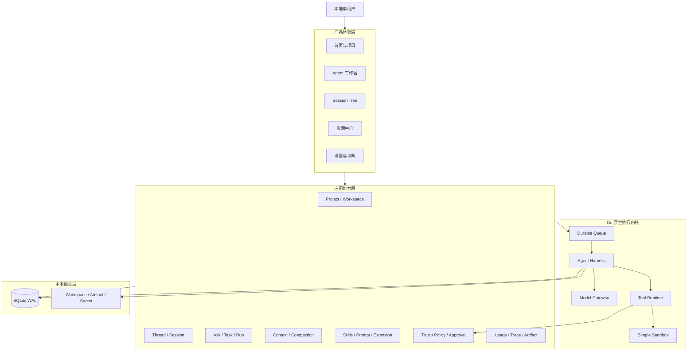

### 4.2 Pi 能力到 Oktapod 产品的映射

| Pi 能力域 | Oktapod 第一阶段产品入口 | 产品验收重点 |
|---|---|---|
| 多 Provider 与模型 | Provider 设置、模型选择器 | 接入、切换、能力映射和错误透明 |
| Stateful Agent / Agent Loop | Thread 工作台、Run 时间线 | Turn 和 Tool 闭环完整 |
| 流式事件 | Message、Thinking、Tool Card | 顺序正确、可断线恢复 |
| Steering / Follow-up / Abort | Composer 运行态操作 | 注入时机和队列语义正确 |
| Session Tree | Thread 历史树 | 选点继续、分支、Leaf 持久化 |
| Fork / Clone | Thread 操作菜单 | 新 Session 保留来源关系 |
| Compaction | 上下文面板、手动压缩 | 自动/手动、Retained Tail、成本可见 |
| Branch Summary | Tree 切换流程 | 离开分支时可生成摘要 |
| Skills | 资源中心、`/skill:name` | 渐进加载、校验和来源可见 |
| Prompt Templates | Composer `/` 菜单 | 参数、默认值和切片 |
| Extensions | 扩展中心 | Tool、Command、Hook、Custom Entry 语义 |
| Packages | 资源包管理 | Local/Git 安装、更新、禁用和哈希 |
| Project Trust | 项目首次打开 | 未信任项目不加载可执行资源 |
| Context Files | Context Inspector | 来源、顺序、Token 和启停可见 |
| JSON/RPC/SDK | REST 写操作、可恢复 SSE、CLI、Go SDK | UI 与外部调用共用 Application API |
| Usage/Cost | 右侧用量面板 | Turn/Run/Session 聚合正确 |
| Images | Composer 附件 | 上传、预览、Provider 能力判断 |
| Windows/Linux | 安装与执行 | 路径、Shell、进程和 E2E |

---

## 5. 信息架构

### 5.1 一级导航

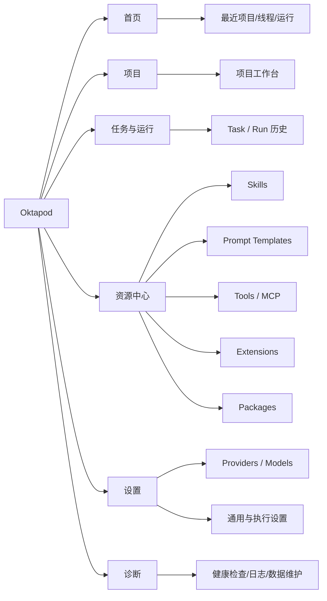

### 5.2 项目工作台布局

```text
┌──────────────────────────────────────────────────────────────────────────┐
│ 顶栏：项目 / Git 分支 / 工作目录 / 模型 / Thinking / 模式 / Run 状态      │
├────────────────┬────────────────────────────────────┬────────────────────┤
│ 左侧导航        │ 中央 Thread 与执行区               │ 右侧检查器          │
│ - Threads       │ - User / Assistant Message        │ - Run              │
│ - Tasks / Runs  │ - Plan/Status Summary             │ - Context          │
│ - Files         │ - Thinking Summary                │ - Usage            │
│ - Changes       │ - Tool / Command Cards            │ - Tools            │
│ - Session Tree  │                                    │ - Trace            │
├────────────────┴────────────────────────────────────┴────────────────────┤
│ Composer：Auto / Ask / Task、@引用、/命令、附件、发送、Steer、Follow-up   │
└──────────────────────────────────────────────────────────────────────────┘
```

### 5.3 页面清单

| 页面 | 主要用途 | 第一阶段要求 |
|---|---|---|
| 首次启动向导 | 初始化目录、数据库和 Provider | MUST |
| 首页 | 最近项目、Thread、Run、待确认和用量摘要 | MUST |
| 项目列表 | 创建、打开、搜索、归档项目 | MUST |
| 项目工作台 | 对话、任务、工具、文件和审查的核心页面 | MUST |
| Session Tree | 浏览、分支、Fork、Clone、Label | MUST |
| 任务与运行 | 查看 Task、Run、状态、重试和恢复 | MUST |
| 文件与 Diff | 浏览文件、变更、Hunk、Git 状态 | MUST |
| 终端 | 交互式本地 Shell；当前非交互式任务页隐藏，待实现 xterm 后开放 | SHOULD |
| 资源中心 | Skills、Prompt、Tools、Extensions、Packages | MUST |
| Provider 设置 | 认证、模型、测试和默认配置 | MUST |
| 通用设置 | 上下文、重试、消息交付、安全、主题 | MUST |
| 导入导出 | Pi/Oktapod Session 导入导出 | MUST |
| 诊断与维护 | 健康、日志、备份、数据库和运行环境 | SHOULD |

---

## 6. 完整功能清单

> 下表中的所有功能均属于第一阶段范围。MUST 是 Phase 1 正式验收门槛；SHOULD 可按内部里程碑后置，但不得默认移入第二阶段。

### 6.1 安装、初始化与应用生命周期

| ID | 功能 | 产品行为 | 优先级 |
|---|---|---|---|
| F-BOOT-001 | 单二进制运行 | 一个 `oktapod` 文件包含服务端、CLI、迁移和 Web 静态资源 | MUST |
| F-BOOT-002 | 初始化命令 | `oktapod init` 创建数据目录、配置、SQLite 和密钥材料 | MUST |
| F-BOOT-003 | 一键启动 | `oktapod serve --role=all` 启动 API、Web、Queue 和 Embedded Worker | MUST |
| F-BOOT-004 | 默认本地监听 | 默认仅监听 `127.0.0.1`，外部监听必须显式配置并显示风险提示 | MUST |
| F-BOOT-005 | 首次启动向导 | 检查运行目录、存储、Shell、Git、Provider 和网络 | MUST |
| F-BOOT-006 | 配置校验 | 启动前校验 YAML/JSON、目录权限、DSN 和冲突端口 | MUST |
| F-BOOT-007 | 自动 Schema 迁移 | 对 SQLite 执行带版本记录的前向迁移，失败时停止启动 | MUST |
| F-BOOT-008 | 启动前备份 | 破坏性迁移前生成 SQLite Online Backup | MUST |
| F-BOOT-009 | 服务状态 | CLI 可查看版本、地址、数据库、Worker、活动 Run 和健康状态 | SHOULD |
| F-BOOT-010 | 安全退出 | 正常退出时停止接单、等待或中断运行、刷写事件和关闭数据库 | MUST |
| F-BOOT-011 | 离线模式 | 禁用模型目录刷新、包更新和其他非必要启动网络请求 | SHOULD |
| F-BOOT-012 | 产品更新检查 | 可选检查新版本；默认不自动安装、不发送匿名分析数据 | SHOULD |

### 6.2 首页、项目与工作区

| ID | 功能 | 产品行为 | 优先级 |
|---|---|---|---|
| F-PRJ-001 | 新建项目 | 选择已有本地目录或创建新目录，并生成项目元数据 | MUST |
| F-PRJ-002 | 打开项目 | 通过目录选择、路径输入或最近列表打开项目 | MUST |
| F-PRJ-003 | 规范路径识别 | 使用 Canonical Path 去重，避免同一路径重复建项目 | MUST |
| F-PRJ-004 | 项目信任确认 | 首次加载可执行资源前展示风险和资源清单并要求选择 | MUST |
| F-PRJ-005 | Trust 范围 | 支持不信任、只读、信任项目资源三种本地决策 | MUST |
| F-PRJ-006 | 最近项目 | 首页按最近访问、最近运行和收藏展示 | MUST |
| F-PRJ-007 | 项目搜索与排序 | 按名称、路径、最后使用时间和 Git 状态筛选 | SHOULD |
| F-PRJ-008 | 项目重命名 | 只修改显示名称，不移动本地目录 | MUST |
| F-PRJ-009 | 项目归档/移除 | 从 Oktapod 列表移除，不删除用户源代码 | MUST |
| F-PRJ-010 | 项目概览 | 显示目录、Git、Thread、Task、变更、资源和使用量 | MUST |
| F-PRJ-011 | 文件索引 | 建立文件树、哈希、更新时间和文本检索索引 | MUST |
| F-PRJ-012 | 索引刷新 | 文件变化时增量刷新，也可手动重建 | MUST |
| F-PRJ-013 | 项目设置覆盖 | 项目设置覆盖全局设置，并显示最终生效值及来源 | MUST |
| F-PRJ-014 | 项目上下文文件 | 识别 `AGENTS.md`、项目规则和用户配置的上下文文件 | MUST |
| F-PRJ-015 | 项目笔记 | 用户可显式新增、编辑、删除项目事实或说明，作为可控上下文 | SHOULD |

### 6.3 Provider、模型与凭据

| ID | 功能 | 产品行为 | 优先级 |
|---|---|---|---|
| F-MDL-001 | Provider Registry | Go 原生注册 Provider Family Adapter 和模型能力 | MUST |
| F-MDL-002 | Provider 配置列表 | 显示已配置、未配置、异常、离线和需要登录状态 | MUST |
| F-MDL-003 | API Key 接入 | 支持安全输入、环境变量引用和加密本地保存 | MUST |
| F-MDL-004 | OAuth/订阅登录 | 对冻结基线中支持订阅认证的 Provider 提供登录和退出 | MUST |
| F-MDL-005 | 自定义 Provider | 支持兼容 API 的 Base URL、Headers、模型和认证配置 | MUST |
| F-MDL-006 | 连接测试 | 测试凭据、基础 URL、模型列表和最小请求 | MUST |
| F-MDL-007 | 模型目录 | 显示 Provider、模型、上下文窗口、工具、图片、Thinking 和价格能力 | MUST |
| F-MDL-008 | 模型目录缓存 | 本地缓存最近成功目录，离线时可继续选择 | MUST |
| F-MDL-009 | 模型目录刷新 | 手动或可选自动刷新，刷新失败不删除可用缓存 | MUST |
| F-MDL-010 | 模型搜索与筛选 | 按 Provider、能力、上下文、Thinking 和本地/云筛选 | MUST |
| F-MDL-011 | 默认模型 | 设置全局默认和项目覆盖 | MUST |
| F-MDL-012 | Thread 模型切换 | 切换只影响下一 Turn，不修改正在进行的 Provider 请求 | MUST |
| F-MDL-013 | Thinking Level | 支持 `off/minimal/low/medium/high/xhigh/max`，按模型能力显示 | MUST |
| F-MDL-014 | Thinking 降级提示 | Provider 不支持指定级别时透明提示映射或降级 | MUST |
| F-MDL-015 | Transport 选择 | 本阶段固定 REST 写操作与可恢复 SSE 读事件；Provider 内部传输由 Adapter 管理 | SHOULD |
| F-MDL-016 | 代理与超时 | 设置 HTTP Proxy、请求超时、流空闲超时和重试上限 | SHOULD |
| F-MDL-017 | 凭据脱敏 | UI、日志、错误、Tool Result 和导出文件不显示完整密钥 | MUST |
| F-MDL-018 | Provider 诊断 | 显示最近错误、延迟、限流、缓存和认证过期信息 | SHOULD |

#### 6.3.1 冻结基线 Provider 范围

Provider 以协议族复用实现，但产品兼容矩阵必须逐项记录以下冻结基线配置：

| 类型 | Provider |
|---|---|
| 订阅/OAuth | ChatGPT Plus/Pro（Codex）、Claude Pro/Max、GitHub Copilot、xAI Subscription、OpenRouter OAuth、Radius |
| 原生 API | Anthropic、OpenAI、Azure OpenAI Responses、Google Gemini、Amazon Bedrock |
| OpenAI-Compatible/API Key | Ant Ling、DeepSeek、NVIDIA NIM、Mistral、Groq、Cerebras、xAI、OpenRouter、Vercel AI Gateway、ZAI、OpenCode、Hugging Face、Fireworks、Together AI、Kimi、MiniMax、Qwen Token Plan、Xiaomi MiMo 等冻结清单项 |
| 网关/云 | Cloudflare AI Gateway、Cloudflare Workers AI、Amazon Bedrock、Azure OpenAI |
| 本地 | llama.cpp Router；Ollama、vLLM 等通过兼容协议接入 |

每个 Provider 不要求拥有独立业务代码；应优先通过协议族 Adapter、配置 Profile 和 Contract Fixture 实现。

#### 6.3.2 Release 1A 已实现契约

- `ProviderInstance` 以 `provider_id` 作为实例身份；同一 `protocol_family=openai_compatible` 可配置多个 Endpoint，同名 `model_id` 通过 Provider 维度隔离。
- API Key 只写入 SecretStore；数据库仅保存 `credential_ref`，API 与错误只显示凭据状态。Provider 元数据与凭据更新采用补偿语义，任一步失败恢复旧值。
- 模型目录按实例持久化，过期目录仍可离线选择并标记 `stale`，后台刷新失败不删除最近成功结果。
- Composer 提交的 Provider、模型和 `auto/off/low/medium/high` Thinking 子集冻结到 Run。Provider 或默认模型更新只影响下一 Turn；运行时 fallback 另行记录 effective ModelRef 与降级原因。
- Release 1A 启用 OpenAI-compatible 协议族；Release 1B 已增加原生 Anthropic/Gemini Message、Tool、Thinking、Usage、目录和增量流式映射。Anthropic SSE 与 Gemini `streamGenerateContent` 均保留工具与最终 Usage；真实 Provider 可见任务仍属于发布门禁。

### 6.4 工作台、Composer 与输入

| ID | 功能 | 产品行为 | 优先级 |
|---|---|---|---|
| F-CMP-001 | 四区工作台 | 左侧导航、中央事件流、右侧检查器和底部 Composer | MUST |
| F-CMP-002 | Ask 模式 | 默认只读，适合快速回答和分析；创建 Ask Run，不创建 Task | MUST |
| F-CMP-003 | Task 模式 | 创建持久 Task 和 Run，允许写文件、命令、重试和验收 | MUST |
| F-CMP-004 | Auto 模式 | 使用规则判断 Ask/Task，并显示路由结果和原因 | MUST |
| F-CMP-005 | 手动覆盖路由 | 用户可在发送前或路由后覆盖 Ask/Task | MUST |
| F-CMP-006 | 多行输入 | 支持多行、撤销、历史草稿和大文本粘贴 | MUST |
| F-CMP-007 | `@` 引用 | 模糊搜索并引用文件、目录、符号、Diff、Artifact 和历史消息 | MUST |
| F-CMP-008 | `/` 命令 | 自动完成 Prompt、Skill、扩展命令和内置命令 | MUST |
| F-CMP-009 | 附件 | 上传文本、日志、图片和常见文件，显示大小与类型 | MUST |
| F-CMP-010 | 图片输入 | 粘贴、拖放、预览、删除和 Provider 能力校验 | MUST |
| F-CMP-011 | 模型选择 | Composer 可查看并切换当前模型 | MUST |
| F-CMP-012 | Thinking 选择 | Composer 可切换当前模型支持的 Thinking Level | MUST |
| F-CMP-013 | Active Tools | 选择本 Thread 启用的 Tool，变更下一 Turn 生效 | MUST |
| F-CMP-014 | 上下文估算 | 发送前显示预计 Token、窗口占用和主要来源 | SHOULD |
| F-CMP-015 | 权限提示 | 显示本次模式允许的文件、进程、网络和审批级别 | MUST |
| F-CMP-016 | 草稿保存 | 页面刷新或切换 Thread 后可恢复未发送草稿 | SHOULD |
| F-CMP-017 | 快捷键 | 支持发送、换行、中止、模型、Thinking、工具折叠和命令面板 | MUST |
| F-CMP-018 | 无障碍输入 | 主要操作可通过键盘完成，焦点和错误提示可感知 | SHOULD |
| F-CMP-019 | 对话恢复任务 | 最新 Task 为失败或阻塞时，Auto Composer 的“继续/重试/重新执行/重新规划并继续”直接恢复该 Task 的安全检查点；确认消息关联原 Task，保留 Run、Skill 快照和已完成计划，不调用聊天模型 | MUST |
| F-CMP-020 | 紧凑消息排版 | Assistant Markdown 折叠源空白，正文块间距 6–8px、Turn 间距约 20px；User 原文继续保留换行 | MUST |

### 6.5 Task、Run、Agent Loop 与流式呈现

| ID | 功能 | 产品行为 | 优先级 |
|---|---|---|---|
| F-RUN-001 | Ask Run | Ask 请求创建可追踪 Run 并关联当前 Session | MUST |
| F-RUN-002 | Task 创建 | Task 保存目标、约束、状态、当前 Run 和验收说明 | MUST |
| F-RUN-003 | Run 创建 | 每次执行、重试或继续均形成独立 Run | MUST |
| F-RUN-004 | Durable Queue | 已接受 Run 先持久化入队，再由 Embedded Worker Claim | MUST |
| F-RUN-005 | Run 状态 | Queued、Preparing、Running、Waiting Approval、Completed、Failed、Interrupted、Cancelled | MUST |
| F-RUN-006 | 实时状态 | 展示当前 Turn、模型、Tool、等待原因和执行时长 | MUST |
| F-RUN-007 | Message Card | 展示用户消息、模型响应、错误和最终结果 | MUST |
| F-RUN-008 | Thinking Summary | 仅展示供应商允许内容或可审计摘要，不展示隐藏思维链 | MUST |
| F-RUN-009 | Tool Card | 展示工具名、目标、状态、耗时、参数摘要和结果摘要 | MUST |
| F-RUN-010 | Tool 详情 | 展示完整参数、工作目录、输出、Exit Code、策略和 Artifact | MUST |
| F-RUN-011 | 流式 Delta | 文本和 Tool 进度实时更新，慢浏览器不阻塞 Provider 读取 | MUST |
| F-RUN-012 | 断线恢复 | 页面重连后使用 Snapshot + Last Sequence 补拉持久事件 | MUST |
| F-RUN-013 | Turn Snapshot | 模型、Thinking、工具和上下文在 Turn 内保持不变 | INTERNAL |
| F-RUN-014 | 保存点 | Assistant 和 Tool Result 完成后持久化并决定后续队列 | INTERNAL |
| F-RUN-015 | 并行 Tool | 无依赖且允许并行的 Tool 并发执行 | MUST |
| F-RUN-016 | 串行 Tool | 任一 Tool 声明 Sequential 时按批次串行 | MUST |
| F-RUN-017 | 持久顺序 | Tool 完成事件可按完成顺序，Tool Result 按源调用顺序保存 | INTERNAL |
| F-RUN-018 | Continue | 从当前可恢复边界继续，不重复写入用户消息 | MUST |
| F-RUN-019 | 自动重试 | 仅对瞬时 Provider 错误按策略重试，并显示倒计时和次数 | MUST |
| F-RUN-020 | 中止重试 | 用户可取消等待中的自动重试 | MUST |
| F-RUN-021 | Run 重试 | 失败 Run 可从安全边界重新执行并形成新 Run | MUST |
| F-RUN-022 | Run 历史 | 按 Task/Thread 查看每次 Run 的状态、模型、成本和结果 | MUST |
| F-RUN-023 | 并发限制 | 本机默认最多 4 个并发 Run，可配置更低限制 | MUST |
| F-RUN-024 | 结果验收 | Task 完成后展示摘要、文件变更、测试和未解决事项 | SHOULD |

#### 6.5.1 Release 1A 运行并发实现约束

- 默认由 4 个唯一 lease owner Worker 领取任务，配置仅允许把当前进程降低到 1–4。
- 数据库 Claim 同时限制不同 Run 的活跃数；同一 Durable ToolBatch 的合法并行步骤不因此退化成串行。
- 取消、租约过期、SQLite Busy 和未知副作用必须先形成可恢复终态或收据，不能用进程内 semaphore 冒充耐久并发。

### 6.6 Steering、Follow-up、Next Turn 与 Abort

| ID | 功能 | 产品行为 | 优先级 |
|---|---|---|---|
| F-CTL-001 | Steering | Run 执行中追加指令，在当前 Assistant 的 Tool Calls 完成后注入 | MUST |
| F-CTL-002 | Follow-up | 排队等待当前 Agent 原本结束后继续处理 | MUST |
| F-CTL-003 | Next Turn | 保存为下一次用户主动请求前插入的消息 | MUST |
| F-CTL-004 | One-at-a-time | 每次安全点消费一条 Steering/Follow-up | MUST |
| F-CTL-005 | All 模式 | 在安全点一次消费所有同类队列消息 | MUST |
| F-CTL-006 | 队列可视化 | Composer 上方显示排队内容、类型、顺序和撤回按钮 | MUST |
| F-CTL-007 | Abort | 取消 Provider、可取消 Tool 和当前 Run | MUST |
| F-CTL-008 | Abort 后队列规则 | 清理 Steering/Follow-up，保留 Next Turn | MUST |
| F-CTL-009 | 排队持久化 | 请求被接受后先写 Durable Event，重启后仍可恢复 | INTERNAL |
| F-CTL-010 | 消费持久化 | Queue ID 与 Turn Start 一并记录，避免重复或丢失 | INTERNAL |

### 6.7 Tool、终端与 MCP

| ID | 功能 | 产品行为 | 优先级 |
|---|---|---|---|
| F-TOL-001 | `read` | 读取工作区内文本和支持的图片，支持范围与大小限制 | MUST |
| F-TOL-002 | `write` | 创建或覆盖文件，执行前进行路径和风险检查 | MUST |
| F-TOL-003 | `edit` | 结构化修改文件，返回变更和冲突信息 | MUST |
| F-TOL-004 | `bash/process` | 通过统一 ExecutionEnv 执行命令并流式返回输出 | MUST |
| F-TOL-005 | `list/find/grep` | 确定性文件浏览和文本检索 | MUST |
| F-TOL-006 | `git` | Status、Diff、Log、Branch、Commit、Fetch/Pull/Push 等受控操作 | MUST |
| F-TOL-007 | `http` | 受策略控制的 HTTP 请求，网络默认需要确认或显式允许 | SHOULD |
| F-TOL-008 | `artifact` | 保存、读取和引用大输出或生成文件 | MUST |
| F-TOL-009 | `human_approval` | Agent 可请求用户确认、选择或输入 | MUST |
| F-TOL-010 | MCP Tool | 配置 stdio 或 HTTP/SSE MCP Server，发现和调用工具 | MUST |
| F-TOL-011 | Tool Schema 校验 | 参数不符合 JSON Schema 时不执行 | MUST |
| F-TOL-012 | Tool 启停 | 全局、项目和当前 Thread 选择启用工具 | MUST |
| F-TOL-013 | Tool 风险信息 | Descriptor 声明文件、进程、网络、Secret、幂等和重试能力 | MUST |
| F-TOL-014 | Tool 超时与取消 | 每个 Tool 有默认和自定义最大执行时间 | MUST |
| F-TOL-015 | Tool 输出截断 | UI 显示摘要，完整输出写入 Artifact | MUST |
| F-TOL-016 | Tool Update | 长工具可持续发送进度、日志或中间状态 | MUST |

#### 6.7.1 Release 1A 内建工具契约

- Tool Registry 是唯一 Schema 来源；Provider Adapter 只做协议映射。
- 文件工具包含 read/list/find/grep/edit/write，统一受 canonical path、workspace root、symlink、分页、二进制、输出上限和 Secret 脱敏约束。
- edit 使用 preimage hash 与原子替换；检测到外部修改时返回冲突。
- Git 只读操作为 status/diff/log；branch/commit/restore 属于审批和 Receipt 保护的变更操作。push/pull 不进入 Release 1A。

#### 6.7.2 Release 1B 受控终端实现

- `/projects/:id/terminal` 的非交互式任务页不等于终端，当前从项目导航隐藏；命令由 Thread 内结构化工具继续经过 Tool Registry、ExecutionPolicy、审批、Receipt 和审计。
- 页面轮询显示任务状态与结果摘要，可在仍可取消时发出 Cancel；任务先完成时不伪造取消成功。
- 终态任务可回到原 Thread，并用 SessionStorage 回填不含原始输出或 Secret 的后续分析提示；真实结果仍从持久会话与 Run 加载。
- 真正的 Terminal 必须提供交互式 xterm、会话级 stdin/stdout/stderr、工作目录与进程生命周期；这些完成前不展示入口。
- 大结果保存为 Artifact，事件流只保留确定性摘要和引用。
| F-TOL-017 | 前后 Hook | beforeToolCall 可阻断/修改，afterToolCall 可转换/终止 | MUST |
| F-TOL-018 | 直接命令 | 终端可执行命令并选择“加入下一次模型上下文”或“仅本地执行” | MUST |
| F-TOL-019 | 终端会话 | xterm.js 展示交互式终端，受工作目录和策略限制 | MUST |
| F-TOL-020 | 命令历史 | 本地保存可清除的命令历史，不记录 Secret 值 | SHOULD |

### 6.8 文件、代码、Diff 与 Git

| ID | 功能 | 产品行为 | 优先级 |
|---|---|---|---|
| F-CODE-001 | 文件树 | 按目录浏览、展开、刷新、忽略规则和变更状态展示 | MUST |
| F-CODE-002 | 文件查看 | Monaco/只读 Viewer 显示语法、行号、编码和大文件提示 | MUST |
| F-CODE-003 | 文件搜索 | 按路径模糊搜索和内容全文检索 | MUST |
| F-CODE-004 | 引用定位 | 从 Tool Card、Message 或 Diff 跳转到文件和行 | MUST |
| F-CODE-005 | 图片/二进制预览 | 支持常见图片；二进制显示元数据和下载入口 | SHOULD |
| F-CODE-006 | 变更列表 | 汇总 Agent 和用户在当前 Run/Task 中修改的文件 | MUST |
| F-CODE-007 | Diff Viewer | 显示新增、修改、删除和行级 Hunk | MUST |
| F-CODE-008 | Hunk 操作 | 对未提交变更执行单 Hunk/文件恢复，操作前确认 | SHOULD |
| F-CODE-009 | 基线选择 | Diff 可相对 Run 开始、Git HEAD 或工作区当前状态查看 | MUST |
| F-CODE-010 | Git 状态 | 显示仓库、分支、未跟踪、已暂存和冲突 | MUST |
| F-CODE-011 | Git Log | 查看提交历史和单提交 Diff | SHOULD |
| F-CODE-012 | Git Commit | 选择变更、填写信息并提交；不得静默提交 | MUST |
| F-CODE-013 | Git 远程操作 | Fetch/Pull/Push 均经过凭据、网络和高风险审批 | SHOULD |
| F-CODE-014 | 冲突呈现 | 识别冲突文件并提供跳转，不自动隐藏冲突 | MUST |
| F-CODE-015 | 文件外部变化 | 检测用户或其他进程修改，避免覆盖新版本 | MUST |
| F-CODE-016 | 自动 Worktree | 第一阶段明确不提供自动创建和并行 Worktree | EXCLUDED |

### 6.9 Thread、Session 与 Session Tree

| ID | 功能 | 产品行为 | 优先级 |
|---|---|---|---|
| F-SES-001 | 新建 Thread | 在项目内创建新的 Session | MUST |
| F-SES-002 | Thread 列表 | 显示名称、摘要、模型、时间、状态、Token 和成本 | MUST |
| F-SES-003 | Thread 搜索 | 按名称、消息内容、标签和时间筛选 | MUST |
| F-SES-004 | Thread 命名 | 手动命名；可选根据首条消息生成建议名称 | MUST |
| F-SES-005 | 自动保存 | Message、配置变化和结构操作追加到 SQLite | MUST |
| F-SES-006 | 恢复 Thread | 重新打开时恢复活动 Leaf、模型、Thinking、Active Tools 和队列 | MUST |
| F-SES-007 | 临时 Thread | 支持不长期保存的临时会话，关闭前可转为持久 Thread | SHOULD |
| F-SES-008 | Session Tree | 以父子 Entry 展示完整分支结构 | MUST |
| F-SES-009 | Tree 过滤 | 默认、隐藏 Tool、仅用户、仅标签、全部 | MUST |
| F-SES-010 | 选择用户节点 | 确认后 Leaf 移至该用户节点，并把原消息放回 Composer 编辑；历史不改写 | MUST |
| F-SES-011 | 选择其他节点 | Leaf 移至该节点，用户可从此继续 | MUST |
| F-SES-012 | 新分支 | 从历史点继续时追加新 Entry，不覆盖原历史 | MUST |
| F-SES-013 | Label | 对 Entry 添加/删除标签，便于导航 | SHOULD |
| F-SES-014 | Fork | 从历史用户消息创建新 Session，并记录 Parent Session | MUST |
| F-SES-015 | Clone | 将当前活动分支复制到新 Session | MUST |
| F-SES-016 | Branch Summary | 离开分支时选择不摘要、默认摘要或自定义摘要 | MUST |
| F-SES-017 | 删除 Thread | 侧栏操作菜单内二次确认；活动任务必须先停止，随后删除 Session、消息、关联任务与本地数据，Fork 副本保留 | MUST |
| F-SES-018 | 导出 Thread | 导出 JSONL、JSON、HTML | MUST |
| F-SES-019 | 消息分页 | 10 万 Entry 可分页和虚拟加载，不一次加载全部 | MUST |
| F-SES-020 | 忙状态保护 | Run 执行时禁止 Tree Navigate、Fork、Clone、Compact 等结构操作 | MUST |

当前后端契约使用独立 `entry_seq`，不再复用 `messages.server_seq`；Message 仅通过 `ref_id` 被 Entry 引用。消息正文、Message Entry、Leaf 和序号在同一事务提交，Navigate 必须携带 `expected_leaf_entry_id`，冲突返回 409。Label 除更新目标节点外还会追加 `system/label` 审计 Entry；Branch Summary 使用独立五节格式，不复用 Compaction 六节格式。Thread 上存在活动 Run 时，Navigate、Fork、Clone、Label、Branch Summary 和 Compaction 均由数据库层拒绝。

删除 Thread 使用 `DELETE /api/v1/conversations/{conversation_id}`。只有 Owner 可执行；存在 `queued/running/waiting_approval/waiting_input/paused` 任务时返回 409。删除事务会清理关联任务链、消息与 Session Entry，并把 Fork 子 Thread 的来源指针置空以保留其独立副本，同时写入 `conversation.deleted` 审计事件。

### 6.10 上下文、压缩与项目知识

| ID | 功能 | 产品行为 | 优先级 |
|---|---|---|---|
| F-CTX-001 | 上下文流水线 | Discover、Normalize、Trust、Retrieve、Rank、Deduplicate、Redact、Budget、Serialize | INTERNAL |
| F-CTX-002 | 上下文检查器 | 展示系统提示、项目规则、Skill、消息、文件、Tool 和运行状态 | MUST |
| F-CTX-003 | 来源与优先级 | 每段上下文显示来源、作用域、Token、是否可关闭 | MUST |
| F-CTX-004 | Token Budget | 根据上下文窗口、输出预留和来源配额构建预算 | MUST |
| F-CTX-005 | Tool 配对完整 | 不在 Tool Call 与对应 Tool Result 之间截断 | INTERNAL |
| F-CTX-006 | 确定性压缩 | 截断日志、去重文件、抽取错误、使用 Artifact 引用 | MUST |
| F-CTX-007 | 自动 Compaction | 达到阈值时在安全点自动压缩 | MUST |
| F-CTX-008 | 手动 Compaction | 用户可输入关注重点并查看压缩前后估算 | MUST |
| F-CTX-009 | Retained Tail | 新 Compaction 保存摘要和保留消息检查点 | MUST |
| F-CTX-010 | 旧格式兼容 | 导入时支持 `firstKeptEntryId` 旧格式 | MUST |
| F-CTX-011 | Split Turn | 超大单 Turn 按 Pi 语义生成历史摘要和 Turn Prefix 摘要 | MUST |
| F-CTX-012 | Branch Summary | 切换树分支时根据共同祖先生成摘要 | MUST |
| F-CTX-013 | 压缩使用量 | 单独记录摘要模型、Token、费用和耗时 | MUST |
| F-CTX-014 | 文件上下文 | `@` 引用和检索片段按相关度、去重和预算注入 | MUST |
| F-CTX-015 | 项目笔记上下文 | 仅注入用户明确启用的项目笔记 | SHOULD |
| F-CTX-016 | 长期记忆写入 | 模型不得静默生成跨 Session 长期记忆 | MUST |
| F-CTX-017 | 语义向量检索 | 第一阶段默认不提供，不作为基本能力依赖 | EXCLUDED |

Compaction 的初次与增量调用使用不同提示词，输出严格为 Goal、Constraints & Preferences、Progress、Key Decisions、Next Steps、Critical Context 六节。阈值优先使用最新有效 assistant `ContextTokens + OutputTokens` 再加尾部估算；无有效 usage 时才使用保守文本估算。摘要保存 read/modified file 清单，超大 Turn 保存 `split_message_id + split_prefix_runes`，失败最多重试三次且不推进 checkpoint。ToolResult 超出内联上限时必须写内容寻址 Artifact，并在模型上下文中留下引用、Hash、大小和短预览。

### 6.11 Skills 与 Prompt Templates

| ID | 功能 | 产品行为 | 优先级 |
|---|---|---|---|
| F-SKL-001 | Skill 发现 | 扫描全局、项目、Package 和显式配置路径 | MUST |
| F-SKL-002 | 项目信任约束 | 未信任项目不自动加载项目 Skill | MUST |
| F-SKL-003 | 渐进加载 | 启动时只加载名称和描述，使用时再读取完整内容 | MUST |
| F-SKL-004 | Agent Skills 校验 | 校验名称、描述、Frontmatter 和冲突并显示警告 | MUST |
| F-SKL-005 | Skill 详情 | 查看说明、来源、目录、脚本、引用、权限和兼容性 | MUST |
| F-SKL-006 | Skill 启停 | 全局或项目级启用、禁用 | MUST |
| F-SKL-007 | Skill 命令 | `/skill:name [args]` 强制加载并执行 | MUST |
| F-SKL-008 | Allowed Tools | 读取实验性允许工具声明，但仍受平台策略约束 | SHOULD |
| F-SKL-009 | Skill 重载 | 资源变化后手动 Reload，不重启整个服务 | MUST |
| F-SKL-010 | Prompt 发现 | 扫描全局、项目、Package 和显式路径中的 Markdown 模板 | MUST |
| F-SKL-011 | Prompt 自动完成 | `/name` 显示描述和参数提示 | MUST |
| F-SKL-012 | Prompt 参数 | 支持 `$1`、`$2`、`$@`、默认值和切片 | MUST |
| F-SKL-013 | Prompt 预览 | 发送前查看展开结果和引用来源 | SHOULD |
| F-SKL-014 | Prompt 编辑 | 在资源中心创建、编辑、校验和删除本地模板 | SHOULD |
| F-SKL-015 | 资源冲突 | 同名资源显示冲突和实际生效来源，不静默覆盖 | MUST |
| F-SKL-016 | 两阶段安装 | 先展示校验结果、作用域、风险和重复/升级判断，再由用户确认安装 | MUST |
| F-SKL-017 | 重复导入 | 同作用域同名同版本同 Hash 幂等返回原记录；不同 Hash 拒绝覆盖；新版本并存 | MUST |

### 6.12 Extensions、Packages、Tools 与主题

| ID | 功能 | 产品行为 | 优先级 |
|---|---|---|---|
| F-EXT-001 | Built-in Go Extension | 官方扩展随二进制编译并显示版本 | MUST |
| F-EXT-002 | Extension Process | 启动可信本地子进程并通过 stdio JSON-RPC 通信 | MUST |
| F-EXT-003 | 注册 Tool | 扩展可注册结构化 Tool 和 Descriptor | MUST |
| F-EXT-004 | 注册 Command | 扩展命令进入 `/` 菜单 | MUST |
| F-EXT-005 | 生命周期 Hook | 订阅 Session、Run、Context、Model 和 Tool 等事件 | MUST |
| F-EXT-006 | Tool 拦截 | 扩展可在前后 Hook 中阻断、修改或转换结果 | MUST |
| F-EXT-007 | Context 注入 | 扩展可返回具备来源标识的上下文片段 | MUST |
| F-EXT-008 | 自定义 Compaction | 扩展可取消或提供自定义摘要 | SHOULD |
| F-EXT-009 | Custom Entry | 扩展可写命名空间化 Session Entry | MUST |
| F-EXT-010 | 用户交互 | 扩展可请求确认、选择、文本输入和通知 | MUST |
| F-EXT-011 | 声明式 UI | 支持状态、卡片和简单表单；禁止任意浏览器脚本注入 | MUST |
| F-EXT-012 | 扩展状态 | 显示运行中、停止、错误、协议不兼容和最近日志 | MUST |
| F-EXT-013 | Reload/Stop | 用户可重载或停止扩展，运行中变更按安全点生效 | MUST |
| F-PKG-001 | Local Package | 从本地目录注册资源包 | MUST |
| F-PKG-002 | Git Package | 从 Git URL 和固定 Ref 安装资源包 | MUST |
| F-PKG-003 | Package Manifest | 解析 Skills、Prompts、Extensions、Themes、版本和权限 | MUST |
| F-PKG-004 | 安装预览 | 安装前展示来源、Ref、Hash、资源和风险 | MUST |
| F-PKG-005 | 包管理 | 列表、更新、移除、启停和资源过滤 | MUST |
| F-PKG-006 | 固定版本 | Git Package 使用 Tag/Commit 固定，更新不静默漂移 | MUST |
| F-PKG-007 | NPM Package | 可通过外部配置的包管理命令扩展，但不作为零依赖硬门槛 | SHOULD |
| F-THM-001 | 基础主题 | Light、Dark、System | MUST |
| F-THM-002 | 自定义主题 | 将主题 JSON 映射为受控 Web Design Token | SHOULD |
| F-THM-003 | TypeScript Extension | 不直接加载 Pi TypeScript Extension | EXCLUDED |
| F-THM-004 | WASM/远程市场 | 第一阶段不提供 | EXCLUDED |

### 6.13 本地安全、策略与审批

| ID | 功能 | 产品行为 | 优先级 |
|---|---|---|---|
| F-SEC-001 | 项目 Trust | 控制项目设置、Skill、Prompt、Extension 和 Package 的加载 | MUST |
| F-SEC-002 | Workspace Root | 文件工具只能访问允许的工作区和显式附加路径 | MUST |
| F-SEC-003 | 路径规范化 | 防止 `..`、符号链接和路径大小写绕过 | MUST |
| F-SEC-004 | 环境变量白名单 | 子进程默认只继承最小环境，不注入全部宿主环境 | MUST |
| F-SEC-005 | 命令预检 | 检查 Shell、可执行文件、参数、管道、重定向、子 Shell 和提权 | MUST |
| F-SEC-006 | 风险分级 | 文件写、命令、网络、Secret、删除、Git Push 等映射风险级别 | MUST |
| F-SEC-007 | 文件写审批 | 默认对风险写入询问，低风险项目内编辑可按设置自动允许 | MUST |
| F-SEC-008 | 进程执行审批 | 对安装、删除、提权和未知程序要求确认或拒绝 | MUST |
| F-SEC-009 | 网络审批 | 默认 Ask，允许按域名/Tool/项目设置一次或持续授权 | MUST |
| F-SEC-010 | Secret 审批 | 读取凭据、Keychain 或敏感文件必须显式授权 | MUST |
| F-SEC-011 | 破坏性操作 | 删除、大范围覆盖、强制 Push、系统命令默认拒绝或强确认 | MUST |
| F-SEC-012 | Approval Card | 展示动作、原因、参数、影响范围、风险和允许时长 | MUST |
| F-SEC-013 | Approval 范围 | 支持仅本次、当前 Run、当前项目规则；永久规则需二次确认 | MUST |
| F-SEC-014 | 变更预览 | 文件高风险操作尽可能先展示 Diff | MUST |
| F-SEC-015 | 输出脱敏 | 对密钥、Token 和常见敏感模式进行日志和 UI 脱敏 | MUST |
| F-SEC-016 | 资源限制 | Tool 超时、输出上限、子进程数和并发上限 | MUST |
| F-SEC-017 | 安全降级提示 | 某平台能力无法启用时显示明确警告，不静默降级 | MUST |
| F-SEC-018 | Simple Sandbox 声明 | UI 明确其不是强安全隔离，恶意代码应在 VM/Container 中运行 | MUST |

#### 6.13.1 Release 1B 项目级审批规则实现

- Approval Card 的“本项目允许 30 天”必须在首次点击后再次确认；API 同时要求 `confirmed=true`，不能只依赖前端提示。
- v2 规则按 Tool、规范化完整参数、风险等级和目标范围形成结构化签名；旧“只匹配程序名”等宽泛规则仅留审计，不再自动命中。规则不保存任意参数通配符，不绕过 `ExecutionPolicy` 的静态拒绝。
- 规则含创建来源、创建人、30 天有效期、撤销时间和撤销人。Project Owner 可在 Security 检查器查看并撤销；过期或撤销后下一次同类动作恢复逐次审批。
- 数据迁移为 `000049_project_approval_rules`，管理 API 为 `GET /api/v1/projects/{project_id}/approval-rules` 和 `DELETE /api/v1/projects/{project_id}/approval-rules/{rule_id}`。

#### 6.13.2 语义计划与统一 Human Action

- 一个 Session 同时只允许一个活动 Plan Revision。首次执行前保存完整语义清单；Tool Batch 只作为计划项内的执行证据，不再新增“读取文件”“生成下一步计划”等伪任务。
- Run 创建时只保存一个短暂的“正在制定执行计划”占位项。模型必须单独调用 `update_plan` 发布完整、目标特定、带状态的语义清单；固定“理解/完成/验证”模板和 Tool 名称计划项由契约拒绝。计划发布后的首轮先执行当前项并暂不暴露 `update_plan`；产生 Tool 证据后才允许提交状态更新。运行中更新按稳定位置绑定原计划项，标题润色或结构增删不产生新 Revision，而是保留原清单并投影完成度；无进度更新写入审计并自动切回执行轮，完成项回退仍拒绝。只有 Steering、追加需求或权限变化才创建新 Revision。
- Steering、新目标、权限变化或恢复会发布完整新 Revision，并事务性将旧 Revision 与未决 Human Action 标记为 `superseded`。
- `human_action_requests` 统一承载工具审批、权限升级、补充输入、预算确认和未知副作用处置；每项必须绑定 Run、Step、Plan Revision 和 Plan Item，并通过 `version` 乐观锁防止人工与自动审批重复生效。
- 权限模式为 Ask、Auto Review 和 Full Access。Auto Review 必须使用独立 Reviewer Model、禁用工具并严格返回 `approve/reject/escalate_to_user`；服务不可用、输出非法和高风险一律转人工。Full Access 由用户在 Composer 中手动开启并持续到手动切换，只减少命令审批。
- MCP Annotation 必须进入冻结快照。缺少标注、破坏性或开放世界 MCP 按高风险处理；即使 Full Access 也必须人工确认，且不得创建会话或项目长期授权。
- Composer 上方只显示“完成数/总数 + 当前计划项”，展开后显示完整语义清单。Human Action 自动展开当前项并显示冻结参数、原因、影响、有效期和授权范围；硬拒绝没有批准按钮。
- 单个 Tool 失败只是模型可见的错误收据。并行 Tool Batch 必须收齐兄弟调用后以 CAS 产生唯一恢复分支；恢复上限耗尽时优先综合已有证据，没有可用证据才进入 `input_request` 等待用户，不得重复输出多条任务失败。
- Harness 对成功检索同样设收敛门禁：安全归一化 `web_search` 可选域名数组中的空字符串，保留非空非法值的硬拒绝；六次成功搜索且累计至少三个候选结果，或达到十二次搜索硬上限后，必须进入无工具证据综合，不再允许继续扩搜。

### 6.14 用量、透明性、运行轨迹与诊断

| ID | 功能 | 产品行为 | 优先级 |
|---|---|---|---|
| F-OBS-001 | Token 明细 | 显示 Input、Output、Reasoning、Cache Read、Cache Write | MUST |
| F-OBS-002 | 成本明细 | 按 Provider 价格记录每次请求和总成本 | MUST |
| F-OBS-003 | 聚合层级 | 支持 Turn、Run、Task、Session 和 Project 聚合 | MUST |
| F-OBS-004 | 上下文占用 | 显示当前估算 Token、窗口大小和百分比 | MUST |
| F-OBS-005 | Tool 统计 | 次数、成功率、耗时、错误和输出量 | MUST |
| F-OBS-006 | Provider 统计 | 延迟、错误、重试、限流和缓存命中 | MUST |
| F-OBS-007 | Run Timeline | 完整事件时间线、Sequence 和 Correlation ID | MUST |
| F-OBS-008 | Context Trace | 展示每次调用注入了哪些来源 | MUST |
| F-OBS-009 | Policy Trace | 展示策略决定、审批和阻断原因 | MUST |
| F-OBS-010 | Queue 指标 | 排队时间、Claim、开始和完成时间 | SHOULD |
| F-OBS-011 | 本地日志 | 可按级别、Run 和组件查看，默认不记录 Raw Provider Payload | MUST |
| F-OBS-012 | 诊断包 | 导出脱敏后的配置、版本、日志和健康信息 | SHOULD |
| F-OBS-013 | 匿名分析 | 默认关闭，第一阶段不以遥测为功能依赖 | MUST |

#### 6.14.1 诊断与高风险维护边界

`GET /api/v1/diagnostics` 是只读、需认证的脱敏接口，覆盖版本、数据库、Provider、Worker 队列/租约和活动 SSE 连接。原始进程日志默认不经 HTTP 暴露；诊断响应只说明日志脱敏策略。备份、下载和恢复属于独立高风险运维流程，不与健康页或诊断 GET 合并。

### 6.15 Artifact、导入与导出

| ID | 功能 | 产品行为 | 优先级 |
|---|---|---|---|
| F-ART-001 | Artifact 保存 | 大 Tool 输出、生成文件、报告和完整日志保存到本地 Artifact Store | MUST |
| F-ART-002 | Artifact 元数据 | 保存名称、类型、大小、Hash、来源 Run/Tool 和创建时间 | MUST |
| F-ART-003 | Artifact 查看 | 支持文本、图片、Diff 和常见文件预览 | SHOULD |
| F-ART-004 | Artifact 下载 | 通过受控本地 API 下载或打开所在目录 | MUST |
| F-ART-005 | Artifact 删除 | 用户可删除；若被 Session 引用则提示影响 | MUST |
| F-IMP-001 | Pi JSONL 导入 | 导入 Pi Session v1/v2/v3 和树形 Entry | MUST |
| F-IMP-002 | Compaction 兼容 | 支持 Retained Tail 和旧 `firstKeptEntryId` | MUST |
| F-IMP-003 | 导入预览 | 导入前显示 Session、消息、模型、资源缺失和冲突 | MUST |
| F-IMP-004 | 缺失依赖处理 | 模型或 Tool 不存在时允许禁用恢复或明确失败 | MUST |
| F-EXP-001 | JSONL 导出 | 导出完整树、配置变化、Compaction 和 Custom Entry | MUST |
| F-EXP-002 | JSON 导出 | 导出便于程序处理的结构化数据 | MUST |
| F-EXP-003 | HTML 导出 | 生成可阅读的会话、Tool、Usage 和 Diff 报告 | MUST |
| F-EXP-004 | 敏感信息处理 | 导出前提示并默认脱敏凭据、环境变量和敏感输出 | MUST |
| F-EXP-005 | Round-trip | Oktapod 导出后重新导入保持核心 Session 语义 | MUST |

#### 6.15.1 Release 1B Portable Transcript 实现

- 浏览器导出支持 JSON、JSONL 和只读 HTML；正文对常见 Bearer、API Key、Token、Password/Secret 赋值模式脱敏，Provider 凭据和 Session 从数据源层排除。
- Oktapod JSONL 记录 Archive、Conversation 和 Message，可按 Thread round-trip；服务端在单事务内重建私有 Conversation、Message、Session Entry 和 Active Leaf，幂等重试不重复创建。
- 通用 Pi JSONL 当前只归一化 user/assistant/tool 角色消息。Pi v1/v2/v3 树、`firstKeptEntryId`、Tool/Compaction/Custom Entry 的精确 round-trip 尚未完成。

### 6.16 设置与个性化

| ID | 功能 | 产品行为 | 优先级 |
|---|---|---|---|
| F-SET-001 | 设置作用域 | 全局设置与项目设置分层覆盖 | MUST |
| F-SET-002 | 生效来源 | 每个配置显示默认、全局或项目来源 | MUST |
| F-SET-003 | 模型设置 | 默认 Provider、模型、Thinking Budget 和模型范围 | MUST |
| F-SET-004 | Compaction 设置 | 自动启停、Reserve Tokens、Keep Recent Tokens | MUST |
| F-SET-005 | Branch Summary | Reserve Tokens、是否询问和默认行为 | MUST |
| F-SET-006 | Retry 设置 | 自动重试、次数、退避、Provider 超时 | MUST |
| F-SET-007 | 消息交付 | Steering 和 Follow-up 的 one-at-a-time/all | MUST |
| F-SET-008 | 事件连接设置 | 可恢复 SSE 的重连、连接和空闲超时；本阶段不提供 WebSocket/Auto 切换 | SHOULD |
| F-SET-009 | Shell 设置 | Shell Path、命令前缀、编码和工作目录 | MUST |
| F-SET-010 | 图片设置 | 自动缩放、阻止图片、预览限制 | SHOULD |
| F-SET-011 | 资源路径 | Packages、Extensions、Skills、Prompts、Themes 路径 | MUST |
| F-SET-012 | Theme 与显示 | Light/Dark/System、Card 折叠、字体和布局偏好 | MUST |
| F-SET-013 | 快捷键 | 查看和自定义主要快捷操作 | SHOULD |
| F-SET-014 | Proxy/Offline | HTTP Proxy 和全局离线模式 | SHOULD |
| F-SET-015 | 配置导入导出 | 导出脱敏配置、导入前校验差异 | SHOULD |
| F-SET-016 | 恢复默认 | 支持单项或作用域重置，不删除 Session 数据 | MUST |

### 6.17 REST、SSE、CLI 与 Go SDK

| ID | 功能 | 产品行为 | 优先级 |
|---|---|---|---|
| F-API-001 | Versioned REST API | `/api/v1/projects/sessions/tasks/runs/resources/providers` | MUST |
| F-API-002 | OpenAPI | 生成并校验 API Schema，Breaking Change 必须版本化 | MUST |
| F-API-003 | REST Snapshot | 页面初始化获取 Project、Session 和 Run 权威快照 | MUST |
| F-API-004 | 可恢复 SSE Run Stream | Prompt/Steer/Follow-up/Abort 使用 REST，事件使用带 Sequence 的 SSE 恢复、去重和重连 | MUST |
| F-API-005 | Event Resume | 客户端携带 Last Sequence，从持久事件补拉 | MUST |
| F-API-006 | 幂等请求 | 创建 Run、审批和结构操作支持 Request ID 或幂等键 | SHOULD |
| F-CLI-001 | `init/serve/status` | 初始化、运行和查看服务状态 | MUST |
| F-CLI-002 | 项目命令 | 列表、添加、打开、信任和移除项目 | MUST |
| F-CLI-003 | Session 命令 | 新建、恢复、列表、Fork、Clone、Compact、导入导出 | MUST |
| F-CLI-004 | Agent 命令 | Prompt、Steer、Follow-up、Abort、Continue | MUST |
| F-CLI-005 | 模型命令 | Provider 登录、模型列表、模型和 Thinking 切换 | MUST |
| F-CLI-006 | Bash 命令 | 受控执行命令、流式输出和中止 | MUST |
| F-CLI-007 | JSON Headless | 以 JSONL 接收命令并输出 Response/Event | MUST |
| F-SDK-001 | Go Client SDK | 封装 REST/SSE 和事件类型 | MUST |
| F-SDK-002 | Go Harness SDK | 允许 Go 应用在明确依赖下嵌入核心 Harness | SHOULD |
| F-API-007 | 同源用例 | Web、CLI、SDK 不复制业务逻辑，调用同一 Application Service | MUST |

### 6.18 可靠性、恢复、数据维护与跨平台

| ID | 功能 | 产品行为 | 优先级 |
|---|---|---|---|
| F-REL-001 | SQLite WAL | 默认 WAL、Foreign Keys 和 Busy Timeout | MUST |
| F-REL-002 | Durable Run Queue | 服务重启不丢已接受 Run | MUST |
| F-REL-003 | 未完成 Provider | 重启后标记 Interrupted，不伪造续流 | MUST |
| F-REL-004 | 未完成 Tool | 非幂等 Tool 不自动重试；幂等且 Retry-safe 可按策略处理 | MUST |
| F-REL-005 | Pending Writes | 运行中接受的 Session 写入按保存点刷新并可恢复 | MUST |
| F-REL-006 | Queue 恢复 | 恢复未消费 Steering、Follow-up、Next Turn 和消费状态 | MUST |
| F-REL-007 | Compaction 恢复 | 无最终 Entry 时可重新执行，已有 Entry 时不重复生成 | MUST |
| F-REL-008 | 数据备份 | CLI/UI 可创建一致性 SQLite 备份 | MUST |
| F-REL-009 | 数据恢复 | 从备份恢复前验证版本、Hash 和目标目录 | SHOULD |
| F-REL-010 | Artifact 校验 | 使用 Hash 检测缺失或损坏文件 | SHOULD |
| F-REL-011 | 分页与内存 | 10 万 Session Entry 分页；大输出不全量常驻内存 | MUST |
| F-REL-012 | Windows 支持 | 路径、Shell、Job Object/进程取消和编码适配 | MUST |
| F-REL-013 | Linux 支持 | 路径、Shell、Signal 和进程组取消适配 | MUST |
| F-REL-014 | 健康检查 | 数据库、Queue、Worker、Artifact、Provider 配置状态 | MUST |
| F-REL-015 | 崩溃报告 | 保存脱敏 Panic/错误上下文，用户可选择导出 | SHOULD |

---

## 7. 核心页面功能设计

### 7.1 首页

首页用于回答“我最近在做什么、什么仍在运行、下一步从哪里继续”。

**主要区域：**

- 最近项目；
- 最近 Thread；
- 正在运行和排队的 Run；
- 等待本地审批的动作；
- 最近失败或中断；
- Token 和成本摘要；
- 新建/打开项目快捷入口；
- Provider 未配置或异常提醒。

**关键规则：**

- 首页不展示团队、成员或租户信息；
- 关闭浏览器不终止 Run；
- 运行状态来自服务端持久状态，不依赖浏览器内存；
- 点击运行项进入对应 Project/Thread 并定位当前事件。

### 7.2 项目工作台

项目工作台是第一阶段的核心产品页面。

**左侧：**

- Thread 列表；
- Task/Run；
- Files；
- Changes；
- Resources；
- Session Tree。

**中央：**

- 用户消息；
- Assistant 文本；
- Thinking Summary；
- Tool、Command、Approval、Retry、Compaction 卡片；
- Diff 和 Artifact；
- 最终结果。

**右侧检查器：**

| Tab | 内容 |
|---|---|
| Run | 状态、Turn、队列、模型、当前工具和耗时 |
| Context | 系统提示、文件、Skill、消息、预算和来源 |
| Usage | Token、成本、缓存和上下文窗口 |
| Tools | Tool 列表、启停、次数、耗时和错误 |
| Security | Trust、Policy、Approval、路径、网络和脱敏 |
| Changes | 文件变更、Diff、Git 和测试 |
| Trace | Run Event、Sequence、Correlation ID 和恢复点 |

### 7.3 资源中心

统一管理以下本地资源：

- Skills；
- Prompt Templates；
- Built-in/Process Extensions；
- Packages；
- MCP Servers；
- Tools；
- Themes。

资源类型必须按职责拆分：Built-in Tools 是产品内建、不可安装的原子能力；Packages 是可安装且可同时携带多个资源的分发单元；MCP 是外部 Server 与其动态工具；Agents 是可导入的角色与运行配置。页面必须提供安装入口，并根据类型接受 `SKILL.md`、ZIP、JSON 或 YAML manifest。

资源作用域分为全局与项目：全局资源对当前组织内所有可访问项目可用；项目资源只属于选定项目。该语义参考 Pi 的用户级 `~/.agents/skills` 与项目级 `.agents/skills` / `.pi/skills` 发现边界，同时保留 Oktapod 的隔离、人工审核、内容哈希和 Run 快照。

每项资源必须显示：

- 名称、描述、类型和版本；
- 来源和实际路径；
- 全局/项目作用域；
- Trust 状态；
- 启用状态；
- 权限/能力；
- 校验警告；
- 被哪些项目或 Thread 使用。

### 7.4 设置页

设置页按以下分组：

1. Provider 与模型；
2. 默认 Thinking；
3. Context 与 Compaction；
4. Retry 与 Transport；
5. Steering/Follow-up；
6. Tool 与安全；
7. Shell 与 Terminal；
8. Skills/Prompt/Extension 路径；
9. Theme 与快捷键；
10. Proxy、Offline 和更新；
11. 数据目录、备份和诊断。

---

## 8. 关键交互流程

### 8.1 首次启动与 Provider 配置

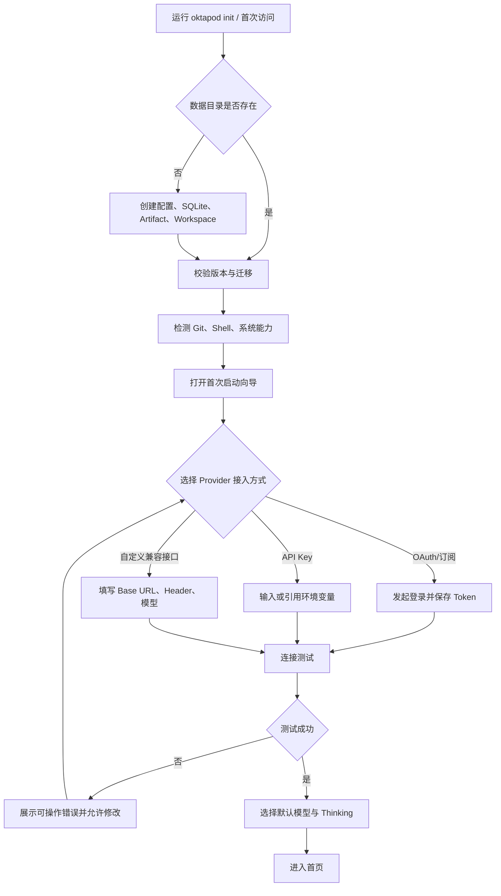

### 8.2 创建或打开项目与 Trust

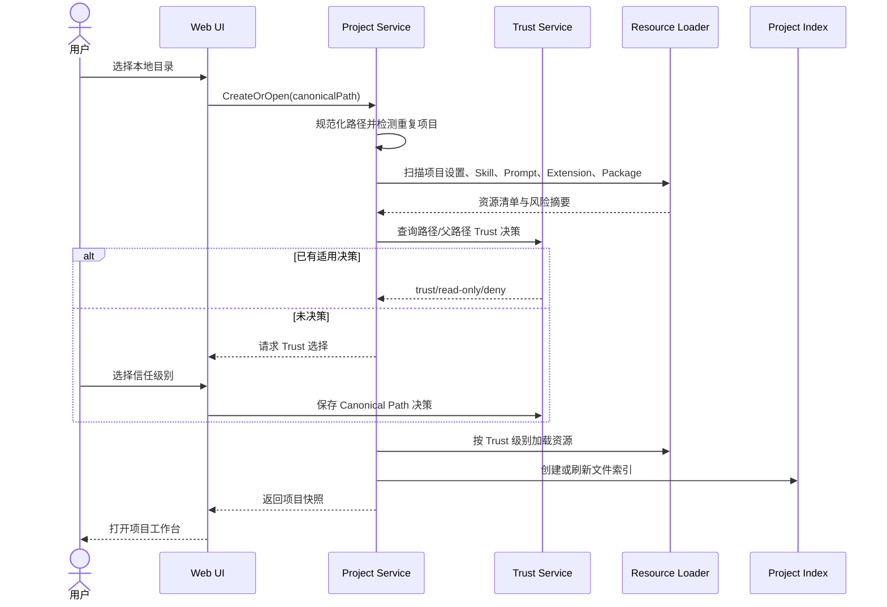

### 8.3 Auto、Ask 与 Task 路由

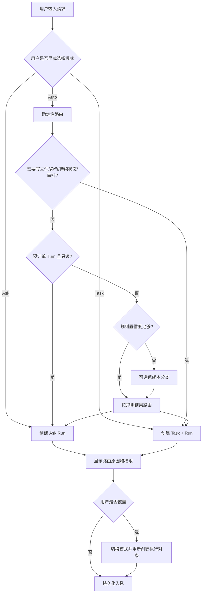

### 8.4 Run 执行主流程

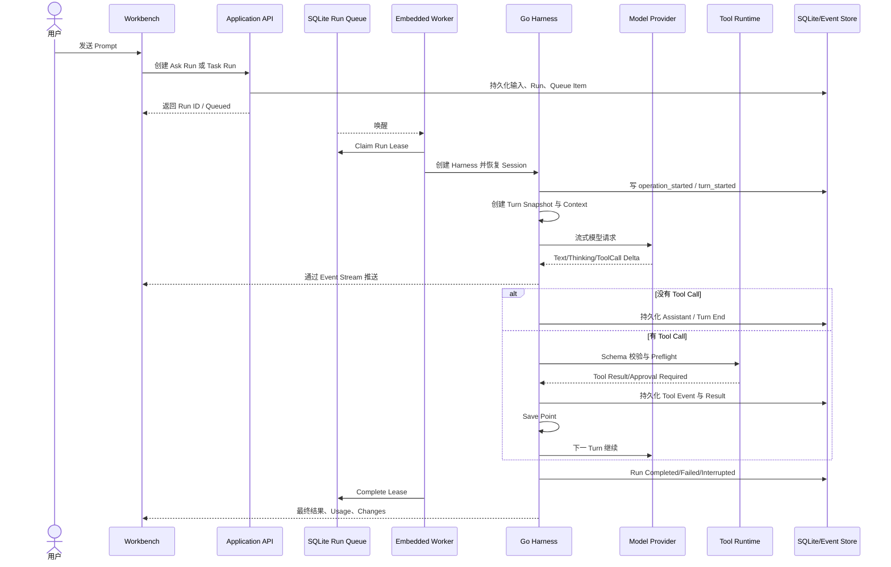

### 8.5 Tool 策略与人工审批

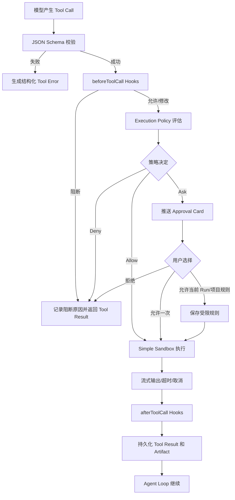

### 8.6 Steering、Follow-up、Next Turn 与 Abort

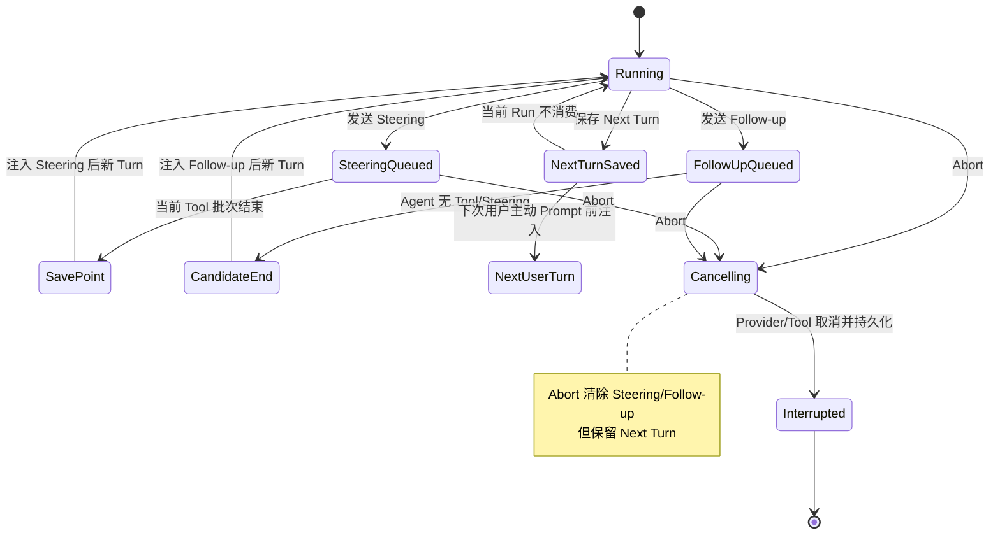

### 8.7 Agent 修改文件与用户审查 Diff

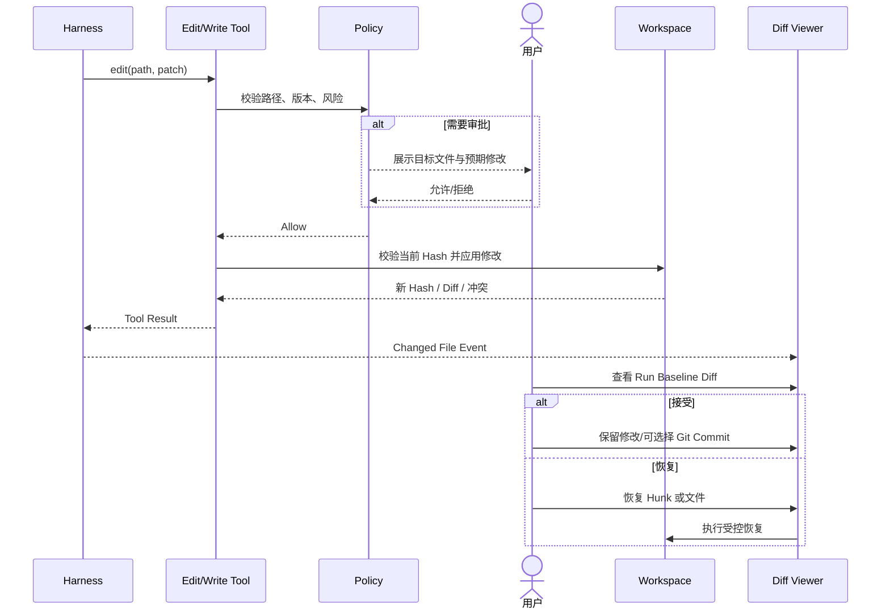

### 8.8 Session Tree、分支、Fork 与 Clone

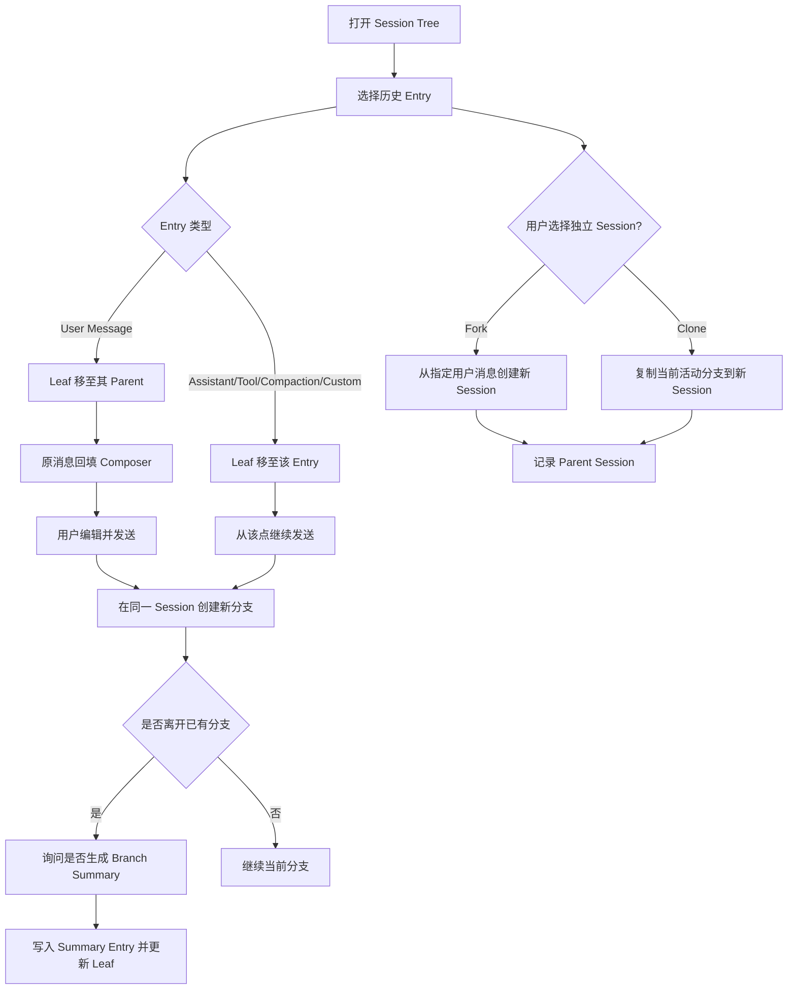

### 8.9 自动与手动 Compaction

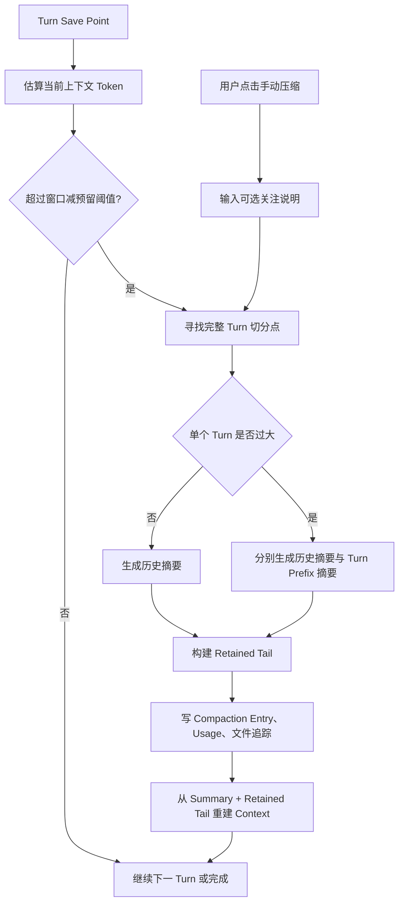

### 8.10 Skill 与 Prompt Template 调用

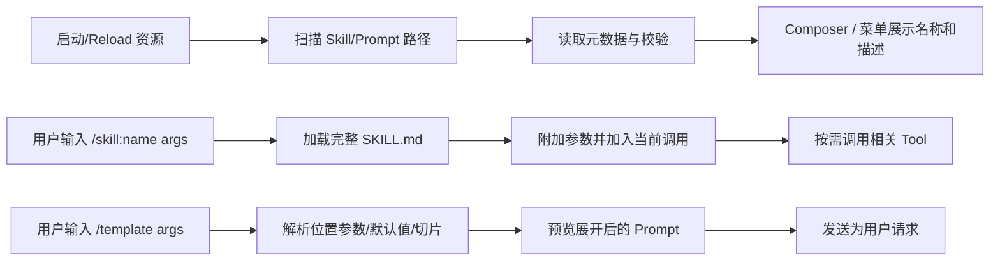

### 8.11 Extension Process 与 Package 安装

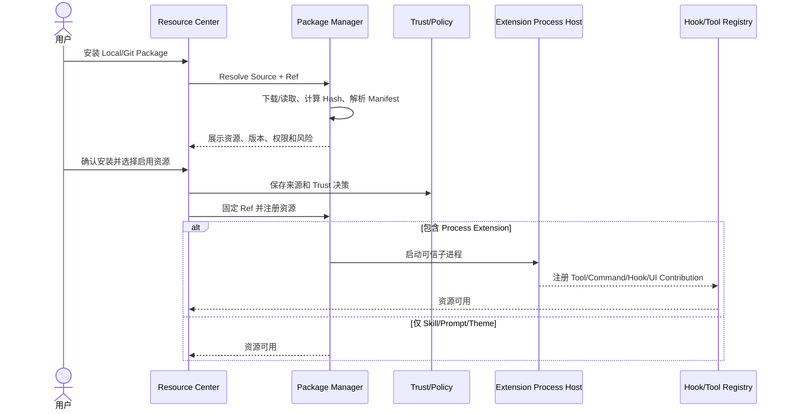

### 8.12 服务重启与 Durable Recovery

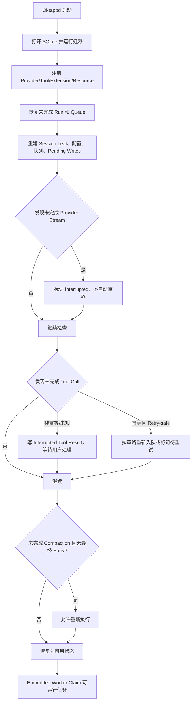

### 8.13 Pi Session 导入与导出

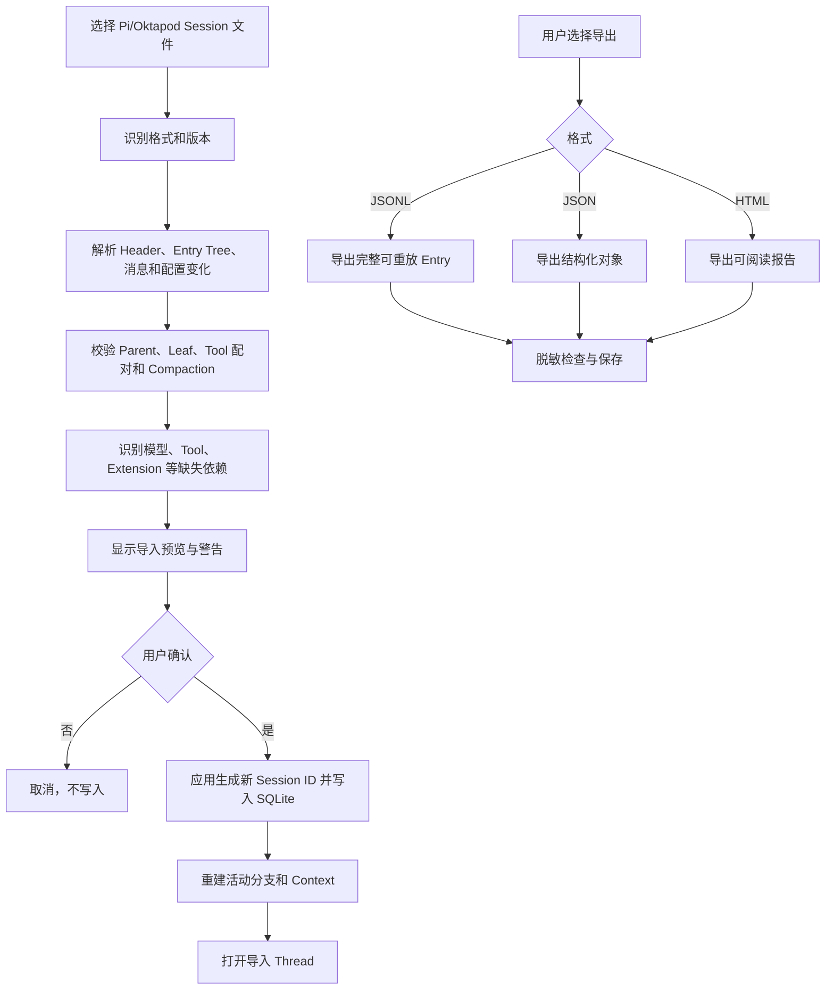

---

## 9. 状态模型

### 9.1 Task 与 Run 状态

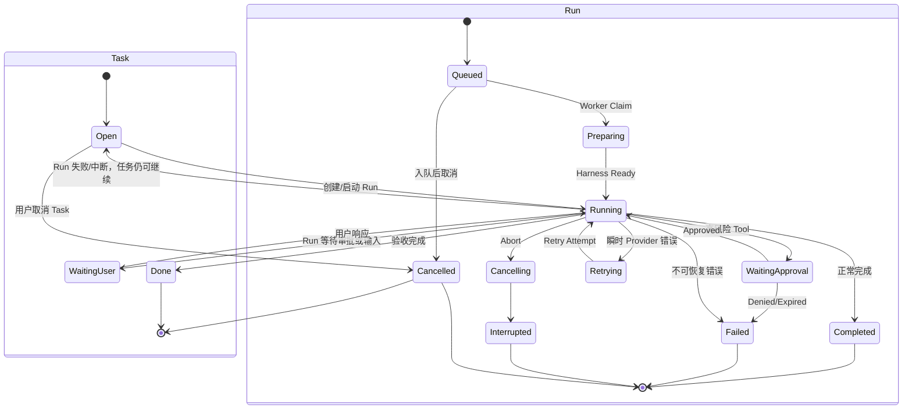

### 9.2 主要 Event Card 类型

| 事件类型 | 默认展示 | 可展开内容 |
|---|---|---|
| User Message | 文本、附件、时间 | 原始引用和路由结果 |
| Assistant Message | Markdown、状态 | 模型、Usage、Stop Reason |
| Thinking Summary | 摘要标题 | 供应商允许的内容和说明 |
| Tool Call | 名称、目标、状态、耗时 | 参数、策略、环境、结果 |
| Command | 命令摘要、Exit Code | 完整输出、工作目录、Artifact |
| Approval | 风险和待确认动作 | 完整参数、范围和决策 |
| Retry | 原因、次数、倒计时 | Provider 错误和策略 |
| Compaction | 压缩前后估算 | Summary、Usage、Retained Tail 元数据 |
| Branch Summary | 离开分支摘要 | 来源分支和文件追踪 |
| File Change | 文件和行数 | Diff、Hunk 和基线 |
| Error | 可操作错误 | Cause、Correlation ID 和诊断 |
| Final Result | 结果摘要 | 变更、测试、Artifact、下一步 |

---

## 10. 空状态、异常状态与降级设计

### 10.1 关键空状态

| 场景 | 页面行为 |
|---|---|
| 没有 Provider | 首页和 Composer 显示配置引导，禁止静默发送 |
| 没有项目 | 显示“打开本地目录”主操作 |
| 项目没有 Thread | 显示示例请求和新建 Thread |
| 没有 Skill/Prompt | 显示本地创建和导入说明 |
| 没有 Git | 隐藏提交操作，但文件和 Agent 能力仍可使用 |
| 没有模型图片能力 | 保留附件但提示切换模型或移除图片 |

### 10.2 关键异常状态

| 异常 | 产品处理 |
|---|---|
| Provider 未认证 | Run 在 Preparing 前失败，提供直接修复入口 |
| Provider 限流 | 显示 Retry 状态、等待时间和取消按钮 |
| Tool 参数错误 | 形成可见 Tool Error，不执行工具 |
| 文件已被外部修改 | 阻止覆盖并要求重新读取或人工合并 |
| Approval 超时 | 返回拒绝/超时 Tool Result，Run 可继续或失败 |
| Extension 崩溃 | 隔离扩展进程，核心服务继续运行并显示错误 |
| SSE 断线 | Run 继续；重连后按 Sequence 补拉 |
| SQLite Busy | 短时退避重试；持续异常进入诊断状态 |
| Artifact 丢失 | 保留元数据并标记损坏，不导致 Session 无法打开 |
| 服务崩溃 | 下次启动执行 Durable Recovery |

### 10.3 跨平台降级

- Windows 与 Linux 的 Shell、路径和进程取消由 Adapter 处理；
- 某平台无法可靠限制某项能力时必须显示“未启用”或“弱保护”；
- 不允许 UI 显示“已沙箱隔离”但实际只执行了命令过滤；
- Git、Shell 或系统凭据组件不存在时，相关功能应可诊断、可配置替代路径。

---

## 11. 非功能要求

### 11.1 性能与容量

参考环境：8 Core、16 GB RAM、模型服务外置。

| 指标 | 第一阶段目标 |
|---|---|
| 冷启动 | P95 ≤ 3 秒 |
| 非模型本地 API | P95 ≤ 100 ms |
| 并发 Run | 默认 4，允许配置更低 |
| Session Entry | 单 Session/项目累计 10 万 Entry 可分页操作 |
| 大 Tool 输出 | 不全量常驻内存，流式写 Artifact |
| SSE 重连 | 可从最后持久 Sequence 恢复 |
| SQLite | WAL、Foreign Keys、Busy Timeout |

### 11.2 可靠性

- 已接受 Prompt/Run 必须先持久化再返回成功；
- 已接受 Queue 不因服务重启丢失；
- Provider Stream 不承诺恢复，必须标记 Interrupted；
- 非幂等 Tool 不自动重放；
- 所有结构操作要么完整提交，要么恢复到可解释状态；
- 导入、迁移和恢复失败不得破坏原文件。

### 11.3 安全

- 默认监听本机；
- 项目资源加载必须经过 Trust；
- Tool 执行必须经过 Schema、Hook、Policy 和 Sandbox；
- Secret 不出现在日志、导出和错误中；
- 网络和高风险操作需要显式授权；
- Simple Sandbox 不宣传为恶意代码隔离。

### 11.4 可测试性

- 核心 Harness 测试覆盖率不低于 90%；
- Pi Golden Trace 覆盖关键事件顺序和状态语义；
- Windows/Linux 均执行核心 E2E；
- API、Event Schema、Provider、Tool、Storage、Extension 均有 Contract Test；
- 必须包含 Crash Recovery、Queue、Compaction 和非幂等 Tool 故障注入测试。

---

## 12. 第一阶段验收场景

### 12.1 核心验收链路

1. 初始化单二进制并完成 Provider 配置；
2. 打开带 `.pi`/Skills/Prompt 的项目并完成 Trust；
3. Ask 模式完成只读代码解释；
4. Task 模式修改代码、运行测试并展示 Diff；
5. Tool 执行中完成一次审批、一次 Steering 和一次 Follow-up；
6. 中止 Run，验证 Next Turn 保留；
7. 切换模型和 Thinking，验证下一 Turn 生效；
8. 创建 Session 分支、Fork 和 Clone；
9. 触发手动和自动 Compaction；
10. 调用 Skill、Prompt Template、MCP Tool 和 Process Extension；
11. 重启服务，验证 Queue、Session、Leaf 和中断状态恢复；
12. 导入 Pi JSONL，导出 Oktapod JSONL/JSON/HTML；
13. 在 Windows 和 Linux 各完成一次端到端执行。

### 12.2 Phase 1 完成定义

第一阶段只有同时满足以下条件才视为完成：

- 所有 MUST 功能已交付；
- Pi Compatibility Matrix 标记为 100%，允许差异均有 ADR；
- Web 中存在所有第一阶段能力入口；
- CLI、Web 和 Go Client 调用同一 Application API；
- OHCS Golden Trace 全部通过；
- Durable Recovery 和安全故障注入通过；
- 第一阶段明确排除项未被提前耦合进 Harness；
- 不依赖 PostgreSQL、Redis、Docker、Kubernetes 或 Node.js Runtime 才能正常运行。

---

## 13. AI 编程实施拆分

### 13.1 内部里程碑

| 里程碑 | 产品可见结果 | 主要功能组 |
|---|---|---|
| P1-A 协议与兼容实验台 | 暂无完整 UI，可执行 Golden Trace | Message、Event、Session、Tool、Provider Contract |
| P1-B Go Harness 内核 | CLI 可完成 Agent Loop | Run、Queue、Tool、Steering、Compaction、Recovery |
| P1-C Coding Agent | CLI 可在真实项目完成 Pi 工作流 | Project、Context、Skill、Prompt、Git、Sandbox、Import |
| P1-D Web 工作台 | 浏览器完成全部 Phase 1 用户流程 | Workbench、Tree、Diff、Terminal、Resources、Usage、Settings |

### 13.2 推荐垂直切片顺序


### 13.3 每个功能工作包必须包含

- 对应功能 ID；
- 用户故事和异常场景；
- Domain/Application 接口；
- 数据迁移或事件 Schema；
- REST/SSE/CLI 入口；
- UI 状态；
- Unit/Contract/Integration/E2E；
- 对 Pi Golden Trace 的影响；
- 明确禁止引入的第二、三阶段依赖。

---

## 14. 第一阶段明确不包含

以下能力不属于本阶段，不应在 UI、数据库或核心代码中以半成品形式出现：

- 团队项目入口、团队成员邀请和团队管理中心；
- Tenant 管理、Team 协作、RBAC、ABAC；
- 项目多人共享和多人实时协作；
- PostgreSQL、读写分离和数据库高可用；
- 独立 Worker、多 Server 和集群调度；
- Redis、Kafka 或外部消息队列；
- S3/MinIO；
- Kubernetes、Container Sandbox 默认实现；
- 自动 Worktree、多 Agent、Agent Team；
- SCIM、SAML、企业 IdP；
- OPA/Rego；
- WASM 插件和远程插件市场；
- 向量数据库和自动长期记忆；
- 直接执行 Pi TypeScript Extension；
- 取代完整 IDE 的代码编辑能力。

第一阶段继续保留已经交付的本地注册、登录和 Session 认证；每个注册用户
只能访问自己创建的个人私有项目。内部保留后续团队扩展边界，但团队能力
不进入当前导航、创建流程或完成度声明。

---

## 15. 参考基线

本功能设计以以下材料为约束：

1. `Oktapod_三阶段递进式架构设计_V1.0.md`；
2. `Oktapod_PRD_v1.1_轻量化架构优化版.md`；
3. `earendil-works/pi@b1c444d956b70e5c437d3d2782b01d157fa05ba3`；
4. Pi `packages/agent` 的 Agent Loop、AgentHarness 和 Durable Harness 行为；
5. Pi `packages/coding-agent/docs` 中的 Sessions、Compaction、Skills、Prompt Templates、Extensions、Packages、Providers、Settings、RPC 和 Security 语义。

若 Pi 主分支在第一阶段开发期间继续变化，新能力进入 Compatibility Backlog，不自动改变本文件的验收边界。更新冻结基线必须经过独立评审，并同步更新功能清单、Golden Trace 和测试 Fixture。
