# Oktapod 第二与第三阶段产品功能设计

> **文档版本**：V1.0
> **文档类型**：Phase 2 / Phase 3 产品功能设计、PRD 细化、AI 编程实施输入
> **编制日期**：2026-07-25
> **第二阶段形态**：团队多用户单机版，SQLite WAL，模块化单体，内嵌/本机 Runner
> **第三阶段形态**：企业集群版，PostgreSQL，多 Server / 多 Worker，S3，Container/Kubernetes Sandbox
> **核心继承约束**：第一阶段 Go Harness、Session Tree、Agent Loop、Tool Contract、Event Protocol 与 Application API 语义保持兼容
> **上位文档**：`Oktapod_三阶段递进式架构设计_V1.0.md`
> **前置基线**：`Oktapod_第一阶段产品功能设计_V1.0.md`

---

## 1. 文档目的

本文档在第一阶段产品功能基线之上，定义 Oktapod 第二阶段与第三阶段的增量产品能力、页面、交互、状态、非功能指标和验收门槛，供产品评审、架构设计、测试设计及 AI 编程工具拆解实施使用。

本文档主要回答：

1. 第一阶段单用户产品如何无损升级为小团队多用户产品；
2. 用户、Tenant、Team、Membership、项目共享、授权、审批、审计和配额如何落地；
3. 第二阶段为什么仍使用 SQLite，以及其明确容量边界是什么；
4. 第三阶段如何在不改写 Harness 的前提下切换 PostgreSQL、拆分 Server/Worker 并实现横向扩展；
5. 多 Server 事件流、Worker Lease、对象存储、Kubernetes Sandbox、企业身份和集中治理如何形成完整产品体验；
6. 各阶段哪些功能是硬门槛，哪些能力明确后置或排除。

本文件采用**递进式增量清单**：

- 第一阶段所有 MUST 能力默认继续有效，不在本文重复抄写；
- 第二阶段功能以 `S2-` 开头，表示在 Phase 1 上新增或改变的产品能力；
- 第三阶段功能以 `S3-` 开头，表示在 Phase 2 上新增或替换基础设施适配器的能力；
- 除明确标注外，第三阶段不得删除第二阶段的用户、租户、授权、安全和协作语义。

---

## 2. 三阶段递进关系

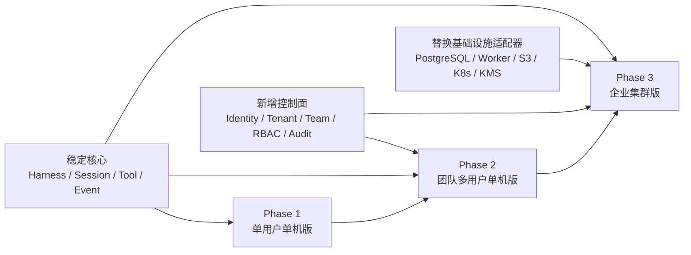

### 2.1 不变核心

三个阶段必须持续复用：

- Go 原生 Provider Registry 与 Model Gateway；
- Agent Harness、Agent Loop、Turn Snapshot 和 Save Point；
- Tool Registry、Tool Descriptor、Hook Bus 与 Tool Result 语义；
- Steering、Follow-up、Next Turn、Abort 与 Durable Queue 语义；
- Session Entry 树、Branch、Fork、Clone、Compaction、Branch Summary；
- Run Event Envelope、Sequence、Correlation ID；
- Context Pipeline、Usage Ledger、Artifact 元数据；
- REST/WebSocket/CLI/Go SDK 的版本化 Application API。

### 2.2 递进原则

1. **先增加主体与作用域，再增加集群拓扑**：Phase 2 先验证多用户隔离和治理，Phase 3 再解决规模与高可用。
2. **逻辑分离先于物理解耦**：Phase 1/2 控制面和执行面可同进程，但必须经 `RunDispatcher` 和 Worker Contract；Phase 3 才拆为独立进程。
3. **授权不进入 Harness 内核**：Harness 只接收已解析的 `ExecutionScope`、`PolicyContext` 和可用资源快照。
4. **数据库切换不改变领域语义**：SQLite 与 PostgreSQL 使用同一 Repository Contract；数据库差异不得泄露到页面和 Harness。
5. **正确性依赖持久事实，不依赖进程内状态**：Run、Lease、Event、Approval、Audit 均应可在进程重启后重建。
6. **安全边界按部署形态升级**：Simple Sandbox → System Sandbox → Container/Kubernetes Sandbox。

---

## 3. 功能优先级与术语

| 标识 | 含义 |
|---|---|
| MUST | 当前阶段正式完成的硬门槛，缺失即不得宣布该阶段完成 |
| SHOULD | 属于当前阶段范围，允许在 Beta 后补齐；延期必须单独评审 |
| OPTIONAL | 提供扩展点或条件满足时启用，不作为默认部署依赖 |
| INTERNAL | 用户不直接操作，但产品正确性、安全或恢复依赖该能力 |
| EXCLUDED | 当前阶段明确不实现，防止 AI 编程工具越界建设 |

### 3.1 核心术语

| 术语 | 产品定义 |
|---|---|
| Platform | 一套 Oktapod 安装实例；Phase 2 为一个单节点实例，Phase 3 为一个集群 |
| Tenant | 最高业务隔离域，拥有团队、项目、资源、配额和审计策略 |
| Team | Tenant 内的成员与共享资源组织单元 |
| Membership | 用户与 Tenant/Team/Project 的授权关系及角色 |
| Subject | 发起访问的用户、服务账户或系统组件 |
| ExecutionScope | 一次执行绑定的 Tenant、Subject、Project、Workspace、Credential 和 Policy 作用域 |
| Project | 可共享的工程工作空间及其 Threads、Tasks、Resources 和策略 |
| Thread | Session 的产品名称；仍以树形 Session Entry 为事实来源 |
| Run | 一次执行尝试；Phase 3 由 Worker Lease 承载 |
| Audit Event | 面向治理和合规的不可抵赖操作记录，不等同于用户可删的 Session Transcript |
| System Sandbox | 使用 OS 原生能力隔离进程、资源、路径和身份的本机执行环境 |
| Sandbox Pool | 集群中可调度、可回收的 Docker/Kubernetes 执行环境集合 |

---

# 第一部分：第二阶段产品功能设计

## 4. 第二阶段产品定义

### 4.1 一句话定义

**Oktapod 第二阶段是在保持第一阶段 Go Harness 与 Coding Agent 能力不变的前提下，为 1～20 名活跃成员提供用户登录、团队协作、租户隔离、共享项目、权限、审批、审计、配额和 System Sandbox 的单节点团队 Agent 工程平台。**

### 4.2 阶段定位

第二阶段不是“把单用户页面加一个登录框”，也不是提前建设微服务集群。它必须完成以下产品跃迁：

- 从固定 `local-user` 迁移到真实 User/Subject；
- 从本地项目变为 Tenant 内可授权共享的 Project；
- 从本地风险确认变为可配置、可追踪、可委派的审批流程；
- 从本地 Run Trace 增加独立的 Security Audit；
- 从本地凭据变为用户、团队和项目作用域凭据；
- 从 Simple Sandbox 升级到面向多用户的 System Sandbox；
- 从“单人可信环境”升级为服务层、Repository、WebSocket、文件路径和执行环境的全链路隔离。

第二阶段仍是**模块化单体、单节点、SQLite WAL**。它不承诺高可用和无限扩展，重点是证明团队产品模型与安全治理模型正确。

### 4.3 目标用户与角色

| 角色 | 主要诉求 | 默认能力边界 |
|---|---|---|
| Platform Admin | 初始化实例、管理系统配置、Tenant、用户和健康状态 | 可管理平台，但不得默认读取用户私有凭据和私有记忆正文 |
| Tenant Admin | 管理 Tenant、Team、成员、共享资源、配额和策略 | 仅限所属 Tenant |
| Project Owner | 创建和共享项目、配置项目策略、管理项目成员 | 仅限拥有或被授权的项目 |
| Member | 在授权项目中创建 Thread、Task、Run 和使用资源 | 按项目角色和策略执行 |
| Viewer | 查看允许的项目、Thread、结果和 Artifact | 默认只读，不可发起写入型 Run |
| Auditor | 查询审批、安全事件、管理员操作和合规报表 | 只读审计，不自动获得业务内容全文 |
| Service Account | 为自动化或外部系统调用 API | 第二阶段 SHOULD；使用明确 Scope 与可撤销凭据 |

### 4.4 第二阶段成功标准

第二阶段完成时，团队应能够：

1. 从 Phase 1 原地升级并将既有数据归属给首位 Platform Admin；
2. 创建 Tenant、Team，邀请成员并配置角色；
3. 将项目共享给成员，确保未授权主体无法通过 API、WebSocket、搜索或文件路径访问；
4. 由不同成员在共享项目中创建各自 Thread、Task 和 Run，并保留明确作者与作用域；
5. 使用个人凭据或团队共享凭据调用 Provider，且凭据不跨用户泄露；
6. 对高风险 Tool Call 发起、处理、过期和审计审批；
7. 查询 Tenant、Project、User、Provider 和 Tool 的用量与配额；
8. 在 System Sandbox 或明确降级的隔离环境中执行命令；
9. 禁用用户后立即阻断新请求并使其登录会话失效；
10. 导出完整、可过滤、可关联的审计记录；
11. 第一阶段 OHCS、Session、Import/Export 和 Harness 行为测试全部继续通过。

---

## 5. 第二阶段关键产品决策

### D2-1：默认创建一个 Tenant，不提供“无 Tenant 多用户”模式

Phase 2 初始化时必须存在 Tenant。Phase 1 的 `namespace_id=local` 数据迁移到默认 Tenant；后续所有 Project、Resource、Credential、Usage 和 Audit 都具有明确 `tenant_id`。

### D2-2：SQLite 继续作为默认数据库

- Phase 2 面向小团队单节点部署；
- 使用 WAL、Busy Timeout、短事务和受控写并发；
- 不将 SQLite 包装成企业高可用数据库；
- 进入多 Worker、多 Server 或数据库级纵深隔离需求时升级 Phase 3。

### D2-3：授权由统一 Authorization Service 决策

HTTP Handler、WebSocket Handler、Repository 和 Worker 不得自行拼接授权逻辑。统一输入：

```text
Subject + Tenant + Resource + Action + Environment + Risk
```

统一输出：

```text
Allow | Deny | RequireApproval + Reason + PolicyRefs
```

### D2-4：项目协作不等于多人实时编辑同一 Thread

Phase 2 支持：

- 共享项目；
- 共享或私有 Thread；
- 共享 Task/Run/Artifact；
- 评论、关注和活动流；
- 同一项目内多人并行创建独立 Run。

Phase 2 不提供 Google Docs 式实时共同编辑 Composer，也不允许两个 Run 同时写同一 Workspace 而无冲突控制。

### D2-5：多用户执行最低使用 System Sandbox

- Linux 优先使用 namespace/cgroup/受限用户等系统能力；
- Windows 使用 Job Object、受限 Token/ACL 或可用的本机隔离能力；
- 可选 Docker Runner；
- 若平台无法提供要求的隔离等级，必须阻止高风险执行或在 UI 显示显著降级状态。

### D2-6：凭据按主体与作用域解析

凭据解析顺序必须显式、可审计，推荐：

1. 当前用户在当前项目的私有凭据；
2. 当前用户的全局私有凭据；
3. 项目共享凭据；
4. Team 共享凭据；
5. Tenant 共享凭据；
6. Platform 默认凭据。

低层凭据不得覆盖上层明确禁用；用户私有凭据不得被其他用户调用。

### D2-7：Audit 与 Run Trace 分离

- Run Trace 用于理解和排障，可随业务保留策略清理；
- Security Audit 记录身份、授权、审批、凭据、管理员和敏感操作；
- Audit 删除、保留和导出权限独立治理；
- 默认不保存供应商隐藏思维链和完整 Secret。

### D2-8：策略引擎保持轻量

Phase 2 使用 Go Native Rule 和可选 CEL 条件，不引入 OPA/Rego 作为强依赖。策略必须可解释、可测试、可版本化。

---

## 6. 第二阶段信息架构

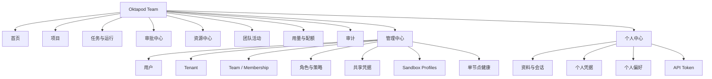

### 6.1 第二阶段页面清单

| 页面 | 主要用途 |
|---|---|
| 登录/首位管理员初始化 | 创建管理员、认领 Phase 1 数据、建立默认 Tenant |
| 首页 | 个人最近工作、团队运行、待审批、配额和风险摘要 |
| 项目列表 | 我的项目、共享项目、可见性、成员和权限筛选 |
| 项目工作台 | 继承 Phase 1 工作台，增加作者、共享范围、成员活动和审批状态 |
| Team 空间 | 成员、角色、共享资源、活动和用量 |
| 审批中心 | 待我审批、我发起的、已处理、过期和委派 |
| 资源中心 | 个人/Project/Team/Tenant 资源及发布流程 |
| 用量与配额 | User/Team/Project/Provider/模型/Tool 聚合与限制 |
| 审计中心 | 身份、授权、敏感操作、管理员操作和导出 |
| 管理中心 | 用户、Tenant、Team、角色、策略、保留和系统健康 |
| 个人中心 | 登录会话、个人凭据、偏好、API Token 和个人记忆 |

---

## 7. 第二阶段完整增量功能清单

> 下列功能是在 Phase 1 完整能力之上的新增或变化项。Phase 1 的所有 MUST 项继续作为 Phase 2 验收前置条件。

### 7.1 升级、初始化与兼容迁移

| ID | 功能 | 产品行为 | 优先级 |
|---|---|---|---|
| S2-UPG-001 | Phase 1 原地升级 | 在原数据目录执行前向 Schema 迁移，不要求复制全部业务数据 | MUST |
| S2-UPG-002 | 升级前一致性备份 | 升级前创建 SQLite Online Backup、配置和密钥材料备份 | MUST |
| S2-UPG-003 | 首位管理员认领 | 首次启动 Phase 2 时创建 Platform Admin 并完成本机确认 | MUST |
| S2-UPG-004 | 默认 Tenant 创建 | 自动建立默认 Tenant，并记录迁移批次和来源版本 | MUST |
| S2-UPG-005 | 本地数据归属 | Phase 1 Projects、Sessions、Tasks、Artifacts 和 Usage 归属首位管理员及默认 Tenant | MUST |
| S2-UPG-006 | Trust 决策迁移 | 保留原项目 Trust，并标记为管理员导入的历史决策 | MUST |
| S2-UPG-007 | 凭据迁移确认 | 不自动把本地私有凭据发布为共享凭据；默认归属首位管理员 | MUST |
| S2-UPG-008 | 迁移预检 | 检查数据库版本、磁盘、备份、Canonical Path 冲突和权限 | MUST |
| S2-UPG-009 | 迁移报告 | 展示对象数量、归属变化、警告、失败项和回滚说明 | MUST |
| S2-UPG-010 | 不可逆步骤确认 | 仅在备份完成且管理员确认后执行不可逆迁移 | MUST |
| S2-UPG-011 | 失败安全停止 | 迁移失败时禁止部分启动，保留原数据库并输出恢复步骤 | MUST |
| S2-UPG-012 | 兼容回归 | 升级后自动执行核心 Schema、Session 和 OHCS 烟雾测试 | SHOULD |

### 7.2 身份、登录与会话安全

| ID | 功能 | 产品行为 | 优先级 |
|---|---|---|---|
| S2-IDN-001 | 本地账户 | 支持用户名/邮箱标识和密码登录 | MUST |
| S2-IDN-002 | 密码策略 | 长度、弱密码、历史密码和失败锁定策略可配置 | MUST |
| S2-IDN-003 | 密码安全存储 | 使用现代自适应哈希并保存参数版本，不保存可逆密码 | INTERNAL |
| S2-IDN-004 | 安全 Cookie Session | HttpOnly、Secure、SameSite、轮换和服务端撤销 | MUST |
| S2-IDN-005 | CSRF 防护 | 所有浏览器写操作使用 CSRF Token 或等价机制 | MUST |
| S2-IDN-006 | WebSocket 身份校验 | 握手校验 Session、Origin、Tenant 和订阅资源 | MUST |
| S2-IDN-007 | 登录失败保护 | 限速、临时锁定和审计，不泄露账户是否存在 | MUST |
| S2-IDN-008 | 登录会话列表 | 用户查看设备、IP 摘要、创建时间、最近活动和撤销 | MUST |
| S2-IDN-009 | 管理员强制失效 | 禁用用户或重置安全状态时撤销所有 Session/API Token | MUST |
| S2-IDN-010 | 密码重置 | 管理员发起一次性重置；不通过邮件也可安全交付 | MUST |
| S2-IDN-011 | 可选 OIDC | 单节点可连接一个或多个 OIDC Provider，映射用户和 Tenant | SHOULD |
| S2-IDN-012 | MFA 扩展点 | 预留 TOTP/WebAuthn Contract；至少为管理员提供 TOTP SHOULD | SHOULD |
| S2-IDN-013 | 个人资料 | 姓名、头像、时区、语言和通知偏好 | MUST |
| S2-IDN-014 | API Token | 用户创建有 Scope、过期时间和最近使用记录的 Token | SHOULD |
| S2-IDN-015 | 服务账户 | 创建非交互主体并限制 Tenant/Project/Action Scope | SHOULD |

### 7.3 Tenant、Team 与 Membership

| ID | 功能 | 产品行为 | 优先级 |
|---|---|---|---|
| S2-ORG-001 | Tenant 创建 | Platform Admin 创建、停用和恢复 Tenant | MUST |
| S2-ORG-002 | Tenant 设置 | 名称、标识、时区、数据保留、默认模型和默认策略 | MUST |
| S2-ORG-003 | Tenant 切换 | 多 Tenant 用户在顶部显式切换，URL/API Scope 同步改变 | MUST |
| S2-ORG-004 | Team 创建 | Tenant Admin 创建 Team 并设置描述和默认资源 | MUST |
| S2-ORG-005 | 成员邀请 | 通过一次性邀请链接或管理员添加成员 | MUST |
| S2-ORG-006 | 邀请状态 | Pending、Accepted、Expired、Revoked，可重发和撤销 | MUST |
| S2-ORG-007 | Tenant Membership | 用户加入 Tenant 并获得精简角色 | MUST |
| S2-ORG-008 | Team Membership | 成员可属于多个 Team，角色独立 | MUST |
| S2-ORG-009 | 成员停用 | 停用后无法访问 Tenant 资源，历史作者信息保留 | MUST |
| S2-ORG-010 | 成员移除 | 移除前展示其拥有项目、任务、凭据和待审批影响 | MUST |
| S2-ORG-011 | 所有权转移 | 项目、共享资源和自动化主体可转移给其他成员 | MUST |
| S2-ORG-012 | 组织搜索 | 按姓名、角色、Team、状态和最近活动筛选 | SHOULD |
| S2-ORG-013 | 成员批量导入 | CSV 预览、校验和结果报告 | OPTIONAL |
| S2-ORG-014 | 组织活动流 | 成员、Team、项目和资源变化形成可过滤活动 | SHOULD |

### 7.4 角色、授权与作用域

| ID | 功能 | 产品行为 | 优先级 |
|---|---|---|---|
| S2-AUZ-001 | 精简内置角色 | Platform Admin、Tenant Admin、Project Owner、Member、Viewer、Auditor | MUST |
| S2-AUZ-002 | Action 目录 | 为 Project、Session、Run、Tool、Credential、Audit 等定义版本化 Action | INTERNAL |
| S2-AUZ-003 | 统一授权服务 | 所有 Web、API、CLI、WebSocket 和 Worker 操作调用同一决策服务 | MUST |
| S2-AUZ-004 | ExecutionScope | Run 创建时固化 Tenant、Subject、Project、Workspace 和 Policy Scope | MUST |
| S2-AUZ-005 | 资源级授权 | 访问 Project、Thread、Task、Run、Artifact、Resource 时逐对象判断 | MUST |
| S2-AUZ-006 | 查询范围过滤 | Repository 查询必须显式带 Scope，不允许先全量查出再在 UI 过滤 | MUST |
| S2-AUZ-007 | WebSocket 订阅授权 | 每个 Channel 和 Run 订阅验证当前 Subject 权限 | MUST |
| S2-AUZ-008 | 缓存键隔离 | 授权、索引、模型目录和上下文缓存键包含 Tenant/Subject/Project | INTERNAL |
| S2-AUZ-009 | ABAC 条件 | 支持风险、环境、时间、项目标签和资源属性条件 | SHOULD |
| S2-AUZ-010 | CEL 条件 | 可选 CEL 表达式，保存版本、测试样例和解释结果 | OPTIONAL |
| S2-AUZ-011 | 权限预览 | 管理员可模拟某用户对某资源的授权结果 | SHOULD |
| S2-AUZ-012 | 拒绝解释 | UI/API 返回可理解原因和策略引用，不泄露敏感资源详情 | MUST |
| S2-AUZ-013 | 最小权限默认 | 新成员、邀请和新共享资源默认最小权限 | MUST |
| S2-AUZ-014 | 越权审计 | 所有 Deny 与异常跨 Scope 访问形成安全事件 | MUST |
| S2-AUZ-015 | 自定义角色 | 由内置 Action 组合 Tenant 自定义角色 | SHOULD |

### 7.5 项目共享与协作

| ID | 功能 | 产品行为 | 优先级 |
|---|---|---|---|
| S2-COL-001 | 项目归属 | Project 必须归属 Tenant，并记录 Owner | MUST |
| S2-COL-002 | 项目可见性 | Private、Team、Tenant 和显式成员共享 | MUST |
| S2-COL-003 | 项目成员 | Project Owner 添加/移除成员并分配角色 | MUST |
| S2-COL-004 | 共享 Thread | Thread 支持 Private 或 Project Shared，默认继承创建者偏好 | MUST |
| S2-COL-005 | 共享 Task/Run | 成员可在权限范围查看状态、结果、Diff 和 Artifact | MUST |
| S2-COL-006 | 作者与操作者 | Message、Task、Run、Approval 和变更显示发起者与执行主体 | MUST |
| S2-COL-007 | 评论 | 对 Task、Run、Diff 或 Artifact 添加 Markdown 评论 | SHOULD |
| S2-COL-008 | 关注与通知 | 关注项目/Task/Run，接收完成、失败、审批和评论通知 | SHOULD |
| S2-COL-009 | 活动时间线 | 项目成员、资源、Run、审批和 Git 变更统一时间线 | MUST |
| S2-COL-010 | 并发写冲突 | 同一 Workspace 存在写入型 Run 时进行锁、排队或显式冲突提示 | MUST |
| S2-COL-011 | 只读运行 | 多个 Ask/只读 Run 可并发，不占用写锁 | MUST |
| S2-COL-012 | 项目归档 | 归档后禁止新 Run，保留只读访问和审计 | MUST |
| S2-COL-013 | 项目转移 | Project Owner 可在 Tenant 内转移所有权 | MUST |
| S2-COL-014 | 导出共享包 | 按权限导出项目元数据、Threads 和 Artifacts，默认脱敏 | OPTIONAL |
| S2-COL-015 | 实时共同编辑 | 不提供多人同时编辑同一 Composer/消息 | EXCLUDED |

### 7.6 共享资源发布与继承

| ID | 功能 | 产品行为 | 优先级 |
|---|---|---|---|
| S2-RES-001 | 资源作用域 | Skills、Prompts、Tools、Agents、Packages 支持 User/Project/Team/Tenant | MUST |
| S2-RES-002 | 资源发布 | 个人资源经有权限者发布为 Team/Tenant 资源 | MUST |
| S2-RES-003 | 发布预览 | 展示版本、来源、权限、脚本、依赖、风险和受影响项目 | MUST |
| S2-RES-004 | 资源版本 | 发布后不可原地覆盖，更新生成新版本 | MUST |
| S2-RES-005 | 启用策略 | Tenant/Team 默认资源可由项目显式启停，安全策略不可被下层关闭 | MUST |
| S2-RES-006 | 继承顺序 | Platform→Tenant→Team→Project→User/Thread，显示最终来源 | MUST |
| S2-RES-007 | 冲突处理 | 同名资源显示冲突并按明确优先级选择，不静默覆盖 | MUST |
| S2-RES-008 | 废弃与撤回 | 资源可标记废弃、阻止新使用并评估现有 Run | MUST |
| S2-RES-009 | 资源审批 | 可执行 Extension/Package 发布可要求安全管理员审批 | SHOULD |
| S2-RES-010 | 使用分析 | 查看资源被哪些 Team、Project、Thread 和 Run 使用 | SHOULD |
| S2-RES-011 | 资源权限 | 区分查看、使用、编辑、发布和管理 | MUST |
| S2-RES-012 | 可信来源 | Tenant 可限制允许的 Git Host、路径和签名策略扩展点 | SHOULD |

### 7.7 凭据、Secret 与模型配置隔离

| ID | 功能 | 产品行为 | 优先级 |
|---|---|---|---|
| S2-CRD-001 | 个人凭据 | 仅所有者可查看元数据和使用；管理员不能读取明文 | MUST |
| S2-CRD-002 | 共享凭据 | Tenant/Team/Project 可创建共享 Provider、Git 或 Tool Credential | MUST |
| S2-CRD-003 | Envelope Encryption | 每条 Secret 使用数据密钥加密，主密钥来自实例密钥或 OS Keychain | MUST |
| S2-CRD-004 | 凭据引用 | Run 只保存 Credential Ref 和版本，不保存明文 | MUST |
| S2-CRD-005 | 解析优先级 | 按用户/项目/Team/Tenant/Platform 明确解析并显示实际来源别名 | MUST |
| S2-CRD-006 | 使用授权 | 共享凭据可限制 Provider、模型、Project、Tool 和时间 | MUST |
| S2-CRD-007 | 凭据测试 | 测试连接时使用最小请求并产生审计 | MUST |
| S2-CRD-008 | 凭据轮换 | 创建新版本、切换生效、撤销旧版本并显示影响 | SHOULD |
| S2-CRD-009 | 凭据过期 | 到期前提醒，到期后阻止新请求，不中途替换当前 Provider Request | MUST |
| S2-CRD-010 | 临时凭据 | 支持带过期时间的短期凭据和只使用一次的 Secret | SHOULD |
| S2-CRD-011 | Secret 脱敏 | Prompt、日志、Tool Result、Artifact、导出和错误统一脱敏 | MUST |
| S2-CRD-012 | 敏感文件 | `.env`、私钥和凭据目录进入敏感路径策略 | MUST |
| S2-CRD-013 | 访问记录 | 记录谁、何时、因何 Run 使用哪个凭据别名 | MUST |
| S2-CRD-014 | 管理员恢复 | 丢失主密钥时不提供后门解密；只能恢复备份密钥材料 | MUST |

### 7.8 用户、项目与团队记忆

| ID | 功能 | 产品行为 | 优先级 |
|---|---|---|---|
| S2-MEM-001 | 用户记忆 | 用户显式创建、确认、编辑、删除和导出个人偏好/事实 | MUST |
| S2-MEM-002 | 项目记忆 | 项目成员按权限维护项目事实、命令和架构约定 | MUST |
| S2-MEM-003 | 团队记忆 | Team Admin 发布公共规范和知识条目 | SHOULD |
| S2-MEM-004 | 记忆作用域 | 每条记录具有 Tenant、Owner、Project/Team 和可见性 | MUST |
| S2-MEM-005 | 显式写入 | 模型不得静默写长期记忆；建议必须由用户确认 | MUST |
| S2-MEM-006 | 来源追踪 | 显示来源消息、Run、文件或管理员发布记录 | MUST |
| S2-MEM-007 | 检索隔离 | 权限过滤先于全文检索和上下文注入 | MUST |
| S2-MEM-008 | 冲突提示 | 冲突记忆不自动合并，显示来源和最后确认时间 | MUST |
| S2-MEM-009 | 过期与复核 | 支持过期时间和定期复核状态 | SHOULD |
| S2-MEM-010 | 管理员边界 | 管理员不得将用户私有记忆自动发布为团队记忆 | MUST |
| S2-MEM-011 | 语义向量库 | 第二阶段仍不作为默认依赖 | EXCLUDED |

### 7.9 策略配置与治理

| ID | 功能 | 产品行为 | 优先级 |
|---|---|---|---|
| S2-POL-001 | 策略作用域 | Platform、Tenant、Team、Project、User，安全上层规则不可被下层放宽 | MUST |
| S2-POL-002 | 策略类型 | Tool、Command、Path、Network、Secret、Model、Cost、Retention | MUST |
| S2-POL-003 | 规则编辑器 | 使用结构化表单和 YAML/JSON 高级视图 | MUST |
| S2-POL-004 | 策略版本 | 每次发布产生版本、作者、时间、Diff 和说明 | MUST |
| S2-POL-005 | 草稿与发布 | 策略草稿不立即生效，发布前校验和影响分析 | MUST |
| S2-POL-006 | 策略模拟 | 输入 Subject/Resource/Action 预览决策和命中链 | SHOULD |
| S2-POL-007 | 命令规则 | 按可执行文件、参数、Shell 特性、路径和风险判断 | MUST |
| S2-POL-008 | 网络规则 | 按域名、端口、协议、Tool、Project 和解析 IP 控制 | MUST |
| S2-POL-009 | 路径规则 | 读写范围、敏感路径、符号链接和附加挂载 | MUST |
| S2-POL-010 | 模型规则 | 允许 Provider/模型、数据驻留标签和最大上下文/成本 | SHOULD |
| S2-POL-011 | 默认拒绝 | 无法解析 Scope、风险或策略时高风险操作默认拒绝 | MUST |
| S2-POL-012 | 解释性 | 每次决定包含命中规则、版本、原因和下一步 | MUST |
| S2-POL-013 | 紧急禁用 | 管理员可紧急禁用 Tool、Provider、Extension 或出网 | MUST |
| S2-POL-014 | OPA/Rego | 不作为 Phase 2 依赖 | EXCLUDED |

### 7.10 审批中心

| ID | 功能 | 产品行为 | 优先级 |
|---|---|---|---|
| S2-APR-001 | 审批请求 | Policy 返回 RequireApproval 时创建持久 Approval | MUST |
| S2-APR-002 | 审批人解析 | 按 Project Owner、Tenant Admin、Security Role 或指定组解析 | MUST |
| S2-APR-003 | 审批卡片 | 显示请求人、Run、动作、参数、风险、Diff、凭据别名和策略原因 | MUST |
| S2-APR-004 | 批准/拒绝 | 处理结果持久化并回传等待中的 Run | MUST |
| S2-APR-005 | 批准范围 | 仅本次、当前 Run、指定时间或受限策略例外 | MUST |
| S2-APR-006 | 审批过期 | 到期自动拒绝或取消，并标记 Run 状态 | MUST |
| S2-APR-007 | 审批撤回 | 请求人在未处理前撤回，Run 获得结构化结果 | MUST |
| S2-APR-008 | 审批委派 | 审批人可设置有期限的代理，记录原审批链 | SHOULD |
| S2-APR-009 | 冲突处理 | 请求人不能审批本人高风险操作，除非策略明确允许 | MUST |
| S2-APR-010 | 并发处理 | 使用版本/状态条件防止同一 Approval 被重复决议 | INTERNAL |
| S2-APR-011 | 批量审批 | 仅对相同低风险规则和明确范围支持批量处理 | OPTIONAL |
| S2-APR-012 | 审批通知 | 站内通知；邮件/Webhook 作为可选 Connector | SHOULD |
| S2-APR-013 | 审批查询 | 按状态、风险、项目、请求人、审批人和时间筛选 | MUST |
| S2-APR-014 | 审批审计 | 请求、查看、决议、过期、委派和恢复均写 Audit | MUST |

### 7.11 审计、活动与数据保留

| ID | 功能 | 产品行为 | 优先级 |
|---|---|---|---|
| S2-AUD-001 | 独立审计日志 | 身份、授权、审批、凭据、策略、管理员和敏感 Tool 形成 Audit Event | MUST |
| S2-AUD-002 | 审计字段 | Tenant、Actor、Subject、Action、Resource、Result、Reason、IP 摘要、Correlation ID | MUST |
| S2-AUD-003 | 追加写入 | 应用层禁止更新既有 Audit Event；修正以新事件表示 | MUST |
| S2-AUD-004 | 审计搜索 | 按 Actor、Project、Run、Action、Result、Risk 和时间筛选 | MUST |
| S2-AUD-005 | 审计详情 | 关联到策略版本、Approval、Run Trace 和资源元数据 | MUST |
| S2-AUD-006 | 敏感字段控制 | Auditor 看到必要元数据，不默认看到 Secret、Prompt 或文件全文 | MUST |
| S2-AUD-007 | 管理员操作 | 用户、角色、策略、凭据、配额和保留变更全部审计 | MUST |
| S2-AUD-008 | 登录审计 | 成功、失败、锁定、Session 撤销和 Token 使用 | MUST |
| S2-AUD-009 | 导出 | CSV/JSONL 导出，带过滤条件、生成者和 Hash | MUST |
| S2-AUD-010 | 保留策略 | 按 Tenant 设置 Audit、Run、Session、Artifact 的不同保留期 | MUST |
| S2-AUD-011 | 清理任务 | 按策略清理并生成清理审计，不破坏仍被引用数据 | MUST |
| S2-AUD-012 | 审计完整率 | 关键操作没有 Audit Event 时操作失败或系统进入降级告警 | MUST |
| S2-AUD-013 | 外部 Syslog | 单节点可选导出到 Syslog/HTTP Endpoint | OPTIONAL |

### 7.12 用量、成本与配额

| ID | 功能 | 产品行为 | 优先级 |
|---|---|---|---|
| S2-QTA-001 | 聚合维度 | Tenant、Team、User、Project、Provider、Model、Tool、时间 | MUST |
| S2-QTA-002 | Token 配额 | 设置日/月输入、输出、Reasoning 和总 Token 限额 | MUST |
| S2-QTA-003 | 成本预算 | 以配置币种记录软预算和硬上限 | MUST |
| S2-QTA-004 | Run 并发配额 | Tenant/Team/User/Project 并发 Run 上限 | MUST |
| S2-QTA-005 | Tool 配额 | 命令时长、网络请求、Artifact 大小和输出量限制 | SHOULD |
| S2-QTA-006 | 优先级继承 | Platform 上限≥Tenant≥Team/User/Project，有效值取最严格 | MUST |
| S2-QTA-007 | 预检 | 创建 Run 和 Provider Request 前检查预计预算 | MUST |
| S2-QTA-008 | 运行中硬停止 | 达到硬上限时在安全点停止，不中断不可安全取消的外部副作用 | MUST |
| S2-QTA-009 | 预警 | 达到 50/80/100% 等可配置阈值通知 | SHOULD |
| S2-QTA-010 | 配额例外 | 管理员可批准有期限、有范围的例外并审计 | SHOULD |
| S2-QTA-011 | 用量报表 | 趋势、Top 用户/项目/模型、失败和缓存命中 | MUST |
| S2-QTA-012 | 价格版本 | Usage 记录使用请求发生时的价格快照 | MUST |

### 7.13 System Sandbox 与执行隔离

| ID | 功能 | 产品行为 | 优先级 |
|---|---|---|---|
| S2-SBX-001 | Sandbox Profile | 按 Tenant/Project/Task 选择 Simple、System 或可选 Docker Profile | MUST |
| S2-SBX-002 | 能力探测 | 启动时检测 OS 隔离、cgroup、namespace、Job Object、Docker 等 | MUST |
| S2-SBX-003 | 独立工作区 | 每个写入型 Run 使用独立或受锁保护的工作目录 | MUST |
| S2-SBX-004 | 进程身份 | System Sandbox 使用受限系统身份或等价安全上下文 | MUST |
| S2-SBX-005 | 资源限制 | CPU、内存、进程数、文件大小、运行时间和输出 | MUST |
| S2-SBX-006 | 文件挂载 | 仅映射工作区和明确附加路径；敏感目录默认不挂载 | MUST |
| S2-SBX-007 | 环境变量 | 只注入当前 Tool 所需的最小变量和短期凭据 | MUST |
| S2-SBX-008 | 网络控制 | 按 Profile 禁止、审批或限制域名/端口 | MUST |
| S2-SBX-009 | 取消与清理 | Abort/超时后终止进程组并回收临时目录 | MUST |
| S2-SBX-010 | 隔离状态可见 | Run 和 Approval 明确显示实际 Sandbox 与降级原因 | MUST |
| S2-SBX-011 | 高风险降级阻断 | 要求 System 隔离但不可用时拒绝执行，而非静默使用 Simple | MUST |
| S2-SBX-012 | 可选 Docker Runner | 管理员配置本机 Docker 作为更强隔离执行器 | OPTIONAL |
| S2-SBX-013 | Sandbox 日志 | 创建、能力、资源、终止和清理记录关联 Run | MUST |
| S2-SBX-014 | Kubernetes Sandbox | Phase 2 不提供 | EXCLUDED |

### 7.14 管理中心与单节点运维

| ID | 功能 | 产品行为 | 优先级 |
|---|---|---|---|
| S2-ADM-001 | 管理仪表盘 | 用户、Tenant、Run、审批、风险、存储和健康摘要 | MUST |
| S2-ADM-002 | 用户管理 | 创建、邀请、禁用、恢复、重置密码和查看会话 | MUST |
| S2-ADM-003 | Tenant/Team 管理 | 组织、Membership、角色和所有权 | MUST |
| S2-ADM-004 | 全局资源 | Provider、模型、Package、Tool 和 Policy 发布 | MUST |
| S2-ADM-005 | 队列监控 | Queued、Running、Waiting Approval、卡住和失败 Run | MUST |
| S2-ADM-006 | 并发控制 | 调整全局和作用域并发上限，显示当前占用 | MUST |
| S2-ADM-007 | 存储监控 | SQLite、Artifact、Workspace、日志和备份容量 | MUST |
| S2-ADM-008 | 安全状态 | Sandbox、主密钥、Cookie、TLS、外部监听和高风险配置 | MUST |
| S2-ADM-009 | 维护模式 | 停止接收新 Run，允许完成或中断现有执行 | MUST |
| S2-ADM-010 | 备份计划 | 定时 SQLite、配置、密钥和 Artifact 备份 | SHOULD |
| S2-ADM-011 | 恢复向导 | 校验版本、主密钥、路径和数据归属后恢复 | SHOULD |
| S2-ADM-012 | 系统公告 | 向所有或指定 Tenant 展示维护和安全公告 | OPTIONAL |

### 7.15 API、事件与通知增量

| ID | 功能 | 产品行为 | 优先级 |
|---|---|---|---|
| S2-API-001 | 认证 API | 登录、登出、刷新、会话撤销和密码重置 | MUST |
| S2-API-002 | 组织 API | Tenant、Team、Membership 和 Invite 版本化 REST | MUST |
| S2-API-003 | 授权一致性 | Web/CLI/SDK 使用相同 Authorization Service | MUST |
| S2-API-004 | Scope Header/Path | Tenant Scope 由服务端会话和资源路径共同确定，客户端不可任意伪造 | MUST |
| S2-API-005 | WebSocket 用户通道 | 审批、通知、配额和用户级事件的授权订阅 | MUST |
| S2-API-006 | 幂等管理操作 | Invite、Approval、Role Change、Quota Exception 使用幂等键 | MUST |
| S2-API-007 | 审计 API | 只读查询和导出，支持分页和过滤 | MUST |
| S2-API-008 | 管理 CLI | 用户、Tenant、Team、Role、Policy、Audit 和 Backup 命令 | MUST |
| S2-API-009 | API Token Scope | Token 绑定 Subject、Tenant、Action、Project 和过期时间 | SHOULD |
| S2-API-010 | Webhook 通知 | Run/Approval/Audit 事件到受控 Endpoint | OPTIONAL |
| S2-API-011 | 破坏性 API 保护 | 二次确认、Request ID、审计和条件更新 | MUST |

### 7.16 可靠性、容量与安全测试

| ID | 功能 | 产品行为 | 优先级 |
|---|---|---|---|
| S2-REL-001 | SQLite 写入治理 | 短事务、队列串行化关键写、Busy Retry 和锁等待指标 | MUST |
| S2-REL-002 | 容量保护 | 超过配置并发或队列上限时拒绝/排队并给出原因 | MUST |
| S2-REL-003 | 用户失效一致性 | 禁用用户后 API、WebSocket、Token 和新 Run 立即失效 | MUST |
| S2-REL-004 | 跨租户测试 | API、Repository、WebSocket、Search、Cache、Artifact、Credential 全覆盖 | MUST |
| S2-REL-005 | 权限矩阵测试 | 内置角色与核心 Action 形成自动化矩阵 | MUST |
| S2-REL-006 | 审批恢复 | 服务重启后 Waiting Approval Run 和 Approval 可继续 | MUST |
| S2-REL-007 | Sandbox 故障 | 创建失败、进程逃逸检测、超时和清理失败可见 | MUST |
| S2-REL-008 | 审计故障 | 关键 Audit 写失败时高风险操作失败关闭 | MUST |
| S2-REL-009 | 备份恢复演练 | 升级和发布前自动化演练核心数据可恢复 | SHOULD |
| S2-REL-010 | Phase 1 回归 | OHCS、Session Round-trip、Provider Contract 和双平台 E2E 全通过 | MUST |
| S2-REL-011 | 容量边界提示 | 管理页显示 Phase 2 单节点建议容量和升级条件 | MUST |
| S2-REL-012 | 无高可用声明 | UI/文档不得将 Phase 2 描述为 HA 集群 | MUST |

---

## 8. 第二阶段核心页面功能设计

### 8.1 登录与首位管理员初始化

- 检测 Phase 1 数据并展示升级摘要；
- 创建首位 Platform Admin；
- 建立默认 Tenant；
- 选择是否允许外部监听、是否配置 TLS；
- 认领既有项目、凭据和资源；
- 完成后强制重新登录，避免沿用初始化 Token。

### 8.2 团队首页

**个人区域：**我的最近项目、Threads、Run、待处理通知、我发起的审批。
**团队区域：**共享项目、正在运行、等待审批、配额、失败和风险摘要。
**管理员区域：**用户、Sandbox、数据库锁等待、存储和安全配置告警。

首页所有卡片必须基于当前 Tenant 和 Subject Scope 查询，不得先获取全局数据再前端过滤。

### 8.3 项目工作台增量

继承 Phase 1 四区工作台，并增加：

- 项目成员和当前权限；
- Thread/Task/Run 的作者、共享范围和关注状态；
- 写入锁和并发冲突提示；
- Team/Tenant 资源来源；
- Approval 状态、审批人和 SLA；
- User/Team/Project 配额占用；
- 实际 Credential 别名和 Sandbox Profile；
- 评论与活动时间线。

### 8.4 审批中心

Tabs：待我审批、我发起的、已批准、已拒绝、已过期、已撤回。
列表必须展示风险、项目、请求人、动作摘要和等待时间；详情展示完整参数的安全摘要、Diff、策略命中和允许范围。

### 8.5 管理中心

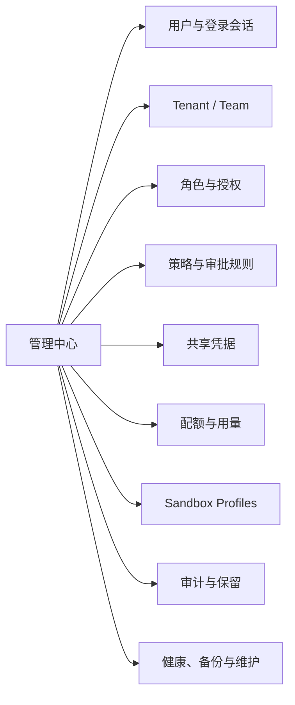

---

## 9. 第二阶段关键交互流程

### 9.1 Phase 1 升级与首位管理员认领

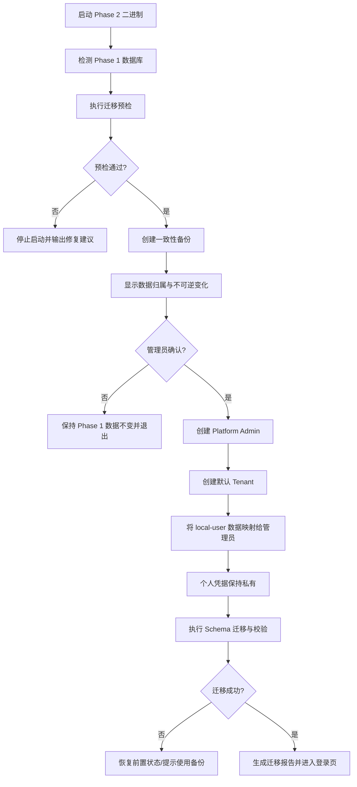

### 9.2 登录、Session 与 Tenant 切换

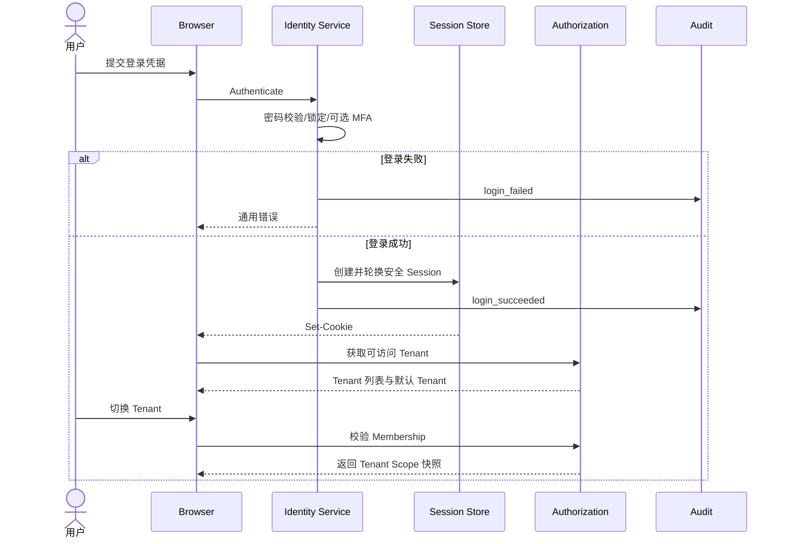

### 9.3 邀请成员加入 Team

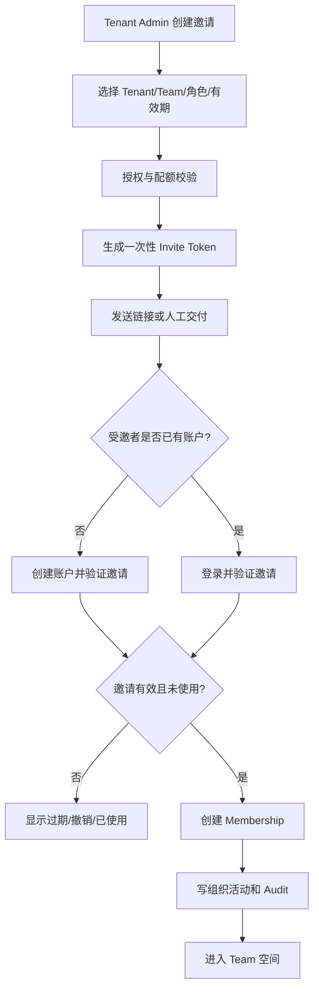

### 9.4 共享项目访问授权

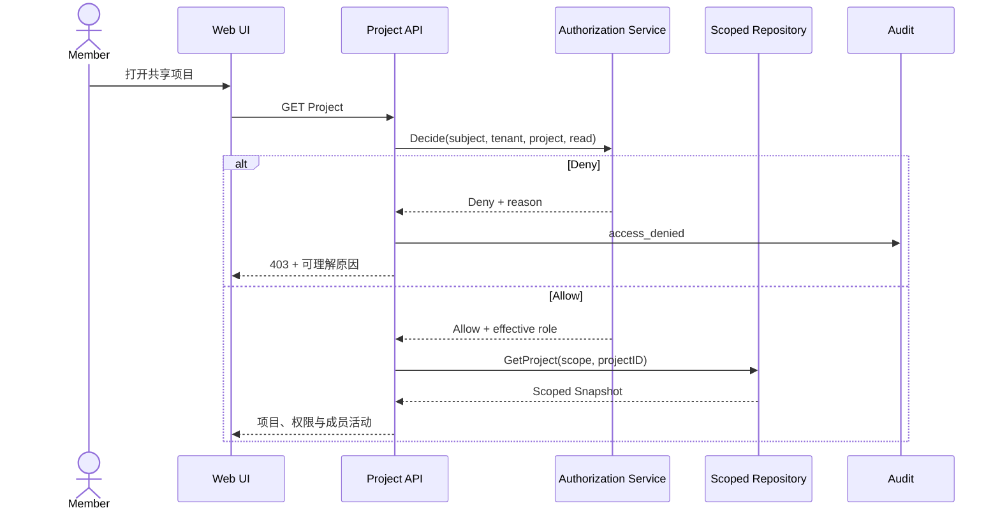

### 9.5 团队成员发起 Run

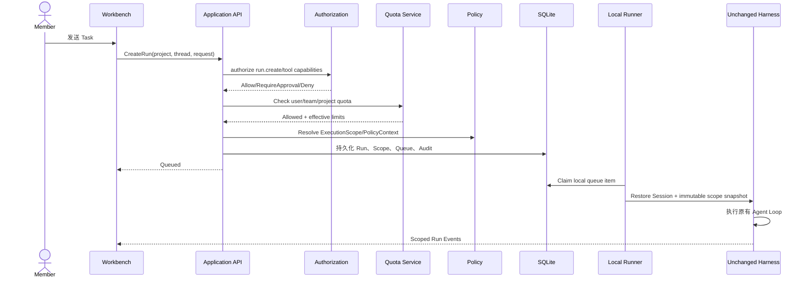

### 9.6 高风险 Tool 审批

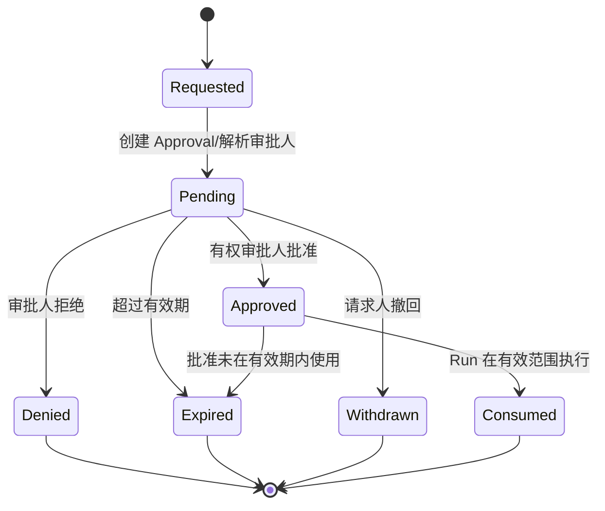

### 9.7 凭据解析与短期注入

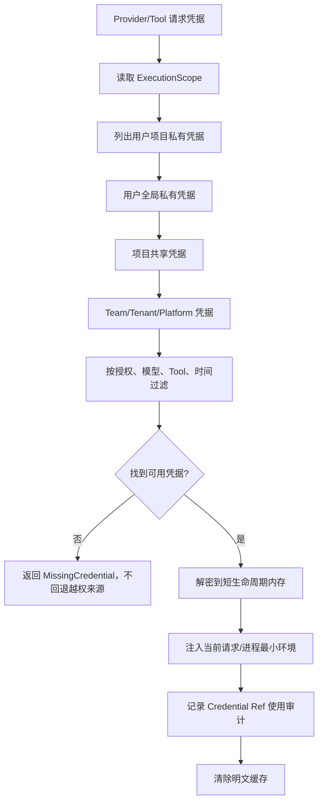

### 9.8 用户禁用与运行处理

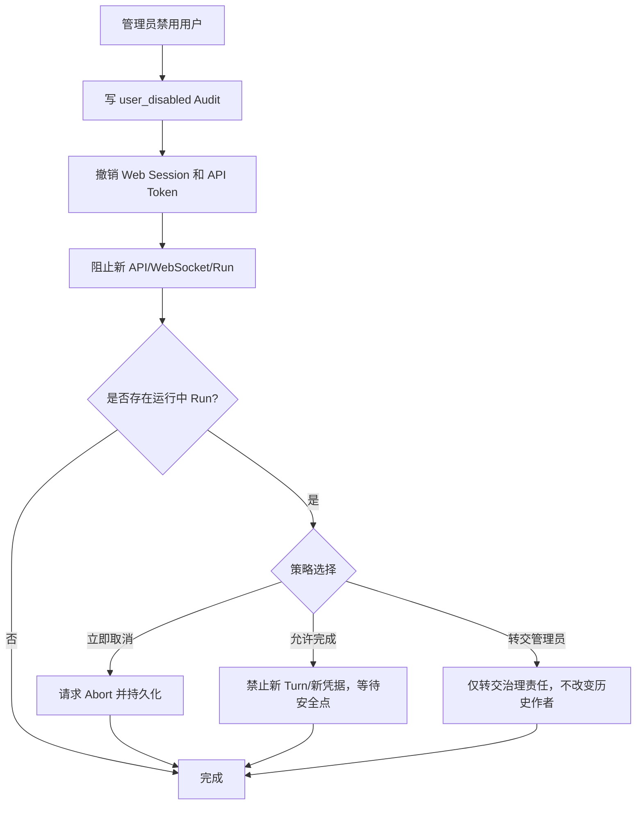

### 9.9 System Sandbox 执行与降级

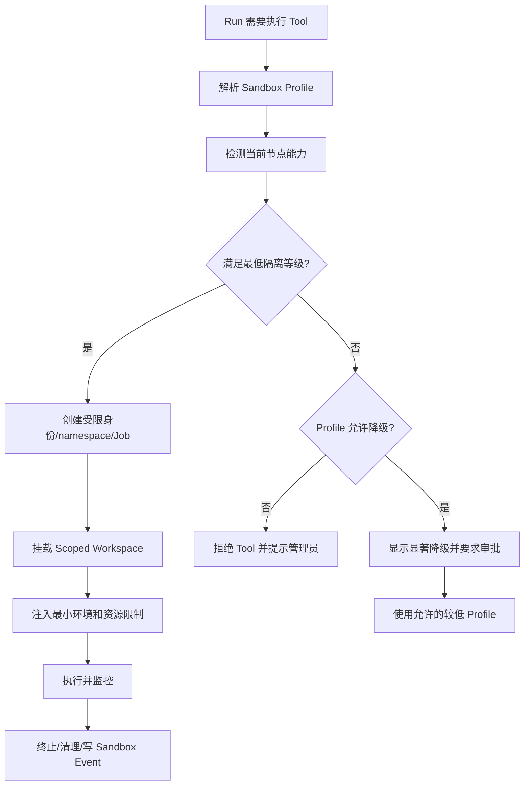

### 9.10 审计查询与导出

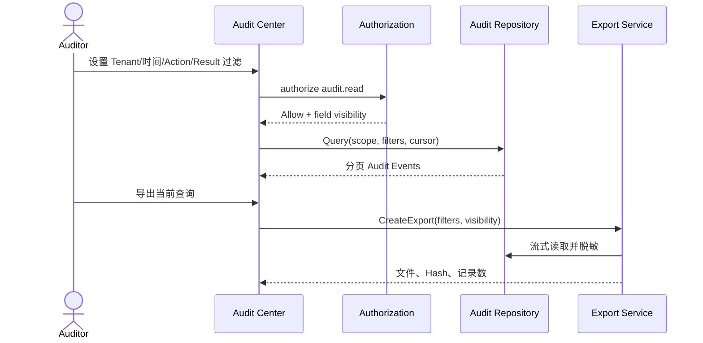

---

## 10. 第二阶段状态模型

### 10.1 User 与 Membership

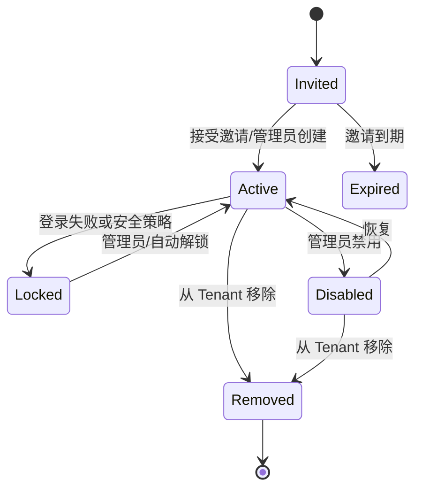

### 10.2 Approval

| 状态 | 含义 | 可执行动作 |
|---|---|---|
| Requested | 请求已创建，待解析审批人 | 系统解析 |
| Pending | 等待处理 | Approve、Deny、Withdraw、Delegate |
| Approved | 已批准但尚未消费 | Consume、Expire |
| Denied | 已拒绝 | 无 |
| Expired | 请求或批准已过期 | 重新发起 |
| Withdrawn | 请求人撤回 | 重新发起 |
| Consumed | 已用于一次具体执行 | 无 |

### 10.3 Project Workspace Lock

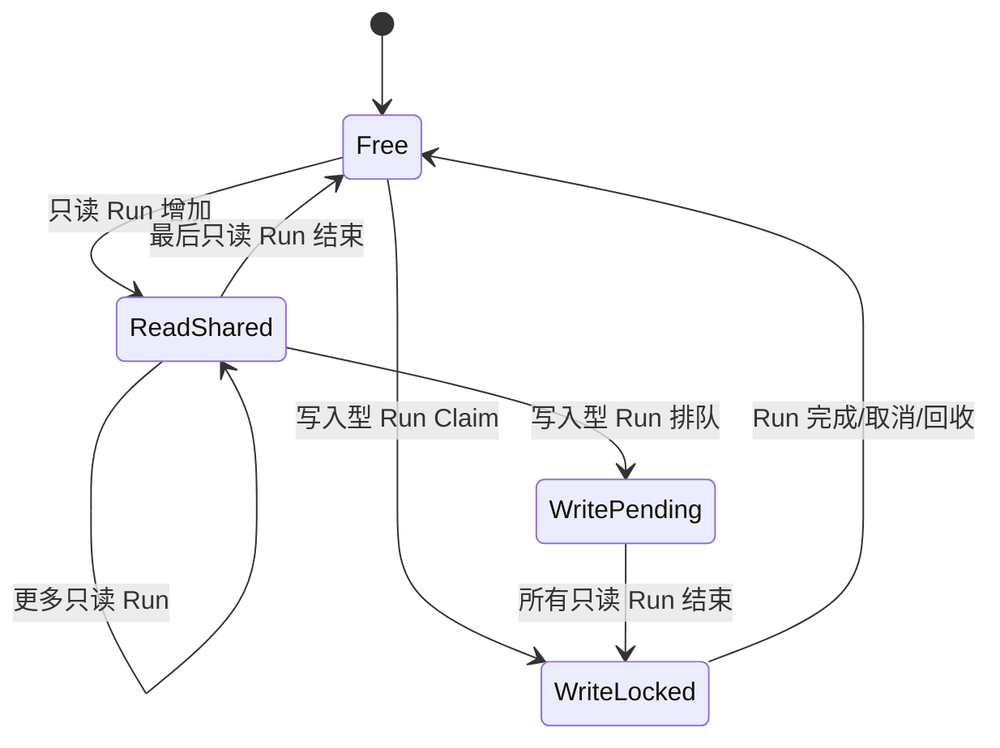

---

## 11. 第二阶段空状态、异常状态与降级

| 场景 | 产品行为 |
|---|---|
| 未创建 Team | 引导 Tenant Admin 创建 Team；不阻止个人项目使用 |
| 用户无可访问项目 | 展示申请访问、创建项目或联系管理员入口 |
| 无审批人 | 高风险操作失败关闭，并提示配置审批规则 |
| 共享凭据失效 | 不回退到其他用户私有凭据；显示可操作错误 |
| SQLite 锁竞争 | 显示排队/重试状态并记录指标，不将其伪装为 Provider 慢 |
| System Sandbox 不可用 | 按 Profile 阻止或显著降级，不静默执行 |
| 用户被禁用时页面在线 | 立即断开用户通道，清除客户端缓存并跳转登录 |
| Audit 写入失败 | 高风险管理/安全操作失败，普通只读操作可按策略降级告警 |
| Tenant 已停用 | 所有成员只读或完全阻断，具体由停用策略决定 |
| 配额耗尽 | 阻止新 Run/Provider Request，保留历史访问和导出 |

---

## 12. 第二阶段非功能要求

### 12.1 容量边界

- 建议 1～20 个活跃用户；
- 约 10 个同时在线 Web Session；
- 5～8 个并发 Run，受宿主 CPU/内存和 Sandbox Profile 限制；
- 单节点、SQLite WAL、本地 Artifact；
- 不提供 Server/数据库高可用承诺；
- 管理中心必须显示当前容量、锁等待和进入 Phase 3 的触发信号。

### 12.2 安全

- 所有资源访问具备 Tenant/Subject Scope；
- 跨租户访问自动化用例 100% 通过；
- 用户私有凭据不允许管理员读取明文；
- WebSocket 不得越权订阅；
- 高风险 Tool 和管理员操作必须写 Audit；
- 多用户写入型执行不得仅依赖 Simple Sandbox；
- Cookie、CSRF、Origin、速率限制和 Session 撤销必须通过安全测试。

### 12.3 可靠性

- 服务重启不丢已接受 Run、Approval 和 Queue；
- Phase 1 数据升级可验证、有备份和明确恢复路径；
- 禁用用户和角色变更对新请求立即生效；
- SQLite Busy/Lock 可观测并受上限保护；
- Audit、Credential 和 Workspace Scope 不因缓存或重连丢失。

### 12.4 可测试性

- `Authorization Contract Test` 覆盖角色、Action 和 Scope；
- `Tenant Isolation Test Suite` 覆盖 API、Repository、WebSocket、文件和缓存；
- `Identity Security Test` 覆盖登录、锁定、CSRF、Session 和 Token；
- `Approval Recovery Test` 覆盖重启、重复处理和过期；
- `Sandbox Capability Test` 覆盖 Linux/Windows 的可用能力和降级；
- 第一阶段 OHCS 和 E2E 不得退化。

---

## 13. 第二阶段验收场景

1. 从 Phase 1 数据目录升级并成功认领所有 Projects/Sessions；
2. 创建两个 Tenant，并验证数据、搜索、WebSocket、Artifact 和 Credential 不可串读；
3. 邀请成员、分配 Team/Project 角色并完成权限矩阵；
4. 两名成员在同一项目创建独立 Thread，作者与共享范围正确；
5. 写入型 Run 发生 Workspace 锁竞争时正确排队或提示；
6. 用户私有 Provider Key 只能被本人 Run 使用；
7. 高风险命令由指定审批人批准后继续，拒绝/过期可恢复；
8. 禁用用户后其 Session/API Token/WebSocket 立即失效；
9. System Sandbox 不可用时按策略阻断且 UI 显示原因；
10. Tenant/User/Project 配额达到阈值后预警和硬限制正确；
11. Auditor 可查询并导出完整审计，敏感内容按字段权限隐藏；
12. 备份恢复后 Membership、Approval、Audit 和 Session Tree 一致；
13. 第一阶段全部核心工作流继续可用。

### 13.1 Phase 2 完成定义

- 所有 `S2-* MUST` 通过验收；
- Phase 1 MUST 与 OHCS 全量回归通过；
- Harness 包不依赖 Identity/Tenant 具体实现；
- 跨 Tenant 安全测试无已知高危缺陷；
- 审计完整率达到 100%；
- Phase 1→Phase 2 升级演练成功；
- Windows/Linux 支持范围和 Sandbox 降级文档明确；
- 产品 UI 明确标注单节点容量和无 HA 边界。

---

## 14. 第二阶段 AI 编程实施拆分

### 14.1 内部里程碑

| 里程碑 | 内容 | 退出条件 |
|---|---|---|
| S2-A 升级与身份 | Schema、管理员认领、本地账户、Session 安全 | Phase 1 原地升级与登录 E2E |
| S2-B Tenant 与授权 | Tenant/Team/Membership、ExecutionScope、Repository Scope | 跨租户测试与权限矩阵通过 |
| S2-C 项目协作 | 项目共享、Thread 可见性、活动、Workspace Lock | 两成员协作 E2E |
| S2-D 凭据与资源 | Credential Scope、共享资源、记忆 | 私有/共享凭据隔离通过 |
| S2-E 策略与审批 | Policy、Approval、Quota、Notification | 高风险执行完整闭环 |
| S2-F 审计与管理 | Audit、Retention、Admin Center、Backup | 审计完整率和恢复演练通过 |
| S2-G System Sandbox | OS 隔离、Profile、能力探测、降级 | 双平台 Sandbox 用例通过 |

### 14.2 实施约束

- 不把 Tenant/User 字段加入 Harness 的核心消息和 Tool 协议；
- 不在 HTTP Handler 中直接读取数据库并手写权限；
- 不先实现“管理员可看一切”的捷径；
- 不使用全局当前用户变量；
- 不以浏览器隐藏按钮代替服务端授权；
- 不在 Phase 2 引入 PostgreSQL、Redis、Kubernetes 或 OPA 作为必要依赖。

---

## 15. 第二阶段明确不包含

- PostgreSQL 作为默认数据库；
- 多 API Server 或多 Worker；
- 高可用和无停机故障转移；
- S3/MinIO 对象存储；
- Kubernetes Sandbox Pool；
- SAML、SCIM 和企业目录全生命周期同步；
- PostgreSQL RLS；
- 集中 KMS/Vault 强依赖；
- WORM 审计存储；
- 多地域 Active-Active；
- Google Docs 式多人实时编辑；
- 默认启用 OPA/Rego、WASM 市场或任意远程插件执行。

---

# 第二部分：第三阶段产品功能设计

## 16. 第三阶段产品定义

### 16.1 一句话定义

**Oktapod 第三阶段是在完整继承 Phase 1 Harness 能力和 Phase 2 团队治理模型的基础上，通过 PostgreSQL、多 Server、多 Worker、S3、Container/Kubernetes Sandbox、企业身份、KMS、集中审计和可观测性，形成可横向扩展、可高可用部署的企业级多用户 Agent 工程平台。**

### 16.2 阶段定位

第三阶段解决的是**规模、隔离强度、基础设施高可用和企业运维**，不是重新设计业务产品：

- 页面中的 Project、Thread、Task、Run、Approval 和 Audit 语义保持不变；
- API 和 Event Envelope 保持兼容，必要变化通过版本化扩展；
- SQLite Repository 替换为 PostgreSQL Adapter；
- Embedded Worker 替换为独立、多节点 Worker；
- 本地 Artifact 替换为 S3/MinIO；
- System Sandbox 替换为 Docker/Kubernetes Sandbox Pool；
- 本地身份和 Secret 可替换为企业 IdP、KMS/Vault；
- 单节点管理中心扩展为集群运维与合规中心。

### 16.3 企业角色增量

| 角色 | 主要能力 |
|---|---|
| Platform Operator | 管理 Server、Worker、队列、Sandbox Pool、升级、备份与容量 |
| Security Admin | 管理企业身份、KMS、Egress、签名、双人审批和安全策略 |
| Compliance Auditor | 查询集中审计、保留、导出、Legal Hold 和 WORM 状态 |
| Identity Admin | 配置 OIDC/SAML、域、Group Mapping 和可选 SCIM |
| Cost Manager | 管理 Provider 路由、预算、成本中心、配额和归因 |
| Service Account Owner | 创建、轮换和撤销服务账户及机器凭据 |

### 16.4 第三阶段成功标准

1. 从 Phase 2 SQLite 安全迁移到 PostgreSQL，并完成数据与 Artifact 校验；
2. API Server 和 Worker 可独立部署，增加节点无需修改业务配置；
3. Worker 崩溃或 Lease 过期后 Run 从持久边界恢复；
4. 多 Server WebSocket 可断线重连并按 Sequence 补拉事件；
5. Artifact 通过 S3/MinIO 管理，支持完整性、生命周期和权限；
6. 每个高风险 Run 在独立 Container/Kubernetes Sandbox 中执行；
7. 企业用户可通过 OIDC/SAML 登录，可选 SCIM 同步组织；
8. Secret 通过 KMS/Vault 解析和轮换，Worker 仅获得短期最小凭据；
9. PostgreSQL RLS 与服务层授权形成纵深隔离；
10. 集群支持滚动升级、Worker Drain、备份恢复和可观测性关联；
11. 第一、第二阶段所有兼容与安全测试继续通过。

---

## 17. 第三阶段关键产品决策

### D3-1：PostgreSQL 是集群权威状态源

PostgreSQL 承担事务数据、Run Queue、Worker Lease、Run Event、Transactional Outbox 和审计索引。正确性不依赖 Redis；缓存和消息系统只能作为可选优化。

### D3-2：同一代码库支持 API、Worker 和 All-in-One 角色

```bash
oktapod serve --role=api
oktapod serve --role=worker
oktapod serve --role=all
```

镜像和 Helm Chart 可设置默认角色，但不得复制领域和 Harness 代码。

### D3-3：Lease + Fencing Token 是调度正确性边界

Worker Claim 必须包含 Lease Expiry、Heartbeat、Attempt 和 Fencing Token。旧 Worker 即使恢复也不能以过期 Token 提交完成结果。

### D3-4：持久 Run Event 是实时 UI 的事实来源

PG Notify、消息总线和进程内广播都只是低延迟信号；客户端重连必须携带 Last Sequence 并从 Event Store 补拉。

### D3-5：对象存储保存大对象，数据库保存权威元数据

Artifact、完整 Tool 输出、导出文件和 Sandbox 日志保存到 S3/MinIO；数据库保存 Hash、Size、Content Type、Scope、Retention 和引用。

### D3-6：企业强隔离使用 Container/Kubernetes Sandbox

高风险或无人监督执行不得仅依赖 Host Process。Sandbox 必须具备独立文件挂载、资源限制、网络策略、短期 Secret 和自动回收。

### D3-7：RLS 是纵深防御，不替代服务层授权

服务层继续执行 Phase 2 Authorization；PostgreSQL RLS 防止 Repository Bug 和错误查询造成跨租户泄露。

### D3-8：不承诺 Provider Stream 无缝恢复

模型流本身不可恢复。Server/Worker 故障时，Run 从最近持久边界标记中断、重试或等待人工处理；非幂等 Tool 不自动重放。

---

## 18. 第三阶段信息架构

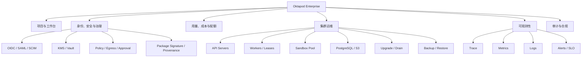

### 18.1 第三阶段页面增量

| 页面 | 主要用途 |
|---|---|
| 集群总览 | Server、Worker、Queue、Sandbox、PostgreSQL、S3、SLO 和风险 |
| Worker 管理 | 节点标签、能力、心跳、Lease、Drain、版本和资源 |
| Sandbox Pool | Profile、镜像、Pod/Container、配额、启动失败和回收 |
| 存储中心 | PostgreSQL、S3 Bucket、容量、生命周期、备份和校验 |
| 身份集成 | OIDC/SAML、Domain、Group Mapping、SCIM 和登录策略 |
| Secret 管理 | KMS/Vault Provider、引用、轮换、健康和使用审计 |
| 企业策略 | Egress、数据驻留、双人审批、签名、保留和 Legal Hold |
| 可观测性 | Run/Turn/Tool 跨 Server/Worker Trace、指标、日志和告警 |
| 升级中心 | 版本兼容、数据库迁移、Server 滚动升级、Worker Drain |
| 迁移向导 | SQLite→PG、Local Artifact→S3、校验和切换 |

---

## 19. 第三阶段完整增量功能清单

### 19.1 集群部署与拓扑

| ID | 功能 | 产品行为 | 优先级 |
|---|---|---|---|
| S3-DEP-001 | 角色化启动 | 同一二进制支持 api、worker、all 角色 | MUST |
| S3-DEP-002 | 容器镜像 | 提供最小、非 Root、可扫描的 API/Worker 通用镜像 | MUST |
| S3-DEP-003 | Kubernetes Helm Chart | 部署 Server、Worker、配置、Secret、Service、Ingress 和 HPA | MUST |
| S3-DEP-004 | Docker Compose | 提供小型集群/评估部署，包含 PG、MinIO 和 Worker | SHOULD |
| S3-DEP-005 | 外部依赖检查 | 启动前验证 PG、S3、IdP、KMS、Sandbox 和版本兼容 | MUST |
| S3-DEP-006 | 配置分层 | 平台、环境、Tenant 和节点配置来源可追踪 | MUST |
| S3-DEP-007 | Server 无状态 | 除短期缓存外不持有权威 Session/Run 状态 | MUST |
| S3-DEP-008 | 节点注册 | Server/Worker 注册实例 ID、版本、能力、标签和心跳 | MUST |
| S3-DEP-009 | 版本兼容 | API、Worker、DB Schema 和 Sandbox Protocol 有兼容矩阵 | MUST |
| S3-DEP-010 | 多环境 Profile | dev/test/prod 使用显式 Profile，禁止生产默认弱配置 | MUST |
| S3-DEP-011 | 基础设施即代码示例 | 提供 Helm values、Terraform 接口说明和安全基线 | SHOULD |

### 19.2 PostgreSQL 与 SQLite 迁移

| ID | 功能 | 产品行为 | 优先级 |
|---|---|---|---|
| S3-PGM-001 | PostgreSQL Adapter | 所有 Repository Contract 在 PG 实现并通过双数据库测试 | MUST |
| S3-PGM-002 | Schema Migration | 版本化、可锁定、可观察的 PG 前向迁移 | MUST |
| S3-PGM-003 | SQLite→PG 预检 | 检查版本、数据量、外键、路径、Artifact 和停机窗口 | MUST |
| S3-PGM-004 | 迁移批次 | 每次迁移具有 ID、阶段、游标、计数、错误和校验结果 | MUST |
| S3-PGM-005 | 可恢复迁移 | 批量复制使用幂等键和检查点，中断后可继续 | MUST |
| S3-PGM-006 | 一致性校验 | 对象计数、Hash、关系、Session Tree、Usage 和 Audit 校验 | MUST |
| S3-PGM-007 | Artifact 迁移 | 本地 Artifact 上传 S3，写入 Hash 和新 Location | MUST |
| S3-PGM-008 | 切换门禁 | 校验通过前不允许将 PG 标记为权威数据源 | MUST |
| S3-PGM-009 | 回退窗口 | 切换前保留只读 SQLite 快照；切换后不支持双写回退 | MUST |
| S3-PGM-010 | 迁移报告 | 展示耗时、数量、异常、未迁移资源和人工步骤 | MUST |
| S3-PGM-011 | 连接池 | 按角色和负载配置连接池、超时和可观测指标 | MUST |
| S3-PGM-012 | 事务边界 | Run/Queue/Outbox/Audit 关键写使用明确事务 | INTERNAL |
| S3-PGM-013 | RLS 基础 | Tenant 关键表配置并测试 Row-Level Security | MUST |

### 19.3 Durable Queue、调度与 Worker Lease

| ID | 功能 | 产品行为 | 优先级 |
|---|---|---|---|
| S3-SCH-001 | PG Run Queue | Queued Run 作为持久记录由 Worker 原子 Claim | MUST |
| S3-SCH-002 | Worker Lease | 保存 Worker ID、Expiry、Heartbeat、Attempt 和 Fencing Token | MUST |
| S3-SCH-003 | 原子 Claim | 使用锁/跳过已锁行等 PG 语义避免重复 Claim | MUST |
| S3-SCH-004 | Heartbeat | Worker 定期续约并上报 Run 和 Sandbox 状态 | MUST |
| S3-SCH-005 | Lease 过期 | 过期后按 Tool 幂等性和 Run 状态决定重排或中断 | MUST |
| S3-SCH-006 | Fencing | 旧 Worker 使用过期 Token 提交事件/完成时被拒绝 | MUST |
| S3-SCH-007 | 调度标签 | 按 OS、架构、GPU、Sandbox、网络区和数据驻留匹配 Worker | MUST |
| S3-SCH-008 | 优先级 | 支持 Tenant/Project/Run 优先级和公平调度 | SHOULD |
| S3-SCH-009 | 配额调度 | Claim 前检查 Tenant/User/Project 并发和资源额度 | MUST |
| S3-SCH-010 | 取消排队 | 用户取消 Queued Run 时原子阻止 Worker Claim | MUST |
| S3-SCH-011 | Drain | Worker Drain 后不接新 Run，现有 Run 完成或迁移到安全边界 | MUST |
| S3-SCH-012 | 死信与人工处理 | 无法安全重试的 Run 进入 NeedsAttention 队列 | MUST |
| S3-SCH-013 | 调度解释 | Run 页面显示等待原因、匹配条件和候选 Worker 摘要 | SHOULD |
| S3-SCH-014 | LISTEN/NOTIFY | 仅作唤醒优化，正确性仍依赖轮询和持久状态 | INTERNAL |

### 19.4 Worker 与节点管理

| ID | 功能 | 产品行为 | 优先级 |
|---|---|---|---|
| S3-WKR-001 | Worker 注册 | 启动时注册身份、版本、能力、标签和最大并发 | MUST |
| S3-WKR-002 | Worker 心跳 | 上报健康、资源、活动 Lease、Sandbox 和错误 | MUST |
| S3-WKR-003 | Worker 状态 | Ready、Busy、Draining、Offline、Incompatible、Degraded | MUST |
| S3-WKR-004 | 并发槽位 | 按 CPU/内存/GPU/Sandbox Profile 管理执行槽位 | MUST |
| S3-WKR-005 | 能力标签 | 管理员设置或自动发现 OS、工具链、网络区和硬件 | MUST |
| S3-WKR-006 | 版本门禁 | 不兼容 Worker 不得 Claim 新 Run | MUST |
| S3-WKR-007 | 远程诊断 | 查看脱敏日志、最近错误、Sandbox 和 Lease | MUST |
| S3-WKR-008 | Cordoning | 管理员禁止节点接收新任务 | MUST |
| S3-WKR-009 | Drain 进度 | 显示活动 Run、预计完成、强制中断风险 | MUST |
| S3-WKR-010 | 节点删除 | 仅 Offline 且无有效 Lease 时移除注册 | MUST |
| S3-WKR-011 | 自动扩缩接口 | 暴露 Queue/Resource 指标供 HPA/KEDA 使用 | SHOULD |
| S3-WKR-012 | GPU Worker | 通过标签和资源请求支持可选 GPU Tool/模型任务 | OPTIONAL |

### 19.5 多 Server 事件流与实时连接

| ID | 功能 | 产品行为 | 优先级 |
|---|---|---|---|
| S3-EVT-001 | 持久 Run Event | 事件先持久化并获得 Sequence，再向客户端发布 | MUST |
| S3-EVT-002 | 多 Server WebSocket | 客户端可连接任一 Server 并订阅有权限的 Run | MUST |
| S3-EVT-003 | Last Sequence Resume | 重连携带最后 Sequence，从 PG 补拉缺失事件 | MUST |
| S3-EVT-004 | 通知丢失恢复 | Notify/消息总线丢失不影响最终事件完整性 | MUST |
| S3-EVT-005 | Snapshot + Events | 页面先获取权威 Snapshot，再应用后续事件 | MUST |
| S3-EVT-006 | 幂等 Reducer | 客户端重复消费同一 Sequence 不改变结果 | MUST |
| S3-EVT-007 | 连接迁移 | Server 下线时客户端指数退避连接其他 Server | MUST |
| S3-EVT-008 | 用户通知通道 | 审批、配额、系统公告跨 Server 一致推送 | MUST |
| S3-EVT-009 | 事件保留 | 热事件保留与归档策略可配置，Session 事实不被错误清理 | MUST |
| S3-EVT-010 | 事件延迟指标 | 持久化、发布、客户端确认和补拉延迟可观测 | SHOULD |
| S3-EVT-011 | Sticky Session | 可用于性能优化，但不得作为正确性条件 | INTERNAL |

### 19.6 S3/MinIO Artifact 与对象生命周期

| ID | 功能 | 产品行为 | 优先级 |
|---|---|---|---|
| S3-OBJ-001 | 对象存储 Adapter | 支持 S3 API 和 MinIO，数据库保存权威元数据 | MUST |
| S3-OBJ-002 | Tenant Key Prefix | 对象 Key 包含不可猜测的 Tenant/Artifact 标识 | MUST |
| S3-OBJ-003 | 上传完整性 | 流式上传并校验 Size、Checksum 和 Content Type | MUST |
| S3-OBJ-004 | 大文件分片 | 支持 Multipart Upload、失败清理和断点策略 | SHOULD |
| S3-OBJ-005 | 受控下载 | API 鉴权后代理下载或生成短期 Signed URL | MUST |
| S3-OBJ-006 | 服务器端加密 | 支持 SSE-S3/SSE-KMS 等配置 | MUST |
| S3-OBJ-007 | 生命周期 | 按 Artifact 类型、Tenant、保留和 Legal Hold 配置 | MUST |
| S3-OBJ-008 | 版本与覆盖 | 默认不可原地覆盖；新内容生成新 Artifact/Version | MUST |
| S3-OBJ-009 | 引用完整性 | 删除前检查 Session、Run、Audit 和导出引用 | MUST |
| S3-OBJ-010 | 孤儿清理 | 扫描无元数据对象和无对象元数据，生成报告后处理 | SHOULD |
| S3-OBJ-011 | 本地缓存 | Worker 可使用有上限的临时缓存，Hash 不符立即丢弃 | OPTIONAL |
| S3-OBJ-012 | 跨区策略 | 数据驻留标签限制可用 Bucket/Endpoint | SHOULD |

### 19.7 Container/Kubernetes Sandbox Pool

| ID | 功能 | 产品行为 | 优先级 |
|---|---|---|---|
| S3-KSB-001 | Sandbox Profile | 镜像、CPU、内存、磁盘、网络、挂载、超时和安全上下文版本化 | MUST |
| S3-KSB-002 | 按 Run 创建 | 高风险 Run 在独立 Container/Pod 中执行 | MUST |
| S3-KSB-003 | 非 Root | 默认非 Root、只读根文件系统和最小 Linux Capabilities | MUST |
| S3-KSB-004 | Seccomp/AppArmor | 支持平台可用的系统调用和 LSM 策略 | SHOULD |
| S3-KSB-005 | Workspace 挂载 | 使用临时 Volume、受控 PVC 或对象同步，不挂载宿主敏感目录 | MUST |
| S3-KSB-006 | 网络策略 | 默认拒绝，按域名/出口代理/NetworkPolicy 放行 | MUST |
| S3-KSB-007 | 短期 Secret | 仅注入当前 Tool/Run 所需的短期凭据 | MUST |
| S3-KSB-008 | 资源配额 | 使用 requests/limits、ephemeral storage 和执行时长 | MUST |
| S3-KSB-009 | 启动与就绪 | 记录 Pending、Pulling、Starting、Ready 和失败原因 | MUST |
| S3-KSB-010 | 日志流 | 标准输出、错误和 Tool Update 流式进入 Run Event/Artifact | MUST |
| S3-KSB-011 | 取消与回收 | Abort、超时和 Worker 故障后最终回收资源 | MUST |
| S3-KSB-012 | 镜像策略 | 只允许批准 Registry、Digest 固定和扫描状态 | MUST |
| S3-KSB-013 | 预热池 | 对常用 Profile 提供可选预热以降低启动延迟 | OPTIONAL |
| S3-KSB-014 | Sandbox 可观测 | 启动、资源、网络、退出、OOM 和回收关联 Run | MUST |

### 19.8 企业身份、目录与服务账户

| ID | 功能 | 产品行为 | 优先级 |
|---|---|---|---|
| S3-IDP-001 | 多 OIDC Provider | 按域或 Tenant 配置多个企业 IdP | MUST |
| S3-IDP-002 | SAML 2.0 | 支持企业 SSO、签名校验、时钟偏差和证书轮换 | MUST |
| S3-IDP-003 | Domain Discovery | 根据邮箱域或登录入口选择 IdP | SHOULD |
| S3-IDP-004 | Just-in-Time Provisioning | 首次登录按策略创建用户和默认 Membership | MUST |
| S3-IDP-005 | Group Mapping | IdP Group 映射 Tenant/Team/Role，变更可预览 | MUST |
| S3-IDP-006 | SCIM 2.0 | 可选同步 User、Group、禁用和删除 | OPTIONAL |
| S3-IDP-007 | 身份链接 | 安全合并本地账户与企业身份，防止邮箱接管 | MUST |
| S3-IDP-008 | MFA/认证强度 | 读取 IdP Claim 并按风险要求认证强度 | SHOULD |
| S3-IDP-009 | 服务账户 | 机器身份、Owner、Scope、过期、轮换和使用审计 | MUST |
| S3-IDP-010 | 短期机器 Token | 使用 OIDC Client Credentials 或平台签发短期 Token | SHOULD |
| S3-IDP-011 | Break-glass Admin | 离线应急账户受强审计、MFA 和使用告警 | SHOULD |
| S3-IDP-012 | 会话全局撤销 | IdP 禁用/SCIM 删除触发平台 Session 和 Token 失效 | MUST |

### 19.9 KMS/Vault 与企业 Secret

| ID | 功能 | 产品行为 | 优先级 |
|---|---|---|---|
| S3-KMS-001 | Secret Provider Adapter | 支持 KMS Envelope、Vault 或云 Secret Manager | MUST |
| S3-KMS-002 | Secret Ref | 业务数据只保存 Provider、Path/Key、Version 和元数据 | MUST |
| S3-KMS-003 | 动态凭据 | 支持 Vault 数据库/云凭据等短期动态 Secret | SHOULD |
| S3-KMS-004 | Worker 身份 | Worker 使用工作负载身份访问其被授权的 Secret | MUST |
| S3-KMS-005 | 最小解析 | 仅在 Provider Request/Tool 执行前解析所需 Secret | MUST |
| S3-KMS-006 | 内存生命周期 | 明文不落盘，尽快释放且不进入 Trace/Crash Dump | MUST |
| S3-KMS-007 | 轮换 | 支持版本切换、双版本过渡和失效影响分析 | MUST |
| S3-KMS-008 | 健康检查 | 检测 Provider 可用性、权限、延迟和即将过期证书 | MUST |
| S3-KMS-009 | 访问审计 | 平台与外部 Secret 系统的访问记录可关联 Run | MUST |
| S3-KMS-010 | 故障策略 | Secret 系统不可用时不使用过期明文缓存执行高风险操作 | MUST |
| S3-KMS-011 | Tenant 自有 KMS | 允许 Tenant 配置独立 KMS Key/Namespace | OPTIONAL |

### 19.10 企业策略、Egress 与供应链

| ID | 功能 | 产品行为 | 优先级 |
|---|---|---|---|
| S3-SEC-001 | 数据驻留 | Tenant/Project 标签限制 Worker、Region、Bucket 和 Provider | MUST |
| S3-SEC-002 | Egress Gateway | Sandbox 出网经受控代理，记录域名、目标和策略 | MUST |
| S3-SEC-003 | DNS/IP 防绕过 | 解析后检查私网、元数据地址、重绑定和端口 | MUST |
| S3-SEC-004 | 双人审批 | 生产部署、强制 Push、敏感数据导出等可要求两名不同审批人 | SHOULD |
| S3-SEC-005 | 策略适配器 | 可选接入外部 Policy Engine，但保持统一 Decision Contract | OPTIONAL |
| S3-SEC-006 | Package 签名 | 验证签名、Digest、Signer 和信任策略 | MUST |
| S3-SEC-007 | Provenance | 记录构建来源、版本、依赖和扫描结果 | SHOULD |
| S3-SEC-008 | 镜像扫描 | 阻止不符合漏洞/签名策略的 Sandbox 镜像 | MUST |
| S3-SEC-009 | SBOM | 官方镜像和 Package 生成/展示 SBOM | SHOULD |
| S3-SEC-010 | 安全事件 | 异常访问、沙箱逃逸迹象、Secret 滥用和策略绕过告警 | MUST |
| S3-SEC-011 | RLS 验证 | 服务账号、Migration 和后台任务均使用正确 Tenant Context | MUST |
| S3-SEC-012 | Legal Hold | 阻止指定 Tenant/Project/Run/Audit 被生命周期清理 | SHOULD |

### 19.11 集中审计与合规

| ID | 功能 | 产品行为 | 优先级 |
|---|---|---|---|
| S3-CAU-001 | 集中 Audit Store | 多 Server/Worker 审计进入统一事实源 | MUST |
| S3-CAU-002 | Transactional Outbox | 业务事务与待发布审计/事件原子提交 | MUST |
| S3-CAU-003 | 外部 SIEM | 可靠推送到 Syslog、Kafka/HTTP 等适配器 | SHOULD |
| S3-CAU-004 | WORM 导出 | 周期导出到 Object Lock/WORM 存储并验证 Hash | SHOULD |
| S3-CAU-005 | 审计链完整性 | 批次 Manifest、Hash 和签名用于检测篡改 | SHOULD |
| S3-CAU-006 | 合规报表 | 登录、权限、审批、Secret、数据导出和管理员操作报表 | MUST |
| S3-CAU-007 | 数据访问报告 | 按用户/项目/数据源追踪上下文与 Artifact 访问 | MUST |
| S3-CAU-008 | 保留与删除 | 按法规、Tenant 和 Legal Hold 执行可证明清理 | MUST |
| S3-CAU-009 | 审计分区 | 按时间/Tenant 分区和归档，查询保持可用 | MUST |
| S3-CAU-010 | 导出审批 | 大范围或敏感审计导出可要求审批 | SHOULD |
| S3-CAU-011 | 时钟一致性 | 记录服务器时间、来源和偏差指标 | MUST |

### 19.12 可观测性、SLO 与告警

| ID | 功能 | 产品行为 | 优先级 |
|---|---|---|---|
| S3-OBS-001 | OpenTelemetry | Server、Worker、Provider、Tool、Sandbox、PG、S3 统一 Trace/Metrics/Logs | MUST |
| S3-OBS-002 | Trace 关联 | Tenant/User/Project/Task/Run/Turn/Tool/Worker/Sandbox Correlation | MUST |
| S3-OBS-003 | 队列指标 | Queue Depth、Wait、Claim、Lease Expiry、Retry 和 Dead Letter | MUST |
| S3-OBS-004 | Worker 指标 | 心跳、槽位、CPU、内存、GPU、Sandbox 和错误 | MUST |
| S3-OBS-005 | 数据库指标 | 连接池、事务、锁、慢查询、复制延迟和存储 | MUST |
| S3-OBS-006 | 对象存储指标 | 延迟、错误、流量、容量、Multipart 和校验失败 | MUST |
| S3-OBS-007 | Sandbox 指标 | 启动、镜像拉取、OOM、网络拒绝、退出和回收 | MUST |
| S3-OBS-008 | SLO | 定义 API、事件、调度、Run 成功和恢复目标 | MUST |
| S3-OBS-009 | 告警 | 按严重度、Tenant 影响和组件路由通知 | MUST |
| S3-OBS-010 | 脱敏 | Telemetry 不记录 Secret、完整 Prompt 和未经授权文件内容 | MUST |
| S3-OBS-011 | 运行诊断 | 从 Run 页面跳转到跨组件 Trace 和相关日志 | MUST |
| S3-OBS-012 | 容量预测 | 基于队列、Worker 和成本趋势提供扩容建议 | SHOULD |

### 19.13 高可用、备份与灾难恢复

| ID | 功能 | 产品行为 | 优先级 |
|---|---|---|---|
| S3-HA-001 | 多 Server | 负载均衡后任一健康 Server 可处理请求 | MUST |
| S3-HA-002 | Server 故障 | 客户端重连其他 Server，未持久化响应不视为成功 | MUST |
| S3-HA-003 | Worker 故障 | Lease 过期后按安全策略恢复或标记中断 | MUST |
| S3-HA-004 | PostgreSQL HA | 支持受维护的主备/云托管方案和故障切换 | MUST |
| S3-HA-005 | S3 高可用 | 依赖对象存储服务的冗余、版本和生命周期 | MUST |
| S3-HA-006 | 数据库备份 | 全量+WAL/PITR 或云等价能力，周期校验 | MUST |
| S3-HA-007 | 配置备份 | 加密备份平台配置、签名信任和 KMS 引用，不导出明文 Secret | MUST |
| S3-HA-008 | 恢复演练 | 按计划恢复到隔离环境并验证应用一致性 | MUST |
| S3-HA-009 | RPO/RTO 配置 | 按部署 Profile 定义并在管理页展示目标与最近演练 | SHOULD |
| S3-HA-010 | 非幂等保护 | 故障后非幂等 Tool 进入人工确认，不自动重放 | MUST |
| S3-HA-011 | Provider Stream | 故障时标记 Interrupted，不宣称无缝续流 | MUST |
| S3-HA-012 | 区域故障 | 单区域多可用区为推荐基线；跨区域 Active-Active 不作默认承诺 | MUST |

### 19.14 滚动升级与集群运维

| ID | 功能 | 产品行为 | 优先级 |
|---|---|---|---|
| S3-OPS-001 | 升级预检 | 检查版本矩阵、DB Migration、Worker Protocol、Sandbox Image 和备份 | MUST |
| S3-OPS-002 | Server 滚动升级 | 逐节点摘流、升级、健康验证和恢复服务 | MUST |
| S3-OPS-003 | Worker Drain 升级 | 停止 Claim、等待安全完成、强制中断需确认 | MUST |
| S3-OPS-004 | Schema 兼容窗口 | 支持相邻版本 Server/Worker 在滚动期共存 | MUST |
| S3-OPS-005 | 维护窗口 | 配置通知、冻结高风险操作和升级步骤 | SHOULD |
| S3-OPS-006 | 集群健康 | 组件依赖图、影响范围和建议动作 | MUST |
| S3-OPS-007 | 配置发布 | 配置草稿、校验、Diff、审批、分批生效和回滚 | MUST |
| S3-OPS-008 | Feature Flag | 版本化、作用域化开关，不用于绕过安全门禁 | SHOULD |
| S3-OPS-009 | Run 管理 | 查找卡住 Run、取消、重新排队或标记 NeedsAttention | MUST |
| S3-OPS-010 | 节点隔离 | 发现异常 Worker 后自动 Cordoning 并告警 | SHOULD |
| S3-OPS-011 | 支持包 | 导出脱敏集群拓扑、版本、指标、日志和错误样本 | SHOULD |
| S3-OPS-012 | 许可/商业计费 | 不作为本架构阶段的核心技术依赖 | EXCLUDED |

### 19.15 企业模型路由、成本与容量

| ID | 功能 | 产品行为 | 优先级 |
|---|---|---|---|
| S3-CST-001 | 集中 Provider 配置 | Platform/Tenant 管理可用 Provider、Endpoint 和 Credential Ref | MUST |
| S3-CST-002 | 模型策略 | 按 Tenant、数据驻留、任务类型、能力和成本选择模型 | MUST |
| S3-CST-003 | 故障转移 | 仅在协议、数据策略和用户设置允许时切换备用 Provider | SHOULD |
| S3-CST-004 | 限流协调 | 跨 Server 统一 Provider/Tenant Rate Limit | MUST |
| S3-CST-005 | 成本中心 | Tenant/Team/Project 映射成本中心和标签 | SHOULD |
| S3-CST-006 | 预算执行 | 分布式并发下使用原子预算预留和结算 | MUST |
| S3-CST-007 | 容量池 | Worker/Sandbox 按标签形成容量池并分配配额 | MUST |
| S3-CST-008 | 公平性 | 避免单 Tenant 占满全局 Worker 和 Provider 配额 | MUST |
| S3-CST-009 | 用量导出 | 对接企业 FinOps/BI，字段脱敏且可追溯 | SHOULD |
| S3-CST-010 | 价格目录 | 集中维护价格版本、币种和生效时间 | MUST |

### 19.16 企业 API、Service Account 与集成

| ID | 功能 | 产品行为 | 优先级 |
|---|---|---|---|
| S3-API-001 | 无状态 API | 所有 API Server 从权威存储和缓存获取状态 | MUST |
| S3-API-002 | 服务账户 Token | 短期、可撤销、Scope 化机器 Token | MUST |
| S3-API-003 | API Rate Limit | 按 Tenant、Subject、Endpoint 和 Token 限速 | MUST |
| S3-API-004 | Webhook Outbox | 事件通过 Outbox 可靠投递、重试和死信 | SHOULD |
| S3-API-005 | 审计流 | 向 SIEM/数据平台提供受控增量导出 | SHOULD |
| S3-API-006 | Idempotency Store | 跨 Server 共享幂等键和结果 | MUST |
| S3-API-007 | OpenAPI 兼容 | Phase 2 API 保持兼容，集群字段向后兼容扩展 | MUST |
| S3-API-008 | SDK 重连 | Go SDK 支持 Server 切换、Sequence Resume 和指数退避 | MUST |
| S3-API-009 | Connector 隔离 | 外部 Connector 以 Service Account、Scope 和独立 Secret 运行 | MUST |
| S3-API-010 | 管理 API | 节点、Worker、Sandbox、迁移、备份和升级接口具备强授权 | MUST |
| S3-API-011 | 异步操作 | 迁移、导出、备份和升级返回 Operation ID 与进度事件 | MUST |

### 19.17 集群可靠性与验证

| ID | 功能 | 产品行为 | 优先级 |
|---|---|---|---|
| S3-REL-001 | Storage Contract | SQLite/PG 使用同一领域测试套件 | MUST |
| S3-REL-002 | 故障注入 | Server Crash、Worker Crash、Lease Expiry、PG Failover、S3 Error | MUST |
| S3-REL-003 | 重复投递 | 事件、Webhook、Outbox 和 Worker 完成均可幂等处理 | MUST |
| S3-REL-004 | 网络分区 | Worker 与 PG/Server/S3 短暂断连后状态收敛 | MUST |
| S3-REL-005 | 时钟偏差 | Lease、SAML、Token 和 Audit 对偏差有监测和容忍边界 | MUST |
| S3-REL-006 | RLS 测试 | 跨 Tenant SQL、后台任务和迁移账户安全用例 | MUST |
| S3-REL-007 | Sandbox 回收 | Worker/控制器故障后孤儿 Pod/Container 最终回收 | MUST |
| S3-REL-008 | 迁移演练 | 真实规模样本完成 SQLite→PG/S3 迁移和校验 | MUST |
| S3-REL-009 | 滚动升级测试 | 相邻版本 Server/Worker 共存和回退流程 | MUST |
| S3-REL-010 | 备份恢复测试 | PG PITR、S3、配置和身份引用恢复 | MUST |
| S3-REL-011 | 兼容回归 | Phase 1 OHCS、Phase 2 隔离/授权全部继续通过 | MUST |
| S3-REL-012 | 性能基线 | API、事件、调度和 Artifact 在参考集群下达到评审 SLO | MUST |

---

## 20. 第三阶段核心页面功能设计

### 20.1 集群总览

必须聚合：

- API Server 数量、版本、健康和连接；
- Worker 数量、槽位、标签、状态和 Drain；
- Queue Depth、最长等待、NeedsAttention；
- Sandbox 启动、运行、失败、OOM 和孤儿；
- PostgreSQL 连接、锁、复制、存储和备份；
- S3 延迟、错误、容量和生命周期；
- Provider 错误、限流和成本；
- SLO、告警和最近变更。

### 20.2 Worker 管理

Worker 详情包含：版本、心跳、OS/Arch、标签、容量、活动 Lease、Sandbox、最近错误和日志。管理动作必须支持 Cordoning、Drain、恢复接单和安全删除。

### 20.3 Sandbox Pool

按 Profile 展示：镜像 Digest、资源、网络、并发、启动 P95、失败率、预热状态和安全扫描。每个实例可跳转到关联 Run、Worker、日志和审计。

### 20.4 身份集成中心

- OIDC/SAML Provider；
- Domain Discovery；
- Claim/Group Mapping；
- JIT Provisioning；
- SCIM Endpoint 与同步状态；
- Break-glass Account；
- 登录成功率、错误和证书过期。

### 20.5 迁移与升级中心

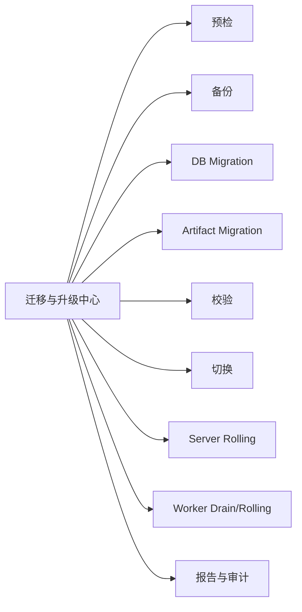

---

## 21. 第三阶段关键交互流程

### 21.1 SQLite 到 PostgreSQL/S3 迁移

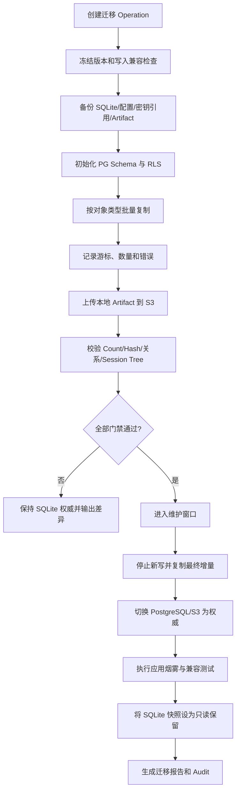

### 21.2 Run 调度与 Worker Lease

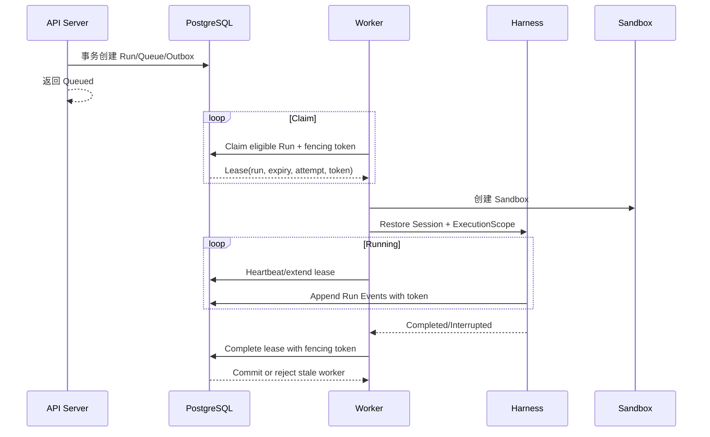

### 21.3 Worker 崩溃与 Lease 过期恢复

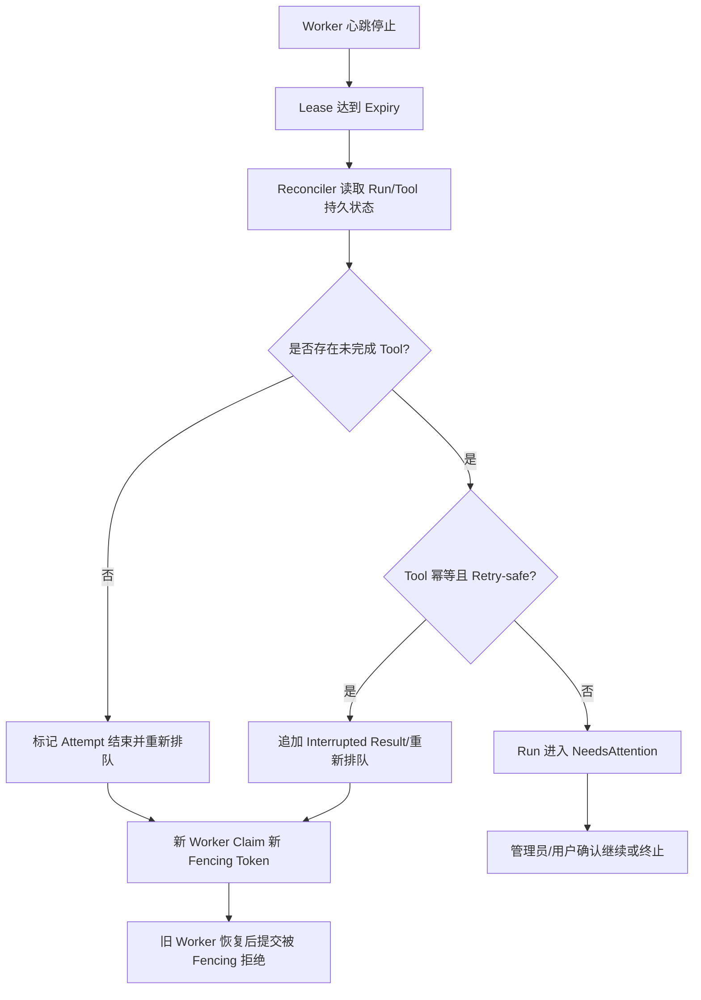

### 21.4 多 Server WebSocket 断线恢复

```mermaid
sequenceDiagram
    actor U as Browser
    participant S1 as Server A
    participant PG as Event Store
    participant S2 as Server B

    U->>S1: Subscribe(run, lastSequence=120)
    S1->>PG: Read events >120
    PG-->>S1: 121..N
    S1-->>U: Snapshot/Events
    S1--xU: Server A 故障
    U->>S2: Reconnect(run, lastSequence=N)
    S2->>PG: Authorize + Read events >N
    PG-->>S2: N+1..M
    S2-->>U: 补拉后继续实时推送
```

### 21.5 Artifact 上传与受控下载

```mermaid
flowchart TD
    A[Tool/Run 产生大输出] --> B[创建 Artifact Metadata Pending]
    B --> C[流式上传 S3/MinIO]
    C --> D[计算并校验 Checksum/Size]
    D --> E{上传成功?}
    E -- 否 --> F[标记 Failed 并清理 Multipart]
    E -- 是 --> G[提交 Ready 元数据和引用]
    G --> H[用户请求下载]
    H --> I[授权 Tenant/Resource/Retention]
    I --> J{允许?}
    J -- 否 --> K[403 + Audit]
    J -- 是 --> L[代理流或短期 Signed URL]
```

### 21.6 Kubernetes Sandbox 生命周期

```mermaid
stateDiagram-v2
    [*] --> Requested
    Requested --> Scheduling
    Scheduling --> Pulling
    Pulling --> Starting
    Starting --> Ready
    Ready --> Running
    Running --> Succeeded
    Running --> Failed
    Running --> Cancelling
    Cancelling --> Terminated
    Succeeded --> Cleaning
    Failed --> Cleaning
    Terminated --> Cleaning
    Cleaning --> Deleted
    Deleted --> [*]
    Scheduling --> Failed: 无匹配节点/配额
    Pulling --> Failed: 镜像/签名/扫描失败
    Starting --> Failed: 策略/挂载/Secret 失败
```

### 21.7 企业 SSO 与 Group Mapping

```mermaid
sequenceDiagram
    actor U as 用户
    participant UI as Oktapod
    participant IDP as Enterprise IdP
    participant IAM as Identity Service
    participant AU as Authorization
    participant AUD as Audit

    U->>UI: 选择企业登录
    UI->>IDP: OIDC/SAML Auth Request
    IDP-->>UI: Assertion/Code
    UI->>IAM: 验证签名、Nonce、Audience、时间
    IAM->>IAM: 匹配域、账户链接、JIT/SCIM 状态
    IAM->>AU: 映射 Group→Tenant/Team/Role
    AU-->>IAM: Effective Membership
    IAM->>AUD: enterprise_login
    IAM-->>UI: 创建平台 Session
```

### 21.8 KMS/Vault Secret 解析

```mermaid
sequenceDiagram
    participant W as Worker
    participant P as Policy
    participant K as KMS/Vault
    participant SB as Sandbox
    participant AUD as Audit

    W->>P: Resolve credential ref for Run/Tool
    P-->>W: Allowed ref + minimum scope
    W->>K: 使用工作负载身份读取/生成短期 Secret
    K-->>W: Secret + expiry
    W->>SB: 注入 tmpfs/env/file，仅当前 Tool 可见
    W->>AUD: secret_used(ref, run, tool, expiry)
    SB-->>W: Tool 完成
    W->>W: 清除内存与临时挂载
```

### 21.9 Worker Drain 与滚动升级

```mermaid
flowchart TD
    A[选择 Worker/版本批次] --> B[Cordon: 停止新 Claim]
    B --> C[列出活动 Lease 与风险]
    C --> D{可在窗口内自然完成?}
    D -- 是 --> E[等待 Run 完成]
    D -- 否 --> F{是否允许安全中断?}
    F -- 否 --> G[延后升级/人工处理]
    F -- 是 --> H[在持久边界 Abort/NeedsAttention]
    E --> I[Drain 完成]
    H --> I
    I --> J[替换 Worker 版本]
    J --> K[注册/兼容/健康测试]
    K --> L[恢复接单]
```

### 21.10 PostgreSQL 故障切换

```mermaid
flowchart TD
    A[监控检测主库不可用] --> B[应用连接失败并退避]
    B --> C[HA 系统提升备用库]
    C --> D[连接池解析新主库]
    D --> E[Server/Worker 重新连接]
    E --> F[校验 Schema/Timeline/只读状态]
    F --> G[Reconciler 检查 Lease/Outbox/未完成事务]
    G --> H[恢复 API 和 Claim]
    H --> I[生成故障与恢复审计]
```

### 21.11 集中审计到 WORM/SIEM

```mermaid
flowchart LR
    A[业务事务] --> B[(PostgreSQL + Outbox)]
    B --> C[Audit Publisher]
    C --> D[集中审计查询]
    C --> E[SIEM Adapter]
    C --> F[WORM/Object Lock Batch]
    F --> G[Manifest + Hash + Signature]
    E --> H[重试/死信/告警]
```

---

## 22. 第三阶段状态模型

### 22.1 Worker

```mermaid
stateDiagram-v2
    [*] --> Registering
    Registering --> Ready: 版本/能力通过
    Registering --> Incompatible: 协议不兼容
    Ready --> Busy: Claim Lease
    Busy --> Ready: 槽位释放
    Ready --> Draining: 管理员 Cordon/Drain
    Busy --> Draining: 停止新 Claim
    Draining --> Offline: 无活动 Lease 且停止
    Ready --> Degraded: 依赖或能力异常
    Busy --> Degraded: 心跳/资源异常
    Degraded --> Ready: 恢复
    Degraded --> Offline: 心跳超时
    Incompatible --> Offline
```

### 22.2 Run Lease

| 状态 | 含义 |
|---|---|
| Available | Run 可被符合条件 Worker Claim |
| Leased | 已分配 Worker、Expiry、Attempt、Fencing Token |
| Heartbeating | Worker 正常续约 |
| Completing | Worker 提交最终状态和事件 |
| Completed | Lease 终结，Run 完成 |
| Expired | 心跳超时，需要 Reconcile |
| NeedsAttention | 存在非幂等副作用或无法自动判断 |
| Cancelled | 排队或运行被用户/策略取消 |

### 22.3 Migration Operation

```mermaid
stateDiagram-v2
    [*] --> Draft
    Draft --> Prechecking
    Prechecking --> Ready
    Prechecking --> Blocked
    Ready --> BackingUp
    BackingUp --> Copying
    Copying --> Validating
    Validating --> CutoverReady
    Validating --> Failed
    CutoverReady --> CuttingOver
    CuttingOver --> Verifying
    Verifying --> Completed
    Verifying --> Failed
    Failed --> Resumable
    Resumable --> Copying
    Blocked --> Draft
```

---

## 23. 第三阶段空状态、异常状态与降级

| 场景 | 产品行为 |
|---|---|
| 无 Ready Worker | Run 保持 Queued，显示缺失标签/容量，不由 API Server 本地执行 |
| Worker 版本不兼容 | 标记 Incompatible 并禁止 Claim |
| PG Notify 丢失 | 通过轮询和 Sequence 补拉恢复 |
| PostgreSQL 只读/故障切换 | 暂停创建与 Claim，保留只读查询，恢复后 Reconcile |
| S3 不可用 | 新 Artifact 失败或 Run 等待，不将大对象塞入数据库兜底 |
| KMS/Vault 不可用 | 阻止需要 Secret 的请求，不使用无限期旧明文缓存 |
| Sandbox 无匹配节点 | 显示资源/标签/配额原因，可等待或管理员调整 |
| Sandbox 启动超时 | 终止并清理，按策略重试或失败 |
| Lease 过期且非幂等 Tool 未完成 | 进入 NeedsAttention，不自动重放 |
| IdP 不可用 | 已有 Session 按策略继续；新登录可使用受控 Break-glass，不自动降级绕过 SSO |
| Audit/SIEM 外部目标不可用 | Outbox 重试；本地集中审计继续，达到堆积上限告警 |
| 迁移校验失败 | 不切换权威数据源，提供差异和可恢复步骤 |

---

## 24. 第三阶段非功能要求

### 24.1 可用性与恢复

- API Server 可横向扩展，无本地权威 Session 状态；
- Worker 故障通过 Lease 过期恢复；
- PostgreSQL、S3 和 IdP/KMS 使用受支持的高可用部署；
- Run 从持久边界恢复，不伪造 Provider Stream 续流；
- 备份和恢复必须定期演练并在管理中心显示最近结果；
- RPO/RTO 由部署 Profile 明确定义，不以模糊“企业级”替代。

### 24.2 性能建议基线

以下为产品验收建议基线，最终数值应在容量评审结合硬件和模型调用特性确认：

- 至少 2 个 API Server、3 个 Worker 的参考集群；
- 非模型 REST 查询 P95 ≤ 200ms；
- 已持久事件到在线客户端 P95 ≤ 1s；
- 有可用 Worker 时 Queue Claim P95 ≤ 2s；
- Server 单节点故障后客户端自动重连并无事件缺口；
- 容量通过增加 Worker 横向提升，不修改 Harness 或 Project 数据模型。

### 24.3 安全

- 服务层授权与 PostgreSQL RLS 双重隔离；
- 高风险执行使用 Container/Kubernetes Sandbox；
- Sandbox 默认非 Root、最小 Capabilities、网络默认拒绝；
- Secret 通过工作负载身份和短期最小注入；
- Package/Image 使用 Digest、签名和扫描门禁；
- 审计、Trace 和 Crash Dump 不包含 Secret 与未授权内容；
- OIDC/SAML/SCIM 输入全部进行签名、Audience、Nonce、时间和映射校验。

### 24.4 可测试性

- 双数据库 Storage Contract；
- Worker Lease/Fencing Model Check 与故障注入；
- 多 Server Event Resume E2E；
- RLS/服务层双重跨租户测试；
- S3 Hash、Signed URL、生命周期和孤儿清理测试；
- Kubernetes Sandbox 策略、回收、网络和 Secret 测试；
- OIDC/SAML/SCIM Contract Fixture；
- KMS/Vault 不可用和轮换测试；
- 滚动升级、PG Failover 和备份恢复演练；
- Phase 1 OHCS 与 Phase 2 安全测试全量回归。

---

## 25. 第三阶段验收场景

1. Phase 2 SQLite 数据与本地 Artifact 迁移至 PG/S3，计数与 Hash 全部通过；
2. 两个 API Server 中任一节点故障，浏览器重连且事件无缺口；
3. Worker 在 Tool 执行中崩溃，Lease 过期后按幂等性正确恢复或进入 NeedsAttention；
4. 旧 Worker 恢复后使用过期 Fencing Token 提交被拒绝；
5. 新增 Worker 后无需重启 Server 即可承接匹配 Run；
6. Tenant 数据在服务层和 PG RLS 两层均无法越权访问；
7. Artifact 经 S3 Signed URL 下载时权限、过期和 Hash 正确；
8. Kubernetes Sandbox 默认拒绝出网，仅策略允许域可访问；
9. OIDC/SAML 登录、Group Mapping、禁用和可选 SCIM 同步正确；
10. KMS/Vault Secret 仅注入目标 Sandbox，日志和 Artifact 无明文；
11. 双人审批完成生产级高风险操作，审批链完整；
12. Server 与 Worker 完成滚动升级，兼容窗口内 Run 不丢失；
13. PostgreSQL 故障切换后 Queue、Lease、Outbox 和事件状态收敛；
14. PG PITR、S3 和配置恢复演练成功；
15. 集中 Audit 可导出到 SIEM/WORM 并验证完整性；
16. Phase 1/2 所有核心产品工作流继续可用。

### 25.1 Phase 3 完成定义

- 所有 `S3-* MUST` 通过验收；
- SQLite→PG/S3 迁移演练成功且有恢复门禁；
- Storage Contract 双数据库测试通过；
- 多 Server、多 Worker、Lease/Fencing 和事件重连故障注入通过；
- RLS 与服务层双重隔离测试通过；
- Sandbox Pool 资源回收和网络隔离通过；
- OIDC/SAML、KMS/Vault 和集中审计达到生产验收；
- 备份恢复、滚动升级和 HA 演练完成；
- Phase 1 OHCS 和 Phase 2 授权/隔离测试无退化。

---

## 26. 第三阶段 AI 编程实施拆分

### 26.1 内部里程碑

| 里程碑 | 内容 | 退出条件 |
|---|---|---|
| S3-A PostgreSQL | PG Adapter、Migration、RLS、双库 Contract | Phase 2 数据可迁移并校验 |
| S3-B 分布式调度 | PG Queue、Lease、Heartbeat、Fencing、Worker Registry | Worker Crash/Expiry 测试通过 |
| S3-C 多 Server 事件 | Event Store、Notify、Sequence Resume、SDK 重连 | Server 故障无事件缺口 |
| S3-D S3 与 Sandbox | Object Store、K8s Sandbox、Egress、镜像策略 | Artifact/Sandbox E2E |
| S3-E 企业身份与 Secret | OIDC/SAML、可选 SCIM、KMS/Vault、Service Account | 企业登录与短期 Secret E2E |
| S3-F 审计与可观测 | Outbox、SIEM/WORM、OTel、SLO、告警 | Run 跨组件追踪完整 |
| S3-G HA 与运维 | Backup/PITR、Failover、Rolling Upgrade、Drain | 恢复和升级演练通过 |

### 26.2 实施约束

- 不用 Redis/消息总线替代 PG 持久状态和 Sequence；
- 不允许 API Server 绕过 Queue 直接运行长任务；
- 不允许旧 Worker 在 Lease 过期后提交成功；
- 不以 Sticky Session 作为 WebSocket 正确性条件；
- 不将 Artifact 大对象存入 PostgreSQL 作为 S3 故障兜底；
- 不把 RLS 当作唯一授权；
- 不在 Worker 长期保存 Tenant Secret；
- 不承诺模型流跨 Worker 无缝迁移；
- 不为集群版复制一套 Harness 或业务代码。

---

## 27. 第三阶段明确不包含

- 自研 Kubernetes、PostgreSQL、S3、KMS 或 IdP；
- 默认多地域 Active-Active 和全球一致性；
- 自研大模型训练与推理资源平台；
- 托管 SaaS 的订阅、支付、计费和商业许可系统；
- 无限制运行任意不可信第三方插件；
- 对模型供应商隐藏思维链的采集和展示；
- 自动重放无法证明幂等的外部副作用；
- 用微服务数量作为企业级完成标准；
- 为每种基础设施组合维护不同业务代码分支。

---

## 28. 第二、三阶段能力矩阵

| 能力 | Phase 2 | Phase 3 |
|---|---|---|
| Harness / Pi Parity | 继承 Phase 1，不修改 | 完全继承，不修改 |
| 用户与登录 | 本地账户，可选 OIDC | 多 OIDC、SAML、可选 SCIM |
| Tenant/Team | 完整 | 完整并支持企业目录映射 |
| 数据库 | SQLite WAL | PostgreSQL HA |
| Worker | Embedded/Local Runner | 多独立 Worker、Lease/Fencing |
| Server | 单节点模块化单体 | 多无状态 API Server |
| Artifact | Scope 化本地文件 | S3/MinIO、生命周期和 Signed URL |
| Sandbox | System、可选 Docker | Container/Kubernetes Sandbox Pool |
| Secret | Envelope Encryption/OS Keychain | KMS/Vault、工作负载身份、动态凭据 |
| 授权 | RBAC/ABAC、Native Rule/CEL 可选 | 服务层授权 + PG RLS + 企业策略适配器 |
| 审批 | 单人/委派/过期 | 可选双人审批、跨系统通知 |
| Audit | SQLite 集中于单节点 | Outbox、SIEM、WORM、Legal Hold |
| 可观测 | 单节点指标和诊断 | OTel 跨 Server/Worker/Sandbox |
| HA | 明确不支持 | Server/Worker/PG/S3 高可用部署 |
| 迁移 | Phase 1 原地升级 | SQLite→PG、Local→S3 |
| 容量 | 1～20 活跃用户、5～8 并发 Run 建议 | 通过 Server/Worker 横向扩展，按部署 Profile 定义 SLO |

---

## 29. 跨阶段数据与协议兼容要求

1. Phase 1 Session Entry、Message、Tool Call、Compaction 和 Branch Summary 可在 Phase 2/3 原样读取；
2. Phase 2 新增 Tenant/Subject Scope 通过外层聚合和引用表达，不改写历史消息内容；
3. Phase 3 PG 导入保留原 ID、Parent ID、Sequence、Timestamp 和 Hash 语义；
4. API Breaking Change 必须使用新版本，不因集群化修改已有客户端行为；
5. Event 类型允许增加可选字段，不改变既有字段含义；
6. Tool Descriptor 与 Harness Snapshot 不包含数据库或 Worker 实现细节；
7. Artifact Location 可从 local 切换到 s3，但 Artifact ID 和引用保持稳定；
8. Credential 迁移只迁移引用与加密材料，不在日志或导出中暴露明文；
9. 第一阶段导入/导出和 Pi Session 兼容能力在 Phase 2/3 继续可用；
10. 每次阶段升级均生成可审计迁移报告。

---

## 30. 参考文档

- `Oktapod_三阶段递进式架构设计_V1.0.md`
- `Oktapod_第一阶段产品功能设计_V1.0.md`
- `Oktapod_PRD_v1.1_轻量化架构优化版.md`
- Pi Frozen Baseline：`earendil-works/pi@b1c444d956b70e5c437d3d2782b01d157fa05ba3`

---

## 31. 结论

Oktapod 的第二、三阶段不是两次重新开发：

- Phase 2 在单节点上完成真实的身份、租户、授权、协作和安全治理；
- Phase 3 将已经验证的产品模型映射到 PostgreSQL、分布式 Worker、对象存储和强 Sandbox；
- Harness、Session、Tool、Event 和业务 API 保持稳定，是三阶段递进成功的核心门槛；
- 企业级不是中间件堆叠，而是隔离、持久性、故障恢复、可观测、可运维和合规能力形成闭环。
