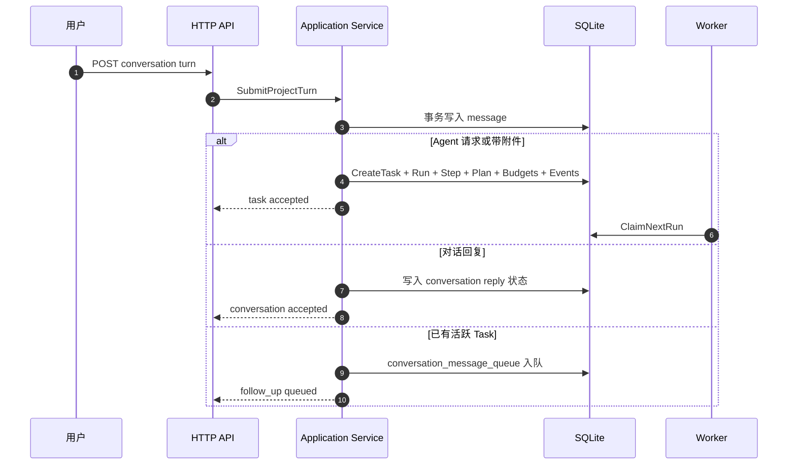
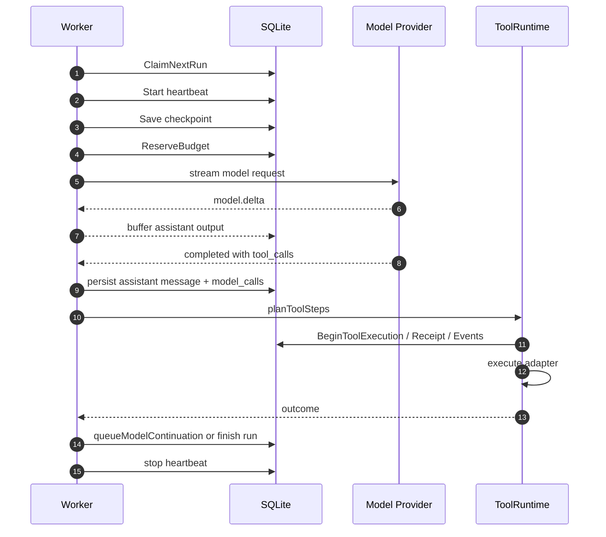
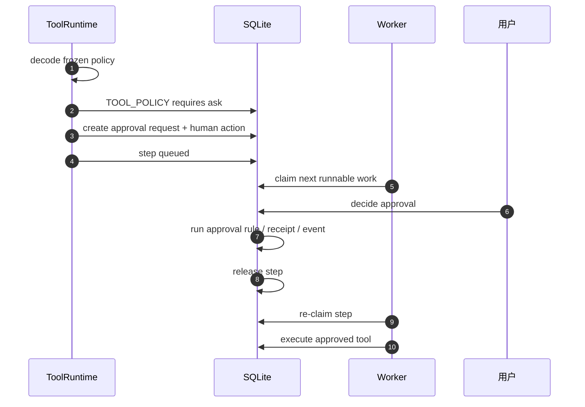
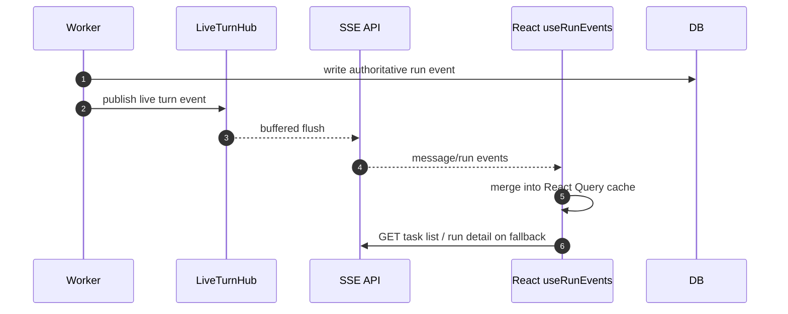
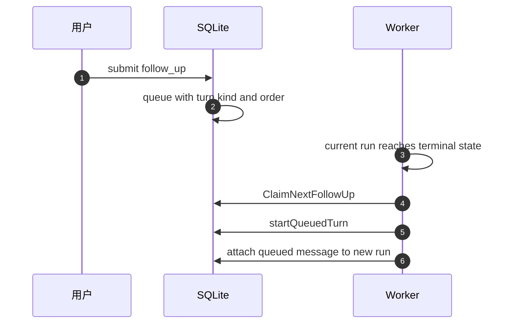
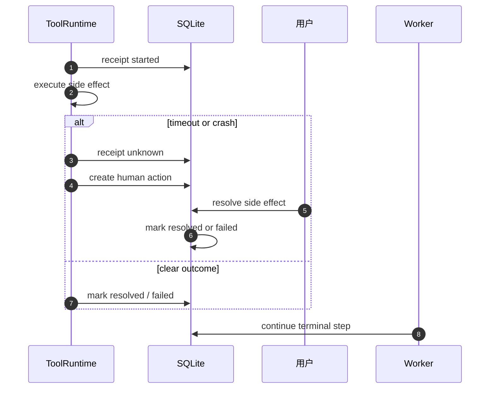
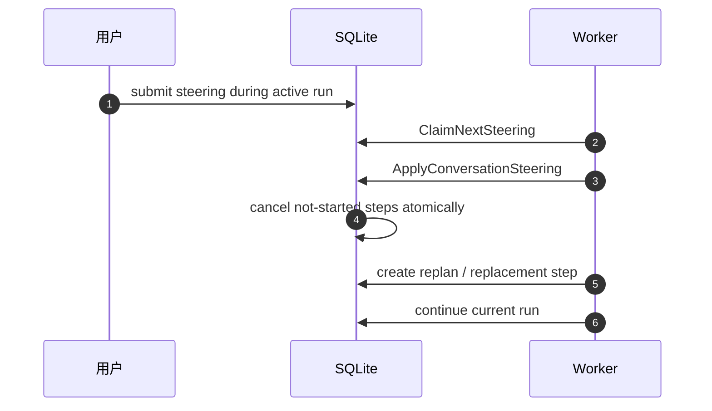

# Oktapod 详细设计文档

> 版本: V1.0 | 生成日期: 2026-09-01 | 状态: 基于当前源码勘察

本文档从源码出发，描述 Oktapod 的系统架构、模块边界、HTTP API 接口、持久化数据模型和关键行为时序。目标是让新加入的工程师或 AI Agent 能在不读完整源码的情况下，理解系统的设计意图、决策依据和执行边界。

**设计原则**: Oktapod 的核心是一个"可信执行内核"——所有 Agent 行为（模型调用、工具执行、副作用）都必须通过持久化状态机驱动，可恢复、可审计、可撤销。这个设计不追求最快执行，而追求在任何崩溃、并发、外部故障场景下，系统状态始终可预测且用户始终可控。

---

## 目录

1. [系统概述与架构总览](#1-系统概述与架构总览)
2. [代码目录结构与模块边界](#2-代码目录结构与模块边界)
3. [HTTP API 接口](#3-http-api-接口)
4. [关键模块详设](#4-关键模块详设)
5. [关键行为时序图](#5-关键行为时序图)
6. [数据模型核心表](#6-数据模型核心表)
7. [安全与治理边界](#7-安全与治理边界)
8. [部署与运行时行为](#8-部署与运行时行为)
9. [验证与追溯](#9-验证与追溯)

---

## 1. 系统概述与架构总览

Oktapod 是一套面向个人与企业团队的多用户 Agent OS。用户登录同一产品后创建个人私有项目或团队项目；当前 V1.0.0 只发布个人私有项目与 SQLite 主路径。

### 1.1 架构分层

```
React/TS 前端 (Src/web)
  TanStack Router + React Query + Radix UI
HTTP API (Src/internal/adapters/httpapi)
  chi 路由 + session auth + CSRF + SSE streams
Application Service (Src/internal/application)
  用例编排、事务边界、路由决策 (SubmitProjectTurn 等)
Runtime (Src/internal/runtime)
  Worker 轮询 + Durable Harness + StepDispatcher
  Agent Loop + ToolRuntime + LiveTurnHub + Scheduler
Harness (Src/internal/harness)
  Claim -> Checkpoint -> Execute -> Finish + fencing
Adapters (Src/internal/adapters)
  SQLite/PostgreSQL, Model Providers, MCP, Workspace,
  SecretStore, WebAccess, DocumentRuntime, Blob
Domain (Src/internal/domain/core)
  领域模型、不变量、无基础设施依赖
```

**为什么分层**: domain 不依赖任何基础设施，保证业务规则可测试；application 承担所有跨领域写操作的事务边界；runtime 专注持久化无关的模型轮次循环和持久化步骤调度；adapters 隔离外部系统（HTTP、SQL、SDK、文件系统）。这使每一层都可以独立替换（如 SQLite 到 PostgreSQL）而不影响上层逻辑。

### 1.2 入口与进程模型

`Src/cmd/oktapod/main.go` 是唯一产品二进制入口，`serve` 子命令的启动流程:

1. 加载 YAML 配置 (`bootstrap.LoadConfig`)
2. 初始化数据库 (SQLite/PostgreSQL) 和迁移
3. 初始化 SecretVault (bootstrap.key + recovery code)
4. 构建 `application.Service`，注入所有 port（Vault、ModelCatalog、MCP Registry、OAuth Coordinator、ChatToolExecutor、ArtifactCapture、DocumentRuntime 等）
5. 构建 `LiveTurnHub`（进程内 SSE delta 分发）
6. 启动 N 个 `runtime.Worker` goroutine（轮询式步骤执行）
7. 启动 `Scheduler`（cron 触发任务）
8. 启动 `DailySummaryLoop`（每日记忆摘要）
9. 挂载 `httpapi.NewHandlerWithUI`（API + 静态 UI）
10. 优雅关闭: 先关 HTTP，再等 Worker 完成（lease 到期后由其他 worker 恢复）

子命令: `serve`, `backup`, `preflight`, `cleanup`, `restore`, `export`, `import`, `model`, `context`, `config`, `vault`, `version`。

### 1.3 核心设计决策

| 决策 | 理由 | 对用户的影响 |
|------|------|-------------|
| 持久化步骤状态机而非内存循环 | 崩溃恢复、多 Worker 并发、审计 | 任务不因进程重启丢失 |
| 冻结工具快照 (Run snapshot) | 防止 TOCTOU: 审批后参数/策略被篡改 | 用户审批的是确切参数，不是模糊意图 |
| Side Effect Receipt | 非幂等操作（发邮件、付款）在崩溃后不可盲目重试 | 系统主动询问用户"操作是否已生效" |
| Event Sourcing (run_events) | UI 流式展示、审计、调试共用同一数据源 | 用户看到的流就是真实执行流 |
| 固定 dispatch map 而非插件注册 | 安全边界明确，不允许可执行代码动态注入 | 减少攻击面，行为可预测 |
| LiveTurnHub 无背压扇出 | Worker 不能因慢客户端阻塞 | 流式输出不卡执行 |

---

## 2. 代码目录结构与模块边界

```
Src/
  api/                     # OpenAPI 契约、事件 Schema、Capability manifest
    openapi.yaml           # ~168KB, 120+ 端点定义
  cmd/oktapod/             # 唯一二进制入口
    main.go                # 子命令解析 + 依赖装配 + 生命周期管理
  db/                      # 按方言分离的迁移与查询
    migrations/sqlite/     # 000001-000067 (67 个 migration)
    queries/sqlite/        # sqlc 查询定义 (core.sql)
  web/                     # React/TypeScript 前端
    src/
      features/           # 按业务域组织
        projects/          # 项目页（Composer、SSE、附件、审批）
        tasks/             # 任务流、状态条、Run diff、多文件审查
        runs/              # Run 事件流（SSE + React Query 合并）
        resources/         # MCP/Skill/Provider 资源管理
        approvals/         # 审批卡片、Inbox
        settings/          # 全局配置
      shared/              # API client、任务状态、Markdown 渲染
  tests/integration/       # 跨模块白盒集成测试
  internal/
    domain/core/           # 领域类型、不变量（types.go 600+ 行）
    application/           # 用例编排（Service 约 3000 行）
      service.go           # CreateTask, SubmitProjectTurn, ForkTask 等
      provider_registry.go
      mcp_oauth.go / mcp_source_resolver.go / mcp_policy.go
      document_runtime.go
      conversation_directive.go / conversation_compaction.go
      project_files.go / session_tree.go / transcript_import.go
    runtime/               # Agent 执行运行时
      worker.go            # 轮询 Worker: Claim, Execute, Finish, Steer, FollowUp
      step_dispatcher.go   # 固定 dispatch: MainAgent/Review/Synthesis/AgentTeam/Tool
      agent_turn_assembler.go  # 组装上下文、工具目录、搜索预算
      agent_turn_context.go    # contextForPrompt（资产 24KB、memory snapshot）
      prompt_assembler.go      # 分层 Prompt 构建
      tool_catalog.go          # 工具目录（MCP/Skill/搜索预算/scene policy）
      tool_runtime.go          # 工具执行（preflight 到 dispatch）
      tool_preparer_registry.go # 各工具家族的 preflight + dispatch
      live_turn_hub.go         # 进程内 SSE hub
      scheduler.go             # cron 调度
      daily_summary.go         # 每日记忆摘要
      agent_team_executor.go   # Coordinator/Worker/Synthesis 步骤
      review_executor.go       # Human Action AI 审查
      synthesis_executor.go    # 多结果合成
    agentloop/             # Provider 中立的模型轮次（无持久化）
      loop.go              # Next(): Stream -> turn_completed/tool_batch_proposed/context_limit
    harness/               # Durable 步骤边界
      harness.go           # Claim/CheckpointBeforeExecution/Finish + RetryBusy
    adapters/              # 基础设施适配器
      httpapi/             # chi 路由 + OpenAPI 生成 server（约 4400 行）
      db/sqlite/           # 主数据库（约 555KB store.go + store_runtime.go 等）
      db/postgres/         # PostgreSQL 适配（V1 未主推）
      model/               # 模型 Provider（native, openaicompat, modeltransport）
      mcp/                 # MCP 客户端（stdio/HTTP, SSRF 防护, SessionBroker, OAuth）
      secretstore/         # AES-256-GCM 数据库密钥库
      workspace/local.go   # 本地 Git workspace 执行器
      documentruntime/     # 文档 RPC 客户端（签名 manifest）
      webaccess/           # Web Fetch/Search 策略与执行
      websearch/
      blob/localfs/        # 本地文件 Blob 存储
      mcpregistry/
    bootstrap/             # 配置加载、Profile 装配、受信密钥
```

### 2.1 关键接口契约

| 接口 | 定义位置 | 实现 | 作用 |
|------|---------|------|------|
| `harness.Store` | `harness.go:14` | `sqlite.Store` | Claim/Checkpoint/Finish 步骤的持久化契约 |
| `agentloop.ModelGateway` | `agentloop/loop.go:76` | model adapters | 非流式模型调用 |
| `agentloop.StreamingModelGateway` | `agentloop/loop.go:83` | model adapters | 流式模型调用（delta callback） |
| `runtime.WorkerRepository` | `worker.go` 内联 | `sqlite.Store` | Worker 侧持久化（预算、事件、steering、queue） |
| `runtime.ModelInvoker` | `model_invoker.go` | wrapper around gateway | 模型调用统一入口（流式优先） |
| `runtime.ToolExecutionLedger` | `tool_runtime.go:22` | `sqlite.Store.BeginToolExecution` | 工具执行授权与 Receipt |
| `runtime.WorkspaceExecutor` | `tools.go` | `workspace.Local` | workspace_* 工具 |
| `runtime.WebAccess` | `tools.go` | `webaccess` | Fetch 策略评估 |
| `application.DocumentExecutor` | `application/document_runtime.go` | `documentruntime.Client` | 文档 RPC |
| `core.LiveTurnPublisher/Subscriber` | `domain/core` | `runtime.LiveTurnHub` | 进程内 delta 分发 |

### 2.2 前端页面与数据流

| 页面 | 路径 | 数据源 |
|------|------|--------|
| 项目页（主入口） | `features/projects/project-page.tsx`（约 128KB） | Composer 提交 -> SSE 流 -> Run Events |
| 任务页 | `features/tasks/task-page.tsx` | Run Events + Run diff + Budget |
| 资源管理 | `features/resources/resources-page.tsx` | Capabilities + MCP 状态 |
| 审批 Inbox | `features/approvals/approval-inbox.tsx` | Human Actions + Approvals |
| 设置 | `features/settings/settings-page.tsx` | AI Governance + Pricing + Context |

前端合并策略 (`use-run-events.ts`): 初始加载用 `GET /runs/{id}/events`（快照），激活期间每 2s 轮询一次作为 SSE 故障恢复兜底；SSE 是主路径，事件按 `stream_seq` 去重合并；delta 文本来自 SSE `assistant_delta` 事件。

---

## 3. HTTP API 接口

API 契约定义于 `Src/api/openapi.yaml`（OpenAPI 3.1），由 oapi-codegen 生成 `Src/internal/adapters/httpapi/generated/api.gen.go`，`server.go` 实现生成的 `ServerInterface`。

### 3.1 基础约定

- Base path: `/api/v1`
- Auth: session cookie + CSRF (`X-CSRF-Token`)，Bearer token 也支持
- SSE 端点不受 CSRF 限制，但需要 session
- 幂等: `Idempotency-Key` header 用于 POST/PUT（创建、决策、提交）
- Correlation: `X-Request-ID` 用于请求追踪
- 分页: cursor-based (`?after=`, `?before=`, `?limit=`)

### 3.2 端点分组（按 openapi.yaml 顺序）

**系统与配置**

| Method | Path | 说明 |
|--------|------|------|
| GET | `/health` | 健康检查 |
| GET | `/diagnostics` | 系统诊断 |
| GET | `/configuration` | Bootstrap 配置 |
| GET/PUT | `/configuration/bootstrap` | Bootstrap 配置管理 |
| GET/PUT | `/settings/ai-governance` | AI 治理设置 |
| GET/PUT | `/settings/model-pricing` | 模型定价版本 |
| GET/PUT | `/settings/context` | 对话上下文压缩设置 |
| GET/PUT | `/preferences` | 用户偏好 |

**Secret Vault**

| Method | Path | 说明 |
|--------|------|------|
| GET | `/security/vault` | Vault 状态 |
| POST | `/security/vault/initialize` | 初始化（生成 recovery code） |
| POST | `/security/vault/confirm` | 确认恢复码 |
| POST | `/security/vault/recover` | 恢复码恢复 DEK |
| POST | `/security/vault/rotate-recovery` | 轮换恢复码 |
| POST | `/security/vault/reset-pending` | 重置 pending 状态 |

**模型 Provider**

| Method | Path | 说明 |
|--------|------|------|
| GET | `/models` | 可用模型列表 |
| GET/POST | `/providers` | Provider 实例管理 |
| GET/PUT/DELETE | `/providers/{id}` | 单个 Provider |
| POST | `/providers/{id}/test` | 连通测试 |
| GET/POST/PUT | `/providers/{id}/models` | 启用模型管理 |
| POST | `/providers/{id}/models/refresh` | 从远端刷新模型列表 |

**项目与任务**

| Method | Path | 说明 |
|--------|------|------|
| GET/POST | `/projects` | 项目管理 |
| GET/PUT/DELETE | `/projects/{id}` | 项目详情/设置 |
| GET/POST | `/projects/{id}/tasks` | 任务列表/创建 |
| GET | `/tasks/{id}` | 任务详情 |
| POST | `/tasks/{id}/commands` | 控制任务（pause/resume/cancel） |
| POST | `/tasks/{id}/fork` | Fork 任务 |
| POST | `/tasks/{id}/acceptance` | 验收任务结果 |
| GET/POST | `/projects/{id}/schedules` | 定时调度 |
| PUT | `/schedules/{id}/status` | 启用/禁用调度 |
| GET/POST | `/projects/{id}/turns` | 提交 Turn（核心入口） |
| POST | `/projects/{id}/turns/stream` | SSE 流式提交（前端默认） |
| POST | `/projects/{id}/transcript-import` | 导入外部对话记录 |

**对话与会话树**

| Method | Path | 说明 |
|--------|------|------|
| GET/POST | `/projects/{id}/conversations` | 对话管理 |
| GET/DELETE/PUT | `/conversations/{id}` | 对话详情/删除/重命名 |
| GET/POST | `/conversations/{id}/messages` | 消息列表/追加 |
| GET | `/conversations/{id}/entries` | 会话树节点 |
| POST | `/conversations/{id}/navigate` | 切换活跃分支 |
| POST | `/conversations/{id}/fork` | 从某节点 Fork |
| POST | `/conversations/{id}/clone` | 克隆对话 |
| PUT | `/conversations/{id}/entries/{entry_id}/label` | 节点标签 |
| POST | `/conversations/{id}/branch-summary` | 分支摘要 |
| GET/POST/DELETE | `/conversations/{id}/queue` | 队列（follow_up/steering） |
| POST | `/conversations/{id}/steer` | 发送 steering（即时引导） |

**Run 事件与治理**

| Method | Path | 说明 |
|--------|------|------|
| GET | `/runs/{id}/events` | Run 事件列表（cursor 分页） |
| GET | `/runs/{id}/events/stream` | SSE 实时事件流 |
| GET | `/conversations/{id}/messages/stream` | SSE 消息流 |
| GET | `/runs/{id}/agent-team` | Agent Team 房间状态 |
| GET | `/runs/{id}/usage` | Run 用量 |
| GET/PUT | `/runs/{id}/budget` | Run 预算管理 |
| POST | `/runs/{id}/advisor` | Advisor 报告 |
| GET | `/runs/{id}/artifacts` | Run 产物 |
| GET | `/runs/{id}/changes` | Run 变更（Git diff） |
| GET | `/runs/{id}/plan` | 当前 Run Plan |

**审批与 Human Action**

| Method | Path | 说明 |
|--------|------|------|
| GET | `/inbox` | 统一收件箱（审批+输入请求+预算） |
| GET | `/human-actions` | Human Action 列表 |
| POST | `/human-actions/{id}/decision` | Human Action 决策 |
| GET | `/approvals` | 审批列表 |
| POST | `/approvals/{id}/decision` | 审批决策（scope: once/run_tool/run_origin/conversation/project） |
| GET/POST | `/projects/{id}/approval-rules` | 项目级审批规则 |
| DELETE | `/projects/{id}/approval-rules/{rule_id}` | 撤销规则 |
| GET | `/side-effect-receipts` | 副作用收据列表 |
| POST | `/side-effect-receipts/{id}/resolution` | 副作用人工确认 |

**资源（Capabilities）**

| Method | Path | 说明 |
|--------|------|------|
| GET | `/resource-catalog` | 预置资源目录 |
| POST | `/resource-catalog/{key}:install` | 安装预置资源 |
| GET/POST | `/projects/{id}/capabilities` | 项目资源 |
| GET/PUT/DELETE | `/capabilities/{id}` | 单资源 |
| PUT | `/capabilities/{id}/status` | 启用/禁用 |
| POST | `/capabilities/{id}/review` | 资源审查 |
| POST | `/capabilities/{id}/mcp/connect` | MCP 连接测试 |
| GET/POST | `/capabilities/{id}/mcp/credential` | MCP 凭据 |
| POST | `/capabilities/{id}/mcp/oauth/start` | 启动 OAuth |
| GET | `/capabilities/{id}/mcp/oauth/{session_id}` | OAuth 状态 |
| POST | `/capabilities/{id}/mcp/oauth/{session_id}/cancel` | 取消 OAuth |
| GET | `/mcp/oauth/callback` | OAuth 回调 |
| POST | `/capabilities/{id}/mcp/disconnect` | 断开 MCP |
| GET | `/capabilities/{id}/mcp/health` | MCP 健康检查 |

**资产与产物**

| Method | Path | 说明 |
|--------|------|------|
| GET/POST | `/projects/{id}/assets` | 资产列表/上传 |
| GET/POST | `/projects/{id}/asset-folders` | 资产目录 |
| GET | `/assets/{id}/content` | 资产内容（下载） |
| GET | `/assets/{id}/preview` | 资产预览 |
| GET | `/artifacts/{id}/content` | 产物内容 |
| POST | `/artifacts/{id}/publish` | 发布为项目资产 |
| POST | `/artifacts/{id}/project-files` | 产物保存为项目文件 |
| GET | `/projects/{id}/artifacts` | 项目产物列表 |
| GET | `/projects/{id}/workspace/files` | workspace 文件列表 |
| GET | `/projects/{id}/workspace/files/content` | workspace 文件内容 |

**记忆/Agent/团队/成员**

| Method | Path | 说明 |
|--------|------|------|
| GET/POST | `/projects/{id}/memories` | 记忆管理 |
| POST | `/projects/{id}/memories/daily-summary` | 每日摘要 |
| POST | `/memories/{id}/promote` | 记忆提升为 Skill |
| GET/PUT/DELETE | `/memories/{id}` | 单条记忆 |
| PUT | `/memories/{id}/status` | 记忆状态 |
| GET/POST | `/projects/{id}/agents` | Agent 定义 |
| GET/PUT/DELETE | `/agents/{id}` | 单 Agent |
| PUT | `/agents/{id}/status` | Agent 状态 |
| GET/POST | `/projects/{id}/teams` | Team 定义 |
| PUT | `/teams/{id}/status` | Team 状态 |
| GET | `/projects/{id}/usage` | 项目用量 |
| GET/POST | `/projects/{id}/members` | 项目成员 |
| DELETE | `/projects/{id}/members/{user_id}` | 移除成员 |
| GET/POST | `/projects/{id}/invitations` | 邀请 |
| POST | `/invitations/accept` | 接受邀请 |

**认证**

| Method | Path | 说明 |
|--------|------|------|
| GET/POST | `/auth/sessions` | 会话管理 |
| DELETE | `/auth/sessions/{id}` | 注销会话 |
| POST | `/auth/login` | 本地登录 |
| POST | `/auth/register` | 本地注册 |
| POST | `/auth/logout` | 登出 |

---

## 4. 关键模块详细设计

### 4.1 Application Service

Application Service 是跨模块写操作的统一入口，负责事务边界、语义路由和事件落库。前端和 HTTP 层不直接拼装运行时状态。

**CreateTask 原子创建链**

任务创建不是单表插入，而是一个原子初始化包：

| 对象 | 作用 |
|---|---|
| Task | 用户可见任务聚合根，承载标题、模式、workspace、状态 |
| Run | 一次执行批次，承载目标、输入、上下文、生命周期 |
| Step | 初始可执行步骤 |
| RunPlan / RunPlanRevision | 计划与版本快照 |
| TaskBudgets / RunBudgets | 预算上下文和初始预留 |
| RunEvents | `task.created`、`run.created` 等初始事件 |

设计原因是把“任务可见”和“可被 Worker 认领”定义成同一事务内的不变量。禁止出现任务已展示但 Run 缺失，或 Run 已创建但没有初始 Step 的中间态。

**SubmitProjectTurn 路由决策**

会话内输入按语义分流，而不是全部创建 Agent 任务：

| 输入形态 | 路由 |
|---|---|
| 普通问句 / answer | 对话回复路径 |
| directive | 转换为项目控制意图 |
| compact | 会话压缩指令 |
| MCP install | 传入 MCP 安装/治理流程 |
| `auto` 且无附件 | 对话回复路径 |
| 单 Agent 请求或带附件 | 创建 Agent Task |
| 会话已有活跃 Task | 进入 conversation_message_queue |

路由上限约定：用户输入超过约 20000 字符时按超长输入处理，避免超长 prompt 直接进入模型上下文造成不可控失败。

### 4.2 Runtime Worker

Worker 是后台执行主体，通过 lease 认领 Run，不与 HTTP 请求生命周期绑定。

**RunOnce 主循环**

1. `ExpireApprovals`：先处理超时审批，释放等待中的 Step。
2. `ClaimNextRun`：按优先级与时间认领 Run。
3. 启动 heartbeat，持续续期 Worker lease。
4. 写入 Checkpoint，保证失败后可恢复。
5. `ReserveBudget`：做执行前预算预留。
6. Dispatch 当前 Step，进入对应执行器。
7. 根据执行结果 Finish Run 或 Step。
8. 停止 heartbeat。
9. `ApplyConversationSteering`：合并会话内新指令，必要时取消未开始 Step。
10. `ClaimNextFollowUp`：若存在排队用户指令，直接开启下一轮。

该顺序保证“过期治理先于新工作”，避免超时审批永远占用调度窗口。

**StepDispatcher 映射**

| Step 类型 | 执行器 | 说明 |
|---|---|---|
| agent | MainAgentExecutor | 模型主循环 |
| plan | PlanStepExecutor | 生成或修订 RunPlan |
| human_action | HumanActionStepExecutor | 等待用户审批/输入 |
| tool | ToolStepExecutor | 执行已建模工具 |
| barrier | BarrierStepExecutor | 等待并行批次完成 |

**MainAgentExecutor 七步**

1. 加载运行快照和消息上下文。
2. 组装 Provider 请求。
3. 流式调用模型。
4. 解析增量与 finish reason。
5. 持久化 assistant 消息与 `model_calls`。
6. 若产出 tool calls，进入 `planToolSteps` 建模为 Step / ToolBatch。
7. 根据 complete、需要工具、需要审批或失败决定下一状态。

### 4.3 Durable Harness

Durable Harness 解决“进程崩溃、DB 写入部分成功、Worker 抢占”三类运行时不确定问题。

核心 Store 接口包括：

| 方法 | 职责 |
|---|---|
| BeginStep | 原子校验 lease 并标记 Step 开始 |
| CompleteStep | 提交成功结果 |
| FailStep | 提交失败结果 |
| EnqueueStep | 追加下一步 |
| ExtendLease / Renew | 续期 owner 身份 |

Fencing 规则：

- 每个 Run/Step lease 携带单调 `fence_token` 和 `owner_id`。
- 写入前原子校验当前 token 与 owner。
- 校验失败返回 `LEASE_LOST`，执行器必须停止本地副作用。

`RetryBusy` 采用最多 5 次、起始 200ms 的退避，用于短暂数据库或调度忙状态。它只覆盖可重试冲突，不掩盖持久化失败。

### 4.4 Agent Loop

Agent Loop 将 Provider 流式输出转换为可恢复事件：

| 事件类型 | 处理 |
|---|---|
| `model.delta` | 增量文本/参数缓冲 |
| `model.completed` | 汇总消息、usage、finish reason |
| `tool.call` | 转换为 ToolBatch / ToolStep |
| `error` | 按模型阶段与持久化阶段分类 |

流式优先原则：只要 Provider 支持流式，模型 token 到达后先进入 LiveTurnHub，再等待完整消息持久化。这样前端不会因长回复阻塞，也不会为了展示而跳过持久化。

### 4.5 ToolRuntime

ToolRuntime 是“危险工具执行前后的治理总线”。

执行链共八步：

1. `decodeFrozen`：读取冻结输入快照。
2. 身份与上下文校验。
3. `PlanTool`：确定工具、目标资源、副作用级别。
4. InputHash 校验，防止计划与执行之间输入漂移。
5. Preflight 检查 workspace、资源、权限和 provider 状态。
6. `BeginToolExecution`：写入执行凭据和 Receipt。
7. Dispatch 实际适配器。
8. 将结果规范化为 Step outcome 和事件。

**BeginToolExecution 持久化流程**

1. fence 校验。
2. 解析 Tool Policy。
3. 解析 Authorization。
4. 计算 InputHash。
5. 写入 Receipt（副作用类工具）。
6. 生成执行凭据。
7. 记录未知副作用检测。
8. 写 ToolCall / ToolBatch 状态。
9. 写 RunEvents。
10. 处理 unknown 工具或缺少 Capability。
11. 返回可执行 / blocked 状态。

### 4.6 审批与 Human Action

`DecideHumanAction` 按 request kind 路由：

| Kind | 行为 |
|---|---|
| `tool_approval` | 进入 DecideApproval |
| `side_effect` | 进入 Side Effect Resolution |
| `input` | 将用户输入映射到等待中的 Step |
| `permission` | 更新资源权限上下文 |
| `budget` | 审批预算追加 |

审批 Scope：

| Scope | 含义 |
|---|---|
| `once` | 只授权本次 |
| `run_tool` | 本 Run 内同工具继续放行 |
| `run_origin` | 本 Run 内同来源继续放行 |
| `conversation` | 会话级规则 |
| `project` | 项目级规则 |

用户选择“记住”时写入 conversation 或 project approval rules。规则不是全局信任：仍会受 frozen policy、资源 scope、副作用级别限制。

`ExpireApprovals` 会将超时请求转为失败/取消结果，并释放 Human Action Step，防止 Run 永久挂起。

### 4.7 Side Effect Unknown Recovery

外部副作用可能在本地崩溃或超时后无法确认是否发生，系统通过 Receipt 状态机兜底：

```
started --> unknown --> resolved
                 \\--\> failed
```

- `started`：已登记即将执行。
- `unknown`：执行中断、超时或返回不可判读。
- `resolved`：确认副作用实际发生或可以安全继续。
- `failed`：确认未发生或放弃恢复。

`ResolveSideEffect` 提供确认/拒绝两个分支：确认后继续原有业务终态；拒绝则回滚 Step 状态并记录审计事件。Receipt 不允许重复 resolving，避免重复补偿。

### 4.8 SecretVault

三层设计：

1. 用户输入或 bootstrap 流程产生 recovery code。
2. recovery code 派生 KEK。
3. KEK 解密 DataRoot 下的 `bootstrap.key` / DEK，DEK 再加密具体 Secret。

算法采用 AES-256-GCM，每条记录使用独立 nonce，并以项目、Provider、Capability 等 identity 作为 AAD，防止密文跨资源挪用。

安全边界：

- 明文 Secret 只在受控解密窗口出现。
- API 和事件不返回明文。
- 日志、Run Snapshot、错误详情均需脱敏。

### 4.9 MCP 适配器

MCP 适配器包含三层能力：

| 层 | 职责 |
|---|---|
| Connection 治理 | 校验连接、Capability、安装状态 |
| SessionBroker | 复用进程内 MCP session |
| OAuth Coordinator | 授权码、token 交换、SecretStore 保存 |

SSRF 防护使用 `validateHost`、`isPrivateIP` 和 `safeDialContext`：域名解析结果和最终拨号地址都要检查，避免 DNS 重绑定绕过。

SessionBroker 以 run + capability 粒度复用，空闲 TTL 约 15 分钟。这样减少进程重建成本，同时避免跨 Run 复用造成状态污染。

### 4.10 Document Runtime

Document Runtime 使用受信外部进程而非 Go 主程序直接生成复杂格式。

流程：

1. 选择平台对应的受信 Runtime。
2. 校验 Ed25519 签名的 manifest 与来源哈希。
3. 通过 RPC 发送固定格式任务。
4. Runtime 产出文档或预览文件。
5. 主程序登记 Artifact / Asset。
6. Web 通过预览路由访问。

好处是格式处理失败不污染主进程，且 Runtime 版本、平台、信任链可独立审计。

### 4.11 模型 Provider

Provider 层使用 phase-classified failure：

- 连接阶段失败：可切换 Provider 或退避重试。
- 请求发送阶段失败：区分幂等状态。
- 流式阶段失败：保留已收到内容并标记不完整。
- 持久化阶段失败：不重复计费调用，优先恢复 checkpoint。

流式调用不设置总超时，因为长回复的合法耗时差异很大；改用空闲超时、心跳、取消和完成 deadline 组合控制。

### 4.12 LiveTurnHub

LiveTurnHub 负责运行态推送：

- 每 live turn 使用容量 64 的 event channel。
- 订阅者消费过慢时被移出，避免拖垮 Worker。
- 批量 flush 约每 50ms 或达到约 2KB 触发。
- SSE 只做实时分发，不替代 RunEvents 权威存储。

## 5. 关键行为时序

### 5.1 提交会话 Turn 并路由



### 5.2 Worker 主循环与工具调用



### 5.3 工具审批



### 5.4 SSE 实时推送



### 5.5 Conversation Queue



### 5.6 Side Effect Unknown Recovery



### 5.7 Conversation Steering


## 6. 数据模型核心表

SQLite 是 V1 唯一主数据库。迁移按版本顺序演进，`sqlc` 生成代码固定写入 `Src/internal/adapters/db/sqlite/sqlc/`。

### 6.1 表域分层

| 域 | 核心表 | 设计作用 |
|---|---|---|
| 项目与身份 | projects, users, memberships, auth_sessions | 个人项目隔离与后续团队扩展 |
| 会话 | conversations, messages, conversation_message_queue | 对话消息、排队 Turn、语义路由 |
| 任务执行 | tasks, runs, steps, step_attempts | 任务、Run、Step 三层生命周期 |
| 计划 | run_plan_revisions, run_plan_items | 语义计划版本化 |
| 工具 | tool_calls, tool_batches, capabilities | 工具调用、批次、能力注册 |
| 治理 | human_action_requests, approval_requests, approval_rules | 人审、授权与可记忆规则 |
| 副作用 | side_effect_receipts, side_effect_resolutions | unknown recovery 凭据 |
| 预算 | run_budgets, task_budgets | token/时间/费用预留与消耗 |
| 事件 | run_events, checkpoints | 权威事件流与恢复点 |
| 模型 | model_calls, provider_instances | 请求审计、Provider 配置 |
| Secret | secret_vaults, secret_records | KEK/DEK 加密存储 |
| MCP | mcp_connections, mcp_sessions, mcp_install_requests | 连接、session、安装治理 |
| 团队预留 | agent_team_members, agent_team_streams, agent_team_messages | V1 不启用，保留扩展边界 |
| 调度 | schedules, scheduler_leases | 定时任务与租约 |
| Workspace | workspaces, workspace_assets, artifacts | 输入输出资源与产物 |

### 6.2 关键关系与不变量

- 一个 Task 可有多个 Run；Run 是一次实际执行。
- Step 只属于 Run；Step attempt 保留重试历史。
- ToolCall 不能脱离 ToolBatch 或 Step 单独作为权威状态。
- HumanAction 必须能映射回一个等待中的 Step。
- RunEvents 是权威历史；SSE 只加速，不承担唯一事实。
- Checkpoint 只引用有效 lease 和单调 fence token。
- 预算预留与消耗必须能追回 Run 或 Step。
- 个人项目在所有相关查询上按 project ownership 过滤，不存在仅靠前端隐藏的可见性。

## 7. 安全与治理边界

### 7.1 冻结快照

工具计划一旦生成，输入、目标资源、策略上下文以 frozen snapshot 形式持久化。执行前重新计算 InputHash，防止模型重试、用户编辑或上下文更新导致“看到的审批内容”与“实际执行内容”不一致。

### 7.2 审批层级

审批规则按作用域从窄到宽匹配：once、run_tool、run_origin、conversation、project。宽 scope 是显式用户决定，而非系统自动升级。所有 rule 都记录来源 HumanAction、资源类型与结果，便于撤销和审计。

### 7.3 Receipt 与副作用

副作用类工具遵循：

- 执行前必须先有 Receipt。
- 不可判定结果必须进入 unknown。
- Resolution 只能发生一次。
- 补偿或继续必须写事件。

### 7.4 MCP 网络边界

- 禁止解析到私有、回环、链路本地或保留网段的地址。
- Dial 前使用 safeDialContext 复检真实连接地址。
- OAuth token 进入 SecretVault，不进环境变量和日志。
- Capability 只按 manifest 授权，不按工具名字符串隐式放行。

### 7.5 Workspace 沙箱

- 路径使用 `secureJoin`，拒绝逃逸 workspace root 的相对路径。
- Windows 与 Linux 统一进行文件系统身份校验，避免文本路径或 symlink 误判。
- 子进程环境使用 `safeEnvironment` 白名单，不透传用户 shell、凭据和无关代理变量。
- 执行命令、文件写入、网络访问进入 Tool Policy 和审计事件。

### 7.6 Secret Vault

- bootstrap key 与 recovery code 分层，支持恢复但不降低日常解密风险。
- Secret record 的 AAD 绑定资源身份，防止密文跨项目/Provider 复用。
- API 响应、RunEvents、model calls、错误堆栈不携带明文 Secret。

## 8. 部署与运行时行为

### 8.1 启动流程

1. 解析 CLI 参数，装配 `Src/cmd/oktapod/` 依赖。
2. 确认 DataRoot 与 SQLite 文件。
3. 执行迁移与 schema 校验。
4. 初始化 SecretVault。
5. 装载 Provider、MCP、Document Runtime 配置。
6. 启动 HTTP API 和 Worker。
7. 注册优雅关闭信号。

健康检查应使用 `/api/v1/health`，并要求返回 JSON；SPA fallback 的 HTML 不能证明后端健康。

### 8.2 DataRoot 约定

| 内容 | 位置语义 |
|---|---|
| SQLite 数据库 | DataRoot 主数据 |
| bootstrap.key | 本机密钥材料 |
| Workspace 文件 | 任务与资源工作区 |
| Runtime 缓存/临时目录 | 可重建，不进仓库 |
| 文档产物 | 登记为 Artifact / Asset 后可迁移 |

### 8.3 Lease 与恢复

- Worker heartbeat 周期续期 lease。
- 进程崩溃后 lease 过期，其他 Worker 可安全接管。
- 新 owner 必须拿到新的 fence token。
- 旧 owner 的后续持久化会被 `LEASE_LOST` 拒绝。
- unknown side effect 优先进入人工恢复，而不是自动重放。

### 8.4 优雅关闭

关闭顺序为：

1. 停止接收新的 Claim。
2. 等待进行中的 HTTP / SSE 订阅自然收缩。
3. 尝试完成当前模型流和工具执行。
4. 停止 heartbeat。
5. 释放可释放的 lease。
6. Flush 事件和日志。

### 8.5 定时任务

`scheduler_leases` 保证同一 schedule 在同一时间只由一个实例执行。`RunDailySummaryLoop` 用于汇总运行与任务状态。调度实现避免依赖进程内存状态，确保重启后可恢复。

## 9. 验证与追溯

### 9.1 本文档的源码依据

本文档基于当前工作区源码归纳，重点来源包括 `openapi.yaml`、Application 命令/查询、Runtime Worker、Durable Harness、ToolRuntime、审批与副作用恢复、SecretVault、MCP 适配器、Document Runtime、LiveTurnHub、SSE、React Query 数据流和 SQLite 迁移。

### 9.2 建议验证

- 后端：`$env:GOCACHE="$env:TEMP\go-build-cache"; pnpm verify`
- 前端：`pnpm build`
- 健康：确认进程监听、PID 和 `/api/v1/health` JSON。
- 时序：按第 5 章逐项在本地创建任务、审批、工具调用、SSE 和 follow-up 场景复验。

### 9.3 后续需补充的部分

| 项 | 状态 |
|---|---|
| 全部 82 张表的字段级 ER 图 | 待按最终迁移单独输出 |
| PostgreSQL / Team Profile 详设 | 不在 V1 主路径 |
| 性能基线 | 需实测，不写推断值 |
| 多平台签名 Runtime 发布证据 | 需构建与安装验证 |