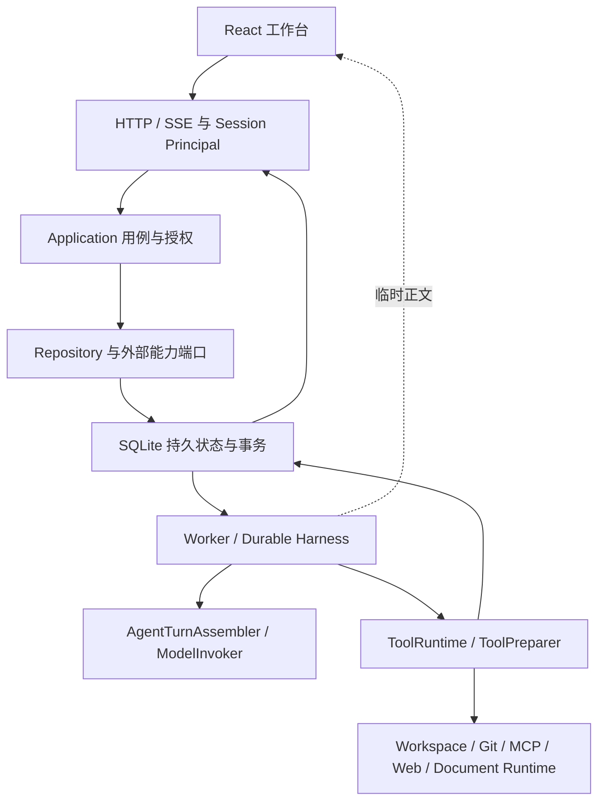

# Oktapod 项目综合评审：多用户个人私有项目

> 版本：V1.0；评审日期：2026-09-05。
> 代码基线：`f1fb36d2531a6d9763a196ce6bf4cb3ee4014113`，评审开始时工作树无业务代码改动。
> 范围：产品设计、架构设计、代码结构、设计模式、编码原则、隔离与工程验证。
> 配套实施文件：[近期优化执行方案](Oktapod_近期优化执行方案_多用户个人私有项目_V1.0.md)。
> 本轮只做静态评审与文档交付，没有修改业务代码、数据库或运行配置，没有执行构建、测试、部署、提交或推送。

## 1. 评审结论

**保留现有技术路线和运行内核，优先修复多用户身份边界与个人任务可靠性。项目需要有针对性的收口，不需要重新设计一套 Agent OS。**

当前产品目标明确为：同一套软件允许多个用户注册、登录，每个用户使用自己的私有项目，项目、会话、任务与成果在用户之间隔离。团队协作只是未来方向，不进入本轮优化任务，也不因此引入 PostgreSQL、团队 RBAC、共享编辑或多 Agent 编排。

现有实现已经超出简单的聊天界面：持久 Run、冻结输入、工具审批与 Receipt、Checkpoint、恢复、SSE、Git Changes、Artifact、Skill/MCP 和文档 Runtime 都有实际代码及测试基础。推倒重写会损失这些积累。

当前最重要的问题不是“页面是否足够像 Codex”，而是以下四件事：

1. **身份不能被另一个普通用户代签，公共配置不能由所有注册用户任意修改。** Personal 部署形态被部分代码当成管理员身份，破坏了多用户前提。
2. **账号切换后不能显示旧账号缓存。** 后端正确拒绝访问，并不能自动消除浏览器中已有的数据。
3. **一次发送失败不能丢失用户的目标和附件，也不能在重试后产生两份任务。** 当前发送状态缺少完整的失败与确认不明处理。
4. **同一项目的两个任务不能相互覆盖工作文件和 Git 状态。** 单个 Run 内的工具调度不等于项目工作目录的并发保护。

文档和发布门禁也有需要收口的地方，但优先级低于上述用户数据与执行正确性问题。文件长度、目录美观和未来扩展能力不应占用首批修复预算。

## 2. 范围、证据与限制

### 2.1 本次采用的产品边界

| 项目 | 当前决定 |
|---|---|
| 用户模型 | 多用户登录；个人私有项目只对创建者开放 |
| 部署与数据库 | 保留 Windows/Linux 原生路径与 SQLite；不因多用户立即更换数据库 |
| Agent 工作方式 | 每个任务沿用现有单 Agent 主链路，可暂停、追加约束、恢复 |
| 产品场景 | Code 与 Work 复用内核；开发任务为主要验收样例，保留现有文档成果能力 |
| 公共能力 | 建议实例维护者配置公共 Provider/Vault/运行策略，普通用户使用已配置能力并管理自己的项目与偏好 |
| 暂不开展 | 团队空间、邀请协作、任务接手、企业角色矩阵、SSO、多 Agent、工作流平台、微服务、分布式调度 |

“实例维护者配置公共能力”是本次提出的最小产品决策，不是声称当前实现已正确区分管理员。复用已有 `owner/member` 语义即可；不要求搭建企业权限系统，也不要求现在新增每用户一套 Provider/Vault。

### 2.2 如何理解证据

- **代码事实**：已读取相应实现与调用链，可以确认当前条件和行为；不等于已经完成动态复现。
- **静态风险**：代码存在可解释的失败路径，需要在隔离夹具中重现后确定修复细节。
- **已有测试**：测试文件确实存在。本轮没有重跑，不能把过去的通过记录写成当前实测。
- **产品建议**：根据当前目标作出的取舍；不计为已实现能力。

评审覆盖了 HTTP 身份入口、Application/Repository、Worker/ToolRuntime/Harness、Workspace、前端登录与发送链路、API 契约、CI 和当前正式基线。它是重点链路评审，不是逐行安全审计或完整性能测试。

读取的验收矩阵版本为 v1.28，仍将当前 RC 标为 `PARTIAL`、正式 tag 标为 `BLOCKED`。本轮健康请求没有取得 `/api/v1/health` 的有效 JSON，工具请求返回 502；未据此判断服务本身的故障原因，也未启动或重启服务。Provider 生效情况、真实浏览器表现、双平台发布和性能都未在本轮重新验证。

## 3. 产品设计评审

### 3.1 应保留的主流程

```text
注册/登录 → 创建私有项目 → 配置或选择可用模型
→ 在一个对话中描述目标 → 看状态/处理必要审批
→ 查看文件、Diff 和交付物 → 验收、继续或恢复
```

现有“对话为中心、执行详情按需展开、成果在侧面查看”的方向适合当前产品。任务状态采用持久 `Task.status`，执行计划表达目标，工具流水进入执行记录，避免让用户理解内部 Step、Receipt 或调度协议才能完成工作。

Workspace、Asset、Artifact 的区分也有实际价值：分别承载可变工作文件、可复用项目资料、不可变任务输出。应继续在文件页面用自然语言解释用途，不把三者合并成一个无法分辨版本与来源的文件列表。

### 3.2 最小体验优化

| 场景 | 当前判断 | 最小建议 |
|---|---|---|
| 首次使用 | 登录、Vault、Provider 均有真实流程；尚不能据静态代码判定首用耗时 | 复用现有状态，给出一个明确的下一步及入口；普通用户缺少公共模型时提示联系实例维护者，不引入新的配置向导系统 |
| 发送目标 | 提交时提前清空草稿与附件，失败缺少恢复 | 保留一次发送的内容、附件引用和请求身份，失败可恢复/重试 |
| 多任务 | 多个对话可以操作同一项目 | 在项目写入冲突时给出“等待当前项目任务完成”的明确状态，不要求用户自行分配目录 |
| 失败与恢复 | 已有 unknown Receipt 禁止盲重试的正确基础 | 区分明确失败与“请求可能已成功”；先对账再重发，保持原对话可见 |
| 高级功能 | V1 可见性开关已经隐藏团队等入口 | 保留边界，不为了减少代码删除兼容功能，也不重新开放团队入口 |

首用体验建议属于后续验收中的观察项。没有真实卡点证据时，不单独发起页面重做。

### 3.3 Codex 应参照什么

| 可参照机制 | 对 Oktapod 的采用判断 |
|---|---|
| 对话内完成工作，随后审查 Diff、逐行反馈和提交选择 | 与现有工作台方向一致，优先修补失败路径；[官方 Code review](https://learn.chatgpt.com/docs/code-review?surface=app) |
| 沙箱与审批分别控制技术能力边界和执行许可 | 用于澄清安全承诺，审批不能代替进程隔离；[官方 Agent approvals & security](https://learn.chatgpt.com/docs/agent-approvals-security)、[官方 Sandbox](https://learn.chatgpt.com/docs/sandboxing) |
| Git worktree 隔离同项目并行任务的文件副本 | 学习要解决的问题；当前先用项目任务排队处理，不立即实现 worktree 生命周期；[官方 Worktrees](https://learn.chatgpt.com/docs/environments/git-worktrees) |

以上官方页面于 2026-09-05 读取；原 Codex 文档入口部分已重定向到 ChatGPT Learn。这里只比较公开机制，不推断 Codex 未公开的后端架构，也不把企业版能力作为 Oktapod 当前清单。

## 4. 架构、结构与模式评审

### 4.1 当前架构值得保留



图中表示职责与主要数据流，不表示每个框都是独立进程。当前是模块化单体：Go 二进制装配 HTTP、运行时和适配器，React 构建资源嵌入交付，外部文档能力保留独立 Runtime。对当前产品规模，运行与排障成本比拆服务更重要。

| 设计模式/原则 | 代码证据 | 评审判断 |
|---|---|---|
| Ports & Adapters | `Src/internal/application/repository.go:11` 起已组合多个窄端口；`security.go:45–108` 有 PrincipalResolver/Authorizer | 保留；接口应围绕消费者和外部边界，不为每个类型新增一层接口 |
| 单一主执行链 | `Src/internal/runtime/worker.go`、`step_dispatcher.go`、`model_invoker.go`、`tool_runtime.go` | 已有实际职责拆分，不应再从零建设 Agent Loop/Harness |
| 持久工作流与提交后推进 | `Src/internal/harness/harness.go:36–72`；`Src/internal/runtime/worker.go` 的 Claim/Heartbeat/Finish/Steering | 保留 Lease、Checkpoint、原子 Finish 和提交后 Steering，不改成纯内存循环 |
| 确定性策略与审批 | `Src/internal/application/security.go:111–140`；`Src/internal/adapters/db/sqlite/store_runtime.go:335` 起 | 保留冻结输入及执行前重评估；补身份边界，不通过扩大自动审批解决权限问题 |
| 副作用收据与恢复 | `Src/tests/integration/side_effect_recovery_test.go:24` | unknown 必须人工确认，不能用自动重试掩盖重复执行风险 |
| 服务端真相与前端投影 | `Task.status`、持久消息/SSE、`run_live` | 临时正文改善反馈，不变成第二套完成状态；需要补账号生命周期边界 |
| 外部能力适配 | Workspace/MCP/Web/Document Runtime 复用 ToolRuntime | 保留；不要为了“全部插件化”把安全内核和事务也变成动态扩展 |

Pi 本地代码也将 Agent Loop 的上下文转换、模型消息转换、Steering/Follow-up 与 SessionManager 分开：`E:/git/pi/packages/agent/src/agent-loop.ts:167,259–295`，`packages/coding-agent/src/core/session-manager.ts:855,1057,1360`。本次只参考职责边界，本地 Pi HEAD 为 `c820aa26fe0907e053e881a957722693fc094c9c`；**不替换项目现有 OHCS 冻结基线 `b1c444d9`，不移植 Pi 最新全部行为**。

### 4.2 结构问题的正确处理方式

基于当前 Git 跟踪文件统计物理行数，含注释和空行，下表文件均为手写业务文件：

| 文件 | 行数 | 实际关注点 |
|---|---:|---|
| `Src/internal/adapters/db/sqlite/store.go` | 12,570 | 数据操作同时包含计划生成、交互恢复等业务决策，跨用例改动容易集中 |
| `Src/internal/adapters/httpapi/server.go` | 4,477 | 路由、身份解析、响应映射和大量 Handler 聚集，安全规则容易散落 |
| `Src/internal/application/service.go` | 3,218 | 聚合用例门面较大，应在触及相关用例时缩小依赖 |
| `Src/internal/runtime/worker.go` | 1,841 | 已拆出协作组件；不能只因仍然较长就认定拆分无效 |
| `Src/web/src/shared/api/client.ts` | 1,397 | 手写协议类型与请求函数集中，TypeScript 未进入 OpenAPI 漂移验证 |
| `Src/web/src/features/projects/project-page.tsx` | 1,210 | 页面装配、Composer、多个管理视图及 mutation 生命周期混合 |

这些数字是定位阅读热点的线索，不是缺陷数量或质量评分。当前不设“文件不得超过 N 行”的验收指标。

最有收益的局部整理是：修复发送失败时抽出发送状态；修复认证时收拢身份解析与会话用例；处理工作空间并发时提取一个可独立测试的领取规则。SQLite 事务仍由现有 Store 统一提交。没有需求触发时，不批量拆 Store、不搬运全部 Runtime、不建设新仓储框架。

### 4.3 编码原则应如何落实

1. **身份来自可信入口，权限在用例边界判定。** 部署 Profile 不能授予管理员身份；资源 ID 不构成访问许可。
2. **失败状态也是产品状态。** 发送、审批、排队和未知结果都必须有可解释的终态或后续动作。
3. **只保留一个业务事实源。** 数据库管理任务终态和副作用证据，UI 与流事件只做投影。
4. **并发规则围绕共享资源。** Run Lease 防止同 Step 重复领取，项目写入保护解决共享目录竞争，两者不能互相代替。
5. **优先简单函数和现有组件。** 只有降低变更耦合或隔离外部依赖时才新增端口/组件；不为“设计模式齐全”抽象。
6. **重构保持语义，修复改变行为。** 两种目标分开验收；涉及授权、事务或恢复必须有能捕获原缺陷的回归。
7. **契约变化能被自动发现。** Go 生成物、前端类型和实际 HTTP 行为不能各自维护出三套含义。
8. **文档写当前行为和边界。** 新增一条“旧描述以此为准”不能长期替代消除冲突文本。

## 5. 发现清单

优先级：P0 为多用户开放前必须关闭的身份隔离问题；P1 为当前正确性/用户数据问题；P2 为局部维护或发布时处理。此处优先级是优化顺序，不是已经实测的漏洞利用等级。

### F-01 · P0 · Personal 会话管理入口允许跨用户签发/撤销

**代码事实。** HTTP 正式路由挂载 generated handler；`CreateAuthSession` 仅在 Team Profile 检查管理员。Personal 已登录请求可以提交其他活跃用户的 `user_id`，Application 不验证调用者与目标身份，Store 签发并返回目标会话 Token。撤销只约束组织，没有约束会话所属用户。

证据：`Src/internal/adapters/httpapi/server.go:88–106,891–932`；`Src/internal/application/service.go:273–300`；`Src/internal/adapters/db/sqlite/store.go:284–321,362` 起；`Src/api/openapi.yaml:430–461`。注册账户进入同一实例组织，见 `service.go:291–292`。

触发前提是用户已登录且知道目标用户/会话 ID；不是匿名绕过登录，也不依赖猜中密码。CSRF 防护不能阻止携带自身合法 CSRF 的普通用户调用。尚未操作真实实例进行动态复现。

**影响：** 后续所有按 Session Scope 隔离的项目接口都可能被合法外观的错误身份绕过。现有“B 看不到 A 项目”的直接查询测试不足以覆盖它。

**最小修复：** Personal 普通 HTTP 路径关闭管理式会话代签；登录/注册的内部签发流程保留。撤销只允许本人会话；明确的实例维护入口与普通登录身份分开。Application 同时保证约束，不能只隐藏 API/UI。

### F-02 · P1 · 部署形态被当成公共配置管理权限

**代码事实。** `server.go:255` 对所有 Personal Session 设置 `Administrator=true`；`configuration.go:217–233` 因此直接放行 Owner 检查。注册账户实际写为 `member`，见 `password_auth.go:143`。另一方面，`provider_registry.go:87–93,196–215` 的保存/删除只确认有 Principal，并按 organization 操作，没有 Owner 检查。

**影响：** 普通用户可影响同实例公共 Provider、治理配置或 Vault 生命周期。即使项目行查询正确，也可能导致其他用户调用失败或把公共模型请求指向错误服务。此处没有证据证明接口直接返回 Secret 明文，不作该声明。

**最小修复：** 复用现有 `owner/member`，给公共配置写入统一加实例维护权限；普通用户可读取必要的非敏感模型选项、管理自己的偏好。不能只把 `Administrator` 改成 false，必须同步检查 Provider 等直接入口及首用/升级的维护者恢复路径。

### F-03 · P1 · 401 后更换账号没有完整清理前端身份状态

**静态风险。** `Src/web/src/main.tsx:14–29` 创建应用级 QueryClient；`authenticated-root.tsx:10–17` 在登录恢复后仅 invalidate `bootstrap`。`shell.tsx:22–28` 的项目查询等 key 不包含用户身份；只有显式 logout 调用了 `clear()`。

**影响：** A 会话过期后登录 B，旧项目列表、偏好或在途请求可能存在短暂显示/回填窗口。没有浏览器复现前，不声称已看到跨账号数据泄露。

**最小修复：** 在认证边界集中处理账号切换、401 和注销：取消旧请求、关闭旧流、丢弃旧缓存、重挂载用户工作台。现有 Composer 草稿 key 已包含 user ID（`project-page.tsx:907–910`），应保留，不应重复重做所有存储隔离。

### F-04 · P1 · 发送失败丢失草稿，确认不明时重发身份不稳定

**代码事实及待复现路径。** `project-page.tsx:1043–1079` 在请求成功前清空文本、本地草稿和附件；`:955` 的 onError 只调用失败回调；`:254–259` 删除乐观消息。`client.ts:1004–1016` 的 `streamProjectTurn` 每次调用生成新 `Idempotency-Key`。

**影响：** 网络或服务错误后用户需要重输长目标、重选附件；服务端已接收但流断开的情况下，用户手工重发可能创建重复工作。后者需要故障注入验证，不能简单断言所有重试都会重复。

**最小修复：** 一次发送保留不可变快照与稳定请求身份；失败消息提供恢复/重试；已接收与确认不明分别处理。旧请求失败时不能覆盖用户正在输入的新草稿。

### F-05 · P1 · 同项目跨 Run 缺少工作目录互斥边界

**静态风险。** `Src/internal/adapters/workspace/local.go:111–127` 按 project ID 定位共享目录；`store_runtime.go:22–81` 领取规则覆盖同 Run 顺序和全局 Run 数量，没有项目级排他。现有 `run_concurrency_test.go:13` 验证的是最多四个不同 Run，不证明同项目文件安全。

**影响：** 同一用户在同项目开启两个任务，即使没有团队协作，也可能互相覆盖文件、混入 Git Diff、提交不属于本任务的改动。

**最小修复：** 先复现两个独立 Thread 的竞争，再默认串行执行会写工作区的任务；不同项目仍可并发。优先使用现有数据库领取/状态机制，不引入 Redis、分布式锁或自动 worktree。暂停、等待审批、unknown 与重启恢复期间的占用规则必须明确，不能只加一个进程内 mutex。

### F-06 · 边界说明 · 应用隔离不等于宿主进程隔离

**代码与既定范围事实。** 当前架构明确 `governed_host` 不是强沙箱，任意宿主 Shell 可能通过绝对路径访问宿主文件，见现有总体架构 §4.5；Workspace 的 cwd/路径检查和审批不构成 OS 权限隔离。

**判断：** 当前可以验收正常 API、受控文件工具、浏览器会话的多用户隔离，但不能据此承诺“不互信用户共用执行宿主且可任意执行命令时仍完全隔离”。这与团队协作是否开启无关。

当前不要求建设强沙箱平台。先把共享实例适用的信任边界写清；若要面向互不信任用户开放任意 Shell/STDIO 扩展，届时单独评审进程隔离或按用户分配执行环境。在此之前，不以“完全访问已获批准”证明跨用户隔离安全。

### F-07 · P2 · 契约与用例职责存在维护热点

**代码事实。** `Test/openapi-drift.mjs:4–32` 只检查 Go 生成文件；前端 `client.ts` 手写类型。SQLite `store.go:8709,9570,11215` 的 `planToolSteps`、`publishModelRunPlan`、`queueModelInteractionRetry` 同时决定部分计划/恢复规则。

**影响：** API 修改可能不触发前端协议漂移失败；业务规则集中在 SQL 大文件中，后续修改更难局部验证。当前没有证据支持“立即全面分层迁移”的收益。

**最小修复：** 本次修复触及哪一类契约，就给该类增加类型/HTTP 验证；触及哪一条业务决策，就提取纯规则并保留原事务。批量生成所有客户端、重写 Repository、整体搬迁 Store 均不列为前置条件。

### F-08 · P2／发布前处理 · 签名 Runtime 发布门禁缺少 CI 输入装配

**代码事实。** `.github/workflows/ci.yml:35–57` 直接执行发布构建/烟测；`Test/build-release.mjs:46` 调用 Document Runtime 打包；`Test/build-document-runtime.mjs:14–16` 要求 stage、签名 Key 文件和 Key ID。当前 workflow 未展示准备这些输入的步骤。

**影响：** 普通验证通过不代表发布工件能产生；依赖未装配的 release job 不能作为可复现交付证明。本轮没有查询最新远端 CI，也没有实跑该失败。

**最小修复：** 发布前把依赖来源、测试/发布签名和隔离加载烟测接通；缺外部输入明确 `BLOCKED_ENV`，保留真实发布硬门禁，禁止跳过签名或伪造可用资源来获得绿色状态。普通安全修复可以先通过开发验证，不被发布材料准备拖成重构工程。

### F-09 · P2 · 现有文档存在补丁叠加后的冲突

README 开头允许 HTML 内联脚本，但后续长段仍写“禁用脚本”；总体架构早期范围写 V1 不做 SBOM，而当前文档 Runtime 发布已要求 SPDX SBOM；架构中还有历史方案评论与当前事实混排。`Src/README.md` 已列 agentloop/harness，项目规则的目录表尚未单列它们。

**影响：** 后续 Codex 容易按旧句子回退正确行为、重复已经完成的拆分，或错误判断发布范围。

**最小修复：** 后续相关修复收口时，用当前合同替换冲突句，不继续叠加优先级声明。本轮新增评审和方案作为补充入口，不把旧验收状态改成新的 PASS，也不趁评审批量重写历史文档。

## 6. 用户隔离应如何验收

已有 `Src/tests/integration/user_auth_test.go:20–97` 通过真实 HTTP 注册两个用户，覆盖无登录、CSRF、项目列表与跨用户项目详情。它是良好基础，应扩充，不另建复杂测试平台。

| 必须保留/补充的场景 | 期望 |
|---|---|
| A/B 注册、正常登录、注销与自己的项目读写 | 正常成功；不存在固定本地用户回退 |
| A 请求为 B 签发会话或撤销 B 会话 | 拒绝，数据库无新会话/撤销副作用；B 会话继续有效 |
| B 直接使用 A 的 project/conversation/task/run/asset/artifact ID | 按现有契约返回 403/404，无内容、路径、下载/预览或流数据泄露 |
| B 修改公共 Provider、Vault、治理配置 | 普通用户拒绝；实例维护者成功；个人偏好仍各自独立 |
| A 会话失效，同一浏览器登录 B，旧请求延迟返回 | 不渲染、不回填 A 的列表、对话、用量和临时正文 |
| 同项目两个任务写同一文件/操作 Git | 后者排队或明确冲突，结果可归属；不同项目保持并发 |
| 请求发送前断网、服务端已接收后断流 | 草稿和附件可找回；同一发送最多一个持久结果 |

只在临时 DataRoot、独立端口、动态测试凭据和哨兵文件中验证。不得访问其他真实用户项目、操作真实 Secret 或删除真实项目作为验收手段。

## 7. 优化取舍与交付判断

**先做：** 身份签发与公共配置边界 → 前端认证生命周期 → 发送失败恢复 → 同项目任务竞争保护。安全项修复完成前，不能把现有实现表述为已满足完整多用户隔离。

**随相关修改做：** 小范围提取组件/纯规则、补契约测试、同步当前文档。

**发布时做：** 双平台签名 Runtime 工件与真实加载烟测，不复用旧工件或历史绿灯替代当前证据。

**现在不做：** 团队协作、PostgreSQL 完整化、企业 RBAC、微服务、全量 worktree 管理、分布式队列、数据库全量重构、追逐 Pi 最新版本、没有性能问题支撑的压测工程。

本轮交付的是评审与后续任务书。问题未修复，安全复现、浏览器回归、性能与发布证据未因文档完成而自动成立。后续按照配套方案逐批推进，并继续由现有 [V1 验收矩阵](Oktapod_V1_验收状态与追踪矩阵.md)记录实现与发布事实。
